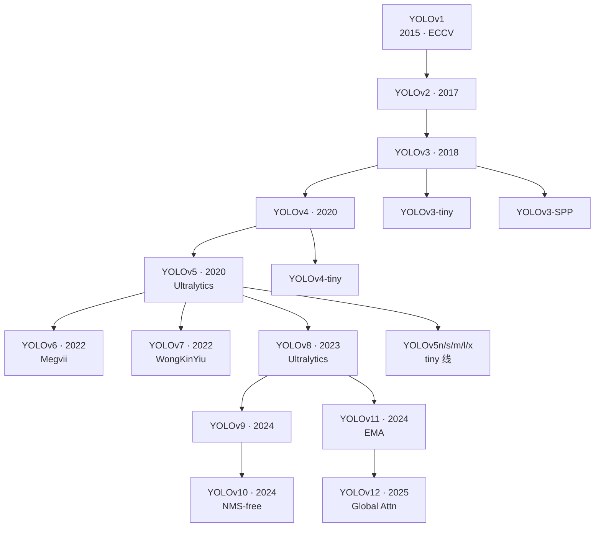
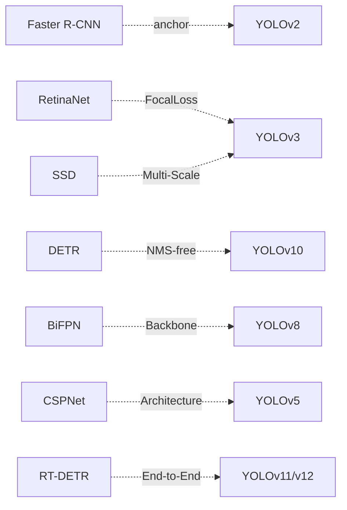

# YOLO 系列家族

YOLO 家族从 2015 年 v1 开始，迄今已超过 10 年。整个家族不是单一演进线，而是**主线 + tiny 线 + enterprise 线 + 若干分叉**并存。

## 分支谱系

## 四条主线

| 分支 | 代表版本 | 目标 | 主导 |
|------|---------|------|------|
| 主线 | v1→v2→v3→v4→v8→v9→v10→v11→v12 | 精度优先 | 学术界 + Ultralytics |
| Tiny 线 | v2-tiny→v3-tiny→v4-tiny→v5n→v8n→v11n | 参数量最小 | Ultralytics |
| Enterprise 线 | v9, v10 | 推理延迟优化 | CWI / THU-MIG |
| 分叉实验 | v6 (Megvii), v7 (WongKinYiu) | 特定改进 | 独立团队 |

## 贯穿家族的关键主题

- **Single-shot**：v1 定调，至今未变
- **Anchor vs Anchor-free**：v2 起用 anchor，v8 起默认 anchor-free
- **多尺度 Neck**：v3 首次 FPN，v4 PAFPN，v8 BiFPN
- **CSP 结构**：v5 起 CSPNet，v8 起 C2f
- **Decoupled Head**：v7 实验，v8 正式
- **Attention 引入**：v7 EVA、v10 全注意力、v11 SPPCSPC、v12 Global Attention
- **NMS-free**：v10 端到端消 NMS

## 与外部检测家族的收敛

## v1→v8 精读版本逐项对照

本站已完成 v1–v8 的快照级精读（论文 + cfg/yaml/Python dict + 源码）。下表是八代的逐项差异一览，每项都可在对应版本页找到出处：

| 维度 | [v1](/versions/v1/index) | [v2](/versions/v2/index) | [v3](/versions/v3/index) | [v4](/versions/v4/index) | [v5](/versions/v5/index) | [v6](/versions/v6/index) | [v7](/versions/v7/index) | [v8](/versions/v8/index) |
|------|------|------|------|------|------|------|------|------|
| 发布 | 2015 arXiv / ECCV 2016 | 2016 arXiv / CVPR 2017 | 2018 arXiv | 2020 arXiv / CVPR 2020 | 2021 GitHub（无论文） | 2022 GitHub / 2022-09 arXiv 报告 | 2022-07 arXiv（2207.02696） | 2023-01 GitHub 首发（**无论文**，官方口径 docs.ultralytics.com + 发布博客） |
| 代码快照 | pjreddie · `8322a58` | pjreddie · `c6afc7f` | pjreddie · `e84933b` | AlexeyAB · `4131ae1` | ultralytics · `f5b8f7d` | meituan · main 分支 | WongKinYiu · main @ `a207844` | ultralytics/ultralytics · `v8.0.100` @ `dce4efc`（**AGPL-3.0**，单库产品线） |
| 实现语言 | C（darknet） | C（darknet） | C（darknet） | C（darknet） | **Python（PyTorch）** | **Python（PyTorch）** | Python（PyTorch） | Python（PyTorch） |
| 配置格式 | cfg（自定义文本） | cfg（自定义文本） | cfg（自定义文本） | cfg（自定义文本） | **yaml（标准格式）** | **Python dict（可执行）** | yaml（cfg/training/*.yaml） | **yaml（从 Python dict 回归）**（models/v8/*.yaml + default.yaml） |
| 输入尺寸 | 448×448 | 416×416 | 416×416 | 608×608 | 640×640 | 640×640 | 640×640 | 640×640 |
| 骨干 | 24 conv 自研 | Darknet-19 | Darknet-53（残差） | CSPDarknet53（CSP+残差） | CSPDarknet53（C3 模块） | **EfficientRep（RepVGG 重参数化）** | **ELAN 堆叠**（4 路 Concat 聚合 + Conv/MP） | CSP 风格（**C2f** 模块 + SPPF 收尾） |
| 层数 | 32（24 conv + 2 FC） | 31（22 conv + 5 maxpool + route/reorg） | 107（75 conv + 23 shortcut + upsample） | 162（110 conv + 23 shortcut + SPP/PANet） | 24（yaml 驱动，C3 内部 Bottleneck） | 模块化组装：骨干 5 段 + RepBiFPANNeck + 3 头 | yaml 驱动 105 模块（骨干 51 + 头 54，4/6 路 ELAN 块） | yaml 驱动 22 模块（n 档注释 225 层 / 3.16M / 8.9 GFLOPs） |
| 参数量 | ≈272M（FC4096 占 2 亿） | ≈67M | ≈61.8M | ≈64.1M | ≈7.2M（yolov5s） | ≈18.5M（yolov6s） | 36.9M（yolov7） | ≈3.2M（yolov8n）~68.2M（yolov8x） |
| BN | ❌（v2 才引入） | ✅ 首次 | ✅ | ✅（CmBN） | ✅ | ✅ | ✅ | ✅ |
| 检测头 | 单头 7×7，每格 2 框 | 单头 13×13，5 anchor | 三头 13/26/52，9 anchor | 三头 76/38/19，18 anchor（顺序反转） | 三头 80/40/20，9 anchor | 三头 80/40/20 **anchor-free 解耦**，fuse_P2 时 P2 也进 Neck | 三头 80/40/20 anchor-based（RepConv 收口 + IDetect），可选 IAuxDetect 辅助头 | 三头 80/40/20 **anchor-free 解耦**（cv2 回归 / cv3 分类，**无 objectness**） |
| 输出维度 | 1470 = 49×30 | 13×13×425 | 3×255（每头） | 3×255（每头） | 3×255（每头） | 3 头 × 84（4 ltrb + 80 cls，**无 obj**） | 3×255（每头） | 3 头 × 84（4 ltrb 由 64 维分布 DFL 解码 + 80 cls，无 obj），合计 8400 预测 |
| Anchor | ❌ 直接回归 | ✅ 5 个 K-means | ✅ 9 个分三组 | ✅ 18 个分三组 | ✅ 9 个 + autoanchor 自动学 | ❌ **彻底 anchor-free** | ✅ 9 个分三组（**仍 anchor-based**，与 v6 路线分叉） | ❌ **彻底 anchor-free**（网格中心 + ltrb 距离分布，reg_max=16） |
| 坐标损失 | SSE（√w√h 加权） | SSE + logistic 偏移 + σ′ 因子 | SSE，权重 `2−w·h` | **CIoU**（IoU 直接可导） | **CIoU**（autograd 自动求导） | **GIoU/SIoU** 权重 2.5 + DFL（蒸馏场景） | **CIoU**（autograd 自动求导） | **CIoU + DFL**（按 TAL 软标签 target_scores 加权） |
| 类别头 | 裸线性 + L2（softmax=0） | softmax | logistic 多标签 | logistic 多标签 | logistic 多标签 | logistic（**VFL 软标签**，无 objectness） | logistic 多标签（BCE，obj 目标 `(1-gr)+gr·iou`） | logistic（**BCE + TAL 软标签**，无 objectness，分类分数即框置信度） |
| 激活 | leaky | leaky | leaky | Mish（骨干）+ leaky（neck） | **SiLU**（全网络） | Rep 块 **ReLU** + SiLU 混用 | **SiLU**（全网络） | **SiLU**（全网络） |
| 浅层融合 | ❌ | passthrough（reorg） | FPN 上采样回连 | FPN + **PANet** 双向 | FPN + **PANet** 双向 | FPN + PAN 双向 + **fuse_P2 四尺度 + BiFusion** | FPN + PANet 双向（ELAN 聚合，骨干 P3/P4 直连） | FPN + PAN 双向（拓扑最朴素，复杂度封装进 C2f） |
| 感受野扩大 | — | — | — | **SPP**（5/9/13 并联池化） | **SPP**（5/9/13 并联池化） | **CSPSPPF** | **SPPCSPC** | **SPPF**（同一 MaxPool 串 3 次 ≈ 5/9/13） |
| 数据增强 | jitter + flip | + 多尺度训练 | + hue/sat/exp 色彩增强 | + **Mosaic** 四图拼接 | + **Mosaic** + **HSV** + **random_perspective** | Mosaic + HSV + 仿射（mixup 默认关） | Mosaic + HSV + 仿射（hyp.scratch.p5） | Mosaic + HSV + 仿射 + **close_mosaic** 末期关闭 |
| 特色 trick | dropout .5 | bias_match warmup | truth_thresh（死代码） | scale_x_y / multi-positive / SAT | autoanchor / EMA / AMP / OneCycle LR | **RepVGG 重参数化 / TAL / VFL / 自蒸馏 / RepOptimizer 量化** | **trainable bag-of-freebies**：E-ELAN / compound scaling / planned re-param / coarse-to-fine 双头标签分配 / partial aux head | **TAL topk=10 / DFL 内建默认 / scales 复合缩放查表 / 单库多任务**（detect/segment/pose/classify） |
| 指标 | VOC07 mAP 63.4 | VOC07 mAP 78.6 | COCO AP50 57.9 · AP 33.0 | COCO AP50 65.7 · AP 43.5 | COCO AP50 56.8 · AP 37.4（yolov5s） | COCO AP 43.5 @ 495 FPS（S，T4 报告口径） | COCO AP **51.4** @ 161 FPS（V100 test-dev，36.9M/104.7G） | COCO AP 37.3~53.9（n~x，val2017，README 口径单模型单尺度） |

## v1→v8 继承谱系

```mermaid
flowchart LR
  subgraph V1[v1 定调]
    A1[single-shot 端到端]
    A2[网格 + 直接回归]
    A3[SSE 全家桶]
  end
  subgraph V2[v2 继承 + 修正]
    B1[继承网格回归]
    B2[+ anchor / BN / log 回归]
    B3[+ passthrough 浅层融合]
  end
  subgraph V3[v3 继承 + 放大]
    C1[继承 anchor + BN]
    C2[+ Darknet-53 残差]
    C3[+ 三头 FPN 多尺度]
    C4[类别 softmax→logistic]
  end
  subgraph V4[v4 继承 + 重构]
    D1[继承三头 + logistic]
    D2[+ CSP 骨干 / SPP / PANet]
    D3[坐标 SSE→CIoU]
    D4[+ Mosaic / multi-positive]
  end
  subgraph V5[v5 继承 + 工程化]
    E1[继承 CIoU / CSP / SPP / PANet]
    E2[+ PyTorch 化 / yaml 驱动]
    E3[+ Focus / SiLU / autoanchor]
    E4[+ EMA / AMP / 多正样本]
  end
  subgraph V6[v6 继承 + 重参数化]
    F1[继承三头 + PAN 双向 + SPP]
    F2[+ RepVGG 重参数化骨干与 Neck]
    F3[anchor-free 解耦头 · 无 objectness]
    F4[+ TAL 分配 / VFL / DFL 蒸馏]
  end
  subgraph V7[v7 继承 + trainable BoF]
    G1[继承 v5 PyTorch + CIoU + anchor]
    G2[+ ELAN / E-ELAN 聚合]
    G3[+ planned re-param RepConv]
    G4[+ coarse-to-fine 双头标签分配]
  end
  subgraph V8[v8 继承 + anchor-free 收敛]
    H1[继承 v5 yaml 驱动 + CIoU + SiLU]
    H2[+ C2f 取代 C3 梯度分流]
    H3[anchor-free 解耦头 · 无 objectness]
    H4[+ TAL topk=10 / DFL 内建 / 软标签]
  end
  V1 --> V2 --> V3 --> V4 --> V5 --> V6
  V4 -.BoF 路线延续.-> V7
  V5 -.Ultralytics 产品线延续.-> V8
  V6 -.anchor-free 与 TAL 收敛.-> V8
  V7 -.ELAN 思想轻量化.-> V8
```

每条继承线的细节：[v2 痛点追踪](/versions/v2/painpoints)（v1 哪些病被治好）、[v3 痛点追踪](/versions/v3/painpoints)、[v4 痛点追踪](/versions/v4/painpoints)、[v5 痛点追踪](/versions/v5/painpoints)、[v6 痛点追踪](/versions/v6/painpoints)、[v7 痛点追踪](/versions/v7/painpoints)、[v8 痛点追踪](/versions/v8/painpoints)。

详见 [演化事件](/global/evolutions) 与 [时间线](/global/timeline)。
