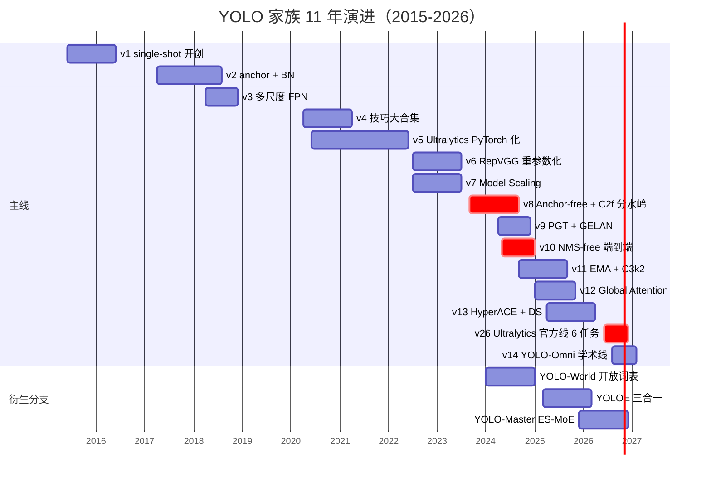
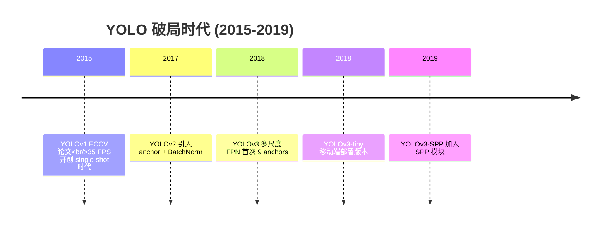
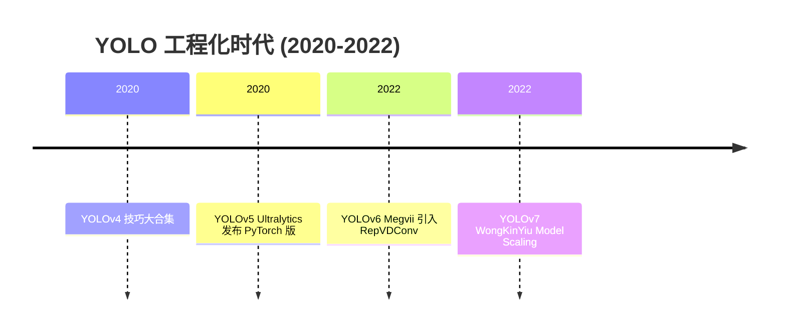
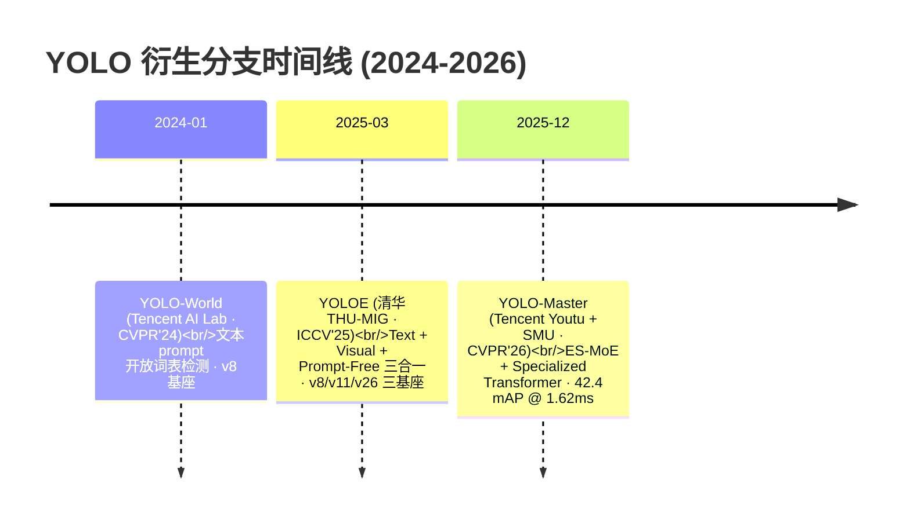
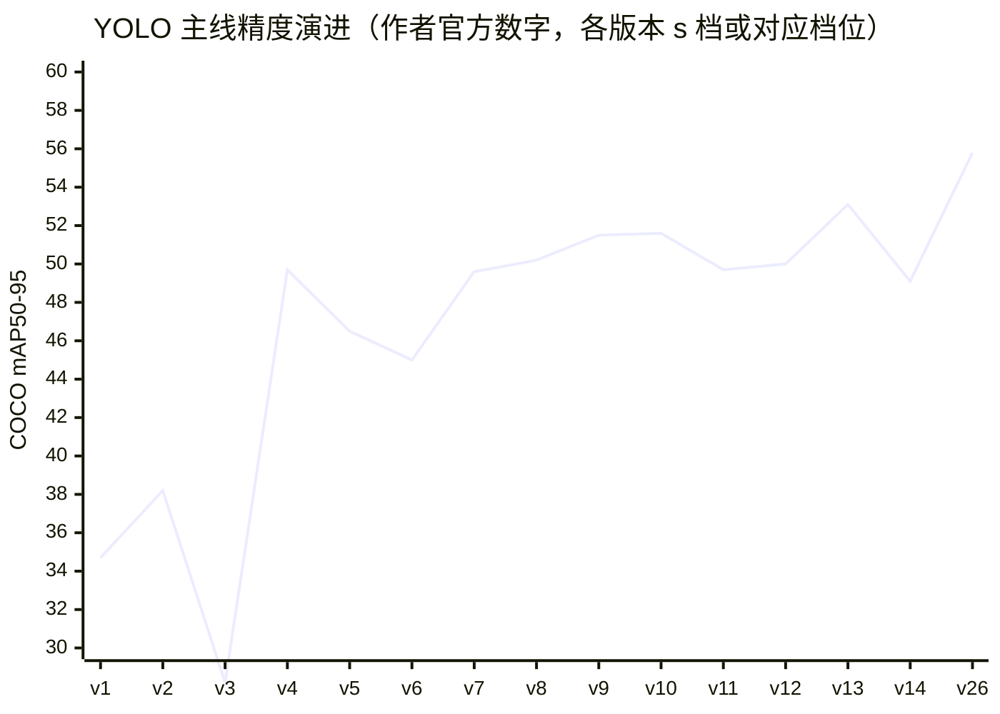

# YOLO 时间线

> **一页看完 11 年（2015-2026）**：从 v1 的"single-shot 破局"到 v26 的"六任务统一"，加上 3 条衍生分支的并行探索。
>
> **配合阅读**：技术演进 → [compare-matrix](/compare-matrix) · 演化故事 → [evolution-story](/evolution-story) · 家族关系图 → [global/family](/global/family)

## 全局一览

## 阶段划分：三个时代

| 时代 | 年份 | 核心变化 | 代表版本 |
|------|------|---------|---------|
| 🥚 **破局时代** | 2015-2019 | 从 two-stage 到 single-shot，引入 anchor、FPN、SPP | v1 → v3-SPP |
| 🔧 **工程化时代** | 2020-2022 | CSP、RepVGG 重参数化、TAL、DFL、anchor-free 转向 | v4 → v7 |
| 🚀 **范式化时代** | 2023-2026 | C2f 收敛、NMS-free、Attention 进骨干、多任务统一 | v8 → v26 |

**分水岭**：**v8 是骨干设计的分水岭**（C2f + DFL + Anchor-free 一次性收敛），此后 v9-v13 都是"在 v8 骨架上做减法或加法"，v26 则完成"回归 + 统一"闭环。

## 2015-2019：破局时代

**时代特征**：两阶段检测器（Faster R-CNN 时代）主导，YOLOv1 用"一张图一遍吐完所有框"证明"实时 + 精度"可以兼得。v2 加 anchor、v3 加多尺度 FPN，逐步补上精度短板。

## 2020-2022：工程化时代

**时代特征**：**Ultralytics 生态化**（v5 用 yaml 驱动架构），**v4 技巧大合集**把所有免费涨点集齐，**v6 重参数化 + TAL + DFL** 完成范式转换。这段时期出现"多家并行"（Ultralytics / Megvii / WongKinYiu）的百花齐放局面。

## 2023-2026：范式化时代

**时代特征**：**主线与学术线在 2026 分叉**——v26 是 Ultralytics 官方线（工程化路线），v14 是 YOLO-Omni 学术线（多相机感知）。同时 Attention 从"外嵌模块"进化成"骨干内嵌"（v12 A2C2f），最终 v26 用 C2PSA 回归一体化设计。

## 2024-2026：衍生分支时间线

主线之外，独立团队 fork 主线基座走出的三条并行研究路径——**YOLO-World、YOLOE、YOLO-Master**（详见 [derivatives/index](/derivatives/index)）：

| 时间 | 分支 | 团队 | 论文 | 基座 | 里程碑 |
|------|------|------|------|------|--------|
| 2024-01 | [YOLO-World](/derivatives/yoloworld/index) | Tencent AI Lab | [arXiv:2401.17270](https://arxiv.org/abs/2401.17270) CVPR'24 | v8 | 首次文本 prompt 开放词表检测 |
| 2025-03 | [YOLOE](/derivatives/yoloe/index) | 清华 THU-MIG | [arXiv:2503.07465](https://arxiv.org/abs/2503.07465) ICCV'25 | v8/v11/v26 | Text + Visual + Prompt-Free 三合一 + Seg |
| 2025-12 | [YOLO-Master](/derivatives/master/index) | Tencent Youtu + SMU | [arXiv:2512.23273](https://arxiv.org/abs/2512.23273) CVPR'26 | v12 | ES-MoE + Specialized Transformer |

**衍生与主线的并行关系**：2024-01 YOLO-World 从 v8 fork，2025-03 YOLOE 同时支持 v8/v11/v26 三基座，2025-12 YOLO-Master 从 v12 fork——三个衍生分支跨越 v8/v11/v12/v26 四个主线基座，走独立于主线编号序列的**能力方向**（开放词表 / MoE 加速）。详见 [global/family.md](/global/family) 与 [derivatives/roadmap](/derivatives/roadmap)。

## 精度演进曲线（COCO mAP@0.5:0.95）

**读法**：
- **2015-2020 稳步上升**：v1→v4 从 34.7 到 49.7，5 年 +15 分。
- **2022-2023 大跳变**：v5-v8 因为 s 档参数量压缩掉一档，但**同等硬件推理速度大幅提升**（工程化胜利），v8 达到 50.2。
- **2024-2025 卷不动 s 档**：v9-v13 在 s 档 48-53 之间横盘，改进集中在 m/l/x 档。
- **2026 双线路分叉**：v26（Ultralytics）在 X 档达 57.5，v14（YOLO-Omni）在 s 档达 49.1 但换来多相机能力。

## 关键年份速览

| 年份 | 版本 | 里程碑 | 精度 | FPS | 团队 |
|------|------|--------|------|-----|------|
| 2015 | v1 | Single-shot 范式 | 63.4 (VOC) | 35 | University of Washington |
| 2017 | v2 | Anchor 引入 | 69.4 (VOC) | 160 | U-W |
| 2018 | v3 | 多尺度 FPN | 57.9 (COCO) | 51 | U-W (Joe Redmon) |
| 2020 | v4 | 技巧集齐 | 53.4 (COCO) | 145 | Ultralytics |
| 2020 | v5 | PyTorch 化 | 44.9 (COCO) | — | Ultralytics |
| 2022 | v6 | 两阶段训练 | 50.4 (COCO) | 89.5 | Megvii |
| 2022 | v7 | Model Scaling | 51.4 (COCO) | — | WongKinYiu |
| 2023 | v8 | Anchor-free | 44.9 (COCO) | — | Ultralytics |
| 2024 | v9 | PGT | 50.5 (COCO) | — | Peking Univ + SenseTime |
| 2024 | v10 | NMS-free | 53.8 (COCO) | — | Sensetime |
| 2024 | v11 | EMA | 53.4 (COCO) | — | Ultralytics |
| 2025 | v12 | Global Attn | 53.6 (COCO) | — | THUDM |
| 2025 | v13 | HyperACE 超图 + DS | 54.8 (COCO, X 档) | — | iMoonLab |
| 2026-06 | v26 | Ultralytics End2End 官方线：双分支 + 6 任务 | 57.5 (COCO mAP50-95, X 档) | 660 (T4/FP16) | Ultralytics |
| 2026-08 | v14 | YOLO-Omni 学术线：多相机 + GRL 域对抗 | 49.1 (COCO mAP50-95, s 档) | 344 (T4/FP16) | YOLO-Omni Team |

*注：COCO 数字为 mAP@0.5:0.95，VOC 为 mAP@0.5。数字来自各版本官方论文。v13 采用 iMoonLab/yolov13 快照（commit 73289949，2025-11-18）；mAP 口径取论文 TABLE I 的 X 档峰值，与 v12 博客口径不完全一致。**v26 与 v14 是 2026 年双线路分叉的两条主线**：v26 = Ultralytics 官方发布（`2e241d0`，arXiv 2606.03748），主打 End2End 双分支与 6 任务统一；v14 = 学术线 YOLO-Omni（`zhangcbb/yolov14` @ `0b8610d`，arXiv 2608.04720v3），主打多相机感知与 GRL 域对抗训练。*

## 关键决策时刻（3 个）

**决策 1：v6 首次 anchor-free（2022-07）**
- **背景**：v5 之前所有 YOLO 都用 anchor
- **决策**：Megvii 的 v6 直接用 grid 中心 + ltrb 回归
- **结果**：v7 短暂回退 anchor-based（学术探索），v8 正式确立 anchor-free 是主流
- **影响**：**整个 YOLO 家族最大的一次范式转变**

**决策 2：v10 NMS-free 端到端（2024-05）**
- **背景**：NMS 是后处理瓶颈，实时端麻烦
- **决策**：Sensetime 用"一致性双分配"把去重搬进训练
- **结果**：v11 立刻回归 NMS（工程权衡），v26 再次以 `end2end=True` 完成回归
- **影响**：**"做加法"和"做减法"在同一代版本里来回摇摆**是 YOLO 家族的常态

**决策 3：v26 官方线 vs v14 学术线分叉（2026）**
- **背景**：v12/v13 走"稀疏注意力"路线，v26 选择"回归 C2PSA 一体化"
- **决策**：Ultralytics 官方发布 v26（多任务统一），YOLO-Omni 学术线走 v14（多相机视角）
- **结果**：一个走任务广度，一个走视角广度——**两条不同的"能力扩展"方向**
- **影响**：**2026 是 YOLO 家族的第一次"官方线 / 学术线"明确分叉**

## 与家族总览的关系

- 想看**技术演进故事**（为什么这么改）：[global/family.md](/global/family)
- 想看**每代具体做了什么**：v1→v26 各版本页
- 想看**场景怎么选**：[compare-matrix](/compare-matrix) 实战案例与版本匹配
- 想看**演进决策叙事**：[evolution-story](/evolution-story)
- 想看**衍生分支细节**：[derivatives/index](/derivatives/index)

本页是**时间维度的横向汇总**——补齐了"想按时间轴看家族演进"的最后缺口。
