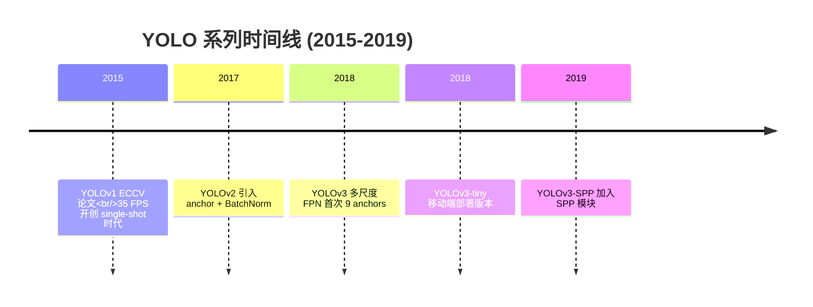
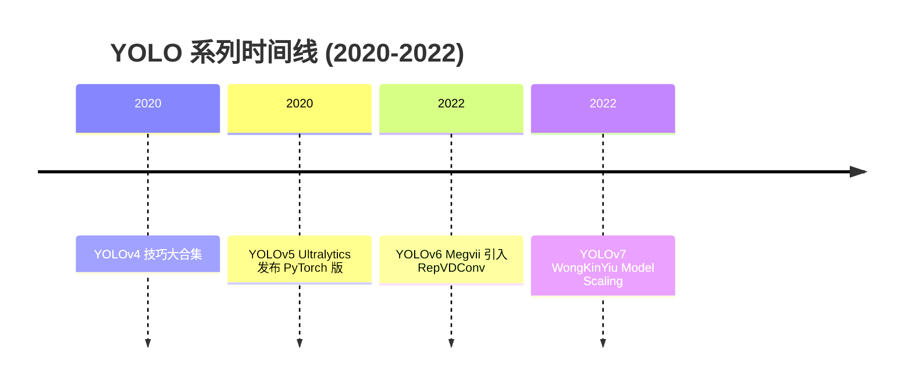
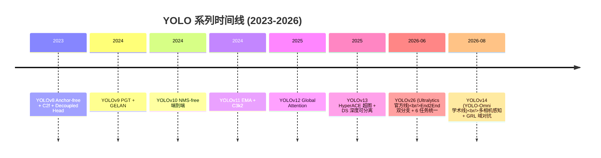

# YOLO 时间线

## 2015-2019：single-shot 时代

## 2020-2022：工程化与多样化

## 2023-2026：回到主线 + 新范式

## 关键年份速览

| 年份 | 版本 | 里程碑 | 精度 | FPS |
|------|------|--------|------|-----|
| 2015 | v1 | Single-shot 范式 | 63.4 (VOC) | 35 |
| 2017 | v2 | Anchor 引入 | 69.4 (VOC) | 160 |
| 2018 | v3 | 多尺度 FPN | 57.9 (COCO) | 51 |
| 2020 | v4 | 技巧集齐 | 53.4 (COCO) | 145 |
| 2020 | v5 | PyTorch 化 | 44.9 (COCO) | — |
| 2022 | v6 | 两阶段训练 | 50.4 (COCO) | 89.5 |
| 2022 | v7 | Model Scaling | 51.4 (COCO) | — |
| 2023 | v8 | Anchor-free | 44.9 (COCO) | — |
| 2024 | v9 | PGT | 50.5 (COCO) | — |
| 2024 | v10 | NMS-free | 53.8 (COCO) | — |
| 2024 | v11 | EMA | 53.4 (COCO) | — |
| 2025 | v12 | Global Attn | 53.6 (COCO) | — |
| 2025 | v13 | HyperACE 超图 + DS | 54.8 (COCO, X 档) | — |
| 2026-06 | v26 | Ultralytics End2End 官方线：双分支 + 6 任务 | 57.5 (COCO mAP50-95, X 档) | 660 (T4/FP16) |
| 2026-08 | v14 | YOLO-Omni 学术线：多相机 + GRL 域对抗 | 49.1 (COCO mAP50-95, s 档) | 344 (T4/FP16) |

*注：COCO 数字为 mAP@0.5:0.95，VOC 为 mAP@0.5。数字来自各版本官方论文。v13 采用 iMoonLab/yolov13 快照（commit 73289949，2025-11-18）；mAP 口径取论文 TABLE I 的 X 档峰值，与 v12 博客口径不完全一致。**v26 与 v14 是 2026 年双线路分叉的两条主线**：v26 = Ultralytics 官方发布（`2e241d0`，arXiv 2606.03748），主打 End2End 双分支与 6 任务统一；v14 = 学术线 YOLO-Omni（`zhangcbb/yolov14` @ `0b8610d`，arXiv 2608.04720v3），主打多相机感知与 GRL 域对抗训练。*
