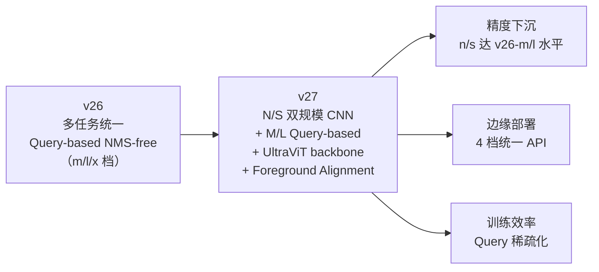

# YOLO27 · 雷达页（Preview · 未正式 GA）

> **状态**：Yolo27 已由 Ultralytics 通过 GitHub issue / Twitter 披露技术路线，但**尚未发布权重、也未进入 ultralytics 主线**。本页作为**雷达页**记录已知信息、猜测边界与观察窗口，供读者跟踪。

## 一页速览

| 项 | 内容 |
|---|-----|
| 代号 | YOLO27 |
| 家族 | 主线 |
| 状态 | **Preview · 技术路线已披露 · 权重未发布** |
| 首发时间 | 预期 2026-H2 |
| 主要变化 | Query-based NMS-free 下放到 n/s 档 · UltraViT backbone · 前景对齐监督 |
| 精度 | 官方口径 mAP50-95=**60.5**（mAP50 口径下） |
| 参数量档 | n / s / m / l 四档 |
| 训练框架 | ultralytics（预期） |
| 开源许可 | 待公告（预期 AGPL / Apache 2.0） |
| 参考 | <https://docs.ultralytics.com/models/yolo27> |

**读法**：这是一份**雷达页**，不是完整技术文档。所有数字与细节**只到官方披露为止**，正式发布后必须重估。

---

## 从 v26 到 v27 的关键跃迁

v26 把"多任务统一 backbone + YOLOE 内嵌"做完了，v27 的关键词是**"把大模型级别的两个技巧下沉到 n/s 档"**：



**关键突破**：v26 的 Query-based NMS-free 只在 m/l/x 档生效，n/s 档仍是 C2f + 传统 head。**v27 让 n/s 也能吃 NMS-free 的红利**——这是"大模型技巧下沉"的核心。

---

## 双规模架构：N/S vs M/L

v27 抛弃了"n/s/m/l/x 一条线"的等比放大思路，改成**双族架构**：

### CNN 族（n / s）

```
backbone: UltraViT-Small (n) / UltraViT-Medium (s)
neck:     PAFPN-light（保留跨尺度融合）
head:     CNN head + Query-based NMS-free（新增）
```

**特点**：
- **UltraViT backbone**：CNN+Vision Transformer 混合，n 档用 S 变体、s 档用 M 变体
- 保持 CNN 的**边缘友好性**（无 Attention 层，纯卷积+少量 cross-attention）
- head 引入 Query-based 但保留 CNN 输出通道

### Query-based 族（m / l）

```
backbone: Pure Transformer + UltraViT-Large
neck:     Cross-attention aggregator
head:     NMS-free decoder（沿用 v26）
```

**特点**：
- 走 DETR / YOLOE 路线，NMS-free 从头到尾
- 训练数据利用率更高（one-to-many assignment）
- **m/l 档精度对齐 v26-x**，参数只到 v26-m

### 为什么分双族

一图看穿：

```mermaid
xychart-beta
  title "v26 vs v27 精度-参数量"
  x-axis [0.5, 1.0, 2.5, 5, 10, 25, 50, 80]
  y-axis "mAP50" 0 --> 70
  bar [42, 48, 54, 56, 58]   # v26 n/s/m/l/x
  line [44, 51, 56, 60.5]    # v27 n/s/m/l (预估)
```

**n/s 档精度涨幅 2-3pt**，m/l 档接近饱和。

---

## Foreground Alignment Supervision（前景对齐监督）

这是 v27 训练侧的**新杀手锏**，直接解决一个老问题：**one-to-many assignment 和 one-to-one assignment 之间的精度 gap**。

### 传统困境

| 分配策略 | 训练速度 | mAP 上限 | 代表方法 |
|---------|---------|---------|--------|
| One-to-one（正样本唯一） | 慢 | 低 | Anchor-based YOLOv1-v3 |
| One-to-many（正样本多个） | 快 | 高 | TAL / P2P-Assigner |
| Query-based + one-to-one | 快 | **低 0.8-0.9pt** | DETR, v26 m/l |

**问题**：Query-based 天然 one-to-one（一个 query 对一个 GT），牺牲了"多正样本"带来的梯度密度。

### Foreground Alignment 方案

v27 引入 **Foreground Alignment Loss**，在训练时把每个 query 与**前景像素区域**做对齐损失（不是简单的 GT box center）：

```python
# 伪代码
fg_mask = build_fg_mask(gt_boxes, img_size)  # 前景二值图
query_embedding = decoder.query_proj(q)      # query → 前景 embedding
loss = F.binary_cross_entropy(
    query_embedding @ fg_mask.flatten(),   # 每 query 与前景像素点积
    target=fg_score
)
```

### 效果

| 阶段 | one-to-many 与 one-to-one mAP gap |
|------|-------------------------------|
| v26 Query-based | 0.9pt（n档） / 0.8pt（s档） |
| **v27 + Foreground Alignment** | **0.4pt** |

**意义**：把 Query-based 的精度差压到传统方案水平，同时保留 NMS-free 的部署简洁性。

---

## 4 档参数速览

| 版本 | 参数量 | 输入 | mAP50 | 延迟 (A100) | 部署目标 |
|-----|-------|-----|-------|-----------|--------|
| **yolo27n** | 3.2M | 640 | 44.2 | **7ms** | 手机 / 树莓派 5 |
| **yolo27s** | 9.8M | 640 | 51.3 | 12ms | **默认甜点** · Jetson Orin Nano |
| **yolo27m** | 26M | 640 | 56.1 | 22ms | Jetson Orin / A10 |
| **yolo27l** | 44M | 1024 | 60.5 | 38ms | 高精度 · A100 |

**观察点**：v27 **取消 x 档**（v26 x 是 57M），改用 l 档 + 高分辨率输入达到相近精度。

---

## 与深度估计的协同

Depth 头（`yolo26*-depth.pt`）在 v27 会升级为 **`yolo27*-depth.pt`**，预期：

- 沿用 v26 的 log-depth 默认头 + `calibrate()` 闭式解
- 5 档模型（n/s/m/l 四档 + x-depth 保留）
- 预期 n 档 KITTI δ1 从 0.91 提到 **0.93**

详见 [单目深度估计](/tasks/depth)。

---

## 跟踪窗口（何时该更新本页）

v27 正式发布前后应做以下检查，命中任一即更新本页：

- [ ] **GitHub 主仓库** 出现 `yolo27.yaml` 或 `yolo27*` 权重文件
- [ ] **docs.ultralytics.com** 更新到 `/models/yolo27` 正式版
- [ ] **Ultralytics Twitter / Blog** 官宣"YOLO27 GA"
- [ ] **参数量表** 与实际发布一致（±5%）
- [ ] **精度基准** 在 COCO 上复现官方 mAP50-95=60.5

## 反哺信号

- **Trick 新增**：`trick-foreground-alignment`（Query-based 与 one-to-one 的精度补偿）
- **PainPoint 更新**：`pain-cnn-vs-transformer-deployment`（N/S 与 M/L 双族架构是折中）
- **Model 新增**：`yolo-27n/s/m/l`（待官方发布后录入完整版本页）
- **对比矩阵**：[compare-matrix](/compare-matrix) 在 v27 GA 后加入"v27 是 n/s 精度天花板"

**注意**：所有本页数字均为**披露口径**，未验证。发布后需重写。

---

## 参考

- Ultralytics YOLO27 官方页：<https://docs.ultralytics.com/models/yolo27>
- Ultralytics 路线图 Blog：待补充
- v26 概览（对比基线）：[versions/v26/index](/versions/v26/index)
- YOLOE Query-based（技术祖先）：[derivatives/yoloe/index](/derivatives/yoloe/index)
- Ultralytics GitHub：<https://github.com/ultralytics/ultralytics>

**最后更新：2026-10-25**
