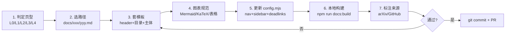

# 编写新页指南（Authoring Guide）

> 本页给维护者和贡献者：如何在 agent-yolo 仓库里正确新增或修改一页文档，通过 CI 校验、通过链接检查、保持与本体的一致性。

- ⏱ 预计阅读：8 分钟
- 前置：熟悉 Markdown、了解 VitePress 1.6.x、读过 [本体 Schema](/ontology/schema)

---

## 目录

- [工作流总览](#工作流总览)
- [第一步：确认这一页属于哪一层](#第一步确认这一页属于哪一层)
- [第二步：文件命名与目录约定](#第二步文件命名与目录约定)
- [第三步：页面结构模板](#第三步页面结构模板)
- [第四步：Mermaid / KaTeX / 表格规范](#第四步mermaid--katex--表格规范)
- [第五步：更新 config.mjs](#第五步更新-configmjs)
- [第六步：本地校验](#第六步本地校验)
- [第七步：数据与来源标注规范](#第七步数据与来源标注规范)
- [常见坑与自查清单](#常见坑与自查清单)

---

## 工作流总览



**核心原则**：

1. **每一页必须有归属** —— 属于四层闭环的哪一层，或属于衍生/横向/案例分类
2. **每一句数字必须有出处** —— 见"数据与来源标注规范"
3. **每一次修改必须跑构建** —— 本地 `npm run docs:build` 通过才能提 PR

---

## 第一步：确认这一页属于哪一层

| 场景 | 页型 | 路径 |
|------|------|------|
| 讲一个 YOLO 版本（v1、v8、v26） | 主线版本 | `docs/versions/vXX/` |
| 讲一个衍生分支（World/E/Master） | 衍生分支 | `docs/derivatives/{branch}/` |
| 讲一个具体任务（Segment/Pose/OBB/Rotated） | 任务页 | `docs/tasks/{task}.md` |
| 讲一段代码 | 源码走读 | `docs/versions/vXX/source/` |
| 讲一个具体场景案例 | 案例 | `docs/cases/{case}.md` |
| 讲一个可执行的操作流程 | 实操手册 | `docs/recipes/{topic}.md` |
| 讲全局视图（时间线、演化、家族） | 全局视图 | `docs/global/` |
| 讲本体知识 | 本体 | `docs/ontology/` |
| 横向汇总 / 决策 / 排查 | 横向页 | 根目录，如 `faq.md`、`compare-matrix.md` |

**判断不了？** 先想想"读者来这一页是要做什么"：

- **查资料**（读论文、看架构图）→ 主线版本或衍生分支
- **学操作**（怎么训练、怎么部署）→ recipes
- **做决策**（哪个版本好、哪个场景用哪个模型）→ 横向页
- **踩坑了怎么办** → troubleshooting 或 bad-cases
- **给项目本身贡献** → 本页 / about.md

---

## 第二步：文件命名与目录约定

### 目录结构速查

```
docs/
├── {index/for-beginners/mid-level-path/...}.md   # 根目录：入口 + 横向页
├── versions/v{1|3|4|5|6|7|8|9|10|11|12|13|14|26}/
│   ├── index.md          # 概览（必须）
│   ├── paper.md          # 论文精读
│   ├── architecture.md   # 架构逐层图解
│   ├── concepts.md       # 理论
│   ├── layers.md         # 层速查
│   ├── losses.md         # 损失
│   ├── loss-gradient.md  # 反向传播
│   ├── tricks.md         # 训练技巧
│   ├── painpoints.md     # 痛点追踪
│   ├── code-walkthrough.md
│   └── source/           # 源码文件快照
├── derivatives/{yoloworld|yoloe|master}/          # 同上结构
├── cases/                                        # 案例
├── tasks/{segment|pose|obb|rotated}.md
├── recipes/                                      # 实操手册
├── global/{family|evolutions|timeline|external-techniques}
└── ontology/{schema|entity-types|relations|authoring}
```

### 命名约定

- **文件命名**：kebab-case，如 `advanced-train.md`、`compare-matrix.md`
- **章节标题**：中文，用 `##` / `###`，不加 emoji（除非页面性质需要，如"翻车案例"用 🚨）
- **标题不加冒号**：Mermaid 目录锚点问题。用"敏感层识别哪些层不能量化"，不用"敏感层识别：哪些层不能量化"
- **文件名与 URL 对应**：`docs/foo/bar.md` → URL `/foo/bar`（VitePress 默认行为）

---

## 第三步：页面结构模板

### 主线版本页模板（versions/vXX/index.md）

```markdown
# YOLOv{X}（{YYYY}-{MM}）

> **一句话总结**：{核心创新点}

- ⏱ 预计阅读：{N} 分钟
- 🔗 相关：[论文](https://arxiv.org/abs/XXXX.XXXXX) · [GitHub](https://github.com/...) · [架构](./architecture) · [痛点](./painpoints)

---

## 目录
（可选，长页建议加）

## 概览
{300-500 字，讲清楚这个版本是谁发布的、什么时候、解决什么问题}

## 核心创新
1. 创新 1：xxx
2. 创新 2：xxx

## 数字表现（COCO 2017）
| 尺寸 | AP | AP50 | Params (M) | GFLOPs | FPS (V100) |
|------|----|----|-----------|-------|-----------|
| n    | ... | ... | ... | ... | ... |

## 与其他版本对比
{指向 compare-matrix 或 changelog 的对比表}

## 关键源码位置
{指向 ./source/ 下的具体文件}

## 常见坑
- xxx
- xxx

## 相关页面
- [论文精读](./paper)
- [架构图解](./architecture)
- [改动清单](/versions/changelog#yolovx)
```

### 任务页模板（tasks/xxx.md）

```markdown
# {任务名}（如 OBB 定向框检测）

## 什么是 {任务}
## 与相关任务的区别
## YOLO 生态里的支持情况
## 数据集与标注格式
## 训练方法
## 评估指标
## 部署注意事项
## 常见坑
## 相关案例
```

### 实操手册模板（recipes/xxx.md）

```markdown
# {主题}深度指南

> **一句话总结**：{什么时候用这个指南}

## 什么时候用 / 什么时候不用
## 前置知识
## 完整流程（分步骤）
## 代码示例（可复制粘贴）
## 常见坑与排查
## 数字基准（可选）
## 相关页面
```

### 案例页模板（cases/xxx.md）

```markdown
# {场景名}实战案例

> 硬件 / 数据 / 部署场景 一句话交代

## 场景描述
## 关键挑战
## 数据准备
## 模型选择与训练
## 部署与推理
## 效果与数字
## 踩坑复盘
## 可复用要点
```

---

## 第四步：Mermaid / KaTeX / 表格规范

### Mermaid 图

**必须遵守**：

1. 节点标签用引号包裹：`A["输入"]`，不要 `A[输入: 图片]`（冒号会导致解析错）
2. 特殊字符转义：中括号、逗号、冒号都要放进引号
3. `×` 不要直接放在节点标签里，改用 `+` 或省略
4. `subgraph` 尽量不用嵌套（v8/v11 那种对比要拆成两个 flowchart）
5. 图表标题不要重复页面标题

**推荐图表类型**：

- `flowchart LR/TB` —— 主流向图
- `sequenceDiagram` —— 时序图（源码走读用）
- `stateDiagram` —— 状态机（部署流程、灰度发布）
- `gantt` —— 时间线（版本演进）
- `pie` —— 参数分布

**不推荐**：

- `classDiagram`（信息量太大，读者不易跟随）
- `erDiagram`（本项目不建模数据实体）

### KaTeX 公式

启用方式：`$...$` 行内、`$$...$$` 独立块。示例：

```markdown
DFL 损失公式：

$$\mathcal{L}_{DFL} = -\sum_{i=1}^{S} (l_i \cdot \log p_i)$$
```

**规则**：

- 变量用斜体、函数用正体（`\mathcal{L}` 而非 `L`）
- 下标用 `_`，上标用 `^`，注意 `{}`
- 常用符号：$\mathcal{L}$ 损失、$\mathbb{R}$ 实数集、$\mathbb{1}$ 指示函数

### 表格

- 表头与内容对齐用 `:` 即可，如 `|---:|` 右对齐
- 数字列右对齐，文字列左对齐
- 长表格（>10 行）加简短表头说明
- 表格里的数字必须能追溯到来源（见下一步）

---

## 第五步：更新 config.mjs

新增页面**必须**同步更新 [docs/.vitepress/config.mjs](/docs/.vitepress/config.mjs)：

### 1. Nav（顶栏）

如果这是新分类的入口，加到 `nav`。已有分类则只加到 sidebar。

### 2. Sidebar

在对应的 sidebar key 下（如 `/recipes/`）追加条目。示例：

```js
'/recipes/': [
  {
    text: '实操手册',
    items: [
      { text: '训练与微调', link: '/recipes/train' },
      { text: 'ONNX / TensorRT 部署', link: '/recipes/export-onnx' },
      // 新增：
      { text: '量化深度指南', link: '/recipes/quantization' },
      { text: '边缘设备实战', link: '/recipes/edge-deploy' }
    ]
  }
]
```

### 3. Dead links 白名单

**如果**你新增的页面里链接到不存在的目录（例如 `/versions/v14` 而不是 `/versions/v14/index`），要么：

- **优先**：修正链接到实际存在的文件
- **无奈**：加到 `ignoreDeadLinks` 正则里

**不要**把整个类别的路径加白名单，除非确实是导航型死链（如 `/cases` 指向目录 index）。

---

## 第六步：本地校验

### 快速命令

```bash
cd f:\src\agent-yolo
npm install         # 首次
npm run docs:dev    # 开发预览，localhost:5173
npm run docs:build  # 生产构建，通过才能提 PR
```

### 检查点

1. **构建无警告**：`vitepress build` 应该 0 error、warnings 可控
2. **Mermaid 无解析错**：构建时会渲染一次所有 mermaid，语法错会报错
3. **链接全绿**：VitePress 构建时会检查所有内部链接，红色报错要修
4. **搜索索引可搜**：`search.provider: 'local'` 会在构建时生成索引，测试搜索关键词能找到
5. **移动端不炸**：本地打开浏览器 dev 面板切换 mobile 视口，检查表格和图表不溢出

### 常见构建失败

| 现象 | 原因 | 修复 |
|------|------|------|
| `Dead link detected: /foo` | 链接指向不存在的页面 | 修链接或加白名单 |
| `Error: Failed to parse Mermaid` | Mermaid 语法错 | 见"第四步" |
| `chunk > 500kb` warning | 主 bundle 太大 | 已在 config 提到 800KB，正常 |
| `KaTeX parse error` | 公式语法错 | 检查 `\` 和 `{}` |

---

## 第七步：数据与来源标注规范

**这是本项目最重要的一条规矩**：任何数字、结论、代码片段，必须能追溯到来源。

### 三种证据类型

| 类型 | 用法 | 示例 |
|------|------|------|
| 论文 | `[arXiv 编号](链接)` | `[arXiv 2303.11246](https://arxiv.org/abs/2303.11246)` |
| 代码 | 相对路径 + 行号 | `source/yolo/task.py L101-120` |
| 实验 | 说明硬件 + 数据 + 命令 | "本机 RTX 4090 + COCO 2017 训练 200 epoch" |

### 数字标注约定

**正确写法**：

> YOLOv8n 在 COCO 2017 val 上 mAP50-95 为 37.3%，来源：Ultralytics 官方 README 2024-06 版。

**错误写法**：

> YOLOv8n 是 37.3%。（没说明是哪个数据集、哪个版本、什么口径）

### 数字口径统一

- **AP 默认指 mAP50-95**（不用特别说明）
- **参数量**：单位为 M（百万）
- **算力**：单位为 GFLOPs（不用 GFLOPS，除非指每秒 FLOP）
- **速度**：FPS，必须标明硬件型号（V100 / A100 / RTX 3060 / Jetson Orin）
- **训练数据**：默认 COCO 2017，其他数据集要写明

### 未验证数据

如果数字来自二手来源或社区实验，加标记：

```markdown
| 模型 | AP | 来源 |
|------|----|----|
| YOLOv13 | 50.2% | ⚠️ 待官方确认（作者本地实验） |
```

---

## 常见坑与自查清单

### 8 大常见坑

1. **文件名冲突** —— `docs/versions/v8.md` 和 `docs/versions/v8/index.md` 同时存在会让 VitePress 报错。目录型一律用 `index.md`。
2. **标题带冒号** —— `## 敏感层识别：xxx` 会导致目录锚点乱码。冒号改成空格或去掉。
3. **Mermaid 中文特殊字符** —— `×`、`÷`、括号（） 直接放进节点标签会失败。加引号。
4. **图片路径** —— 图片放 `docs/public/` 或就近的 `assets/`，路径用 `/logo.svg` 或 `./assets/foo.png`。
5. **Markdown 表格没空格** —— `|内容|` 和 `| 内容 |` 后者才规范。构建虽然容忍，但 GitHub 渲染会炸。
6. **代码块没语言标注** —— 一定写 ```` ```python ```` 或 ```` ```bash ````，别留空。
7. **锚点跳转失效** —— 中文标题转英文锚点不稳定。用 `[文本](#id)` 显式写 id 而不是让 markdown 生成。
8. **忘更新 config** —— 新增页面但不加 nav/sidebar，用户找不到。

### 提交前自查清单

- [ ] 文件名 kebab-case，路径符合目录约定
- [ ] 标题无冒号、无 emoji（案例页可加）
- [ ] Mermaid 用引号包裹标签
- [ ] KaTeX 公式用 `\mathcal` 等规范
- [ ] 表格数字有来源标注
- [ ] 更新 config.mjs 的 nav 或 sidebar
- [ ] 本地 `npm run docs:build` 通过
- [ ] `npm run docs:dev` 目视检查页面
- [ ] 无 dead links（或已加入白名单并解释原因）
- [ ] 引用外部论文链接正确
- [ ] 中英文一致（同一术语全站统一，见 glossary）

---

## 相关页面

- [本体 Schema](/ontology/schema)
- [实体类型详解](/ontology/entity-types)
- [关系类型详解](/ontology/relations)
- [关于本项目](/about)
- [论文索引](/references)
- [术语表](/glossary)
- [故障排查](/troubleshooting)
