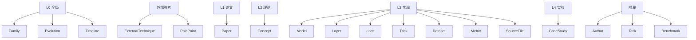

# 实体类型详解

Schema v0.3.0 定义 **18 种实体类型**，按四层闭环分组。每种实体给出：核心字段、示例、典型用途。

## 全景图



---

## L0 全局层

### Family

描述一个模型家族的谱系与分支。

**核心字段**：
- `originModel`: 家族起点的 Model ID
- `lineages[]`: 分支谱系数组，每个分支是一个有序 Model ID 链
- `keyThemes[]`: 贯穿家族的关键主题
- `yearRange`: 时间跨度

**示例**：

```yaml
- id: family-yolo
  type: Family
  name: "YOLO 家族"
  originModel: "yolo-v1"
  yearRange: {start: 2015, end: 2026}
  lineages:
    - name: "main-line"
      chain: ["yolo-v1", "yolo-v2", "yolo-v3", "yolo-v4"]
    - name: "ultralytics-line"
      chain: ["yolo-v5", "yolo-v6", "yolo-v7"]
    - name: "enterprise-line"
      chain: ["yolo-v8", "yolo-v9", "yolo-v10", "yolo-v11", "yolo-v12"]
  keyThemes: ["single-shot", "anchor-free", "decoupled-head", "CSPNeXt", "EMA", "NMS-free"]
```

---

### Evolution

描述一次演化事件，从 A 演化到 B。

**核心字段**：
- `from` / `to`: 演化前后 Model
- `kind`: `version_up` / `fork` / `converge` / `variant` / `revival` / `abandon`
- `introduced.{concepts, layers, losses, tricks}`: 本次引入
- `removed.{...}`: 本次放弃
- `rationale`: 演化理由
- `quantitativeDelta`: 关键指标变化

**示例**：

```yaml
- id: evolution-v1-to-v2
  type: Evolution
  from: "yolo-v1"
  to: "yolo-v2"
  kind: "version_up"
  introduced:
    concepts: ["concept-anchor", "concept-decoupled-head"]
    layers: ["layer-region-v2"]
    tricks: ["trick-batch-norm", "trick-multi-scale-training"]
  removed:
    concepts: ["concept-sqrt-loss"]
    layers: ["layer-fc-4096", "layer-fc-1470"]
    tricks: ["trick-random-best-index", "trick-dropout-fc"]
  rationale: "引入 anchor 提升定位精度；去 FC 换全卷积以支持任意输入尺寸。"
  quantitativeDelta:
    map-05: {from: 63.4, to: 69.2}
    fps: {from: 35, to: 165}
```

---

### Timeline

按年份组织的 YOLO 系列时间线节点。

```yaml
- id: timeline-yolo-family
  type: Timeline
  scope: "yolo-family-2015-2026"
  nodes:
    - year: 2015
      model: "yolo-v1"
      milestone: "首个 single-shot 端到端检测器"
      notable: true
    - year: 2016
      model: "yolo-v2"
      milestone: "引入 anchor + BN"
    - year: 2018
      model: "yolo-v3"
      milestone: "FPN 多尺度预测"
    # ...
```

---

## L1 论文层

### Paper

一篇论文一个实体。

**核心字段**：
- `arxivId` / `url` / `venue` / `year`
- `authors`: 作者列表
- `contributions`: 贡献清单
- `abstractZh`: 中文摘要
- `motivation`: 核心动机
- `keyResults`: 关键结果

**示例**：

```yaml
- id: paper-2015-yolo-single-shot
  type: Paper
  name: "You Only Look Once: Unified, Real-Time Object Detection"
  arxivId: "1506.02640"
  url: "https://arxiv.org/abs/1506.02640"
  venue: "ECCV 2016"
  year: 2015
  authors: ["Joseph Redmon", "Santosh Divvala", "Ross Girshick", "Ali Farhadi"]
  contributions:
    - "single-shot 端到端检测范式"
    - "7×7 grid 空间分解"
    - "Confidence = P(Object)·IoU"
  abstractZh: "YOLO 把目标检测重定义为单次前向回归问题，在 VOC 2007 达到 63.4 mAP 且运行速度 35 FPS..."
  motivation: "两阶段方法太慢，无法做到实时检测"
  keyResults:
    - "VOC 2007 63.4 mAP @ 35 FPS"
    - "VOC 2012 67.5 mAP"
    - "YOLO9000 48.3 mAP @ 50 FPS"
```

---

## L2 理论层

### Concept

论文的知识点/创新点，是本体的**灵魂层**。

**核心字段**：
- `kind`: `motivation` / `idea` / `innovation` / `design_choice` / `failure_mode` / `limitation` / `assumption`
- `paper`: 关联论文
- `summary`: 2-4 句话讲清
- `formalDefinition`: 数学表达
- `whyItWorks`: 为什么有效
- `tradeoffs[]`: 权衡
- `practicalImplication`: 落地影响

**示例**：

```yaml
- id: concept-single-shot
  type: Concept
  name: "Single-Shot 端到端检测"
  kind: "innovation"
  paper: "paper-2015-yolo-single-shot"
  summary: "把目标检测重定义为单次前向的回归问题，去掉两阶段分类器。"
  formalDefinition: "输入 I → 网络 f → 输出 R^(N, 4+1+C)，N = 7² × 2 = 98"
  whyItWorks: "去掉两阶段方法的分类器，把空间分解和类别预测合并到同一个网络。"
  tradeoffs:
    - "(+) FPS 35+，为实时检测打开大门"
    - "(-) 位置精度下降"
    - "(-) 小目标召回差"
  practicalImplication: "这个范式选择贯穿整个 YOLO 系列，是 v1-v12 从未变的核心承诺。"
```

---

## L3 实现层

### Model

具体 YOLO 版本。见 [Schema 页](/ontology/schema) 的完整 v1 示例。

### Layer

网络层类型，**跨版本可复用**。

**核心字段**：
- `category`: `conv` / `pool` / `fc` / `activation` / `norm` / `shortcut` / `upsample` / `reorg` / `route` / `yolo_head` / `detection_head` / `anchor_head` / `decoder` / `other`
- `signature`: 参数签名
- `kernel` / `stride` / `padding`
- `firstVersionIntroduced`: 首次出现版本

### Loss

损失函数。

**核心字段**：
- `formula`: 公式
- `weight`: 权重
- `appliesTo[]`: `box` / `objectness` / `class` / `noobject` / `anchor` / `pose` / `seg`

### Trick

训练/推理技巧。

**核心字段**：
- `category`: `training` / `inference` / `architecture` / `loss_design` / `data_aug` / `regularization` / `optimization` / `quantization`
- `rationale`: 为什么这样做
- `pros[]` / `cons[]`

### Dataset

数据集。

```yaml
- id: ds-pascal-voc-2007
  type: Dataset
  name: "Pascal VOC 2007"
  numClasses: 20
  numImages: 16507
  yearIntroduced: 2007
  license: "Non-commercial"
  url: "https://hosting.robots.ox.ac.uk/pascal/VOC/voc2007/"
```

### Metric

评价指标。

```yaml
- id: metric-map-05
  type: Metric
  name: "mAP@0.5"
  definition: "在 IoU 阈值 0.5 下所有类别的平均 AP"
  range: "[0, 100]"
  higherIsBetter: true
```

### SourceFile

源码文件，把本体**锚定到实际代码行**。

```yaml
- id: src-detection-layer-c
  type: SourceFile
  name: "detection_layer.c"
  path: "source/yolov1/snapshot/src/detection_layer.c"
  language: "C"
  role: "layer_impl"
  keySymbols: ["forward_detection_cpu", "forward_detection_gpu"]
  commit: "8322a58"
```

---

## L4 实战层

### CaseStudy

具体场景的实验记录。

**核心字段**：
- `domain`: `autonomous_driving` / `industrial_inspection` / `retail` / `medical` / `agronomy` / `security` / `robotics` / `education` / `edge_deployment` / `server_inference` / `custom`
- `task`: 任务描述
- `modelsUsed[]` / `datasetsUsed[]`
- `problem`: 问题描述
- `solution`: 解决方案
- `gotchas[]`: 踩坑记录
- `results`: 实验结果
- `reproduceLink`: 复现链接

**示例**：

```yaml
- id: case-industrial-inspection-yolov8n
  type: CaseStudy
  name: "工业表面缺陷检测 (YOLOv8n)"
  domain: "industrial_inspection"
  task: "金属板划痕检测"
  modelsUsed: ["yolo-v8n"]
  datasetsUsed: ["ds-custom-defect-2024"]
  problem: "划痕尺寸 2-8mm，占比 <0.1%，容易漏检"
  solution: "YOLOv8n + P2 anchor + Mosaic 增强 + 480×480 输入"
  gotchas:
    - "Mosaic 关闭对小目标反而更好"
    - "conf 阈值 0.25 以下 FPR 急剧上升"
  results:
    precision: 0.92
    recall: 0.88
    fps: 120
```

---

## 外部参考层

### ExternalTechnique

传统 CV 或非 YOLO 系技术。

**核心字段**：
- `domain`: `classical_cv` / `early_dnn` / `two_stage_detector` / `region_proposal` / `descriptor` / `tracking` / `segmentation` / `nms_related` / `other`
- `era`: 时代标签
- `representativeWork[]`: 代表工作
- `strength` / `weakness`
- `yoloRelation`: `inherited` / `extended` / `replaced` / `inspired` / `rejected` / `generalized`
- `yoloRelationDetail`: 关系详情

**示例**：

```yaml
- id: ext-technique-nms
  type: ExternalTechnique
  name: "Non-Maximum Suppression (NMS)"
  domain: "nms_related"
  era: "pre-2012"
  representativeWork: [" Viola-Jones 2001"]
  strength: "简单有效的后处理去重"
  weakness: "硬阈值敏感；两阶段方法延迟放大器"
  yoloRelation: "inherited"
  yoloRelationDetail: "v1 直接沿用 IoU=0.5 NMS；v10 起被 NMS-free 检测头取代。"
```

---

### PainPoint

YOLO 系列要解决的痛点。

**核心字段**：
- `symptom`: 表现
- `rootCause`: 根因
- `severity`: `critical` / `high` / `medium` / `low`
- `affectedVersions[]`: 受影响版本
- `attempts[]`: 尝试的解决方案，每项 `{attempt, solved, versionIntroduced}`

**示例**：

```yaml
- id: pain-small-object-recall
  type: PainPoint
  name: "小目标召回差"
  symptom: "7×7 grid 分辨率不足以覆盖小目标"
  rootCause: "grid cell 数量固定为 49，感受野过大"
  severity: "critical"
  affectedVersions: ["v1"]
  attempts:
    - attempt: "concept-multi-scale-training"
      solved: false
      versionIntroduced: "v3"
    - attempt: "trick-fpn-neck"
      solved: true
      versionIntroduced: "v3"
    - attempt: "trick-p2-small-anchor"
      solved: true
      versionIntroduced: "v7"
```

---

## 附属类型

### Author / Task / Benchmark

- **Author**：作者/机构，用于关联 Paper
- **Task**：任务类型（Object Detection / Segmentation / Pose / OBB）
- **Benchmark**：基准测试（VOC/COCO/VOC-KITTI/VOC-Instance）

这三类目前主要在 Schema 里定义了字段，实例填充中。

## 与其他页的链接

- [Schema 总览](/ontology/schema)
- [关系类型详解](/ontology/relations)
- [v1 理论 Concept](/versions/v1/concepts)
- [v1 架构与层](/versions/v1/layers)
- [v1 损失函数](/versions/v1/losses)
- [v1 训练技巧](/versions/v1/tricks)
- [v1 痛点追踪](/versions/v1/painpoints)
