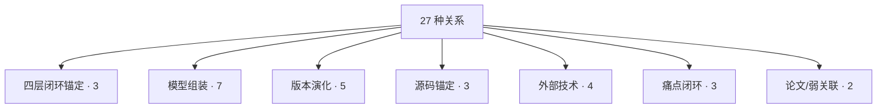

# 关系类型详解

Schema v0.3.0 定义 **27 种关系类型**，用于把 18 种实体类型编织成知识图谱。

## 全景分组



## 1. 四层闭环锚定（3 种）

这是本体的**主干**，把「论文 → 理论 → 实现 → 实战」串成一条链。

| 关系 | 方向 | 含义 |
|------|------|------|
| `elaborates` | Concept → Paper | Concept 详述论文中的知识点 |
| `manifestsIn` | Concept → Layer/Loss/Trick | 理论在实现中的具体体现 |
| `appliedIn` | Layer/Loss/Trick → CaseStudy | 实现被应用到实战 |

**示例（v1）**：

```yaml
- subject: "concept-single-shot"
  predicate: "elaborates"
  object: "paper-2015-yolo-single-shot"

- subject: "concept-grid-spatial-decomposition"
  predicate: "manifestsIn"
  object: "layer-detection-v1"
  note: "side=7, num=2 参数直接把 grid 思想映射到 detection_layer。"
```

## 2. 模型组装（7 种）

描述 Model 由哪些零件组成、在什么数据集上评估。

| 关系 | 方向 | 含义 |
|------|------|------|
| `hasLayer` | Model → Layer | 模型使用了某层 |
| `usesLoss` | Model → Loss | 模型使用了某损失 |
| `usesTrick` | Model → Trick | 模型使用了某技巧 |
| `evaluatedOn` | Model → Dataset | 在数据集上评估 |
| `measuredBy` | Model → Metric | 用什么指标衡量 |
| `relatedTo` | 任意 → 任意 | 弱关联 |
| `cites` | Paper → Paper | 论文引用 |

**示例**：

```yaml
- subject: "yolo-v1"
  predicate: "hasLayer"
  object: "layer-conv-7x64"

- subject: "yolo-v1"
  predicate: "usesLoss"
  object: "loss-coord-l2"

- subject: "yolo-v1"
  predicate: "evaluatedOn"
  object: "ds-pascal-voc-2007"

- subject: "paper-2015-yolo-single-shot"
  predicate: "cites"
  object: "paper-2014-fasterrcnn"
```

## 3. 版本演化（5 种）

描述 YOLO 系列内部的谱系。

| 关系 | 方向 | 含义 |
|------|------|------|
| `derivedFrom` | Model → Model | 版本演化链（有先后但语义弱） |
| `supersedes` | Model → Model | 新版本取代旧版本（语义强） |
| `outperforms` | Model → Model | 性能对比（可带 `weight` 填 delta） |
| `evolvesTo` | 任意 → 任意 | 演化事件 |
| `forksFrom` / `isVariantOf` / `originOf` / `convergesWith` | 任意 | 分支/变体/起源/收敛 |

**演化关系语义辨析**：

```
derivedFrom  =  "从 X 派生出来"（可能只是参考思想）
supersedes   =  "取代 X 成为主流"（X 退居次要）
outperforms  =  "比 X 强"（性能对比，不代表替代）
forksFrom    =  "从 X 分叉出独立分支"
convergesWith=  "与 X 收敛到同一结论"
```

**示例**：

```yaml
- subject: "yolo-v2"
  predicate: "derivedFrom"
  object: "yolo-v1"

- subject: "yolo-v3"
  predicate: "supersedes"
  object: "yolo-v2"

- subject: "yolo-v8"
  predicate: "outperforms"
  object: "yolo-v7"
  weight: 5.5         # COCO mAP@0.5:0.95 delta
  note: "v8 相对 v7 精度大幅提升"

- subject: "yolo-v3-tiny"
  predicate: "forksFrom"
  object: "yolo-v3"
```

## 4. 源码锚定（3 种）

把概念/层/损失锚定到实际代码行。

| 关系 | 方向 | 含义 |
|------|------|------|
| `implements` | SourceFile → Layer/Loss | 源码文件实现了某概念 |
| `referencedByCode` | 概念 → SourceFile | 概念指向具体源码 |
| `introducedIn` | Layer/Loss/Trick → Model | 首次出现的版本 |

**示例**：

```yaml
- subject: "src-detection-layer-c"
  predicate: "implements"
  object: "layer-detection-v1"

- subject: "loss-coord-l2"
  predicate: "referencedByCode"
  object: "src-detection-layer-c"
  lines: "101-105"

- subject: "loss-ciou"
  predicate: "introducedIn"
  object: "yolo-v4"
```

## 5. 外部技术（4 种）

描述 YOLO 与传统 CV 技术的关系。

| 关系 | 方向 | 含义 |
|------|------|------|
| `inheritsFrom` | 概念/Model → ExternalTechnique | 继承某传统技术 |
| `generalizes` | 概念 → ExternalTechnique | 泛化传统技术 |
| `supersedes_technique` | Model → ExternalTechnique | 取代某传统技术 |
| `inspired_by_technique` | Model/概念 → ExternalTechnique | 受启发 |

**示例**：

```yaml
- subject: "concept-single-shot"
  predicate: "inheritsFrom"
  object: "ext-technique-rcnn"
  note: "保留『候选框 + 分类回归』的建模，但把区域提议合并到 grid。"

- subject: "yolo-v1"
  predicate: "supersedes_technique"
  object: "ext-technique-sliding-window"

- subject: "yolo-v1"
  predicate: "supersedes_technique"
  object: "ext-technique-hog-svm"

- subject: "yolo-v1"
  predicate: "inspired_by_technique"
  object: "ext-technique-fasterrcnn-rpn"
  note: "RPN 的 anchor 思想直接影响了 YOLOv2。"

- subject: "yolo-v1"
  predicate: "inheritsFrom"
  object: "ext-technique-nms"

- subject: "yolo-v1"
  predicate: "inheritsFrom"
  object: "ext-technique-alexnet"
  note: "24 层 backbone 是 AlexNet 变体。"
```

## 6. 痛点闭环（3 种）

把痛点和解决方案闭环。

| 关系 | 方向 | 含义 |
|------|------|------|
| `solvesPainPoint` | 概念/Trick → PainPoint | 解决某痛点 |
| `exacerbatesPainPoint` | 概念/Trick → PainPoint | 加剧某痛点 |
| `tradesOff` | 概念 ↔ 概念 | 权衡关系 |

**示例**：

```yaml
- subject: "pain-two-stage-latency"
  predicate: "solvesPainPoint"
  object: "concept-single-shot"
  note: "v1 的核心动机就是解决两阶段太慢。"

- subject: "pain-small-object-recall"
  predicate: "exacerbatesPainPoint"
  object: "concept-grid-spatial-decomposition"
  note: "grid 化分解在提速的同时牺牲了小目标召回。"

- subject: "concept-anchor-free"
  predicate: "solvesPainPoint"
  object: "pain-anchor-sensitive"
```

## 7. 论文/弱关联（2 种）

| 关系 | 方向 | 含义 |
|------|------|------|
| `cites` | Paper → Paper | 论文引用 |
| `relatedTo` | 任意 → 任意 | 弱关联，用于补充信息 |

## 27 种关系一览

| # | Predicate | 方向 | 分组 |
|---|-----------|------|------|
| 1 | `hasLayer` | Model → Layer | 组装 |
| 2 | `usesLoss` | Model → Loss | 组装 |
| 3 | `usesTrick` | Model → Trick | 组装 |
| 4 | `evaluatedOn` | Model → Dataset | 组装 |
| 5 | `measuredBy` | Model → Metric | 组装 |
| 6 | `derivedFrom` | Model → Model | 演化 |
| 7 | `supersedes` | Model → Model | 演化 |
| 8 | `outperforms` | Model → Model | 演化 |
| 9 | `cites` | Paper → Paper | 论文 |
| 10 | `implements` | SourceFile → Layer/Loss | 源码 |
| 11 | `referencedByCode` | 概念 → SourceFile | 源码 |
| 12 | `introducedIn` | 概念 → Model | 源码 |
| 13 | `relatedTo` | 任意 → 任意 | 弱 |
| 14 | `inspiredBy` | 概念 → 概念/External | 弱 |
| 15 | `elaborates` | Concept → Paper | 四层 |
| 16 | `manifestsIn` | Concept → Layer/Loss/Trick | 四层 |
| 17 | `appliedIn` | 概念 → CaseStudy | 四层 |
| 18 | `evolvesTo` | 任意 → 任意 | 演化 |
| 19 | `forksFrom` | 任意 → 任意 | 演化 |
| 20 | `convergesWith` | 任意 → 任意 | 演化 |
| 21 | `isVariantOf` | 任意 → 任意 | 演化 |
| 22 | `originOf` | Family → Model | 演化 |
| 23 | `inheritsFrom` | 概念 → ExternalTechnique | 外部 |
| 24 | `generalizes` | 概念 → ExternalTechnique | 外部 |
| 25 | `supersedes_technique` | Model → ExternalTechnique | 外部 |
| 26 | `inspired_by_technique` | Model → ExternalTechnique | 外部 |
| 27 | `solvesPainPoint` | 概念 → PainPoint | 痛点 |
| 28 | `exacerbatesPainPoint` | 概念 → PainPoint | 痛点 |
| 29 | `tradesOff` | 概念 ↔ 概念 | 痛点 |

> 注：Schema 里实际是 27 种（`inspiredBy` 和 `inspired_by_technique` 是两种，语义不同：前者在概念内，后者指向 ExternalTechnique）。

## 关系边的完整例子（v1 摘要）

```yaml
relations:
  # 论文 → 理论
  - subject: "concept-single-shot"
    predicate: "elaborates"
    object: "paper-2015-yolo-single-shot"

  # 理论 → 实现
  - subject: "concept-grid-spatial-decomposition"
    predicate: "manifestsIn"
    object: "layer-detection-v1"

  # 层 → 源码
  - subject: "src-detection-layer-c"
    predicate: "implements"
    object: "layer-detection-v1"

  # Model 组装
  - subject: "yolo-v1"
    predicate: "hasLayer"
    object: "layer-detection-v1"

  - subject: "yolo-v1"
    predicate: "usesLoss"
    object: "loss-coord-l2"

  # 外部继承
  - subject: "yolo-v1"
    predicate: "inheritsFrom"
    object: "ext-technique-nms"

  # 痛点闭环
  - subject: "pain-two-stage-latency"
    predicate: "solvesPainPoint"
    object: "concept-single-shot"

  - subject: "pain-small-object-recall"
    predicate: "exacerbatesPainPoint"
    object: "concept-grid-spatial-decomposition"
```

## 与其他页的链接

- [Schema 总览](/ontology/schema)
- [实体类型详解](/ontology/entity-types)
- [v1 关系实例](file:///f:/src/agent-yolo/ontology/instances/yolov1/relations.yaml)
- [全局演化事件](/global/evolutions)
- [传统 CV 谱系](/global/external-techniques)
