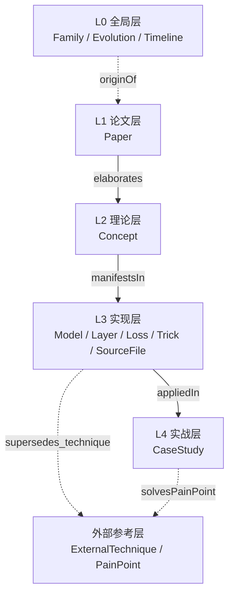

# YOLO 本体 Schema

YOLO 系列本体采用 **JSON Schema (draft-07)** 描述，用 YAML 存实例。整个本体围绕「**论文 → 理论 → 实现 → 实战**」四层闭环组织，另加 L0 全局层承载演化视图。

- Schema 文件：[yolo-ontology.schema.json](file:///f:/src/agent-yolo/ontology/schema/yolo-ontology.schema.json)
- 版本：**v0.3.0**
- 校验方式：JSON Schema draft-07

## 四层闭环设计



- **L0 全局层**：承载系列谱系与跨版本演化事件
- **L1 论文层**：一篇论文一个实体，是知识的原子来源
- **L2 理论层**：论文提炼的知识点/创新点/设计选择/失败模式
- **L3 实现层**：概念落到 Model/Layer/Loss/Trick，再锚定到 SourceFile
- **L4 实战层**：具体场景的实验记录
- **外部参考层**：传统 CV 技术 + YOLO 系列遇到的痛点

## Entity 基础定义

所有实体共享以下字段：

```json
{
  "id": "yolo-v1",              // 全局唯一，kebab-case
  "type": "Model",              // 见 17 种实体类型
  "name": "YOLO v1",            // 中文可读名
  "aliases": ["yolov1"],        // 别名，用于跨版本对齐
  "description": "首个 single-shot 端到端检测器",
  "tags": ["realtime", "single-shot"],
  "source": [                    // 证据来源
    {"kind": "paper", "path": "arxiv:1506.02640", "section": "3"},
    {"kind": "code", "path": "src/detection_layer.c", "lines": "101-105"}
  ]
}
```

**ID 命名约定**（kebab-case，前缀与 type 对应）：

| 前缀 | Type | 示例 |
|------|------|------|
| `yolo-v*` | Model | `yolo-v1`, `yolo-v8` |
| `layer-*` | Layer | `layer-conv-3x256` |
| `loss-*` | Loss | `loss-ciou` |
| `trick-*` | Trick | `trick-sqrt-one` |
| `ds-*` | Dataset | `ds-coco-2017` |
| `metric-*` | Metric | `metric-map-05` |
| `paper-*` | Paper | `paper-2015-yolo-single-shot` |
| `src-*` | SourceFile | `src-detection-layer-c` |
| `concept-*` | Concept | `concept-single-shot` |
| `case-*` | CaseStudy | `case-industrial-inspection-yolov8` |
| `family-*` | Family | `family-yolo` |
| `evolution-*` | Evolution | `evolution-v1-to-v2` |
| `ext-technique-*` | ExternalTechnique | `ext-technique-nms` |
| `pain-*` | PainPoint | `pain-small-object-recall` |

## 17 种实体类型

| # | Type | 层级 | 用途 |
|---|------|------|------|
| 1 | **Model** | L3 | YOLO 具体版本（v1-v12） |
| 2 | **Layer** | L3 | 网络层类型（conv/fc/yolo_head 等） |
| 3 | **Loss** | L3 | 损失函数 |
| 4 | **Trick** | L3 | 训练/推理技巧 |
| 5 | **Dataset** | L3 | 数据集 |
| 6 | **Metric** | L3 | 评价指标 |
| 7 | **Paper** | L1 | 论文 |
| 8 | **Concept** | L2 | 理论知识点/创新点 |
| 9 | **SourceFile** | L3 | 源码文件（把本体锚定到代码行） |
| 10 | **Author** | 附属 | 作者/机构 |
| 11 | **Task** | 附属 | 任务类型 |
| 12 | **Benchmark** | 附属 | 基准 |
| 13 | **CaseStudy** | L4 | 实战案例 |
| 14 | **Family** | L0 | 家族谱系 |
| 15 | **Evolution** | L0 | 演化事件 |
| 16 | **Timeline** | L0 | 时间线节点 |
| 17 | **ExternalTechnique** | 外部 | 传统 CV 技术 |
| 18 | **PainPoint** | 外部 | 痛点 |

详见 [实体类型详解](/ontology/entity-types)。

## 27 种关系类型

按功能分 6 组：

### 1. 四层闭环锚定（3 种）

| 关系 | 方向 | 含义 |
|------|------|------|
| `elaborates` | L2 → L1 | Concept 详述论文中的知识点 |
| `manifestsIn` | L2 → L3 | Concept 在实现中的具体体现 |
| `appliedIn` | L3 → L4 | 实现被应用到实战案例 |

### 2. 模型组装（4 种）

| 关系 | 方向 | 含义 |
|------|------|------|
| `hasLayer` | Model → Layer | 模型使用了某层 |
| `usesLoss` | Model → Loss | 模型使用了某损失 |
| `usesTrick` | Model → Trick | 模型使用了某技巧 |
| `evaluatedOn` / `measuredBy` | Model → Dataset / Metric | 评估 |

### 3. 版本演化（5 种）

| 关系 | 方向 | 含义 |
|------|------|------|
| `derivedFrom` | Model → Model | 版本演化链 |
| `supersedes` | Model → Model | 新版本取代旧版本 |
| `outperforms` | Model → Model | 性能对比 |
| `evolvesTo` | 任意 → 任意 | 演化事件 |
| `forksFrom` / `isVariantOf` / `originOf` / `convergesWith` | 任意 | 分支/变体/起源 |

### 4. 源码锚定（3 种）

| 关系 | 方向 | 含义 |
|------|------|------|
| `implements` | SourceFile → Layer/Loss | 源码实现了某概念 |
| `referencedByCode` | 概念 → SourceFile | 概念指向具体源码 |
| `introducedIn` | Layer/Loss/Trick → Model | 首次出现的版本 |

### 5. 外部技术（4 种）

| 关系 | 方向 | 含义 |
|------|------|------|
| `inheritsFrom` | 概念 → ExternalTechnique | 继承传统 CV 技术 |
| `generalizes` | 概念 → ExternalTechnique | 泛化传统技术 |
| `supersedes_technique` | Model → ExternalTechnique | 取代传统技术 |
| `inspired_by_technique` | Model → ExternalTechnique | 受启发 |

### 6. 痛点闭环（3 种）

| 关系 | 方向 | 含义 |
|------|------|------|
| `solvesPainPoint` | 概念 → PainPoint | 解决某痛点 |
| `exacerbatesPainPoint` | 概念 → PainPoint | 加剧某痛点 |
| `tradesOff` | 概念 ↔ 概念 | 权衡关系 |

详见 [关系类型详解](/ontology/relations)。

## SourceRef 证据引用

每个实体可挂多个证据来源：

```yaml
source:
  - kind: paper
    path: "arxiv:1506.02640"
    section: "3. Training YOLO"
    quote: "YOLO predicts bounding boxes and class probabilities directly..."

  - kind: code
    path: "source/yolov1/snapshot/src/detection_layer.c"
    lines: "101-105"
    quote: "l.coords * l.weight_scale"

  - kind: commit
    path: "https://github.com/pjreddie/darknet"
    commit: "8322a58"

  - kind: url
    path: "https://pjreddie.com/darknet/yolo/"
    quote: "You Only Look Once"

  - kind: note
    path: "docs/notes/2015-v1-review.md"
```

**证据类型**：`paper` / `code` / `commit` / `url` / `note`。

## 一个完整 Model 实例（v1）

```yaml
- id: yolo-v1
  type: Model
  name: "YOLO v1"
  aliases: ["yolov1"]
  version: "v1"
  year: 2015
  authors: ["joe-redmon", "santosh-divvala", "ross-girshick", "ali-farhadi"]
  paper: "paper-2015-yolo-single-shot"
  repo: "https://github.com/pjreddie/darknet"
  framework: "darknet"
  inputSize: [448, 448]
  numClasses: 20
  parameters: 70e6
  backbone: "yolo-backbone-v1"
  neck: null                # v1 没有 neck
  head: "layer-detection-v1"
  losses:
    - "loss-coord-l2"
    - "loss-box-iou-l2"
    - "loss-object-l2"
    - "loss-noobject-l2"
    - "loss-class-l2"
  metrics:
    - metric: "metric-map-05"
      dataset: "ds-pascal-voc-2007"
      value: 63.4
      inputSize: 448
    - metric: "metric-fps"
      value: 35
  source:
    - kind: paper
      path: "arxiv:1506.02640"
      section: "1"
```

## 与 OWL/RDF 的差异

| 维度 | OWL/RDF | YOLO 本体 |
|------|---------|-----------|
| 表达力 | 支持 OWL 公理（类间公理、属性公理） | 仅实体 + 关系，无公理 |
| 推理 | 支持推理机 | 无推理机，需人工查询 |
| 校验 | OWL 一致性检查 | JSON Schema draft-07 校验 |
| 工具链 | Protégé / Apache Jena | YAML + 正则 + jq |
| 迁移成本 | 高 | 低 |
| 适合场景 | 学术本体 | 工程知识管理 |

**选择理由**：工程优先。我们只关心「概念 → 实现 → 源码」这条锚定链，不需要 OWL 级别的公理系统。

## 版本演进

| 版本 | 变更 |
|------|------|
| v0.1.0 | 初版：Model/Layer/Loss/Trick/Dataset/Metric/Paper/SourceFile/Author/Task/Benchmark |
| v0.2.0 | 加 Concept + CaseStudy（四层闭环） |
| v0.3.0 | 加 Family + Evolution + Timeline（L0 全局）+ ExternalTechnique + PainPoint（外部参考）；27 种关系边 |

## 与其他页的链接

- [实体类型详解](/ontology/entity-types)
- [关系类型详解](/ontology/relations)
- [系列家族](/global/family)
- [演化事件](/global/evolutions)
- [传统 CV 谱系](/global/external-techniques)
