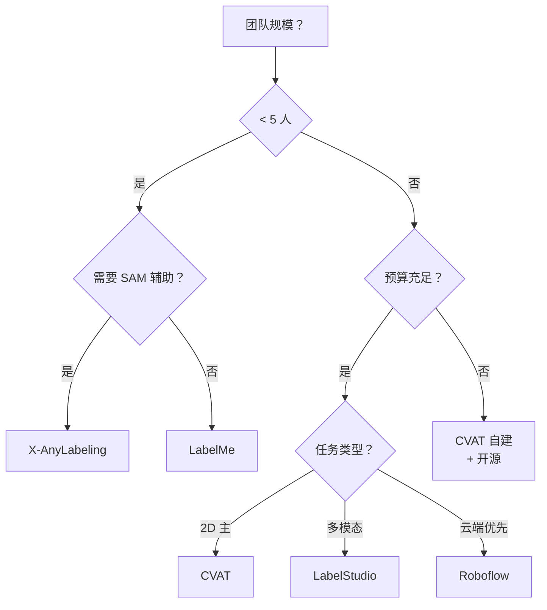

# 数据标注避坑指南 · 从工具选型到质检流程

> **一句话**：YOLO 模型 80% 的精度上限来自数据质量，这一页把"工具选型 → 标注规范 → 质检流程 → 半自动加速"讲透，避免"模型不涨点其实是标注烂"的经典惨剧。

- ⏱ 预计阅读：20 分钟
- 📌 前置阅读：[train.md · 数据集准备](/recipes/train)
- 🔗 相关：[cases 索引](/cases) · [tasks/segment](/tasks/segment) · [tasks/pose](/tasks/pose)

---

## 目录

- [为什么标注是最大坑](#为什么标注是最大坑)
- [工具选型矩阵](#工具选型矩阵)
- [YOLO 格式规范](#yolo-格式规范)
- [标注规范模板](#标注规范模板)
- [标注质量控制三阶段](#标注质量控制三阶段)
- [半自动标注：SAM + Labeling 工具](#半自动标注sam--labeling-工具)
- [不同任务的标注要点](#不同任务的标注要点)
- [小规模数据怎么办（<100 张）](#小规模数据怎么办100-张)
- [大规模数据怎么办（>10万张）](#大规模数据怎么办10万张)
- [常见坑](#常见坑)

---

## 为什么标注是最大坑

行业调研（2023 YOLO Workshop）显示，80% 的"模型不涨点"问题根源在数据，不是模型：

| 问题类型 | 出现频率 | 影响 |
|---------|---------|------|
| 类别分布严重不均 | 68% | mAP 掉 5-15% |
| 类别定义模糊 | 55% | 模型混乱 |
| 边界框不精确 | 45% | 小目标漏检 |
| 标注漏标/误标 | 40% | 训练损失噪声 |
| 数据分布偏差 | 35% | 部署环境不匹配 |
| 图片质量差 | 25% | 训练噪声大 |

**标注是"数据工程"，不是"标注员工作"**：从数据收集到标注规范到质检流程，每一环都可能出坑。

---

## 工具选型矩阵

按"任务 × 团队规模 × 预算"选择：

| 工具 | 类型 | 支持任务 | 团队协作 | 价格 | 推荐场景 |
|------|------|---------|---------|------|---------|
| **LabelMe** | 单机 | 2D 框/多边形/关键点 | ❌ | 免费 | 个人/小团队 <10 人 |
| **LabelImg** | 单机 | 2D 框 | ❌ | 免费 | YOLO 老项目 |
| **X-AnyLabeling** | 单机 | 2D + SAM 辅助 | ❌ | 免费 | 想省时间标多边形 |
| **CVAT** | 团队级 | 2D/3D/关键点/视频 | ✅ | 企业版收费 | 中大项目首选 |
| **LabelStudio** | 通用 | 文本+图+音频+视频 | ✅ | 企业版收费 | 多模态项目 |
| **Roboflow** | 云端 | 2D/3D | ✅ | 按量付费 | 云端协作 + 数据增强 |
| **Encord** | 企业 | 视频/多模态 | ✅ | 企业版收费 | 视频标注为主 |

### 决策速查



### 各工具优劣势

**LabelMe**
- ✅ 轻量、开源、多边形友好
- ❌ 无团队协作、无版本管理
- 学习曲线：30 分钟

**CVAT**
- ✅ 企业级功能齐全（任务分配、进度追踪、多人协同）
- ✅ 支持 SAM / Grounded-SAM
- ❌ 部署复杂（Docker Compose）
- 学习曲线：半天

**Roboflow**
- ✅ 云端一站式（标注 + 增强 + 训练）
- ✅ 自动版本管理
- ❌ 数据出境合规问题（国内项目慎用）
- 学习曲线：1 小时

---

## YOLO 格式规范

Ultralytics YOLO 格式的**图片 + 标签**：

```
dataset/
├── images/
│   ├── train/xxx.jpg
│   └── val/xxx.jpg
├── labels/
│   ├── train/xxx.txt    # 每图对应一个 txt
│   └── val/xxx.txt
└── dataset.yaml
```

### 标签文件格式

**Detect / OBB / Rotated**：
```
<class_id> <x_center> <y_center> <width> <height>
```
坐标都是归一化到 [0, 1] 的相对值，中心点 + 宽高（不是左上角 + 宽高）。

**OBB（4 点多边形）**：
```
<class_id> <x1> <y1> <x2> <y2> <x3> <y3> <x4> <y4>
```
4 个点按顺时针或逆时针顺序，**必须闭合**。

**Segment**：
```
<class_id> <x1> <y1> <x2> <y2> ... <xn> <yn>
```
多边形点越多越好（推荐 32-64 点）。

**Pose**：
```
<class_id> <x_center> <y_center> <width> <height> <k1x> <k1y> <k1v> <k2x> <k2y> <k2v> ...
```
关键点坐标 + visibility 状态（0/1/2）。

**Classify**：
```
0   # 仅一个类别 ID
```

**Depth**：
```
<float depth value>
```
单像素深度值。

**Semantic**：
- 生成 `.png` 分割图，每个像素是类别 ID

### 常见错误

- ❌ 坐标用了像素值，没归一化 → 训练直接报错
- ❌ 用了 4 位小数以上 → 训练时精度损失
- ❌ 文件扩展名带 BOM → Ultralytics 读不出
- ❌ 一行多个对象写反了顺序 → 类别错位

**校验命令**：
```bash
yolo data check img2label-contamination data=dataset.yaml
```

---

## 标注规范模板

给标注员发这个文档，避免"每个人标的不一样"：

### 1. 类别定义（必填）

| 类别 | ID | 定义 | 边界框范围 | 排除情况 |
|------|-----|------|----------|---------|
| 车辆 | 0 | 所有四轮或以上的陆上交通工具 | 包含车顶、车底、后视镜、车牌 | 不含自行车/摩托 |
| 行人 | 1 | 步行或站立的人 | 从头顶到脚底 | 不含被车辆完全遮挡 |
| 骑行者 | 2 | 骑自行车/摩托车的人 | 包含人和车 | 不含电动车（归"车辆"） |

### 2. 标注规则

**边界框**：
- 尽量贴合目标，允许 1-3 px 过扩
- 遮挡 <30% 时正常标注
- 遮挡 30-70% 时标注可见部分
- 遮挡 >70% 时标注完整框（如果可推测）
- 完全遮挡（<10% 可见）不标

**图片裁切**：
- 目标 >50% 被裁切 → 正常标
- 目标 <50% 被裁切 → 只标可见部分
- 目标完全不可见 → 不标

**模糊 / 低质**：
- 目标轮廓可辨 → 正常标
- 目标轮廓模糊 → 不标
- 严重运动模糊 → 不标

**特殊场景**：
- 目标在镜子里 → 不标
- 目标在屏幕上 → 不标
- 目标在水面反射 → 不标

### 3. 质检流程

- **一级质检**：随机抽 10% 图片，两人独立标，比对一致性
- **二级质检**：CVAT 的 "Task QA" 环节，专家复审
- **三级质检**：模型训练后评估，看哪类错误率高，回查标注

---

## 标注质量控制三阶段

### 阶段 1：预标注意前（收集期）

- 收集 20-50 张样本，先由专家标一遍
- 检查类别定义是否合理（有没有歧义）
- 决定边界框风格（紧凑 vs 宽松）
- 输出**标注手册 v1**

### 阶段 2：批量标注中（生产期）

- 前 5% 由专家标注，作为"标准答案"
- 随机抽 10% 由第二标注员独立标，比对一致率
- **一致率要求**：
  - 类别一致率 > 95%
  - 边界框 IoU > 0.75
  - 关键点 PCK @ 0.1 > 85%
- 一致率不达标 → 重新培训 + 修订手册

### 阶段 3：训练后回查（验证期）

- 训练完成 → 找出 mAP 最差的类
- 抽查该类样本 20 张
- 检查：
  - 是不是漏标了？
  - 是不是边界框太松？
  - 是不是类别定义有问题？
- 修正后重训，mAP 通常能再涨 2-5%

---

## 半自动标注：SAM + Labeling 工具

### 方案 1：X-AnyLabeling + SAM

**流程**：
1. 装 X-AnyLabeling：`pip install -U x-anylabeling`
2. 下载 SAM 权重（ViT-L / ViT-H）
3. 点击目标 → SAM 自动抠图 → 手动微调 → 存为多边形

**性能**：
- 普通物体：1 秒/个
- 复杂边缘：3-5 秒/个
- 相比纯手工快 5-10×

**成本**：本地跑 ViT-L 需要 8GB VRAM，云端 API ~$0.01/图

### 方案 2：CVAT 内置 SAM 集成

**流程**：
1. CVAT 安装 SAM 后端（Docker Compose）
2. 打开 SAM Segmentor 面板
3. 点选目标 → 自动 mask → 微调

**优势**：团队协作友好，可指定每个任务用不同标注员

### 方案 3：SAM + LabelStudio（云端）

**流程**：
1. LabelStudio 接 SAM API
2. 网页上传 → SAM 预处理 → 标注员修正
3. 提交后进入 QA 环节

**优势**：无需本地硬件，但需付费 API

### 半自动的边界

SAM 强项：**自然物体、清晰边缘、单一类别**

SAM 弱项：
- **细粒度物体**：钥匙、螺丝钉、小零件 → 边缘糊
- **同类密集物体**：一排人 → 分离困难
- **医学影像**：器官边界模糊 → 需要专家修正
- **工业缺陷**：微小划痕 → SAM 识别不到

**结论**：SAM 加速 5-10×，但仍需人工复核，不能全自动。

---

## 不同任务的标注要点

### Detect（2D 框）

- 紧凑度：允许 1-3 px 过扩，紧贴会掉点
- 遮挡：>70% 遮挡不标
- 小目标：<20px 需要仔细标，误差影响大

### Segment（多边形）

- 点数：32-64 点最佳，少于 20 精度差，多于 100 无收益
- 复杂形状：允许锯齿，不要过度平滑
- 边界：像素级精度，比 Detect 严格

### Pose（关键点）

- 关键点定义必须精确：如"手腕"是掌心还是掌根？
- visibility 三档：0=不可见 / 1=可见但不确定 / 2=精确可见
- 关节数量与模型匹配（COCO 17 / MPII 16）
- **训练时 visibility=0 的样本会被加权降低**

### OBB（定向框）

- 4 点顺序：顺时针或逆时针，**不要交叉**
- 角度：用 sin/cos 参数化时注意 -90° 到 90° 范围
- 小目标：小物体角度容易标错，多标几个校准

### Depth（深度）

- 单像素深度值或稠密图
- 单位统一（米 vs 毫米 vs 归一化）
- LiDAR 数据 vs 单目深度差异大

### Classify（分类）

- 一图一标签，多类冲突需定义主类别
- 类别互斥 vs 多标签要明确

---

## 小规模数据怎么办（<100 张）

100 张以下数据是"极端稀缺"，靠标更多没用，需要策略：

### 策略 1：数据增强到极致

```yaml
# dataset.yaml
augment:
  - mixup: 0.5
  - cutmix: 0.5
  - mosaic: 1.0
  - hflip: 0.5
  - vflip: 0.0        # 除非任务对称
  - scale: 0.5
  - hsv_h: 0.015
  - hsv_s: 0.7
  - hsv_v: 0.4
  - perspective: 0.0
```

### 策略 2：预训练 + 微调

- 用 COCO 预训练权重起步，不要从头训练
- 冻结 backbone，只训 head（少样本友好）

### 策略 3：合成数据

- 从 100 张真实图中抠出目标
- 合成到随机背景中，生成 1000-5000 张
- 训练时 30% 真 + 70% 合成

### 策略 4：Zero-Shot 或 Few-Shot

- 用 **YOLO-World / YOLOE** 的开放词表能力
- 只需 5-10 张示例即可检测新类

---

## 大规模数据怎么办（>10万张）

10 万张以上标注成本高，策略不同：

### 策略 1：主动学习

- 先标 10% → 训初版模型
- 用初版模型预测剩余 90%，找出"不确定"样本
- 只标这些不确定样本（通常 5-20%）
- 迭代 3-5 轮

**收益**：标注成本降低 70-80%，精度接近全量标注。

### 策略 2：伪标签

- 用强模型（v8-m）预测弱模型（v8-n）没见过的样本
- 置信度 > 0.9 的作为伪标签加入训练
- 训练后精度反而更好（相当于数据增强）

### 策略 3：分层采样

- 按类别 / 场景 / 时段分层
- 每层独立配额，防止数据分布不均

### 策略 4：多标注员 + 一致性校验

- 前 20% 数据多标注员独立标
- 一致率 > 90% 才批量
- 一致性差 → 修订标注手册

---

## 常见坑

- **类别定义模糊**：如"车辆"是含摩托车吗？"人"含坐轮椅吗？定义不清模型必然崩。
- **同一目标标注不一致**：有人紧贴边界，有人宽松过扩。规范不明确是最大坑。
- **图片重复没去重**：训练集 / 验证集 / 测试集有交集，mAP 虚高。用 `yolo data check img2label-contamination` 检查。
- **标注顺序乱**：OBB 4 个点交叉了，程序能读但训练崩。
- **类别 ID 不连续**：从 0 开始连续，中间不要空（如 0,1,3,5 会让训练出错）。
- **图片文件名含中文**：某些系统处理不了，一律 ASCII 命名。
- **验证集太小（<5%）**：mAP 波动大，评估不稳。至少 5%，理想 10-20%。
- **数据增强覆盖不足**：只翻水平，没做颜色抖动 / 缩放，模型泛化差。
- **忽略数据分布偏差**：训练时都是白天图片，测试时都是夜晚，mAP 掉一半。
- **标注速度 > 精度**：追求"每图 30 秒"的结果就是标注烂，返工成本更高。

---

## 下一步

- 训练自己的模型 → [train.md](/recipes/train)
- 部署到生产 → [edge-deploy.md](/recipes/edge-deploy)
- 学 Segment 细节 → [tasks/segment.md](/tasks/segment)
- 学 Pose 细节 → [tasks/pose.md](/tasks/pose)
