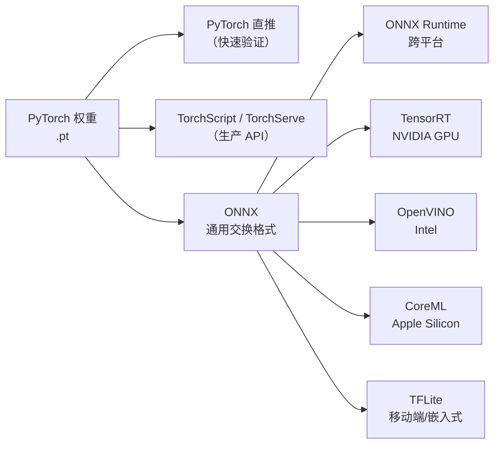
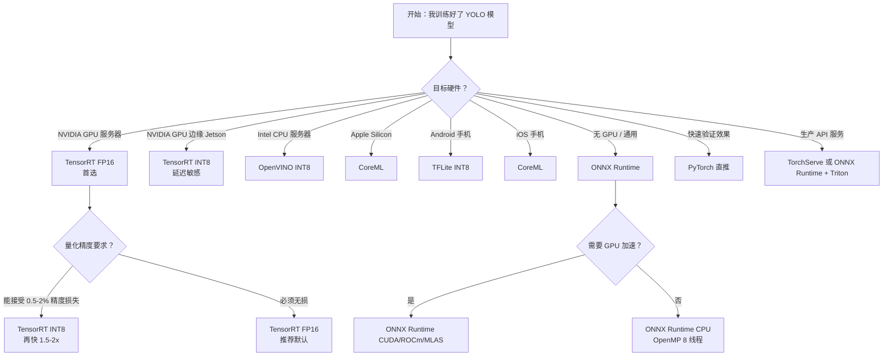

# 部署后端对比 · 7 个推理运行时怎么选

> **一句话**：训练完只是开始。这一页把「ONNX Runtime / TensorRT / OpenVINO / CoreML / TensorFlow Lite / PyTorch 直推 / TorchServe」7 个主流推理后端横向对比，帮你在 5 分钟内选定部署路线。

## 目录

- [为什么需要对比](#为什么需要对比)
- [全景图](#全景图)
- [7 个后端横向对比表](#7-个后端横向对比表)
- [决策树](#决策树)
- [什么时候直接用 PyTorch](#什么时候直接用-pytorch)
- [PyTorch 导出路径速查](#pytorch-导出路径速查)
- [精度损失与量化策略](#精度损失与量化策略)
- [常见坑](#常见坑)
- [反哺信号](#反哺信号)

---

## 为什么需要对比

同一个 yolo11n.pt 模型，可以在 7 个不同的后端上跑，性能和部署难度差异极大：

- **速度**：TensorRT INT8 是 PyTorch 直推的 10-20x
- **精度**：FP16 几乎无损；INT8 通常掉 0.5-2% mAP，需要校准
- **部署难度**：ONNX Runtime 5 分钟上手，TensorRT 需要 pin CUDA/驱动/引擎缓存
- **硬件绑定**：TensorRT 只能跑 NVIDIA；CoreML 只能跑 Apple；OpenVINO 主打 Intel

**这一页的目标**：给你一个决策树，跳过"每个后端都试一遍"的时间黑洞。

---

## 全景图



---

## 7 个后端横向对比表

| 后端 | 目标硬件 | 精度损失 | 模型大小 | 部署难度 | 生态成熟度 | 典型延迟 (yolo11n/640) |
|---|---|---|---|---|---|---|
| **ONNX Runtime** | CPU/GPU/NPU 通用 | 无 (FP32) / 低 (INT8) | 原始大小 | ⭐ 低 | 5/5 | ~50 ms (CPU 8 核) |
| **TensorRT** | NVIDIA GPU | 无 (FP16) / 低 (INT8) | 引擎化后 0.5-1.2x | ⭐⭐⭐ 中 | 5/5 | ~3 ms (RTX 4090 FP16) |
| **OpenVINO** | Intel CPU/iGPU/VPU | 低 (INT8) | 0.8-1.0x | ⭐⭐ 中 | 4/5 | ~15 ms (i7 CPU) |
| **CoreML** | Apple Silicon | 无 / 低 (INT8) | 0.9-1.1x | ⭐⭐ 中 | 4/5 | ~8 ms (M2/M3) |
| **TensorFlow Lite** | 移动端/嵌入式 | 低 (INT8) | 0.3-0.8x | ⭐⭐ 中 | 3/5 | ~25 ms (Android 手机) |
| **PyTorch (Eager/TorchScript)** | CPU/GPU | 无 | 2-3x（含依赖） | ⭐ 低 | 5/5 | ~15 ms (RTX 4090) |
| **TorchServe** | 服务器 GPU | 无 | 2-3x | ⭐⭐ 中 | 3/5 | ~3 ms (batch=1, RTX 4090) |

**说明**：
- **精度损失**：FP32→FP16 通常 <0.1%，FP16→INT8 0.5-2%，PTQ INT8 无需重训；QAT 更精细但成本高
- **模型大小**：TensorRT 引擎化后通常更小（算子融合 + 常量折叠）；TFLite INT8 压缩比最大
- **部署难度**：⭐ = 5 分钟可跑通；⭐⭐ = 半天；⭐⭐⭐ = 一到两天含坑
- **延迟数据**：来自社区基准与官方 benchmark，仅供参考（真实场景受 batch size / 输入分辨率 / 后处理影响）

---

## 决策树



### 一句话速查

| 场景 | 首选 | 备选 |
|---|---|---|
| 服务器 GPU 高并发推理 | TensorRT FP16 | ONNX Runtime GPU + Triton |
| Jetson / 边缘 NVIDIA | TensorRT INT8 | ONNX Runtime CUDA |
| Intel 服务器 CPU | OpenVINO INT8 | ONNX Runtime CPU |
| iOS / macOS 原生 | CoreML | ONNX Runtime CoreML EP |
| Android / 嵌入式 | TFLite INT8 | NCNN / MNN |
| 快速验证算法 | PyTorch 直推 | — |
| CPU 通用兜底 | ONNX Runtime | — |
| 生产 API 服务 | TorchServe 或 Triton | FastAPI + ONNX Runtime |

---

## 什么时候直接用 PyTorch

**✅ 应该用 PyTorch 直推的场景**：

1. **快速验证算法效果** — 刚训完想立刻看效果，不想折腾导出
2. **数据科学 / Jupyter Notebook** — 交互式探索，模型改动频繁
3. **模型不大 + 延迟不敏感** — 单张推理 <500 ms 都够用的场景
4. **需要反向传播做在线推理** — 比如 few-shot 适配、在线微调
5. **需要访问完整 PyTorch 生态** — transformers、detectron2、sam 等

**❌ 不要用 PyTorch 直推的场景**：

1. **边缘设备 / 移动端** — 依赖包 200MB+，运行时内存 2-3x
2. **高并发生产 API** — 缺 batching、CUDA graph、算子融合
3. **对延迟敏感** — 比 TensorRT 慢 3-10 倍
4. **需要 INT8 量化** — PyTorch 的量化推理链路尚不成熟
5. **多后端部署** — 每次改代码都要改所有后端，维护成本高

**经验法则**：**"训推分离"** — 用 PyTorch 训练，用 ONNX Runtime / TensorRT 推理。

---

## PyTorch 导出路径速查

| 目标后端 | 导出命令 | 备注 |
|---|---|---|
| ONNX | `yolo export model=x.pt format=onnx` | 通用交换格式，推荐起点 |
| TorchScript | `yolo export format=torchscript` | 生产 API 备选 |
| TensorRT | `yolo export format=engine` | 需先有 NVIDIA GPU + TensorRT |
| CoreML | `yolo export format=coreml` | Apple Silicon 部署 |
| TFLite | `yolo export format=tflite` | 移动端部署 |
| OpenVINO | `yolo export format=openvino` | Intel 硬件部署 |
| NCNN | `yolo export format=ncnn` | 移动端备选 |
| MNN | `yolo export format=mnn` | 阿里移动端 |

**Ultralytics 一键导出**（Python 一行代码）：

```python
from ultralytics import YOLO
model = YOLO('yolo11n.pt')
model.export(format='onnx')           # 通用起点
model.export(format='engine')         # TensorRT（NVIDIA）
model.export(format='coreml')         # Apple
model.export(format='tflite')         # 移动端
model.export(format='openvino')       # Intel
```

**推荐工作流**：

```
PyTorch 训练 → ONNX（起点）→ 按硬件再优化到目标后端
```

---

## 精度损失与量化策略

| 精度模式 | 相对 FP32 | 速度提升 | 是否需要校准集 | 推荐场景 |
|---|---|---|---|---|
| FP32 | 100% | 1x | 否 | 参考基准 |
| FP16 | ~99.8% | 1.5-2x | 否 | **推荐默认** |
| INT8 PTQ | 98-99.5% | 2-3x | 是（100-500 张） | 生产部署 |
| INT8 QAT | 99-99.9% | 2-3x | 是（重训） | 精度敏感场景 |
| INT4 | 95-98% | 3-4x | 是 | 极端延迟敏感（不推荐） |

**PTQ 校准最佳实践**：

- 校准集大小：100-500 张，覆盖目标分布
- 避免极端样本（全黑、全白、极端曝光）
- 校准前保持 FP32 精度，不要预量化
- 量化后跑一次评估集验证 mAP 下降

---

## 常见坑

1. **TensorRT 引擎化后不能跨版本运行** — 不同 TensorRT 版本 / CUDA 版本生成的 `.engine` 文件不通用；部署时 pin 版本，或每次 build 都重新引擎化。参考 [trick-cross-backend-calibration](/concepts-feedback)。

2. **ONNX Runtime 后端插件 (EP) 混用要注意算子覆盖** — 比如 `CUDAExecutionProvider` 不支持的算子会 fallback 到 CPU，导致延迟异常。用 `session.get_providers()` 检查。

3. **CoreML 转换偶有算子不支持** — 特别是新引入的 `C2PSA` / `Attention` 算子，老版本 CoreML 会 fallback 或失败。测试时用 `coremltools.models.MLModel.load()` 检查 warning。

4. **TFLite 移动端量化损失比服务器大** — 因为移动端算子实现相对简单，INT8 kernel 精度较低。建议用 INT8 QAT 或混合精度（关键层 FP16）。

5. **PyTorch 2.0+ 的 `torch.compile` 会破坏 ONNX 导出** — 如果用了 `torch.compile`，导出前要 `model._orig_mod` 或先 uncompile。

6. **OpenVINO 转换需要 pin 版本** — OpenVINO 22.x 和 23.x 的行为差异较大，特别是动态形状支持。

7. **多卡 DDP 训练后 checkpoint 需先转成单卡再导出** — `yolo export` 不识别 `optimizer / ema` 字段的分布式格式。

---

## 反哺信号

- **PainPoint 新增**：`pain-deploy-backend-selection-fatigue`（7 个后端每次选型都要查一遍基准）
- **PainPoint 关联**：`pain-tensorrt-version-pin`（TensorRT 引擎化后跨版本不通用，回滚困难）
- **Trick 新增**：`trick-onnx-runtime-ep-fallback`（用 `session.get_providers()` 检查 EP fallback 到 CPU 的算子）
- **Trick 新增**：`trick-coreml-op-coverage-check`（用 `coremltools` 加载时抓 warning 检查算子覆盖）
- **Trick 新增**：`trick-quantize-calibration-distribution`（校准集分布必须覆盖真实使用场景）
- **Metric 新增**：`metric-backend-latency-yolo11n-640`（yolo11n/640 各后端延迟基准）
- **PainPoint 新增**：`pain-pytorch-export-torch-compile-conflict`（torch.compile 后导出 ONNX 报错）

---

**下一步**：

- 想深入 ONNX/TensorRT 实操 → [export-onnx](/recipes/export-onnx)
- 想深入量化策略 → [quantization](/recipes/quantization)
- 想在浏览器里跑推理 demo → [interactive/compare](/interactive/compare)
- 想估算训练成本 → [interactive/cost-calculator](/interactive/cost-calculator)

**最后更新：2026-10-25**
