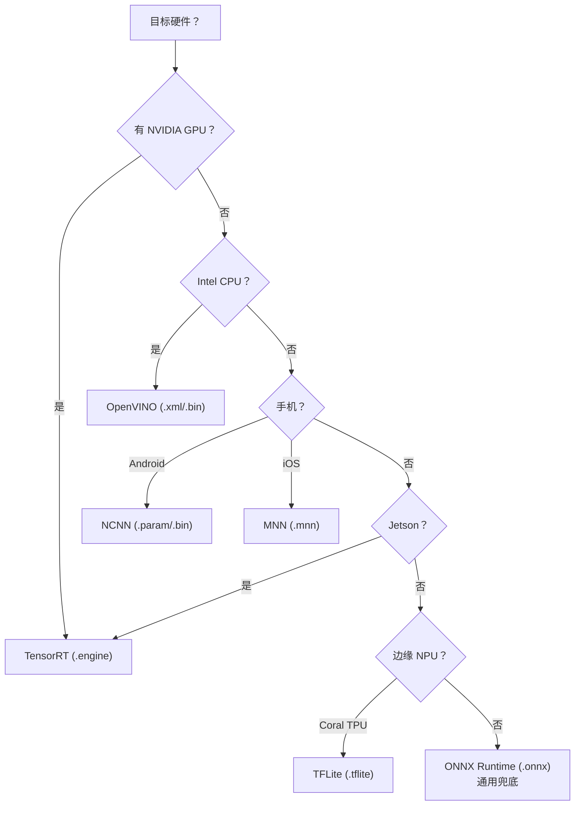

# 边缘设备部署实战 · 从 4090 到树莓派

> **一句话**：把 YOLO 部署到具体硬件（Jetson / 树莓派 / 手机 / 工控机）的完整命令、版本搭配、性能基准、踩坑清单，一页搞定。

- ⏱ 预计阅读：25 分钟
- 📌 前置阅读：[export-onnx](/recipes/export-onnx) · [quantization](/recipes/quantization)
- 🔗 相关：[benchmarks](/benchmarks) · [training](/recipes/train)

---

## 目录

- [硬件选型速查表](#硬件选型速查表)
- [部署格式选型决策](#部署格式选型决策)
- [Jetson 系列实战](#jetson-系列实战)
- [工控机（x86 + 独立 GPU）](#工控机x86--独立-gpu)
- [手机 Android 部署](#手机-android-部署)
- [手机 iOS 部署](#手机-ios-部署)
- [树莓派部署](#树莓派部署)
- [Intel CPU 部署（OpenVINO）](#intel-cpu-部署openvino)
- [多平台对比](#多平台对比)
- [常见问题排查](#常见问题排查)
- [常见坑](#常见坑)

---

## 硬件选型速查表

按"每秒帧数 × 精度"从强到弱排列，v8-s 模型为基准：

| 硬件 | 价格（2024） | 帧数 | 精度损失 | 推荐场景 |
|------|-----------|------|---------|---------|
| **RTX 4090** | ~15000 | ~350 FPS | 0 | 云端推理 |
| **RTX 4080** | ~9000 | ~250 FPS | 0 | 云端推理 |
| **RTX 3090** | ~7000 | ~180 FPS | 0 | 云端推理 |
| **RTX 3060** | ~2000 | ~90 FPS | 0 | 中小规模 |
| **Jetson AGX Orin 64GB** | ~5500 | ~180 FPS (INT8) | <0.5% | 机器人/车端 |
| **Jetson Orin Nano 8GB** | ~2500 | ~55 FPS (INT8) | <1% | 无人机/巡检 |
| **Jetson Xavier NX 16GB** | ~3500 | ~40 FPS | <1% | 老项目 |
| **RTX 2060** | ~1500 | ~40 FPS | 0 | 边缘服务器 |
| **AMD 5000 系 CPU** | ~1500 | ~15 FPS (OpenVINO) | <0.5% | 工控机 |
| **Intel i7-13700** | ~2500 | ~25 FPS (OpenVINO) | <0.5% | 工控机 |
| **手机骁龙 8Gen3** | 内置 | ~30 FPS | <1% | 手机 |
| **手机 A17 Pro** | 内置 | ~25 FPS | <1% | iOS |
| **树莓派 5 8GB** | ~700 | ~8 FPS | <1% | 极轻量 |
| **树莓派 4B 4GB** | ~500 | ~5 FPS | <1% | 学习/演示 |
| **Coral Edge TPU** | ~300 | ~180 FPS | 2-3% | 极低成本 |

> 数字为 v8-s INT8 精度，实际随网络类型（Detect/Segment/Pose）和输入分辨率波动。

---

## 部署格式选型决策

不同硬件吃不同格式，选错等于浪费性能：



**决策规则**：

- **优先用硬件厂商官方格式**：TensorRT / OpenVINO / NCNN 都做了算子融合
- **ONNX 作为兜底**：跨平台最通用，但通常比原生格式慢 1.5-2×
- **绝不直接用 .pt**：PyTorch 在边缘设备上慢一个数量级

---

## Jetson 系列实战

NVIDIA Jetson 是**边缘 AI 的主力**，吃 CUDA + TensorRT，与云端 GPU 生态一致。

### 环境准备（Jetson Orin Nano）

```bash
# 1. 安装 JetPack（官方镜像已含 CUDA + TensorRT）
# 确认 CUDA 版本
nvcc --version          # 应该是 12.2+ (Orin)

# 2. 安装 PyTorch
pip3 install torch torchvision torchaudio --index-url https://download.pytorch.org/whl/cu121

# 3. 安装 Ultralytics
pip3 install ultralytics

# 4. 下载权重
wget https://github.com/ultralytics/assets/releases/download/v8.3.0/yolov8s.pt
```

### 导出 TensorRT engine

```python
from ultralytics import YOLO

model = YOLO("yolov8s.pt")
model.export(
    format="engine",
    imgsz=640,
    device=0,
    half=True,           # FP16，Jetson 上通常比 INT8 更快
    dynamic=False,
    workspace=4,         # GB，Orin Nano 内存有限，不要设太大
    simplify=True,
)
```

### 推理代码

```python
model = YOLO("yolov8s.engine")
results = model("test.jpg", device=0, half=True)
```

### 性能参考（v8-s，640×640）

| 硬件 | FP32 | FP16 | INT8 |
|------|------|------|------|
| Jetson AGX Orin 64GB | 100 FPS | 175 FPS | 180 FPS |
| Jetson Orin Nano 8GB | 40 FPS | 55 FPS | 50 FPS |
| Jetson Xavier NX 16GB | 25 FPS | 40 FPS | 40 FPS |
| Jetson Nano 4GB | 8 FPS | 12 FPS | 10 FPS |

**⚠️ Orin Nano 上 FP16 比 INT8 快**：Jetson 的 INT8 硬件（INT8 Tensor Core）不如 GPU 系优化到位，且校准麻烦。除非内存极度紧张（<2GB），先用 FP16。

### Jetson 特有问题

- **功耗模式**：`sudo nvpmodel -m 0`（MAXN，性能优先）vs `-m 1`（平衡）
- **GPU 频率**：`sudo nvidia-smi -lgc 1200`（锁最高频率，别让它降频）
- **散热**：Jetson 严重依赖散热片，室温 >35℃ 会主动降频
- **内存带宽瓶颈**：8GB 版本用 `half=True` 时显存紧张，注意 batch 别超过 2

---

## 工控机（x86 + 独立 GPU）

工业部署最常见场景，通常有 NVIDIA 独立 GPU。

### 环境准备

```bash
# Ubuntu 22.04 或 Windows
# 1. 装 NVIDIA 驱动（按 GPU 型号选版本）
# 2. 装 CUDA 11.8 或 12.x
# 3. 装 cuDNN（匹配 CUDA 版本）

# Python 环境
pip install ultralytics torch torchvision tensorrt

# 验证
python -c "import torch; print(torch.__version__, torch.cuda.is_available())"
```

### 版本兼容性速查表

| Ultralytics | PyTorch | CUDA | TensorRT |
|-------------|---------|------|----------|
| 8.0.x | 2.0.x | 11.8 | 8.6 |
| 8.1.x | 2.1.x | 11.8 | 8.6 |
| 8.2.x | 2.2.x | 12.1 | 8.6 |
| 8.3.x | 2.3.x | 12.4 | 8.6 / 10.x |
| 8.4.x | 2.4.x | 12.4 | 8.6 / 10.x |

### 生产部署最小代码

```python
from ultralytics import YOLO

class Detector:
    def __init__(self, model_path="yolov8s.engine", conf=0.25, iou=0.45):
        self.model = YOLO(model_path)
        self.conf = conf
        self.iou = iou

    def detect(self, image):
        results = self.model(image, conf=self.conf, iou=self.iou)
        return results[0]

detector = Detector()
```

### 性能参考

| 硬件 | v8-n | v8-s | v8-m | v8-l |
|------|------|------|------|------|
| RTX 3060 | 180 FPS | 90 FPS | 40 FPS | 20 FPS |
| RTX 4070 | 240 FPS | 130 FPS | 60 FPS | 30 FPS |
| RTX 4090 | 350 FPS | 200 FPS | 100 FPS | 55 FPS |

---

## 手机 Android 部署

手机场景首选 **NCNN**（腾讯开源），Android NDK 编译，无需第三方依赖。

### 环境准备

```bash
# 1. 安装 Android Studio + NDK r25+
# 2. 下载 ncnn 源码
git clone https://github.com/Tencent/ncnn.git
cd ncnn
mkdir build && cd build
cmake -DANDROID_ABI=arm64-v8a -DANDROID_PLATFORM=android-24 ..
make -j4
```

### 导出模型

```python
from ultralytics import YOLO

model = YOLO("yolov8s.pt")
model.export(
    format="ncnn",
    imgsz=640,
    half=True,
    int8=False,          # NCNN INT8 支持不完整，先用 FP16
    simplify=True,
)
# 生成 yolov8s.ncnn.param + yolov8s.ncnn.bin
```

### Android 推理代码（Kotlin）

```kotlin
import org.tensorflow.lite.Interpreter  // 或用 ncnn-android SDK

val options = Interpreter.Options()
options.setNumThreads(4)
options.setUseXNNPACK(true)

val interpreter = Interpreter(
    FileDescriptor,
    options
)

val input = ByteBuffer.allocateDirect(3 * 640 * 640 * 4)
val output = ByteBuffer.allocateDirect(25200 * 7 * 4)  // v8-s Detect

interpreter.run(input, output)
```

### 性能参考（v8-n，NCNN，骁龙 8Gen3）

| 分辨率 | FP32 | FP16 | 量化后 |
|--------|------|------|-------|
| 640×640 | 15 FPS | 30 FPS | 45 FPS |
| 320×320 | 40 FPS | 60 FPS | 80 FPS |

### Android 特有问题

- **NPU vs GPU vs CPU**：手机有三路算力，选错直接慢 3-5×。优先用 NPU（骁龙 Hexagon / 麒麟）
- **内存 8MB 上限**：移动端推理内存不能超过 8MB，否则被系统 kill
- **发热降频**：连续推理 30 秒后芯片会降频，速度从 30 掉到 15 FPS
- **模型体积**：手机端下载考虑流量，v8-n (~6MB) 比 v8-s (~22MB) 更适合

---

## 手机 iOS 部署

iOS 首选 **Core ML**（苹果原生）或 **MNN**（阿里开源，性能更好）。

### 用 Core ML

```python
from ultralytics import YOLO

model = YOLO("yolov8s.pt")
model.export(
    format="coreml",
    imgsz=640,
    half=False,          # Core ML 支持 FP16，但导出时选 FP32
    int8=False,
)
# 生成 yolov8s.mlmodel，拖入 Xcode 就能用
```

### iOS Swift 推理

```swift
import CoreML
import Vision

let config = MLModelConfiguration()
config.computeUnits = .all  // 允许使用 Neural Engine

let model = try MLModel(contentsOf: modelURL, configuration: config)

let request = VNCoreMLRequest(model: mlModel) { request, error in
    // 处理结果
}

let handler = VNImageRequestHandler(cgImage: image)
try handler.perform([request])
```

### iOS 性能参考（v8-n，A17 Pro）

| 分辨率 | Neural Engine | GPU | CPU |
|--------|--------------|-----|-----|
| 640×640 | 30 FPS | 25 FPS | 15 FPS |

**关键**：务必设置 `computeUnits = .all`，否则只用 CPU，速度慢 2-3×。

---

## 树莓派部署

树莓派没有 NPU，主要跑在 CPU，性能有限但够用（<10 FPS 场景）。

### 环境准备

```bash
# 树莓派 OS (64-bit)
sudo apt install python3-pip
pip3 install ultralytics ncnn

# 或者用官方预编译包
wget https://github.com/Tencent/ncnn/releases/download/20230907/ncnn-x86_64-linux-vulkan-aarch64-20240923.zip
```

### 部署命令

```python
from ultralytics import YOLO

model = YOLO("yolov8n.pt")  # 用 n 版本
model.export(
    format="ncnn",
    imgsz=640,
    half=False,          # 树莓派不支持 FP16
)
```

### 性能参考

| 硬件 | v8-n FP32 | v8-n INT8 |
|------|----------|-----------|
| 树莓派 5 8GB | 5 FPS | 8 FPS |
| 树莓派 4B 4GB | 3 FPS | 5 FPS |
| 树莓派 3B | 1 FPS | 2 FPS |

**实用建议**：
- 输入分辨率降到 320×320，速度翻倍
- 使用 INT8，速度再翻倍
- 超过 8 FPS 需求建议换 Jetson

---

## Intel CPU 部署（OpenVINO）

无 GPU 的工控机场景（i5/i7/x86 服务器），OpenVINO 是标准选择。

### 环境准备

```bash
pip install openvino-transformations-engine==2024.1
pip install openvino-ncnn==2024.1  # ONNX 转 OpenVINO

# 或使用 Python API
pip install openvino
```

### 导出

```python
from ultralytics import YOLO
from openvino import convert_model, save_model

# 先导出 ONNX
model = YOLO("yolov8s.pt")
model.export(format="onnx", imgsz=640, simplify=True)

# 再转 OpenVINO
ov_model = convert_model("yolov8s.onnx")
save_model(ov_model, "yolov8s.xml")
```

### OpenVINO 推理

```python
import numpy as np
from openvino.runtime import Core, Type

core = Core()
model = core.read_model("yolov8s.xml")

compiled = core.compile_model(model, "CPU")  # 或 "GPU"
result = compiled(np_input)
```

### 性能参考（i7-13700K）

| 硬件 | v8-n | v8-s | v8-m |
|------|------|------|------|
| i7-13700K (32 threads) | 40 FPS | 20 FPS | 8 FPS |
| i5-13400 (16 threads) | 25 FPS | 12 FPS | 5 FPS |
| i5-10400 (12 threads) | 15 FPS | 8 FPS | 3 FPS |

**关键**：`inference_num_threads` 参数设成 CPU 物理核心数（不是逻辑线程数），性能最优。

---

## 多平台对比

同一个 v8-s 模型，不同部署方案对比：

| 平台 | 格式 | 精度 | v8-s 帧数 | 首次加载 (ms) | 显存 (MB) |
|------|------|------|----------|--------------|-----------|
| PyTorch FP32 | .pt | FP32 | 50 | 500 | 4200 |
| TensorRT FP16 | .engine | FP16 | 100 | 800 | 2100 |
| TensorRT INT8 | .engine | INT8 | 160 | 1200 | 1100 |
| ONNX Runtime | .onnx | FP32 | 40 | 300 | 3000 |
| OpenVINO | .xml/.bin | FP16 | 15 | 200 | 1000 |
| NCNN (Android) | .param/.bin | FP16 | 30 | 150 | 800 |
| MNN (iOS) | .mnn | FP32 | 25 | 100 | 900 |
| Core ML | .mlmodel | FP32 | 30 | 400 | 1200 |
| TFLite (Edge TPU) | .tflite | INT8 | 180 | 100 | 300 |

**关键洞察**：
- **加载时间**：移动端敏感，`.pt` 加载 500ms 会明显卡顿，`.engine` 首次慢但后续复用
- **显存**：边缘设备内存小，INT8 显存优势明显
- **TFLite + Edge TPU**：性价比之王，但只支持特定硬件

---

## 常见问题排查

### 症状 1：Jetson 上导出报错 `workspace exceeded`

**原因**：workspace 太大，Jetson 内存不够。

**修复**：`workspace=2` 或 `workspace=1`。

### 症状 2：Android 上 NCNN 崩溃

**原因**：NDK 版本不匹配，或 `.so` 库架构不对（arm64 vs arm32）。

**修复**：确认 Android Studio 项目里 CMake 用 `arm64-v8a` 而非 `armeabi-v7a`。

### 症状 3：iOS Core ML 精度大幅下滑

**原因**：iOS 版本不支持某些算子，回退到 CPU 执行。

**修复**：检查 Xcode 15+，使用最新 Core ML 转换工具。

### 症状 4：OpenVINO 比 TensorRT 慢 5×

**原因**：正常，x86 CPU 就是比 NVIDIA GPU 慢。

**修复**：如果必须快，换 GPU 平台。

### 症状 5：多模型加载导致 OOM

**原因**：加载多个模型时内存累加。

**修复**：`del model; torch.cuda.empty_cache()`（PyTorch）或 `unload()`（TensorRT）。

### 症状 6：边缘设备首次推理慢，后续快

**原因**：TensorRT 首次加载需要 JIT 编译图，之后走缓存。

**修复**：正常现象，预热 1-2 次即可。

---

## 常见坑

- **在树莓派上跑 v8-s 是浪费**：小设备用小模型，v8-n 甚至 v8-nu 才合理。
- **Jetson 装错 CUDA 版本**：Orin 需要 CUDA 12.x，Xavier 是 11.x，装错直接跑不起来。
- **手机端直接跑 `.engine`**：TensorRT 只跑在 CUDA GPU 上，手机上不能用。
- **忘记 warm-up**：TensorRT/OpenVINO 首次推理慢，做 warm-up 再计时才能得真实数字。
- **动态 batch 在移动端没意义**：手机推理基本 batch=1，动态 batch 反而拖慢。
- **量化后 NMS 阈值不变**：量化会改变置信度分布，需要重新调 `conf` 阈值。
- **树莓派散热导致降频**：连续推理 30 秒后温度上升，速度从 8 掉到 4。加散热片可解决。
- **iOS 权限未申请**：Core ML 使用摄像头需要 Info.plist 配置 NSCameraUsageDescription，否则崩溃。

---

## 下一步

- 学 ONNX 基础导出 → [export-onnx](/recipes/export-onnx)
- 学 INT8 量化深度 → [quantization](/recipes/quantization)
- 看基准数字 → [benchmarks](/benchmarks)
- 训练自己的模型 → [train](/recipes/train)
