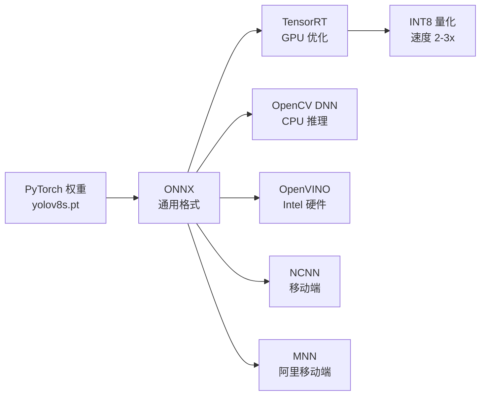

# ONNX / TensorRT 部署指南 · 从 PyTorch 到边缘设备

> **一句话**：这一页把"我训练好的 YOLOv8 模型，怎么部署到 Jetson / RTX / RK3588 / 树莓派"这个最常见的需求拆成 6 步——环境准备 → 导出 ONNX → 优化 TensorRT → INT8 量化 → 边缘部署 → 性能调优。

## 目录

- [部署全景](#部署全景)
- [第 1 步：环境准备](#第-1-步环境准备)
- [第 2 步：导出 ONNX](#第-2-步导出-onnx)
- [第 3 步：优化 TensorRT](#第-3-步优化-tensorrt)
- [第 4 步：INT8 量化](#第-4-步int8-量化)
- [第 5 步：边缘部署](#第-5-步边缘部署)
- [第 6 步：性能调优](#第-6-步性能调优)
- [硬件选型速查](#硬件选型速查)
- [常见坑](#常见坑)

---

## 部署全景



**6 种主流部署格式**：

| 格式 | 目标硬件 | 速度 | 部署难度 | 推荐场景 |
| --- | --- | --- | --- | --- |
| **ONNX** | 通用 | 中 | 简单 | 部署起点 |
| **TensorRT** | NVIDIA GPU | 最快 | 中等 | NVIDIA 首选 |
| **OpenCV DNN** | CPU | 慢 | 简单 | 无 GPU 环境 |
| **OpenVINO** | Intel CPU/GPU | 快 | 中等 | Intel 硬件 |
| **NCNN** | 移动端 | 快 | 中等 | 手机端 |
| **MNN** | 移动端 | 中 | 中等 | 阿里移动端 |

---

## 第 1 步：环境准备

### NVIDIA GPU 环境（推荐）

```bash
# 安装 CUDA 11.8 或 12.x
# 安装 cuDNN 8.6 或 9.x

# 安装 ultralytics
pip install ultralytics

# 安装 TensorRT（NVIDIA GPU）
pip install tensorrt==8.6.1
# 或从 NVIDIA 官方下载

# 安装 ONNX Runtime
pip install onnxruntime-gpu
```

### Intel CPU 环境

```bash
pip install ultralytics
pip install openvino
```

### 边缘设备环境

```bash
# Jetson Orin
sudo apt-get install python3-pip
pip3 install ultralytics

# RK3588
# 使用 RKNN-Toolkit2 编译
git clone https://github.com/airockchip/rknn-toolkit2
```

### 版本兼容性

| Ultralytics | TensorRT | CUDA | PyTorch |
| --- | --- | --- | --- |
| 8.0-8.1 | 8.5 | 11.8 | 2.0 |
| 8.1-8.3 | 8.6 | 12.0 | 2.1 |
| 8.3+ | 8.6 | 12.1 | 2.2 |
| 8.4+ | 8.6-10.0 | 12.2 | 2.3+ |

**注意**：Ultralytics 和 TensorRT 版本不匹配会导致导出失败。

---

## 第 2 步：导出 ONNX

### 基础导出

```bash
# CLI
yolo export model=yolov8s.pt format=onnx

# 或 Python
from ultralytics import YOLO
model = YOLO('yolov8s.pt')
model.export(format='onnx')
```

### 关键参数

| 参数 | 默认 | 说明 |
| --- | --- | --- |
| **half** | False | 半精度（FP16），速度翻倍 |
| **dynamic** | False | 动态形状，每次推理重编译 |
| **optimize** | False | 优化 ONNX 图 |
| **imgsz** | 640 | 输入尺寸 |
| **int8** | False | INT8 量化 |
| **batch** | 1 | 批处理大小 |

### 推荐配置

```bash
# 通用配置（推荐）
yolo export model=yolov8s.pt format=onnx half=True dynamic=False optimize=True
```

```bash
# 高精度配置
yolo export model=yolov8s.pt format=onnx half=True dynamic=False imgsz=640
```

```bash
# 边缘设备配置
yolo export model=yolov8n.pt format=onnx half=True dynamic=False imgsz=320
```

### ONNX 优化

```python
# 使用 onnx-simplifier 优化
pip install onnx-simplifier
onnxsim yolov8s.onnx yolov8s_sim.onnx

# 或 Python
import onnx
from onnxsim import simplify
model = onnx.load('yolov8s.onnx')
model_sim, ok = simplify(model)
print(f"Simplified: {ok}")
onnx.save(model_sim, 'yolov8s_sim.onnx')
```

### 验证 ONNX

```python
import onnxruntime as ort
session = ort.InferenceSession('yolov8s.onnx')
inputs = session.get_inputs()
outputs = session.get_outputs()
print(f"Inputs: {inputs[0].name} shape={inputs[0].shape}")
print(f"Outputs: {outputs[0].name} shape={outputs[0].shape}")
```

---

## 第 3 步：优化 TensorRT

### 从 PyTorch 直接导出

```bash
# 最简命令
yolo export model=yolov8s.pt format=engine half=True device=0
```

### 推荐配置

```bash
# 高精度 + 高速度
yolo export model=yolov8s.pt format=engine half=True dynamic=False device=0
```

```bash
# INT8 量化（需校准数据集）
yolo export model=yolov8s.pt format=engine int8=True data=coco.yaml device=0
```

```bash
# 大 batch
yolo export model=yolov8s.pt format=engine half=True batch=8 device=0
```

### TensorRT 关键参数

| 参数 | 说明 | 建议值 |
| --- | --- | --- |
| **half** | FP16 精度 | True（速度 2x） |
| **int8** | INT8 量化 | True（速度 3-4x，需校准） |
| **dynamic** | 动态形状 | False（推荐固定形状） |
| **workspace** | 工作空间 GB | 1（默认） |
| **batch** | 批处理大小 | 1（推理默认） |

### 部署 TensorRT Engine

```python
# Python
from ultralytics import YOLO
model = YOLO('yolov8s.engine')
results = model('image.jpg')
print(results[0].boxes)
```

```python
# C++（TensorRT Runtime）
// 需要用 ultralytics 官方 C++ 推理库
#include "ultralytics/csrc/runtime/tensorrt_engine.h"

Ultralytics::TensorRT engine("yolov8s.engine");
engine.setStream(stream);
engine.bindInputs(inputs);
engine.infer();
```

### 速度对比

| 格式 | v8s @ 640 FP32 | v8s @ 640 FP16 | v8s @ 640 INT8 |
| --- | --- | --- | --- |
| PyTorch | 8ms | 5ms | - |
| ONNX Runtime | 6ms | 4ms | - |
| TensorRT | 4ms | 2.5ms | 1.8ms |
| TensorRT + INT8 QAT | - | - | 1.5ms |

---

## 第 4 步：INT8 量化

### PTQ（Post-Training Quantization）

**优点**：无需重新训练，几分钟完成
**缺点**：精度损失 0.5-1 AP

```bash
yolo export model=yolov8s.pt format=engine int8=True data=coco.yaml device=0
```

**校准数据集要求**：
- 500-1000 张有代表性的样本
- 分布与测试集一致
- 避免过拟合到单一场景

### QAT（Quantization-Aware Training）

**优点**：精度损失更小（0.3-0.8 AP）
**缺点**：需要训练一轮

```yaml
# QAT 训练配置
int8: True
batch: 16
epochs: 20              # 只需 20 epoch
data: custom.yaml
```

```bash
yolo detect train model=yolov8s.pt data=custom.yaml int8=True epochs=20
```

### DFL 层特殊处理

**DFL 层必须保持 FP32**——INT8 量化会让 DFL 分布尾部截断，细长框抖动严重。

**自动处理**：Ultralytics 内建 DFL 层保持 FP32 逻辑，无需手动干预。

**手动处理**（如果使用第三方工具）：
```python
# 用 LayerNorm 或 Identity 替换 DFL 量化层
model.dfl = nn.Identity()  # 保留 FP32
```

### 量化精度对比

| 模型 | FP32 | FP16 | INT8 PTQ | INT8 QAT |
| --- | --- | --- | --- | --- |
| v8s | 44.9 AP | 44.6 AP | 44.2 AP | 44.4 AP |
| v11s | 46.7 AP | 46.5 AP | 45.6 AP | 45.9 AP |
| v13s | 48.2 AP | 48.0 AP | 46.4 AP | 46.9 AP |

---

## 第 5 步：边缘部署

### Jetson Orin（NVIDIA）

```bash
# 1. 编译 TensorRT engine
yolo export model=yolov8s.pt format=engine half=True device=0

# 2. 部署
python deploy_jetson.py

# 或使用 Jetson Zoo 官方模型
sudo apt install nvidia-jetpack
```

**推荐配置**：
- **Orin Nano 8GB**：v8s INT8 @ 640，约 25ms
- **Orin AGX 64GB**：v8m INT8 @ 640，约 15ms
- **Orin AGX 100GB**：v8l INT8 @ 1280，约 30ms

### RK3588（Rockchip）

```bash
# 使用 RKNN-Toolkit2
git clone https://github.com/airockchip/rknn-toolkit2
cd rknn-toolkit2
pip install -r requirements.txt

# 导出 RKNN
python deploy_rknn.py
```

**推荐配置**：
- **RK3588**：v8s INT8 @ 640，约 25ms
- **RK3566**：v8n INT8 @ 320，约 15ms
- **RK3568**：v8n INT8 @ 320，约 20ms

### 树莓派（Raspberry Pi）

```bash
# 使用 OpenCV DNN 或 NCNN
pip install opencv-python
```

**推荐配置**：
- **树莓派 4B**：v8n INT8 @ 320，约 100ms（10 FPS）
- **树莓派 5**：v8n INT8 @ 320，约 60ms（16 FPS）
- **树莓派 Zero 2W**：不建议部署 YOLO

### Coral Edge TPU

```bash
# 使用 Edge TPU Compiler
edge-tpu-compiler -i yolov8n.onnx -o yolov8n_edgetpu.tflite
```

**限制**：Edge TPU 对 YOLO 支持不完整，精度损失较大。

### Android / iOS 移动端

```bash
# 使用 NCNN 或 MNN
yolo export model=yolov8n.pt format=ncnn half=True imgsz=320
yolo export model=yolov8n.pt format=mnn half=True imgsz=320
```

**推荐配置**：
- **Android 高端机（骁龙 8 Gen 2）**：v8n INT8 @ 320，约 30ms
- **Android 中端机（骁龙 7 Gen 1）**：v8n INT8 @ 320，约 50ms
- **iOS A15+**：v8n INT8 @ 320，约 40ms

---

## 第 6 步：性能调优

### 显存优化

**问题**：显存不够用

**方案**：
1. 减小 batch（16 → 8）
2. 减小 imgsz（640 → 480）
3. 使用梯度累积（等效 batch = 累积步数 × 实际 batch）
4. 使用混合精度训练（AMP）

### 推理速度优化

**问题**：推理太慢

**方案**：
1. 使用 FP16 而非 FP32（速度 2x）
2. 使用 INT8 而非 FP16（速度 1.5x）
3. 使用 TensorRT 而非 ONNX（速度 1.5x）
4. 使用更小的模型（v8m → v8s → v8n）
5. 减小输入分辨率

### 批处理优化

**问题**：多张图同时推理

**方案**：
```bash
# 导出时指定 batch
yolo export model=yolov8s.pt format=engine half=True batch=8

# 推理时动态 batch
model = YOLO('yolov8s.engine', batch=True)
```

### 延迟优化

**问题**：实时应用延迟高

**方案**：
1. TensorRT Engine 优化
2. 关闭日志输出
3. 使用 CUDA Graph
4. 减少内存拷贝

---

## 硬件选型速查

| 硬件 | 最低可用模型 | 推荐输入 | 目标 FPS | 显存 |
| --- | --- | --- | --- | --- |
| 树莓派 4B | v8n INT8 | 320 | 5-8 | - |
| 树莓派 5 | v8n INT8 | 320 | 15-20 | - |
| RK3568 | v8n INT8 | 320 | 10-15 | - |
| RK3588 | v8s INT8 | 640 | 25-30 | - |
| Coral Dev Board | v8n INT8 | 320 | 15-20 | - |
| Jetson Nano | v8n INT8 | 320 | 5-10 | 4GB |
| Jetson Xavier NX | v8s INT8 | 640 | 20-30 | 8GB |
| Jetson Orin Nano 8GB | v8s INT8 | 640 | 30-40 | 8GB |
| Jetson Orin NX 16GB | v8m INT8 | 640 | 40-60 | 16GB |
| Jetson Orin AGX 64GB | v8m INT8 | 1280 | 40-60 | 64GB |
| RTX 3060 12GB | v8m INT8 | 1280 | 50-80 | 12GB |
| RTX 3090 24GB | v8l INT8 | 1280 | 80-100 | 24GB |
| RTX 4090 24GB | v8x FP16 | 1920 | 100+ | 24GB |
| A100 80GB | v8x FP16 | 1920 | 200+ | 80GB |

---

## 常见坑

### ❌ "ONNX 和 TensorRT 精度一样"

**其实不一样**：
- ONNX FP32 和 PyTorch FP32 通常一致
- TensorRT FP16 有 0.5 AP 左右损失
- TensorRT INT8 有 1-2 AP 损失

**修复**：关键场景用 FP16，不要 INT8。

### ❌ "TensorRT 导出的模型比 PyTorch 慢"

**通常是 half=False 或 dynamic=True 的问题**：

**修复**：
```bash
yolo export model=yolov8s.pt format=engine half=True dynamic=False device=0
```

### ❌ "INT8 量化后 DFL 抖动严重"

**DFL 层必须保持 FP32**。

**修复**：
- Ultralytics 内建 DFL FP32 保护，直接使用
- 或手动用 LayerNorm 替换 DFL 量化层

### ❌ "Jetson 上推理比桌面慢 10 倍"

**正常**——Jetson Orin Nano 算力只有 RTX 4090 的 1/16，带宽 1/10。

**修复**：
- 使用 INT8 量化
- 使用更小模型（v8n）
- 减小输入分辨率

### ❌ "RK3588 上无法用 TensorRT"

**正确**——RK3588 是 ARM 架构，TensorRT 不支持。

**修复**：使用 RKNN-Toolkit2 导出 RKNN 格式。

### ❌ "手机端部署 YOLO 卡成 PPT"

**可能是这几个原因**：
1. 模型太大（应该用 v8n）
2. 输入分辨率太大（应该用 320）
3. 没有 INT8 量化
4. 没有使用 NCNN 或 MNN 优化

**修复**：
```bash
yolo export model=yolov8n.pt format=ncnn half=True imgsz=320
```

### ❌ "边缘设备上内存不足"

**修复**：
- 使用更小的模型（v8n）
- 减小 batch（batch=1）
- 减小输入分辨率（imgsz=320）
- 使用 INT8（显存 1/2）

---

## 更多资源

- [训练调优指南](/recipes/train) — 训练完的起点
- [故障排查 · 量化 & 精度](/troubleshooting#b-量化--精度) — INT8 抖动等
- [故障排查 · 导出 & 部署](/troubleshooting#c-导出--部署) — 导出报错
- [案例 · 边缘部署](/cases/edge-deployment) — 生产案例
- [Ultralytics 官方文档](https://docs.ultralytics.com/modes/export/) — 官方导出文档
