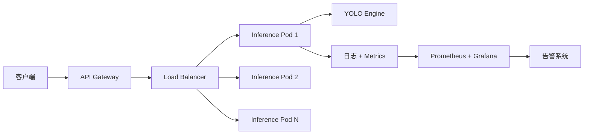

# 生产化部署 · 从 POC 到线上稳定

> **一句话**：YOLO 从"能跑通"到"线上稳跑 90 天不崩"，需要监控、回归测试、A/B 灰度、版本管理、告警兜底这一整套流程。这一页是工程视角的完整落地清单。

- ⏱ 预计阅读：25 分钟
- 📌 前置阅读：[export-onnx.md](/recipes/export-onnx) · [quantization.md](/recipes/quantization) · [edge-deploy.md](/recipes/edge-deploy)
- 🔗 相关：[training.md](/recipes/train) · [benchmarks](/benchmarks)

---

## 目录

- [从 POC 到生产：四道坎](#从-poc-到生产四道坎)
- [模型版本管理](#模型版本管理)
- [推理服务架构](#推理服务架构)
- [在线监控（Metrics）](#在线监控metrics)
- [回归测试体系](#回归测试体系)
- [A/B 灰度发布](#ab-灰度发布)
- [告警与兜底](#告警与兜底)
- [漂移检测（Data Drift）](#漂移检测data-drift)
- [生产化清单](#生产化清单)
- [常见坑](#常见坑)

---

## 从 POC 到生产：四道坎

### 坎 1：POC 阶段
- 目标：证明"能做"
- 指标：单次准确率、单张图片效果
- 常见做法：本地脚本，`yolo detect.jpg` 直接看结果

### 坎 2：MVP 阶段
- 目标：跑通端到端流程
- 指标：吞吐、延迟
- 常见做法：Flask/FastAPI 服务 + Docker

### 坎 3：上线阶段
- 目标：服务真实用户
- 指标：SLA（延迟 P99、可用性）
- 常见做法：gRPC 服务 + 消息队列 + K8s

### 坎 4：稳定阶段
- 目标：不崩、不漂移、可迭代
- 指标：模型质量漂移、业务指标变化
- 常见做法：监控 + 回归测试 + 自动回滚

---

## 模型版本管理

### 命名规范

```
yolov8s_{data_version}_{train_version}_{timestamp}
例：yolov8s_v2.3_2024-06_train20240715_20240720_1430
```

### 版本信息表

每次训练记录一条：

| 字段 | 说明 |
|------|------|
| model_id | 唯一 ID（UUID） |
| base_model | 起点权重（v8-s.pt） |
| data_version | 训练数据版本号 |
| hyperparams | 训练超参 JSON |
| train_time | 训练起止时间 |
| val_metrics | 验证集 mAP / FPS |
| test_metrics | 测试集 mAP / FPS |
| deploy_time | 上线时间 |
| status | dev / staging / prod / retired |

### 用 DVC / LakeFS 管数据版本

数据版本管理比模型版本更关键（因为数据变化不可逆）：

```bash
pip install dvc

dvc init
dvc add datasets/mydata
dvc commit -m "v1.0: initial data"
```

### 用 MLflow 管模型版本

```python
import mlflow

with mlflow.start_run(run_name="yolov8s-v1"):
    model = YOLO("yolov8s.pt")
    results = model.train(data="mydata.yaml", epochs=100)

    mlflow.log_artifacts("runs/.../weights/best.pt")
    mlflow.log_metric("mAP", results.metrics.box.map)
    mlflow.log_param("lr0", 0.01)
```

---

## 推理服务架构

### 简易版：同步 API

```python
from fastapi import FastAPI, File, UploadFile
from ultralytics import YOLO

app = FastAPI()
model = YOLO("yolov8s.engine")

@app.post("/predict")
async def predict(file: UploadFile):
    result = model.predict(file.file, conf=0.25, iou=0.45)
    return {
        "boxes": result[0].boxes.xyxy.tolist(),
        "conf": result[0].boxes.conf.tolist(),
        "classes": result[0].boxes.cls.tolist(),
    }
```

### 生产版：异步 + 队列

```
[客户端] → [Kafka/RabbitMQ] → [Worker Pool] → [结果库] → [客户端拉取]
```

**优势**：
- 削峰填谷（1000 QPS 峰值时不崩）
- 支持批处理（batch=8 一次处理 8 张）
- 支持异步回调（客户端不阻塞等待）

### 部署架构



### 关键 SLA 指标

| 指标 | 目标 |
|------|------|
| P50 延迟 | <100ms |
| P99 延迟 | <300ms |
| 可用性 | >99.9% |
| 错误率 | <0.1% |
| QPS 上限 | 按容量规划 |

---

## 在线监控（Metrics）

### 系统指标

| 指标 | 采集方式 | 告警阈值 |
|------|---------|---------|
| CPU / GPU 利用率 | nvidia-smi / Prometheus | >85% 告警 |
| 显存占用 | nvidia-smi | >90% 告警 |
| QPS | Prometheus | <目标 50% 告警 |
| P50/P99 延迟 | Prometheus | >目标 2× 告警 |
| 错误率 | 应用日志 | >0.1% 告警 |

### 模型指标（关键）

不能只看"服务活着"，要监控"模型还在正常工作"：

```python
# 每次预测都记录
metrics = {
    "detected_count": len(boxes),           # 检测数
    "max_conf": max(confidences, default=0), # 最高置信度
    "avg_conf": mean(confidences, default=0),
    "latency_ms": time_used * 1000,
    "image_size": (width, height),
    "class_distribution": Counter(classes),
}
push_to_prometheus(metrics)
```

### 关键业务指标

根据业务定制：
- **零售**：日均检测人数 vs 门店 POS 交易数
- **交通**：车流量 vs 路侧摄像头原始计数
- **安防**：告警数量 vs 人工复核确认数

---

## 回归测试体系

模型上线前必须过的四道测试：

### 测试 1：功能测试（冒烟）

```python
# test_smoke.py
def test_predict_single_image():
    result = predict("test.jpg")
    assert len(result["boxes"]) >= 0
    assert result["latency"] < 300
```

### 测试 2：黄金集（Golden Set）

固定 100-500 张"标准答案"图片，每次上线跑一遍：

```python
GOLDEN_IMAGES = ["golden/001.jpg", "golden/002.jpg", ...]

def test_against_golden():
    for img in GOLDEN_IMAGES:
        predicted = predict(img)
        ground_truth = load_golden(img)
        mAP = compute_mAP(predicted, ground_truth)
        assert mAP > 0.7, f"mAP dropped: {mAP}"
```

**关键**：
- 黄金集包含：正常样本、边界样本、极端样本、历史 bug 样本
- 每次上线跑，mAP 下降 >1% 阻止发布
- 定期（每季度）扩充黄金集

### 测试 3：A/B 对比测试

新模型 vs 旧模型同图对比：

```python
def compare_models(new_model, old_model, images):
    new_metrics = run_eval(new_model, images)
    old_metrics = run_eval(old_model, images)
    report = generate_report(new_metrics, old_metrics)
    # mAP 提升 <1% 不发布
```

### 测试 4：压力测试

```python
# 目标 QPS × 2，跑 10 分钟
load_test(
    target_qps=200,
    duration=600,
    image_source="sample_pool",
)
```

看：P99 延迟、错误率、GPU 峰值。

---

## A/B 灰度发布

### 灰度策略

| 阶段 | 流量占比 | 时长 | 观察指标 |
|------|---------|------|---------|
| Canary | 1% | 24h | 服务健康、错误率 |
| Alpha | 10% | 3-7 天 | 业务指标、用户投诉 |
| Beta | 50% | 7-14 天 | 全指标对比 |
| GA | 100% | - | 稳定运行 |

### 灰度基础设施

```python
class ABRouter:
    def __init__(self, new_model, old_model):
        self.new = new_model
        self.old = old_model

    def route(self, request_id):
        hash_val = hash(request_id) % 100
        if hash_val < 10:  # 10% 流量给新模型
            return self.new
        return self.old
```

### 回滚条件

**自动回滚触发**：
- 错误率 > 基线 × 2
- P99 延迟 > 基线 × 3
- 关键业务指标（如检测数）异常波动 >20%

---

## 告警与兜底

### 三级告警

**P0 - 致命（立即介入）**：
- 服务完全不可用
- 显存爆、GPU 挂
- 数据写入错误

**P1 - 严重（1 小时内处理）**：
- 错误率 > 1%
- 延迟 P99 超阈值 5 分钟
- 模型版本切换失败

**P2 - 一般（当天处理）**：
- 单实例异常
- 内存缓慢上涨（可能泄漏）
- 日志噪声增加

### 兜底策略

**兜底 1：降级到旧模型**
```python
try:
    result = new_model.predict(image)
except Exception as e:
    log_error(e)
    result = old_model.predict(image)  # 兜底
```

**兜底 2：返回缓存**
- 高频请求缓存最近 100 次结果
- 服务异常时返回"上次成功结果"

**兜底 3：熔断器**
```python
from pybreaker import CircuitBreaker

@CircuitBreaker(fail_max=5, reset_timeout=30)
def predict(image):
    return model.predict(image)
```

失败 5 次后熔断 30 秒，防止级联故障。

---

## 漂移检测（Data Drift）

**问题**：模型上线 3 个月后效果变差，因为世界变了。

### 常见漂移类型

| 类型 | 说明 | 检测方式 |
|------|------|---------|
| **数据分布漂移** | 输入图片变了（如新增场景） | 统计特征分布 KL 散度 |
| **概念漂移** | 类别定义变了（如新增车型） | 类别分布对比 |
| **季节性漂移** | 昼夜、季节变化 | 按时段分桶评估 |
| **对抗漂移** | 攻击者试图误导模型 | 异常检测 |

### 漂移检测代码

```python
from collections import Counter
import numpy as np
from scipy.spatial.distance import jensenshannon

baseline_stats = np.array([0.4, 0.3, 0.2, 0.1])  # 基线分布

def check_drift(recent_stats, threshold=0.3):
    js = jensenshannon(baseline_stats, recent_stats)
    if js > threshold:
        alert_drift(js)
    return js

# 每小时评估一次
recent_stats = compute_class_distribution_from_recent_images()
check_drift(recent_stats)
```

### 应对策略

- **漂移告警**：不自动重训，先人工评估
- **增量训练**：新增数据加进来重训，替换旧模型
- **版本回滚**：新模型效果差时切回旧版

---

## 生产化清单

上线前逐项检查：

### 代码层
- [ ] 模型文件路径绝对化（不依赖 cwd）
- [ ] 配置外部化（YAML / 环境变量）
- [ ] 日志结构化（JSON）
- [ ] 异常捕获并告警
- [ ] 超时机制（防止某张图卡死）

### 部署层
- [ ] Docker 镜像构建（`python:3.11-slim` + CUDA）
- [ ] Kubernetes 部署（Replicas ≥2）
- [ ] HPA 自动扩缩容
- [ ] PDB 防止滚动更新时全部下线
- [ ] 优雅关闭（处理完当前请求再退出）

### 监控层
- [ ] Metrics 接入 Prometheus
- [ ] Dashboard 建好（Grafana）
- [ ] 告警规则配置
- [ ] 日志聚合（ELK / Loki）

### 数据层
- [ ] 数据版本管理（DVC）
- [ ] 黄金集准备
- [ ] 模型版本追踪（MLflow）
- [ ] 备份策略（数据 + 权重）

### 发布层
- [ ] CI/CD 流水线
- [ ] 灰度发布方案
- [ ] 回滚脚本
- [ ] 值班表

---

## 常见坑

- **忘记 warm-up**：服务启动后前 100 次请求慢，因为 CUDA / TensorRT 冷启动。用户拿到慢响应误以为服务崩了。启动时先跑 100 张空图预热。
- **只监控 CPU/GPU，不监控模型质量**：服务活着但模型漂移了，业务方完全不知道。加漂移检测。
- **没有回滚脚本**：新模型上线出问题，回滚要 30 分钟。回滚应该 <1 分钟。
- **模型更新和代码更新耦合**：改模型代码就要重发镜像。模型和推理代码分离部署。
- **忽视显存泄漏**：`del result` 忘记，显存缓慢上涨，最后 OOM。加 GC 检查。
- **压测不真实**：用 640×640 压测，生产是 1920×1080，性能差 5×。用真实分辨率压测。
- **黄金集不更新**：一年没加新样本，模型迭代覆盖了新场景但黄金集还是老的，评估失真。季度更新。
- **告警疲劳**：阈值太敏感，一天 50 条告警没人看。分 P0/P1/P2 三级，P0 才打电话。
- **忽略推理时的 batch 效果**：训练 batch=32，推理时 1 张一批。可以攒 batch（如 100ms 内到的请求合并），吞吐翻倍。
- **生产环境用 `best.pt`**：训练完 `best.pt` 是 EMA 权重，`last.pt` 是末期权重。生产用 `best.pt`，评估用 `last.pt`。混用会困惑。

---

## 下一步

- 学基础部署 → [export-onnx.md](/recipes/export-onnx)
- 学边缘部署 → [edge-deploy.md](/recipes/edge-deploy)
- 学量化 → [quantization.md](/recipes/quantization)
- 学训练 → [train.md](/recipes/train)
