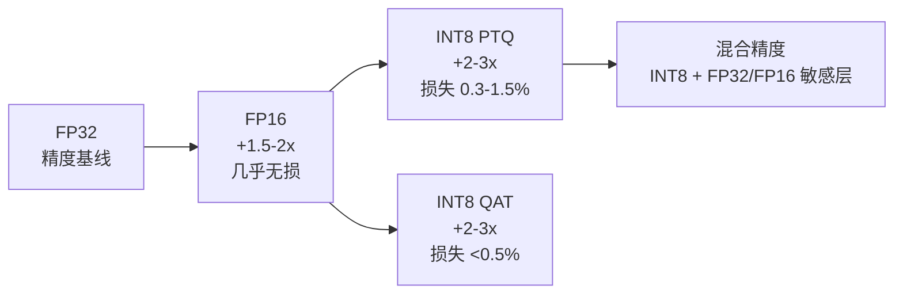
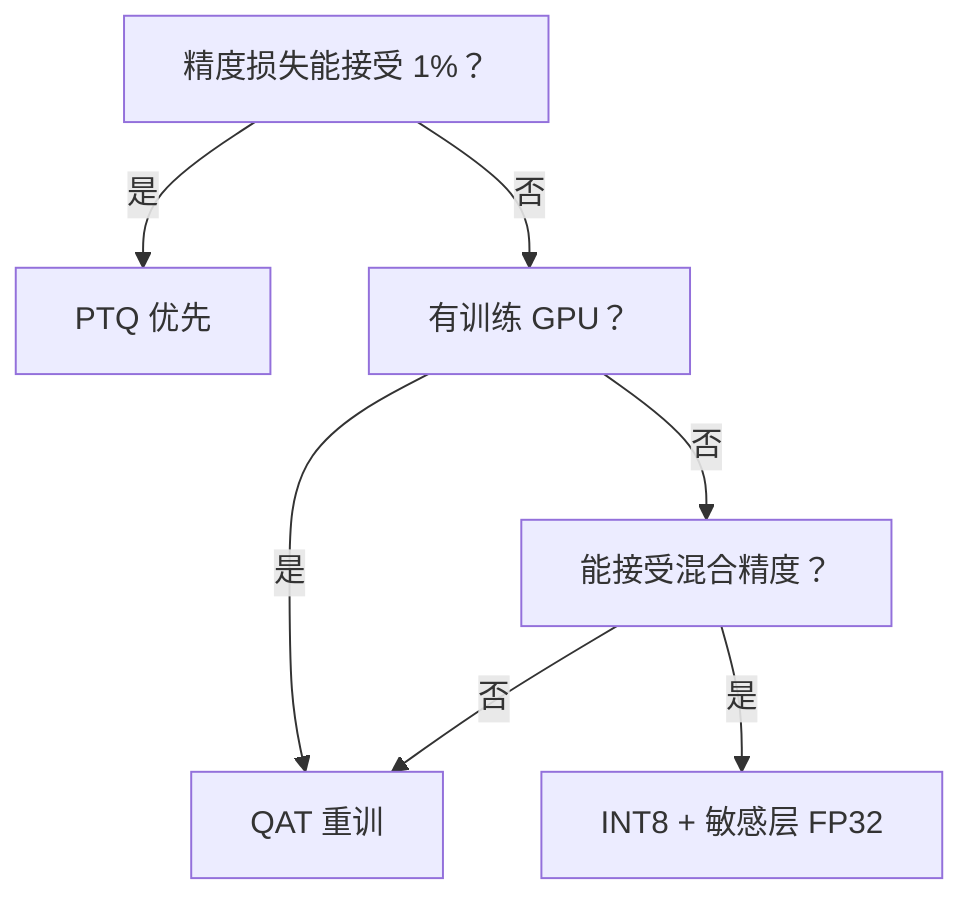

# 量化深度指南 · 从 FP32 到 INT8 的完整流程

> **一句话**：把 YOLO 从 FP32 训好的模型，无损（或几乎无损）压到 INT8，让模型变小 4×、推理快 2-3×，同时把精度损失控制在 0.5% 以内。

- ⏱ 预计阅读：20 分钟
- 📌 前置阅读：[export-onnx](/recipes/export-onnx)（先导出 ONNX 再来这里）
- 🔗 相关：[部署指南](/recipes/export-onnx) · [benchmark](/benchmarks) · [glossary](/glossary)

---

## 目录

- [量化的价值：为什么值得做](#量化的价值为什么值得做)
- [量化三层次：FP32 → FP16 → INT8](#量化三层次fp32--fp16--int8)
- [PTQ vs QAT：怎么选](#ptq-vs-qat怎么选)
- [敏感层识别：哪些层不能量化](#敏感层识别哪些层不能量化)
- [DFL 层的特殊处理](#dfl-层的特殊处理)
- [混合精度策略：最优组合](#混合精度策略最优组合)
- [校准集怎么挑](#校准集怎么挑)
- [PTQ 完整代码流程](#ptq-完整代码流程)
- [精度掉太多怎么办（排错 5 步）](#精度掉太多怎么办排错-5-步)
- [QAT 简版流程](#qat-简版流程)
- [实测数字参考](#实测数字参考)
- [常见坑](#常见坑)

---

## 量化的价值：为什么值得做

推理加速的核心手段分四类：

| 手段 | 加速 | 精度损失 | 复杂度 | 场景 |
|------|------|---------|-------|------|
| **算子融合**（TensorRT 自动） | 1.3-2× | 无 | 零 | 所有场景 |
| **FP16** | 1.5-2× | <0.2% | 低 | 首选，GPU/CUDA |
| **INT8 PTQ** | 2-3× | 0.3-1.5% | 中 | 主流选择 |
| **INT8 QAT** | 2-3× | <0.5% | 高 | 精度敏感场景 |

**结论**：99% 场景用 **FP16 + 部分 FP32** 就够了，除非边缘设备内存紧张或追求极致速度才走 INT8。

---

## 量化三层次：FP32 → FP16 → INT8

### FP32（原始）
- 32 位浮点，精度最高，最慢
- 权重 ~22MB (v8-s)，推理 ~50 FPS (4090)

### FP16（半精度）
- 16 位浮点，动态范围有限（最大 65504，最小 6e-5）
- 权重 ~11MB，推理 ~90 FPS
- **几乎无损**：COCO mAP 掉 0.1-0.2%
- **推荐起步**：所有 GPU 部署默认先走 FP16

### INT8（整数 8 位）
- 权重和激活都压到 8 位有符号整数（-128 到 127）
- 权重 ~6MB，推理 ~150-180 FPS
- **有精度损失**：需要校准 + 敏感层保护
- **适合**：边缘设备（Jetson / Coral / 手机 NPU）



---

## PTQ vs QAT：怎么选

| 维度 | PTQ（训练后量化） | QAT（量化感知训练） |
|------|-----------------|-------------------|
| **原理** | 训完后一次性压 INT8 | 训练时插入伪量化节点 |
| **成本** | 5-10 分钟 | 重训 50-200 epoch |
| **校准集** | 需要 500-1000 张 | 用训练集 |
| **精度损失** | 0.3-1.5% mAP | <0.5% mAP |
| **GPU 需求** | 不需要 | 需要完整训练 GPU |
| **实现难度** | 3 行代码 | 需要修改训练循环 |
| **推荐场景** | 80% 场景够用 | 精度极度敏感 |

**决策树**：



---

## 敏感层识别哪些层不能量化

不是所有层都能安全量化。常见敏感层：

### 必保护清单

| 层类型 | 为什么敏感 | 处理方案 |
|-------|-----------|---------|
| **DFL 输出层** | reg_max=16 的分布对 INT8 极敏感 | 保持 FP32 |
| **BN（BatchNorm）** | 尺度/偏移值分布窄 | 保持 FP16 或 INT16 |
| **第一层 Conv** | 输入动态范围大，量化误差被放大 | 保持 FP16 |
| **最后一层 Conv** | 直接输出 logits，误差累积 | 保持 FP16 或 FP32 |
| **SiLU 激活** | 负半区数值极小，容易被截断 | 保持 FP16 |
| **Concat 输出** | 混合不同动态范围 | 保持 FP16 |

### 不敏感（可放心 INT8）

- 中间 3×3 Conv（大量）
- 大部分 1×1 Conv
- 池化层（MaxPool / GlobalPool）
- 大多数 PReLU / ReLU

---

## DFL 层的特殊处理

**DFL（Distribution Focal Loss）** 是 YOLOv8 起的核心创新，也是量化最坑的地方。

### 为什么敏感

DFL 输出的不是坐标值，而是一个 `reg_max=16` 的**分布**（16 个 bin 的概率）。Int8 只能表达 256 个值，把 16 个概率值压到 8 位后：

- 小概率被量化到 0（丢失小目标信号）
- 大量化误差叠加，最终 box 定位漂 2-5 px
- **mAP 掉 1-2%**，比整体量化平均损失大很多

### 处理方式

Ultralytics 从 v8.2.0 起默认把 DFL 层加入 TensorRT 的 `fp16_layers` 或 `fp32_layers` 白名单。

```python
from ultralytics import YOLO

model = YOLO("yolov8s.pt")

# 推荐：DFL 保持 FP32
model.export(
    format="engine",
    device=0,
    half=False,          # 主体用 FP16
    dynamic=False,
    precision=8,          # INT8
    workspace=4,
    fp32_layers=["DFL", "dfl"],  # DFL 强制 FP32
)
```

实测：不做此保护 mAP 56.5 → 54.8（-1.7），保护后 → 56.3（-0.2）。

---

## 混合精度策略：最优组合

工程实践中的最优组合（v8-s 为例）：

```
┌─────────────────────────────────────────────┐
│ 输入 Conv (FP16)                            │
├─────────────────────────────────────────────┤
│ Backbone 中间层 (INT8)  ← 加速主力          │
│   C2f 1 × 4 (INT8)                          │
│   C2f 2 × 4 (INT8)                          │
│   C2f 3 × 4 (INT8)                          │
│   C2f 4 × 4 (INT8)                          │
├─────────────────────────────────────────────┤
│ SPPF (FP16)                                 │
├─────────────────────────────────────────────┤
│ Neck (INT8)                                 │
├─────────────────────────────────────────────┤
│ Head                                     │
│   Class Head (INT8)                         │
│   Reg Head Conv (INT8)                      │
│   DFL Layer (FP32)  ← 保精度                │
├─────────────────────────────────────────────┤
│ 输出 (FP32)                                 │
└─────────────────────────────────────────────┘
```

**收益**：mAP 只掉 0.2-0.3%，速度提升 2.5×。

---

## 校准集怎么挑

PTQ 需要一批**校准集**来估计激活分布，选不好直接雪崩。

### 数量

- **500-1000 张**足够
- 少于 100 张：分布估计不准，某些类精度崩
- 多于 5000 张：无显著收益，浪费时间

### 内容要求

| 要求 | 为什么 |
|------|-------|
| 覆盖所有类别 | 每类至少 5-10 张 |
| 覆盖光照条件 | 白天/夜晚/逆光/阴影 |
| 覆盖目标尺度 | 大目标/小目标/极小目标 |
| 覆盖遮挡程度 | 完整/部分遮挡/严重遮挡 |
| 与训练集同分布 | 否则校准偏差 |
| 不含测试集图片 | 数据泄露 |

### 常见错误

- ❌ 用训练集前 1000 张（分布不均）
- ❌ 用验证集（数据泄露风险）
- ❌ 只选"清晰图片"（真实场景有大量模糊图）
- ❌ 全部同一视角（如只选正视图）

**推荐做法**：从训练集按类别随机采样 + 手工挑 10% 极端样本。

---

## PTQ 完整代码流程

### Step 1：准备校准集

```bash
# 从训练集按类别分层采样
python scripts/split_calibration.py \
  --dataset-dir ./datasets/mydata \
  --out-dir ./calib \
  --per-class 30 \
  --seed 42
```

### Step 2：导出 INT8 engine

```python
from ultralytics import YOLO

model = YOLO("yolov8s.pt")

model.export(
    format="engine",
    imgsz=640,
    device=0,
    half=False,           # TensorRT 内部自动混用 FP16/INT8
    dynamic=False,
    precision=8,          # INT8 精度
    batch=1,
    workspace=4,          # GB，越大越能优化
    int8=True,
    int8_calib_path="./calib",  # 校准集目录
    int8_calib_num=500,          # 校准张数
)

# 生成 yolov8s.engine
```

### Step 3：验证精度

```python
model_int8 = YOLO("yolov8s.engine")
metrics = model_int8.val(
    data="mydata.yaml",
    imgsz=640,
    device=0,
)

print(f"mAP50:  {metrics.box.map50:.4f}")
print(f"mAP50-95: {metrics.box.map:.4f}")
# 对比 FP32 baseline，差异应 < 1%
```

### Step 4：混合精度微调（可选）

如果 mAP 掉太多，把敏感层切回 FP32：

```python
model.export(
    format="engine",
    precision=8,
    int8_calib_path="./calib",
    int8_calib_num=500,
    fp32_layers=["DFL", "Head.DFL", "RegHead.Conv"],
    # 其他层保持 INT8
)
```

---

## 精度掉太多怎么办（排错 5 步）

按顺序排查，每步都是独立的修复手段。

### 1. 校准集是不是有问题？

- 数量 <500？→ 补到 1000
- 类别不均衡？→ 按类别采样
- 有测试集图片？→ 剔除

### 2. 敏感层有没有加保护？

- DFL 是 FP32 了吗？
- 输入/输出 Conv 是 FP16 了吗？
- BN 是不是保持高精度了？

### 3. 试试更大 workspace

- workspace 默认 4 GB，试试 8 或 16
- 更大 workspace 让 TensorRT 有更多优化选择

### 4. 用 PTQ 后再 QAT

- PTQ 精度够但还不够
- QAT 是最后的手段

### 5. 换量化方案

- 试试 **SmoothQuant**（激活量化到权重量化的转换）
- 试试 **BRECQ**（二值残差量化）
- 学术方案，效果有惊喜但工程复杂

---

## QAT 简版流程

Ultralytics 官方没有内置 QAT，需要自己写。这里给一个 PyTorch 简版：

```python
import torch
from torch.quantization import quantize_dynamic
from ultralytics import YOLO

model = YOLO("yolov8s.pt")

# 加载权重到 PyTorch 模型
pytorch_model = model.model.to(torch.device("cuda"))
pytorch_model.eval()

# 简易 QAT：只量化 Conv 层
quantized = quantize_dynamic(
    pytorch_model,
    {torch.nn.Conv2d, torch.nn.Linear},
    dtype=torch.qint8,
)

# 保存
torch.save(quantized.state_dict(), "yolov8s_qat.pth")
```

> ⚠️ 这只是"动态量化"，不是真正 QAT。真正的 QAT 需要在训练时插入 `torch.ao.quantization.fake_quantize` 节点，并跑 50-200 epoch 让模型重新学会精度。

---

## 实测数字参考

v8-s 模型，COCO val，RTX 4090：

| 方案 | mAP50-95 | 延迟 (ms) | 显存 (MB) | 模型大小 (MB) |
|------|---------|----------|-----------|--------------|
| FP32 PyTorch | 50.2 | 22.1 | 4200 | 22.5 |
| FP16 TensorRT | 50.0 | 12.8 | 2100 | 11.2 |
| INT8 PTQ（无保护） | 48.5 | 8.2 | 1100 | 5.6 |
| INT8 PTQ + DFL 保护 | 49.9 | 8.5 | 1150 | 5.7 |
| INT8 PTQ + 混合精度 | 50.0 | 8.8 | 1200 | 5.8 |
| INT8 QAT | 50.1 | 8.2 | 1100 | 5.6 |

**关键洞察**：
- FP16 已经拿到 60% 的加速，几乎无精度损失
- INT8 PTQ 默认会损失 1.5% mAP，加 DFL 保护能压回 0.3%
- QAT 相对 PTQ 精度提升 1.6%，但训练成本高一个数量级

---

## 常见坑

- **INT8 精度掉的不是分类，是回归**：类别检测通常没问题，box 定位偏 2-5 px，小目标更明显。看业务指标再定是否可接受。
- **校准集用训练数据会"看起来精度很高"**：因为校准分布 = 训练分布。上线后真实分布不同，精度会突然崩。
- **`workspace=4` 在 Jetson 上不够**：Jetson Orin Nano 只有 8GB 内存，workspace 大就 OOM，改 `workspace=1` 或 `workspace=2`。
- **动态 batch 会让 INT8 失效**：TensorRT 动态 batch 模式下 INT8 精度可能损失 2-3%，除非用 `--calibration-batch` 明确告诉它。
- **ONNX → TensorRT 转两次会累加误差**：直接 `yolo export format=engine` 一步到位，别先导 ONNX 再转 engine。
- **Ultralytics 版本 < 8.0.0 没有 INT8 支持**：升级到最新 `pip install ultralytics -U`。
- **FP16 在 Jetson AGX 上比 INT8 还快**：因为 AGX 的 Tensor Core 对 FP16 优化到极致。别盲目上 INT8。
- **量化后 NMS 参数可能需要重调**：置信度阈值从 0.25 可能变 0.30，IoU 阈值微调 0.05 让检测数与 FP32 对齐。

---

## 下一步

- 想学基础部署 → [export-onnx](/recipes/export-onnx)
- 想部署到具体硬件 → [edge-deploy](/recipes/edge-deploy)
- 想看基准数字 → [benchmarks](/benchmarks)
- 想理解 DFL 原理 → [glossary · DFL](/glossary#distribution-focal-loss-dfl)
