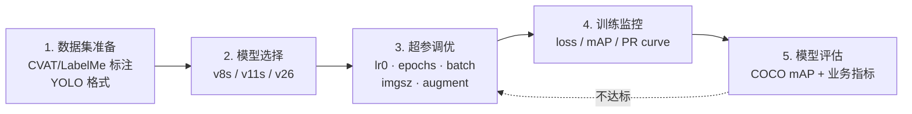
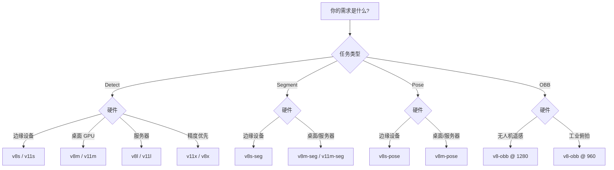

# 训练调优指南 · 从预训练权重到你的模型

> **一句话**：这一页把"我用 YOLOv8s 微调自己数据集，怎么调出最佳结果"这个最常见的需求拆成 5 步——数据集准备 → 模型选择 → 超参调优 → 训练监控 → 模型评估。

## 目录

- [完整流程 5 步走](#完整流程-5-步走)
- [第 1 步：数据集准备](#第-1-步数据集准备)
- [第 2 步：模型选择](#第-2-步模型选择)
- [第 3 步：超参调优](#第-3-步超参调优)
- [第 4 步：训练监控](#第-4-步训练监控)
- [第 5 步：模型评估](#第-5-步模型评估)
- [少样本微调](#少样本微调)
- [从 Detect 迁移到 Segment / Pose / OBB](#从-detect-迁移到-segment--pose--obb)
- [常见坑](#常见坑)

---

## 完整流程 5 步走



---

## 第 1 步：数据集准备

### 目录结构

```
your_dataset/
├── images/
│   ├── train/      # 训练集，约 80-90%
│   ├── val/        # 验证集，约 10-20%
│   └── test/       # 测试集（可选）
└── labels/
    ├── train/      # YOLO 格式标注
    ├── val/
    └── test/
```

### YAML 配置

```yaml
# dataset.yaml
path: /path/to/your_dataset
train: images/train
val: images/val

nc: 10          # 类别数
names:
  0: class_a
  1: class_b
  ...
```

### YOLO 标注格式

```
# 每行一个目标
# <class_id> <x_center> <y_center> <width> <height>
# 坐标归一化到 [0, 1]
0 0.512 0.123 0.234 0.456
```

### 标注工具推荐

| 工具 | 场景 | 优势 |
| --- | --- | --- |
| **CVAT** | 生产项目 | 标注质量高、支持团队协作 |
| **LabelMe** | 个人快速 | 上手快、单张操作 |
| **Roboflow** | 云协作 | 自动标注 + 版本控制 |
| **SAM + LabelStudio** | 大规模 | SAM 快速预分割 |

**注意**：训练集和验证集的图像分布必须一致，否则 mAP 会失真。

### 数据集规模参考

| 目标数量 | 每类样本数 | 建议 imgsz | 期望 mAP |
| --- | --- | --- | --- |
| 单类别 | ≥300 | 640 | 70-85% |
| 5-10 类 | ≥200/类 | 640 | 65-80% |
| 20-50 类 | ≥150/类 | 960-1280 | 60-75% |
| 50+ 类 | ≥100/类 | 1280 | 55-70% |

---

## 第 2 步：模型选择

### 决策树



### 五档参数对比

| 型号 | 参数量 | 输入 | COCO AP | 显存占用 | 推荐场景 |
| --- | --- | --- | --- | --- | --- |
| v8n | 3.2M | 640 | 37.3 | 1.2G | 边缘设备 |
| **v8s** | **11.2M** | **640** | **44.9** | **2.5G** | **默认起点** |
| v8m | 25.9M | 640 | 50.2 | 4.5G | 服务器推理 |
| v8l | 43.7M | 640 | 52.9 | 6.2G | 高精度需求 |
| v8x | 68.2M | 640 | 53.9 | 8.5G | 学术评测 |

**推荐起点**：**v8s**（生态最完善、性价比最高）。

---

## 第 3 步：超参调优

### 关键超参速查

| 超参 | 默认值 | 调优方向 | 影响 |
| --- | --- | --- | --- |
| **lr0** | 0.01 | 微调降到 0.001 | 学习率决定收敛速度和过拟合 |
| **epochs** | 100 | 微调升到 300+ | 太少欠拟合，太多过拟合 |
| **batch** | 16 | 显存允许可增大 | 大 batch 稳定但需调 lr0 |
| **imgsz** | 640 | 小目标场景升到 1280 | 显存翻倍、速度变慢 |
| **weight_decay** | 0.0005 | 一般不动 | 正则化 |
| **warmup_epochs** | 3 | 微调升到 5 | 前期学习率缓升 |
| **momentum** | 0.937 | 一般不动 | SGD 动量 |

### 微调 vs 从头训练

**微调（fine-tune）默认首选**：
```bash
yolo detect train data=dataset.yaml model=yolov8s.pt epochs=100 imgsz=640 batch=16
```

**从头训练（scratch）**：只在**类别差异极大**（如卫星图 vs COCO）时才考虑：
```bash
yolo detect train data=dataset.yaml model=yolov8s.yaml epochs=500 imgsz=640 batch=16 lr0=0.01
```

**微调的关键改动**：
```python
# 微调学习率
lr0=0.001            # 从 0.01 降到 0.001
warmup_epochs=5      # 从 3 升到 5
# 其他保持不变
```

### 数据增强调优

**默认增强**（自然场景）：
```yaml
hsv_h: 0.015
hsv_s: 0.7
hsv_v: 0.4
flipud: 0.0
fliplr: 0.5
mosaic: 1.0
mixup: 0.0
copy_paste: 0.0
```

**特殊场景增强**：

**PCB / 工业俯拍**：
```yaml
mosaic: 0.0          # 关闭拼接
mixup: 0.0
perspective: 0.0     # 关闭透视
fliplr: 0.0          # PCB 有极性
flipud: 0.0
```

**医学影像**：
```yaml
mosaic: 0.0
mixup: 0.0           # 严禁
flipud: 0.0          # 解剖方向
fliplr: 0.0          # 同上
random_rotation: 0
```

**遥感 / 无人机**：
```yaml
mosaic: 0.2          # 极低
random_rotation: 0   # OBB 严禁
perspective: 0.0
```

---

## 第 4 步：训练监控

### 关注 4 条曲线

1. **train loss**：应稳定下降，最后趋于平缓
2. **val loss**：应与 train loss 同步下降
3. **val mAP50-95**：主要指标，稳步上升
4. **PR 曲线**：Precision vs Recall 曲线，越靠左上越好

### 训练曲线诊断

```
正常收敛：
train loss  ↘↘↘↘↘
val mAP     ↗↗↗↗↗↗→
            ↑ 平缓即收敛

过拟合信号：
train loss  ↘↘↘↘↘↘↘
val mAP     ↗↗↗↗↘↘↘  ← 峰值已过
                ↑ 提前停止
```

### 早停策略

**手动早停**：
- val mAP 连续 30-50 epoch 不提升 → 停
- val loss 反弹 → 停

**Ultralytics 早停**：
```yaml
patience: 50         # 50 epoch 不提升就自动停
# 默认 50
```

### 训练时间估算

| 模型 | 数据集 | imgsz | GPU | 500 epoch |
| --- | --- | --- | --- | --- |
| v8n | 1k 张 | 640 | RTX 4090 | 30 分钟 |
| v8s | 1k 张 | 640 | RTX 4090 | 60 分钟 |
| v8s | 10k 张 | 640 | RTX 4090 | 8 小时 |
| v8s | 10k 张 | 1280 | A100 | 12 小时 |
| v8m | 10k 张 | 1280 | A100 | 20 小时 |

---

## 第 5 步：模型评估

### COCO 评估

```bash
yolo detect val model=best.pt data=coco.yaml
```

**关注指标**：
- **mAP50**：IoU 0.5 时的 AP，反映召回
- **mAP50-95**：IoU 0.5-0.95 平均，综合精度
- **Precision / Recall**：查错率 / 漏检率

### PR 曲线分析

```
Precision
1.0 |___
    |    \
    |     \  ← 好曲线（右上弯曲）
    |      \
0.5 |       \
    |________\___
    0          1 → Recall
```

- **曲线右上**：模型好，高 Precision 下仍有高 Recall
- **曲线左下**：模型差，容易查错或漏检
- **曲线下降快**：阈值设太松

### 业务指标转换

**COCO mAP 不等于业务价值**：

| 业务场景 | 主指标 | 目标值 |
| --- | --- | --- |
| 安防监控 | Recall | ≥95% |
| 工业质检 | Precision | ≥99% |
| 医疗诊断 | F1 | ≥0.85 |
| 无人机计数 | Recall + Count 误差 | ≥98% 且误差 <3% |

**转换公式**：
- 安防 Recall = mAP50 - 0.05（近似）
- 工业 Precision = mAP50-95 / 2 × 2（简化）

---

## 少样本微调

**当数据集只有几百张时的策略**：

### 关键超参调整

```yaml
epochs: 300            # 大幅增加
lr0: 0.0005           # 学习率降到 0.0005
batch: 8              # batch 减半
warmup_epochs: 10     # 慢热
patience: 100         # 更耐心

augment:
  - mosaic: 1.0       # 增强开满
  - mixup: 0.3        # 增加混合
  - copy_paste: 0.5   # 关键：复制粘贴补样本
  - copy_paste_classes_per_image: 3  # 每张最多 3 类拼接
```

### 数据增强组合

**方案 A（保守）**：
- `mosaic=1.0, mixup=0.3, copy_paste=0.5`
- 适合：自然场景少样本

**方案 B（激进）**：
- `mosaic=1.0, mixup=0.5, copy_paste=1.0, copy_paste_classes_per_image=5`
- 适合：极小样本（<100 张/类）

**方案 C（安全）**：
- `mosaic=0.5, mixup=0.0, copy_paste=0.3`
- 适合：医学 / 工业（严禁 mixup）

### 预期提升

| 原始样本 | 增强后等效样本 | 提升 |
| --- | --- | --- |
| 100 张 | 500-1000 | +5-10 AP |
| 500 张 | 2000-3000 | +3-8 AP |
| 1000 张 | 3000-4000 | +1-4 AP |

---

## 从 Detect 迁移到 Segment / Pose / OBB

### 迁移到 Segment

```bash
yolo segment train data=dataset_seg.yaml model=yolov8s-seg.pt epochs=300
```

**关键改动**：
- `mask_loss_weight`（默认 1.5）可适当加大到 3.0
- imgsz 保持 640，但 mask 精度受分辨率限制
- 增强策略与 Detect 类似，但关闭 `mosaic=1.0`（降到 0.5）

**参考**：[Segment 任务指南](/tasks/segment)

### 迁移到 Pose

```bash
yolo pose train data=dataset_pose.yaml model=yolov8s-pose.pt epochs=300
```

**关键改动**：
- `pose_loss_weight`（默认 4.0）
- 数据格式：关键点坐标 + visibility
- 严禁 `mixup` 和 `random_rotation`

**参考**：[Pose 任务指南](/tasks/pose)

### 迁移到 OBB

```bash
yolo obb train data=dataset_ob.yaml model=yolov8s-obb.pt epochs=200
```

**关键改动**：
- 数据格式：4 点多边形
- imgsz 涨到 1280
- 关闭所有几何增强

**参考**：[OBB 任务指南](/tasks/obb)

---

## 常见坑

### ❌ "batch 越大精度越高"

**不对**：大 batch 稳定但**精度上限略低**。

**建议**：
- 显存允许：batch 16-32 稳定
- 显存紧张：batch 8-16
- 微调时**不建议**增大 batch

### ❌ "微调用同样的 lr0=0.01"

**大坑**：预训练权重用 0.01 训过，微调再 0.01 会把预训练分布"洗掉"。

**修复**：微调 `lr0=0.001` 或更低。

### ❌ "训练 1000 epoch 才收敛"

**通常不需要**：
- 小数据集（<1k 张）：100-300 epoch
- 中等（1-10k 张）：300-500 epoch
- 大数据集（>10k 张）：500-1000 epoch

超过 1000 通常已过拟合。

### ❌ "验证集太小"

**建议**：至少 100 张或 10% 训练集。太少会让 mAP 波动大，评估不准。

### ❌ "训练时 val mAP 很低，怀疑模型问题"

**先检查数据**：
- 验证集和训练集分布是否一致
- 标注是否正确（可视化几张验证）
- 类别数量是否正确（`nc` 字段）

---

## 更多资源

- [部署指南 · ONNX / TensorRT](/recipes/export-onnx) — 训练完的下一步
- [FAQ · 训练 & 精度](/faq#训练--精度) — 训练疑问
- [故障排查 · 训练 & 增强](/troubleshooting#a-训练--增强) — 训练报错
- [v8 官方文档](https://docs.ultralytics.com/tasks/train/) — Ultralytics 文档
