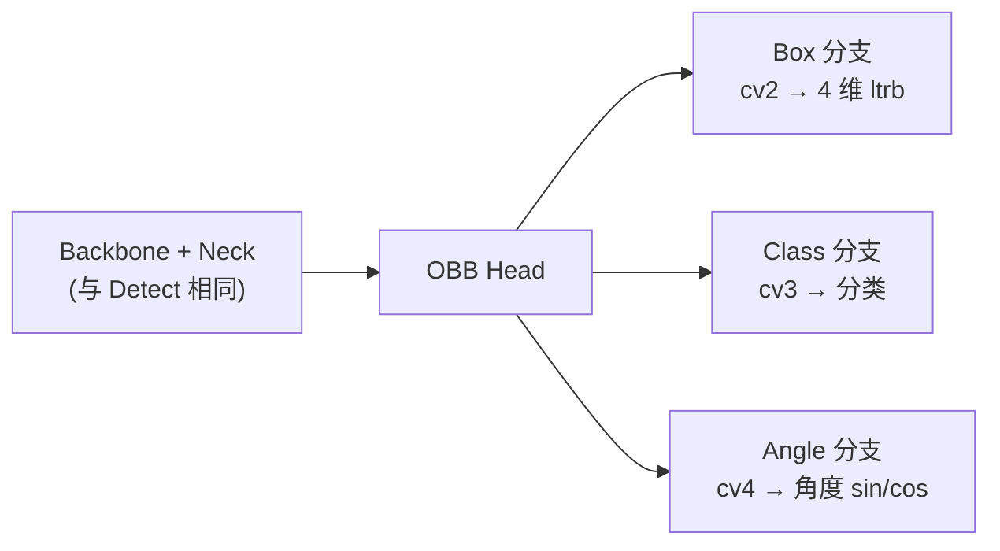

# 定向框（OBB） · YOLO 任务全景

> **一句话**：定向框（Oriented Bounding Box）用 5 个参数描述物体位置——`(x, y, w, h, θ)`——相比普通水平框（HBB）的 4 个参数，**多了旋转角度**，能精确表达"任意朝向"的目标。

## 目录

- [何时用 OBB](#何时用-obb)
- [OBB vs HBB](#obb-vs-hbb)
- [YOLO 家族支持情况](#yolo-家族支持情况)
- [OBB 标注格式](#obb-标注格式)
- [OBB 架构与损失](#obb-架构与损失)
- [训练数据与配置](#训练数据与配置)
- [调优要点](#调优要点)
- [常见坑](#常见坑)

---

## 何时用 OBB

**OBB 是"目标朝向任意"的任务**——HBB 处理不了倾斜目标。

**必用 OBB 的场景**：
- **无人机遥感**：港口车辆、田间作物、集装箱（俯拍 + 任意朝向）
- **卫星影像**：船舶、飞机、建筑物识别
- **交通监控**：倾斜拍摄的车辆、行人
- **林业监测**：倒木、砍伐树桩（斜向排列）
- **军事侦察**：坦克、导弹发射车（任意角度）

**不必用 OBB 的场景**：
- **正对摄像头的人脸/人像** → Detect 就够
- **水平排列的产品**（比如传送带上的 PCB）→ Detect 就够
- **纯计数场景** → Detect 更省算力

**参考**：[案例 · 无人机 OBB](/cases/drone-obb)

---

## OBB vs HBB

| 维度 | HBB（水平框） | OBB（定向框） |
| --- | --- | --- |
| 参数 | x, y, w, h（4） | x, y, w, h, θ（5） |
| 最小外接面积 | 大（斜向物体被撑大） | 小（贴合真实轮廓） |
| 精度 | 中等 | 高 |
| 速度 | 快 | 稍慢（+10-20%） |
| IoU 计算 | 简单（矩形交并比） | 复杂（多边形交并比） |
| 训练数据 | 4 点多边形 | 4 点多边形（含角度） |
| 部署难度 | 简单 | 稍难（角度对齐逻辑） |

**直观对比**：

```
    ┌────┐                ┌────┐
    │ 🚗 │   HBB          │🚗 │   OBB
    └────┘   ┌────┐      └────┘   / / /
              │ 🚗 │              旋转 θ
              └────┘
              面积大 25%
```

---

## YOLO 家族支持情况

| 版本 | OBB 支持 | 备注 |
| --- | --- | --- |
| v1-v4 | ❌ | 只做 Detect（HBB） |
| v5-OBB | ✅（社区版） | v5 官方未支持，社区 [xuebinqin/YOLOv5-OBB](https://github.com/xuebinqin/YOLOv5-OBB) |
| **v8-OBB** | ✅ | Ultralytics 官方支持，生态最完善 |
| v11-OBB | ✅ | 实验性，精度略好于 v8-OBB |
| v26 | ✅ | 内嵌多任务统一 backbone |
| YOLO-World | ❌ | 只做 HBB 开放词表 |
| YOLOE | ❌ | 只做 HBB 分割 |

**推荐起点**：**v8-OBB**（生态最好）或 **v11-OBB**（精度最好）。

---

## OBB 标注格式

### YOLO 格式（Ultralytics）

```
# 每行一个目标：
# <class_id> <x1> <y1> <x2> <y2> <x3> <y3> <x4> <y4>
# 4 个点必须按顺时针或逆时针排列
# 坐标归一化到 [0, 1]

0 0.512 0.123 0.894 0.145 0.887 0.673 0.501 0.652
1 0.105 0.234 0.456 0.198 0.462 0.789 0.115 0.823
```

**注意点**：
- 4 个点顺序很重要，错误顺序会破坏角度回归
- 建议使用 CVAT 或 LabelMe 的多边形工具
- 顺时针和逆时针都可以，但**同一数据集要保持一致**

### 从 HBB 到 OBB 的转换

如果你有 HBB 数据，想扩展到 OBB：
1. 用 SAM 或手动标注生成 4 点多边形
2. 或者用旋转回归预测模型（比如 RotateBoxLib）生成初始 OBB
3. 人工修正后导出

---

## OBB 架构与损失

### 架构（YOLOv8-OBB）

**OBB 与 Detect 的架构差异极小**，只在 Detect 头多一个角度回归：



**关键点**：OBB 头比 Detect 头多 `cv4` 分支，输出角度（通常用 sin/cos 表示 [-π/2, π/2] 范围）。

### 损失函数

```python
# OBB 总损失
loss = box_loss + cls_loss + dfl_loss + angle_loss

# angle_loss 通常是：
# l1_angle = |pred_angle - gt_angle|
# 或用 GIoU / DIoU / CIoU 的旋转版本
```

**YOLOv8-OBB 使用 DIoU**（Distance IoU）作为旋转框的 IoU 计算方式——比 CIoU 稍简单但精度足够。

---

## 训练数据与配置

### YAML 示例

```yaml
# obb_data.yaml
path: /data/detectron-ob
train: images/train
val: images/val

nc: 5
names:
  0: truck
  1: container
  2: excavator
  3: crane
  4: forklift

# OBB 特殊：4 点多边形标注
# 已在标注文件里指定
```

### 关键训练配置

```yaml
# OBB 特殊配置
imgsz: 1280                # 遥感场景 imgsz 通常 1280+
epochs: 200
batch: 16
box: 7.5
cls: 0.5
dfl: 1.5

# OBB 数据增强注意
augment:
  - random_rotation: 0     # ⚠️ 关键：不允许随机旋转
  - perspective: 0.0       # ⚠️ 关键：不允许透视
  - affine: 0.0            # ⚠️ 关键：不允许仿射
  - flipud: 0.0            # 无人机俯拍无上下方向
  - fliplr: 0.0            # 遥感影像有明确方向
  - mosaic: 0.2            # OBB 建议关闭或极低
  - mixup: 0.0             # 严禁 mixup
```

**为什么 OBB 增强这么严？**

**OBB 的核心是"相对角度"**：
- 如果训练时 `random_rotation=0.5`，网络会学不到"角度是相对量"
- 生产环境目标角度固定，训练时乱旋转等于把角度信号污染了
- **实测**：`random_rotation=0.5` 时 OBB mAP 掉 3-5pt

**参考**：[案例 · 无人机 OBB 增强策略](/cases/drone-obb#增强策略)

---

## 调优要点

### 1. 分辨率的选择

**OBB 对分辨率特别敏感**：
- **640**：小目标丢失，OBB 角度回归抖动
- **960**：中等目标 OK，速度稍慢
- **1280**：推荐，覆盖大多数遥感场景
- **1536+**：极小目标场景，但显存和速度压力大

### 2. 角度回归的损失权重

**默认角度损失权重较小**，因为角度本身比位置/尺寸变化小。

**调优策略**：
- **旋转角度变化大**（比如车辆 0-360°）：角度损失权重加大到 2.0
- **旋转角度变化小**（比如集装箱总是水平）：角度损失权重保持 1.0
- **角度回归不稳**：改用 GIoU/DIoU/CIoU 的旋转版本，通常比单纯 L1 角度损失更稳

### 3. 遥感小目标的处理

**遥感 OBB 常见痛点**：
- 目标像素面积 <100
- 目标密集，相邻目标角度接近

**方案**：
- 加 P2 head（stride=4）
- imgsz 涨到 1536 或 2048
- 使用 `scale_ratios` 多尺度训练
- 训练时 `copy_paste=0.1`（复制密集目标）

---

## 常见坑

### ❌ "OBB 精度比 HBB 差"

**其实正好相反**——OBB 在旋转目标上精度显著高于 HBB：
- HBB COCO AP：45.3（v8s）
- OBB DOTA mAP：52.9（v8s-obb）

**差 7.6 pt**，但 OBB 提供的角度信息是 HBB 完全没有的。

### ❌ "OBB 训练时开了 random_rotation"

**大坑**：`random_rotation` 会污染角度信号，实测 mAP 掉 3-5 pt。

**修复**：
```yaml
augment:
  - random_rotation: 0
  - perspective: 0.0
  - affine: 0.0
```

**允许**：
```yaml
augment:
  - hsv_h: 0.015
  - hsv_s: 0.7
  - hsv_v: 0.4
  - flipud: 0.0
  - fliplr: 0.0
```

### ❌ "OBB 4 点顺序乱了"

**OBB 标注 4 点顺序必须一致**（全顺时针或全逆时针）。

**修复**：
- 用 CVAT 或 LabelMe 自动排序
- 或者标注工具里配置"顺时针"约束
- 或者用后处理脚本按角度排序

**症状**：模型收敛但精度上不去，mAP 停在 30% 以下。

### ❌ "OBB 部署时角度对齐错误"

**常见问题**：
- 导出 TensorRT 后角度输出偏移
- NMS 用 HBB 的 IoU，忽略角度信息

**修复**：
- 使用 Ultralytics 官方导出（角度逻辑已处理）
- NMS 用 **RotateBoxLib** 或 Ultralytics 的 OBB NMS
- 部署时保留 FP32 角度层

### ❌ "遥感 OBB 小目标召回差"

**方案**：
1. imgsz 涨到 1536
2. 加 P2 head
3. 训练时 `copy_paste=0.15`
4. 数据增强：`scale: [0.5, 1.5]` 强制多尺度

---

## 更多资源

- [案例 · 无人机 OBB](/cases/drone-obb) — 生产级 OBB 案例
- [案例 · 3D BEV](/cases/3d-bev) — OBB 与 3D 结合
- [故障排查 · OBB 专项](/troubleshooting#g-3d--bev--obb-专项)
- [v8-OBB 官方文档](https://docs.ultralytics.com/tasks/obb/) — Ultralytics 文档
