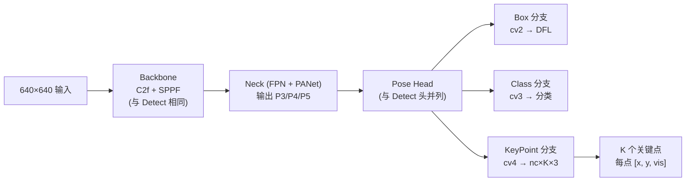

# 姿态估计（Pose） · YOLO 任务全景

> **一句话**：姿态估计不仅检测出人体（或动物）的位置，还标出**关键点的坐标**（关节、身体部位）——把"人在哪里"扩展到"人在什么姿势"。

## 目录

- [何时用 Pose](#何时用-pose)
- [YOLO 家族支持情况](#yolo-家族支持情况)
- [关键点定义](#关键点定义)
- [Pose 架构拆解](#pose-架构拆解)
- [关键点数量与任务](#关键点数量与任务)
- [训练数据与配置](#训练数据与配置)
- [调优要点](#调优要点)
- [常见坑](#常见坑)

---

## 何时用 Pose

**Pose 是"必须知道姿态"的任务**——只有框和类别不够。

**必用 Pose 的场景**：
- **体育分析**：动作识别、运动姿态优化、损伤风险预警
- **健身跟踪**：健身房姿态纠正、动作计数
- **医疗康复**：康复训练进度跟踪、步态分析
- **安防识别**：摔倒检测、打架检测、异常行为识别
- **AR/VR**：实时人体重建、虚拟试衣
- **儿童行为分析**：校园安全、老人跌倒检测

**不必用 Pose 的场景**：
- **计数场景**：只数人头 → Detect 就够
- **人脸识别**：用专门的 Face 检测器更好
- **纯监控**：只关心人在不在 → Detect

**参考**：[案例 · 安防监控](/cases/security-monitoring)

---

## YOLO 家族支持情况

| 版本 | Pose 支持 | 备注 |
| --- | --- | --- |
| v1-v4 | ❌ | 只做检测 |
| v5-v13 | ✅ | 官方 Pose 任务 |
| v26 | ✅ | 内嵌多任务统一 backbone |
| YOLO-World | ❌ | 只做开放词表检测 |
| YOLOE | ❌ | 支持开放词表分割，不做姿态 |
| YOLO-Master | ✅ | 多任务统一 |

**推荐起点**：**v8-pose**（生态最完善）或 **v11-pose**（精度最好）。

---

## 关键点定义

**YOLO Pose 使用 COCO-Keypoints 标准**（人体 17 个关键点）：

| ID | 关键点 | 说明 |
| --- | --- | --- |
| 0 | nose | 鼻子 |
| 1 | left_eye | 左眼 |
| 2 | right_eye | 右眼 |
| 3 | left_ear | 左耳 |
| 4 | right_ear | 右耳 |
| 5 | left_shoulder | 左肩 |
| 6 | right_shoulder | 右肩 |
| 7 | left_elbow | 左肘 |
| 8 | right_elbow | 右肘 |
| 9 | left_wrist | 左手腕 |
| 10 | right_wrist | 右手腕 |
| 11 | left_hip | 左髋 |
| 12 | right_hip | 右髋 |
| 13 | left_knee | 左膝 |
| 14 | right_knee | 右膝 |
| 15 | left_ankle | 左踝 |
| 16 | right_ankle | 右踝 |

**每关键点输出格式**：`[x, y, visibility]`，visibility ∈ {0, 1, 2}（不可见/遮挡/可见）。

**扩展任务**：
- **动物关键点**：猫 18 点、狗 18 点（AIPet 数据集）
- **手部关键点**：21 点（HandPose，YOLOv8 支持）
- **自定义**：任意数量的关键点，如"手部+工具"或"机器臂关节"

---

## Pose 架构拆解

以 **YOLOv8-pose** 为例：



**关键区别**：Pose head 比 Detect head 多一个 `cv4` 分支，输出 `nc × K × 3` 的关键点坐标（K 是关键点数量）。

**关键点坐标是相对目标框的**，不是绝对坐标——`x, y ∈ [0, 1]`，`vis ∈ {0, 1, 2}`。

---

## 关键点数量与任务

| 任务 | 关键点数量 | 数据集 | 典型场景 |
| --- | --- | --- | --- |
| 人体全身 | 17 | COCO-Keypoints | 体育/健身/安防 |
| 人体手部 | 21 | HandPose / ARCTIC | 手势识别 |
| 动物全身 | 18 | AIPet / AnimalKeypoints | 宠物/野生动物 |
| 面部 | 4-68 | iBUG / Aflw2000 | 表情识别 |
| 机器臂 | 关节数 | 自定义 | 工业机器人 |
| 服装 | 15-25 | DeepFashion2 | 虚拟试衣 |

**关键点数量与精度关系**：
- **5-10 个**：精度容易，适合入门
- **15-20 个**：需要充足数据（≥10K 张标注）
- **>30 个**：极难收敛，通常不推荐

---

## 训练数据与配置

### YAML 示例

```yaml
# pose_data.yaml — COCO-Keypoints 格式
path: /data/coco-pose
train: annotations/instances_train2017.json
val: annotations/instances_val2017.json

nc: 1
names:
  0: person
kpt_shape:
  num_keypoints: 17
  dims: 3                    # [x, y, visibility]

# YOLO 格式关键点标注：
# <class_id> <x_box> <y_box> <w_box> <h_box>
# <kp1_x> <kp1_y> <kp1_vis> <kp2_x> <kp2_y> <kp2_vis> ...
```

### 标注工具对比

| 工具 | 优势 | 劣势 | 推荐场景 |
| --- | --- | --- | --- |
| **CVAT** | 关键点标注 UI 优秀、支持 17+ 点 | 部署略复杂 | 生产项目首选 |
| **LabelMe** | 支持关键点但 UI 一般 | 关键点标注慢 | 个人快速标注 |
| **DWPose 自动标注** | SAM + DP 融合，自动生成关键点 | 后处理工作量 | 大规模数据集 |
| **MediaPipe 预标注** | 实时预标注 + 人工修正 | 只能用于人体 | 人体数据集 |

### 关键训练配置

```yaml
# Pose 特殊配置
imgsz: 640
epochs: 300                # Pose 收敛比 Detect 慢
batch: 16
box: 7.5
cls: 0.5
dfl: 1.5
# Pose 特有
pose: 4.0                  # 关键点损失权重（默认）
kobj: 1.0                  # 关键点存在损失权重（可选）

# 数据增强注意
augment:
  - hsv_h: 0.015
  - hsv_s: 0.7
  - hsv_v: 0.4
  - flipud: 0.0            # 严禁上下翻转（人体有方向）
  - fliplr: 0.5            # 左右翻转安全，但关键点要对称交换
  - random_rotation: 0     # 姿势任务不能旋转
  - mosaic: 0.5            # Pose 一般不开 mosaic（会破坏关键点对齐）
  - mixup: 0.0             # 严禁 mixup（合成不可能的姿势）
  - copy_paste: 0.0        # Pose 一般不开
```

---

## 调优要点

### 1. 关键点可见性（visibility）

**visibility ∈ {0, 1, 2}** 是 Pose 的隐性难点：
- **0**：完全不可见（关键点在画外）
- **1**：部分可见（遮挡或模糊）
- **2**：完全可见

**训练注意**：
- visibility=0 的关键点不参与损失计算
- 数据集中 visibility 标注不全会让模型学不到"不可见"概念
- **建议**：标注工具配置 visibility 严格（CVAT 支持）

### 2. 遮挡问题的处理

**遮挡是 Pose 的杀手**：
- 前景人物遮挡背景人物 → 关键点错位
- 衣物遮挡关节 → 关键点不可见
- 家具遮挡身体 → 关键点丢失

**方案**：
- 训练时增加遮挡场景样本
- 关键点损失用 `kobj`（关键点存在损失）惩罚不可见情况
- 推理时 visibility < 0.4 的关键点做插值预测

### 3. 稀疏关键点的强化

**问题**：人体远处（15px 高）关键点全部挤在几个像素内，无法区分。

**方案**：
- 输入 imgsz 从 640 涨到 1280
- 关键点数太少（<10）时用 Detect + Pose 融合（先 Detect 出人，再 crop 出 Pose）
- 训练时对稀疏关键点做 SMOTE 类过采样

---

## 常见坑

### ❌ "Pose 精度比 Detect 差很多"

**没那么差**：
- v8s-pose COCO AP：56.2（Detect AP 45.3 + Pose OKS 56.2）
- 差 10 点，但 Pose 提供信息量远大于 Detect

**OKS（Object Keypoint Similarity）** 是 Pose 的评估指标，衡量关键点位置与真值相似度的加权和。

### ❌ "关键点训练太慢"

**正常，Pose 训练比 Detect 慢 30-50%**：
- 关键点多、损失更复杂
- 需要更多 epoch 收敛

**加速技巧**：
- 用 `kobj` 只惩罚关键点可见度，不惩罚完全不可见的关键点
- 减少关键点数量（比如 17 → 8）
- imgsz 从 640 降到 512（对精度影响小）

### ❌ "关键点定位抖动"

**常见原因**：
- 关键点数量多但数据不足 → 稀疏关键点被平均掉
- visibility 标注不一致 → 模型学到"半可见"的伪信号
- 关键点损失权重太低 → 关键点被框回归主导

**修复**：
- 关键点损失权重 `pose: 4.0 → 6.0`
- visibility 标注严格化
- 训练前做关键点数据清洗（去除明显错误标注）

### ❌ "Pose 部署比 Detect 慢太多"

**实际情况**：
- v8s-pose TensorRT FP16 @ 640：约 6-8ms
- v8s-det TensorRT FP16 @ 640：约 4-5ms
- **差距 1.5×，可接受**

如果太慢，考虑：
- **v8n-pose**（参数量最小，推理约 4ms）
- **只预测必要关键点**（比如人跌倒检测只需要 5 个关键点：头、肩、髋、膝、踝）

---

## 更多资源

- [案例 · 安防监控](/cases/security-monitoring) — Pose 应用
- [案例 · 农业](/cases/agriculture) — Pose 在牲畜上的应用
- [故障排查 · 训练 & 增强](/troubleshooting#a-训练--增强) — Pose 专属坑
- [v8 · Pose 训练](/versions/v8/index) — 主线详解
- [CO CO-Keypoints 数据集](https://cocodataset.org/#keypoints) — 官方数据集
