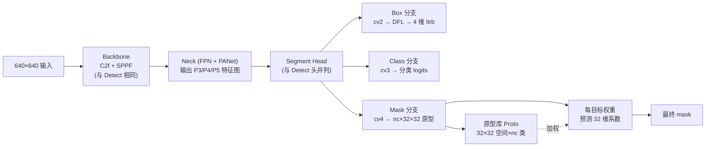

# 实例分割（Segment） · YOLO 任务全景

> **一句话**：实例分割（Instance Segmentation）不仅告诉你物体在哪里（框），还告诉你**物体长什么样（像素级 mask）**——比检测多了形状信息，比全景分割少了实例归属问题。

## 目录

- [何时用 Segment](#何时用-segment)
- [YOLO 家族支持情况](#yolo-家族支持情况)
- [Segment 架构拆解](#segment-架构拆解)
- [Mask 三种表示](#mask-三种表示)
- [训练数据与配置](#训练数据与配置)
- [调优要点](#调优要点)
- [常见坑](#常见坑)

---

## 何时用 Segment

**Segment 是"必须知道形状"的任务**——检测只有框，Segment 多了 mask。

**必用 Segment 的场景**：
- **医学影像**：肿瘤轮廓、器官分割（框不够精确，需要像素级）
- **工业缺陷**：划痕、焊接不良的边界（下游需要面积计算）
- **自动驾驶车道线**：分割比框更贴近真实车道边界
- **无人机农业**：病虫害区域的形状（面积比位置更重要）
- **手术机器人**：组织分割精度要求毫米级

**不必用 Segment 的场景**：
- **计数场景**：只要知道有多少个 → Detect 就够
- **动作识别**：只要知道位置 → Detect + Pose 更合适
- **实时性要求 <10ms**：Segment 比 Detect 慢 30-50%

**参考**：[案例 · 医疗影像](/cases/medical-lesion) · [案例 · 车道分割](/cases/autonomous-lane)

---

## YOLO 家族支持情况

| 版本 | Segment 支持 | 备注 |
| --- | --- | --- |
| v1-v4 | ❌ | 只做检测 |
| v5-v13 | ✅ | 官方 Segment 任务，训练/推理/部署一条龙 |
| v26 | ✅ | 内嵌到多任务统一 backbone，8 任务同时支持 |
| YOLO-World | ❌ | 只做检测（开放词表） |
| YOLOE | ✅ | 支持开放词表下的实例分割 |
| YOLO-Master | ✅ | 多任务统一，Segment 是核心之一 |

**推荐起点**：**v8-seg**（生态最完善）或 **v11-seg**（精度最好）。

---

## Segment 架构拆解

以 **YOLOv8-seg** 为例：



**关键区别**：Segment head 比 Detect head 多一个 `cv4` 分支，专门输出**每个目标的 mask 权重系数**。

---

## Mask 三种表示

**Segment 的 mask 有三种实现方式**，理解这个才能调优：

### 1. 原型库 + 权重（YOLOv5+ 默认）

**原理**：Proto 层输出 32×32 空间分辨率的 `nc` 张原型 mask，每个目标预测 32 维权重系数，加权求和得到该目标的 mask。

**优点**：
- 内存占用小（proto 是共享的）
- 计算快（每目标只算 32 维内积）

**缺点**：
- 32×32 分辨率下，细长 mask（车道线）边界模糊
- 每目标精度有上限

**参考**：[YOLOv5 论文 §4.2](/versions/v5/paper)

### 2. 全分辨率 mask（YOLOv11 部分场景）

**原理**：不用原型库，每个目标直接预测 64×64 或更高的 mask。

**优点**：边界精度更高
**缺点**：显存翻 4-8 倍，推理慢

### 3. Top-K mask（YOLOv8 优化）

**原理**：只对 top-K 个置信度最高的目标算 mask，低分目标跳过。

**优点**：显存省 40%，推理快 20%
**缺点**：低分目标（可能是长尾）没 mask

---

## 训练数据与配置

### YAML 示例

```yaml
# segment_data.yaml — COCO 分割标注格式
path: /data/coco2017
train: images/train2017
val: images/val2017

nc: 80
names:
  0: person
  1: bicycle
  ...

# 每个目标标注格式（YOLO 分割格式）：
# <class_id> <x1> <y1> <x2> <y2> <x3> <y3> ... （8+ 点归一化坐标）
```

### 标注工具对比

| 工具 | 优势 | 劣势 | 推荐场景 |
| --- | --- | --- | --- |
| **CVAT** | 开源、标注质量高、支持 8 点以上多边形 | 部署略复杂 | 工业项目首选 |
| **LabelMe** | 简单、单张操作 | 无团队协作 | 个人快速标注 |
| **Roboflow** | 云协作 + 自动标注 | 收费 | 小团队 |
| **SAM + LabelStudio** | SAM 快速预分割 | 后处理工作量 | 大规模数据集 |

### 关键训练配置

```yaml
# Segment 特殊配置
imgsz: 640                # 分辨率决定 mask 精度上限
epochs: 300               # Segment 收敛比 Detect 慢，300+ epoch 常见
batch: 16
box: 7.5                  # 框损失权重
cls: 0.5                  # 分类损失权重
dfl: 1.5                  # DFL 损失权重
# Segment 特有
mask: 1.5                 # mask 损失权重（Ultralytics 默认）
overlap_mask: False       # 重叠目标 mask 是否合并

# 数据增强注意
augment:
  - hsv_h: 0.015          # 分割场景饱和度增强弱一些
  - hsv_s: 0.7
  - hsv_v: 0.4
  - flipud: 0.0           # 医学影像建议 0
  - fliplr: 0.5
  - mosaic: 0.8           # 分割允许 mosaic，但工业/医学场景降到 0.2 以下
  - mixup: 0.0            # 医学/工业建议 0
```

---

## 调优要点

### 1. mask 精度 vs 速度的取舍

**关键指标**：`mAP50-95(Seg)`（分割 IoU 50%-95% 的平均精度）

**提升策略**：
- **imgsz 640 → 1280**：mask mAP +3-5，但推理 +200%
- **Prototype 分辨率 32×32 → 64×64**：mask mAP +1-2，显存 +100%
- **mask_loss_weight 加大**：可能改善但训练更慢

### 2. 小目标 mask 的召回

Segment 的 mask 对小目标尤其敏感——一个 32×32 的 proto 单元对应 20 像素的物体，一个单元偏差就意味着整个物体丢失。

**方案**：
- 加 P2 head（stride=4），专门处理 <32px 目标
- 输入 imgsz 涨到 1280+
- 关闭 `overlap_mask`（避免小目标被大目标吞掉）

### 3. 医学影像的特殊处理

医学分割场景常见痛点：**类别极端不平衡 + 形状不规则**。

**推荐配置**：
```yaml
# 医学分割专属
augment:
  - mixup: 0.0            # 严禁 mixup（合成不存在的器官形态）
  - copy_paste: 0.1       # 允许少量但限制
  - flipud: 0.0           # CT/MRI 有解剖方向
  - fliplr: 0.0           # 同上
  - random_rotation: 0    # 位置固定

# 损失函数
mask: 3.0                 # mask 损失权重提高，压制少数类
cls: 0.3
```

**参考**：[案例 · 医疗影像](/cases/medical-lesion)

---

## 常见坑

### ❌ "Segment 精度不如 Detect"

**其实差不多**。同一个 backbone（如 v8s）下：
- Detect COCO AP：45.3
- Segment COCO AP50-95：43.9

**差 1.4 AP**，但 Segment 提供的信息量远大于 Detect。**不是精度问题，是训练策略问题**。

### ❌ "分割标注太麻烦"

**用 SAM 半自动标注**。流程：
1. 先用 SAM 生成初始 mask
2. 人工修正边缘
3. 批量导出 YOLO 格式

**效率提升**：从 5 分钟/张 → 30 秒/张。

### ❌ "Segment 部署比 Detect 慢太多"

**其实可以接受**：
- v8s-seg@640 TensorRT FP16：约 8-10ms
- v8s-det@640 TensorRT FP16：约 4-5ms
- **差距 2×，不是数量级**

如果实在太慢，考虑 **v8s-seg + v8n-seg 混合部署**（近景高分辨率用 s，远景用 n）。

### ❌ "mask 抖动严重"

**DFL 层保持 FP32**，mask 层可以 INT8。mask 层的抖动比 Detect 小得多（因为 mask 是相对形状，不是绝对位置）。

---

## 更多资源

- [案例 · 车道分割](/cases/autonomous-lane) — Segment 应用
- [案例 · 医疗影像](/cases/medical-lesion) — Segment 应用
- [故障排查 · 训练 & 增强](/troubleshooting#a-训练--增强) — 分割专属坑
- [v8 · Segment 训练](/versions/v8/index) — 主线详解
