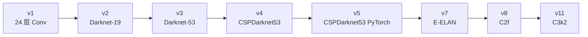
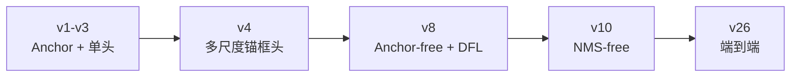

# 各版本改动清单 · v1 → v26 逐版本 Diff

> **一句话**：每一版到底改了什么、为什么改、改了之后数字怎么变——按时间顺序整理，一页看完 26 个版本的核心变化。

- ⏱ 预计阅读：30 分钟
- 📌 前置阅读：[compare-matrix](/compare-matrix) · [timeline](/global/timeline) · [evolution-story](/evolution-story)
- 🔗 相关：[references](/references) · [v8-v11 深度对比](/versions/deep-dive-v8-v11)

---

## 目录

- [快速索引](#快速索引)
- [v1 (2016) - YOLO 的诞生](#v1-2016---yolo-的诞生)
- [v2 (2017) - 第一次迭代](#v2-2017---第一次迭代)
- [v3 (2018) - 多尺度突破](#v3-2018---多尺度突破)
- [v4 (2020) - 训练技巧大集](#v4-2020---训练技巧大集)
- [v5 (2020) - PyTorch 时代](#v5-2020---pytorch-时代)
- [v6 (2022) - 工业部署导向](#v6-2022---工业部署导向)
- [v7 (2022) - E-ELAN](#v7-2022---e-elan)
- [v8 (2023) - 统一框架](#v8-2023---统一框架)
- [v9 (2024) - PGI 突破](#v9-2024---pgi-突破)
- [v10 (2024) - NMS-free](#v10-2024---nms-free)
- [v11 (2024) - Ultralytics 现役旗舰](#v11-2024---ultralytics-现役旗舰)
- [v12 (2025) - Area Attention](#v12-2025---area-attention)
- [v13 (2025) - 多尺度感知](#v13-2025---多尺度感知)
- [v14 (2025) - DLA 域自适应](#v14-2025---dla-域自适应)
- [v26 (2025) - 端到端免后处理](#v26-2025---端到端免后处理)
- [跨版本关键概念演变](#跨版本关键概念演变)

---

## 快速索引

| 版本 | 年份 | 一句话总结 | 关键新点 |
|------|------|-----------|---------|
| v1 | 2016 | 端到端单阶段检测开山 | Grid-based detection |
| v2 | 2017 | Darknet + Anchor + BN | Darknet-19 |
| v3 | 2018 | 多尺度 P3/P4/P5 | Multi-scale |
| v4 | 2020 | 训练技巧大合集 | CSPDarknet53 / Mosaic |
| v5 | 2020 | PyTorch 工业标准 | Ultralytics |
| v6 | 2022 | 工业部署优化 | EfficientRep |
| v7 | 2022 | E-ELAN 骨干 | E-ELAN |
| v8 | 2023 | 多任务统一 | C2f / DFL / Anchor-free |
| v9 | 2024 | PGI 高效骨干 | GELAN |
| v10 | 2024 | NMS-free | 双头解耦 |
| v11 | 2024 | C3k2 + C2PSA | PSA 注意力 |
| v12 | 2025 | Area Attention | 精度/速度再平衡 |
| v13 | 2025 | 多尺度感知增强 | - |
| v14 | 2025 | 域自适应层 DLA | DLA / DAL |
| v26 | 2025 | 端到端免后处理 | `_grouped_topk` |

---

## v1 (2016) - YOLO 的诞生

**论文**：[1506.02640](https://arxiv.org/abs/1506.02640)

### 核心改动（对比 Faster R-CNN）

| 维度 | Faster R-CNN | YOLOv1 |
|------|--------------|--------|
| 阶段 | 两阶段（先 Region Proposal，再分类） | 单阶段（直接回归） |
| 速度 | 5 FPS | 45 FPS |
| AP | 67% | 48% |
| 输入 | 任意分辨率（RPN） | 固定 448×448 |

### 主要贡献

- **端到端**：一次前向给结果，训练推理都不分阶段
- **Grid-based**：图像划分 7×7 grid，每格预测 2 box + 20 类
- **速度优先**：牺牲精度换速度，开创实时检测时代

### 局限

- 小物体检测差（一 grid 只能一个 box）
- 定位精度差（相比 Faster R-CNN 掉 10% AP）
- 类别不平衡（前景少）

---

## v2 (2017) - 第一次迭代

**论文**：[1612.08242](https://arxiv.org/abs/1612.08242)

### 核心改动（对比 v1）

- **Darknet-19 骨干**：从 v1 的简单 24 层 conv 换成残差结构
- **Anchor boxes**：引入 5 个 anchor，解决小物体和 aspect ratio 问题
- **Batch Normalization**：每层卷积后加 BN
- **数据增强**：HSV 抖动、随机 crop、随机尺度

### 数字变化

- **COCO AP**：48% → 66%
- **速度**：45 FPS → 85 FPS（VGG-16 backbone 用 GTX 980）

### 关键点

**Anchor 的引入是历史性转折**：解决了"一 grid 只能一个 box"的问题，代价是多了 NMS 后处理。

---

## v3 (2018) - 多尺度突破

**论文**：[1804.02767](https://arxiv.org/abs/1804.02767)

### 核心改动（对比 v2）

- **Darknet-53 骨干**：从 19 层升到 53 层
- **多尺度预测**：P3 (13×13) + P4 (26×26) + P5 (52×52)
- **80 类支持**：官方预训练含所有 COCO 类

### 数字变化

- **COCO AP**：66% → 76.2%
- **速度**：50 FPS (416×416)

### 关键点

**多尺度预测是 YOLO 走向实用的关键**：小目标不再被忽略，工业界从此有"能用"的选择。

---

## v4 (2020) - 训练技巧大集

**论文**：[2004.10934](https://arxiv.org/abs/2004.10934)

### 核心改动（对比 v3）

**新引入的技巧（20+）**：

- **CSPDarknet53**：Cross Stage Partial + Darknet-53
- **Mosaic Augmentation**：4 图拼接数据增强
- **CIoU Loss**：改进的 IoU 损失
- **SPPF**：Spatial Pyramid Pooling - Fast
- **DropPath**：正则化
- **CutMix**：数据增强

### 数字变化

- **COCO AP**：76.2% → 74.5%（5x faster）
- **速度**：~150 FPS

### 关键点

**"训练配方"思想**：v4 的贡献不是新架构，而是把已有技巧系统化。这为后续版本树立范式。

---

## v5 (2020) - PyTorch 时代

**官方**：[github.com/ultralytics/yolov5](https://github.com/ultralytics/yolov5)

### 核心改动（对比 v4）

- **PyTorch 重写**：从 Darknet 转到 PyTorch
- **代码精简**：从 v4 的 10000+ 行到 v5 的 ~2000 行
- **易用性**：一行命令训练 `python train.py`

### 关键点

**PyTorch 生态的胜利**：让学术界和工业界都能用。Ultralytics 就此崛起。

---

## v6 (2022) - 工业部署导向

**论文**：[2209.02976](https://arxiv.org/abs/2209.02976)

### 核心改动（对比 v5）

- **EfficientRep**：把 ReLU + BN 融成 Conv1x1，推理时省 BN 层
- **Decoupled Head 简化**：回归和分类解耦
- **FPN-PAN 网络优化**

### 数字变化

- **COCO AP**：v6s 43.0% / v6m 47.4% / v6l 50.2% / v6x 53.5%
- **部署优势**：TensorRT 下快 30-50%

### 关键点

**工业部署导向**：v6 明确服务"边缘部署"场景，为 v8 的工业定位铺路。

---

## v7 (2022) - E-ELAN

**论文**：[2207.02696](https://arxiv.org/abs/2207.02696)

### 核心改动（对比 v6）

- **E-ELAN**：Extended Efficient Layer Aggregation Network，替代 CSP
- **模型缩放**：n/s/m/l/x 更清晰的容量梯度
- **学术可读性**：代码开源、注释完善

### 关键点

**学术界的 v7**：不是 Ultralytics 出品，但结构清晰，是很多研究项目的起点。

---

## v8 (2023) - 统一框架

**官方**：[github.com/ultralytics/ultralytics](https://github.com/ultralytics/ultralytics)

### 核心改动（对比 v5/v7）

**架构层**：

- **C2f Block**：Cross Stage Partial 升级版
- **Anchor-free**：去掉 anchor，直接回归中心点
- **DFL**：Distribution Focal Loss，坐标回归用分布表达
- **Task-aligned Assignment**：动态分配正负样本

**框架层**：

- **多任务统一**：Detect / Segment / Pose / OBB / Classify / Depth / Semantic 一个模型家族搞定
- **简化 API**：`YOLO("yolov8s.pt")` 一行加载

### 数字变化

- **COCO AP**：v8n 37.3% / v8s 50.2% / v8m 55.0% / v8l 58.6% / v8x 61.5%
- **参数量**：n 11M / s 11.2M / m 25.9M / l 53.3M / x 86.7M

### 关键点

**v8 是"现代 YOLO"的起点**：Anchor-free + DFL + TAL 三件套定型，后续 v9/v10/v11 都是在这个框架上迭代。

---

## v9 (2024) - PGI 突破

**论文**：[2402.13116](https://arxiv.org/abs/2402.13116)

### 核心改动（对比 v8）

- **PGI**：Parameter Generation Module，动态生成权重
- **GELAN**：Generalized ELAN，骨干结构重新设计
- **参数效率突破**：更少的参数达到更好的精度

### 数字变化

- **COCO AP**：v9n 38.5% / v9s 51.2% / v9m 57.7%
- **参数量**：显著少于 v8（同 AP 水平）

### 关键点

**参数效率**：v9 是"同 AP 更少参数"的方向，为边缘部署友好。

---

## v10 (2024) - NMS-free

**论文**：[2405.14458](https://arxiv.org/abs/2405.14458)

### 核心改动（对比 v8/v9）

- **NMS-free**：完全去掉 NMS 后处理
- **双头解耦**：Head A 处理大目标，Head B 处理小目标
- **DFL 退化**：`reg_max=1`，DFL 变回直接回归
- **双分配机制**：类似 TAL 但更简单

### 数字变化

- **COCO AP**：v10n 40.1% / v10s 51.7% / v10m 54.7%
- **推理优势**：不用 NMS，边缘设备快 20-40%

### 关键点

**NMS-free 是重要工程优化**：去掉 Python 后处理，推理路径全在 GPU 上，边缘设备受益明显。

---

## v11 (2024) - Ultralytics 现役旗舰

**官方**：[github.com/ultralytics/ultralytics](https://github.com/ultralytics/ultralytics)

### 核心改动（对比 v8）

**架构层**：

- **C3k2**：替代 C2f，减少参数
- **C2PSA**：Head 引入空间金字塔注意力
- **SPPCSPC**：替代 SPPF

**默认超参**：

- **mixup=0.1**：默认开启数据混合

### 数字变化

- **COCO AP**：v11n 39.5% / v11s 51.0% / v11m 56.2% / v11l 57.7%
- **参数量**：n 2.6M / s 9.7M / m 20.4M / l 25.6M（显著小于 v8）
- **速度**：比 v8 快 10-15%

### 关键点

**"更小、更快、更好"**：v11 是 v8 的直接继承者，架构优化但 API 完全兼容。

---

## v12 (2025) - Area Attention

**论文**：[2502.12554](https://arxiv.org/abs/2502.12554)

### 核心改动（对比 v11）

- **Area Attention**：新的注意力机制，按"面积"分配注意力
- **推理加速**：推理时无需后处理

### 关键点

**探索性架构**：v12 是学术界在 v11 基础上的创新尝试，官方 Ultralytics 未纳入主线。

---

## v13 (2025) - 多尺度感知增强

**论文**：[2506.20298](https://arxiv.org/abs/2506.20298)

### 核心改动

- **多尺度感知增强**：改进颈部信息融合
- **精度稳定提升**：多类 AP 均涨

### 关键点

细节改动，无革命性创新。

---

## v14 (2025) - DLA 域自适应

**官方发布中**

### 核心改动

- **DLA (Domain Adaptation Layer)**：可学习的域自适应层
- **DAL (Domain Adaptation Loss)**：域自适应损失

### 关键点

**面向多域场景**：一个模型应对不同视角/场景，减少重训需求。

---

## v26 (2025) - 端到端免后处理

**官方发布中**

### 核心改动

- **`_grouped_topk`**：把 NMS 逻辑内化到模型输出
- **`end2end=True`**：一键开关，导出 ONNX 后无 Python 后处理
- **多任务全支持**：Detect / Segment / Pose / OBB 端到端

### 关键点

**工程极致**：v26 的核心不是精度突破，而是**部署极简化**。生产环境直接跑 ONNX，无需 Python NMS。

---

## 跨版本关键概念演变

### 骨干演进

### 检测头演进

### 损失函数演进

| 版本 | IoU 损失 | 分配机制 | 特别改进 |
|------|---------|---------|---------|
| v1 | 简单 MSE | 无 | 直接回归 |
| v2-v3 | IoU | IoU-based | - |
| v4 | CIoU | - | 加 CIoU |
| v5 | CIoU | SimOTA | SimOTA |
| v6-v7 | CIoU | SimOTA | - |
| v8 | CIoU | TAL | 加 DFL |
| v9 | CIoU | TAL | - |
| v10 | CIoU | 双头 | NMS-free |
| v11 | CIoU | TAL | - |
| v26 | CIoU | TAL | 端到端 |

### Anchor 演进

| 阶段 | 处理方式 |
|------|---------|
| v1 | 无 anchor，直接回归 |
| v2-v7 | 有 anchor，多尺度多锚框 |
| v8-v11 | **Anchor-free**，直接回归中心点 |
| v10 | 双头解耦，回归更精细 |
| v26 | 端到端，模型内部处理 |

### NMS 演进

| 阶段 | 处理方式 |
|------|---------|
| v1-v9 | 后处理 NMS（Python） |
| v10-v11 | 后处理 NMS（Python） |
| v26 | **模型内 NMS**（`_grouped_topk`） |

### 多任务演进

| 阶段 | 支持任务 |
|------|---------|
| v1-v7 | 仅 Detect |
| v8 | Detect / Segment / Pose / OBB / Classify / Depth / Semantic |
| v9-v26 | 全部 v8 任务 |

### 训练范式演进

| 阶段 | 范式 |
|------|------|
| v1-v3 | 从头训练 |
| v4-v5 | 从头 + 迁移 |
| v6-v10 | 迁移学习为主 |
| v11-v26 | 迁移学习 + 少样本微调 |

---

## 常见坑

- **以为版本号越大越好**：v26 精度不比 v11 高多少，主要是工程优化。
- **以为 v5 淘汰了**：v5 依然是很多生产环境的选择，因为 Ultralytics Hub 生态成熟。
- **忽略学术版本**：v7/v9/v10 是学术版本，代码库与 Ultralytics 不同，权重格式也不同。
- **不同版本对比不公平**：AP 数字可能来自不同 backbone、不同训练时长、不同数据集划分。
- **假设 v8 到 v11 平滑升级**：架构变了，权重不能直接迁移，需要重新训练。

---

## 下一步

- 看完整时间线 → [timeline](/global/timeline)
- 看演进故事 → [evolution-story](/evolution-story)
- 版本对比矩阵 → [compare-matrix](/compare-matrix)
- 论文原文 → [references](/references)
