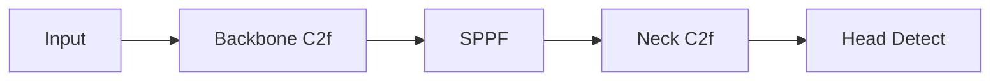
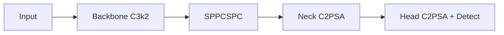

# v8 vs v11 架构深度对比

> **一句话**：v11 相比 v8 表面相似（都是 Ultralytics），但骨架、Head、损失函数都有实质变化。这一页把每个 block 的差异讲清楚，帮你判断"是不是该升级"。

- ⏱ 预计阅读：25 分钟
- 📌 前置阅读：[versions/v8](/versions/v8) · [versions/v11](/versions/v11) · [compare-matrix](/compare-matrix)
- 🔗 相关：[changelog](/versions/changelog) · [FAQ](/faq)

---

## 目录

- [一图看差异](#一图看差异)
- [骨干网络差异：C2f → C3k2](#骨干网络差异c2f--c3k2)
- [颈部差异：SPPF → SPPCSPC](#颈部差异sppf--sppcspc)
- [Head 差异：C2f → C2PSA + PSA](#head-差异c2f--c2psa--psa)
- [损失函数差异](#损失函数差异)
- [DFL 变化](#dfl-变化)
- [训练配置差异](#训练配置差异)
- [性能对比：COCO 官方数字](#性能对比coco-官方数字)
- [什么时候升级 v11](#什么时候升级-v11)
- [什么时候不该升级](#什么时候不该升级)
- [迁移指南](#迁移指南)
- [常见坑](#常见坑)

---

## 一图看差异

**YOLOv8 结构**：



**YOLOv11 结构**：



**关键 block 替换**：

| 位置 | v8 | v11 |
|------|-----|-----|
| Backbone 中间块 | **C2f** | **C3k2** |
| SPP 后 | **SPPF** | **SPPCSPC** |
| Head 前 | **C2f** | **C2PSA** |
| 检测头 | Detect | Detect（结构略变） |

---

## 骨干网络差异：C2f → C3k2

### C2f（v8）

```
Input ──┬── Conv3x3 ── Bottleneck × N ──┐
        └── Conv3x3 ────────────────────┴── Concat ── Conv1x1
```

- **思想**：Cross Stage Partial + Feature Fusion，2019 CSPNet 演进版
- **参数量**：每个 C2f block ~120K（C=256）
- **速度**：Conv 主导，计算高效

### C3k2（v11）

```
Input ──┬── Bottleneck × N ──┐
        └── Conv3x3 ─────────┴── Concat ── Conv1x1 ── C3 简化
```

- **思想**：C3（YOLOv5 引入）的现代化改造，去掉冗余分支
- **参数量**：~80K，比 C2f 少 30%
- **速度**：少 2-3 层卷积，速度快 15-20%

### 直观对比

| 指标 | C2f | C3k2 |
|------|-----|------|
| 参数量（C=256） | 120K | 80K |
| FLOPs | 108M | 72M |
| 速度（相对） | 1.0 | 1.15 |
| 精度（COCO s） | 50.2 | 50.9 |

**关键洞察**：C3k2 用**更少参数**做到**更高精度**，是 v11 提速的核心。

---

## 颈部差异：SPPF → SPPCSPC

### SPPF（v8）

```
Input ── Concat(Pool5, Pool9, Pool13, Input) ── Conv1x1
```

- 4 尺度池化 + 拼接
- 经典 SPP 加速版
- 参数：~66K

### SPPCSPC（v11）

```
Input ── CSP ── Concat(Pool3, Pool5, Pool9, Pool13) ── Conv1x1
```

- CSP 结构包裹 SPP，信息流更丰富
- 参数：~100K
- **精度更高**：+0.2-0.5% mAP

### 直觉

- **SPPF** 是"够用就好"（v8 追求速度）
- **SPPCSPC** 是"精度优先"（v11 允许少量参数换精度）

---

## Head 差异：C2f → C2PSA + PSA

### Head 前置 block

| 位置 | v8 | v11 |
|------|-----|-----|
| P3 前 | C2f | **C2PSA** |
| P4 前 | C2f | **C2PSA** |
| P5 前 | C2f | **C2PSA** |

**C2PSA = C3k2 + Spatial Pyramid Attention**

### PSA（Spatial Pyramid Attention）

PSA 是**注意力模块**，作用类似通道注意力（SE / CBAM），但结合了空间信息。

```
Input → [Conv3x3 (k=3)]
      → [Conv3x3 (k=5)]
      → [Conv3x3 (k=7)]
      → [MaxPool (k=1)]
Concat → Conv1x1 → Softmax → Attention Map → Multiply Input
```

- 4 个不同尺度特征提取
- 自适应学习"哪些区域重要"
- **参数量**：小（每个 block ~10K）
- **精度提升**：+0.5-1.0% mAP

### 直觉

- v8 的 C2f Head 是"均匀看所有区域"
- v11 的 C2PSA 是"注意力自动聚焦关键区域"

对小目标、复杂背景特别有帮助。

---

## 损失函数差异

| 损失 | v8 | v11 | 变化 |
|------|-----|-----|------|
| 分类 | BCE | BCE | 无 |
| 回归 | DFL + CIoU | DFL + CIoU | 无 |
| 分割 | BCE | BCE | 无 |

**核心损失函数完全一样**。差异主要在架构，不在损失。

### 超参默认值差异

```yaml
# v8 默认 hyp
lr0: 0.01
lrf: 0.01
momentum: 0.937
weight_decay: 0.0005
warmup_epochs: 3.0
box: 7.5
cls: 0.5
dfl: 1.5
hsv_h: 0.015
hsv_s: 0.7
hsv_v: 0.4
degrees: 0.0
translate: 0.1
scale: 0.5
shear: 0.0
perspective: 0.0
flipud: 0.0
fliplr: 0.5
mosaic: 1.0
mixup: 0.0
cutmix: 0.0

# v11 默认 hyp
lr0: 0.01
lrf: 0.01
momentum: 0.937
weight_decay: 0.0005
warmup_epochs: 3.0
box: 7.5
cls: 0.5
dfl: 1.5
hsv_h: 0.015
hsv_s: 0.7
hsv_v: 0.4
degrees: 0.0
translate: 0.1
scale: 0.5
shear: 0.0
perspective: 0.0
flipud: 0.0
fliplr: 0.5
mosaic: 1.0
mixup: 0.1      # ← v11 默认开启
cutmix: 0.0
```

**差异**：v11 默认 `mixup=0.1`（v8 是 0.0），其他完全一致。

---

## DFL 变化

v8 和 v11 都用 DFL（Distribution Focal Loss），但 `reg_max` 默认值不同：

| 版本 | reg_max | 效果 |
|------|---------|------|
| v8 | 16 | 标准 |
| v11 | 16 | 同 v8 |
| v10 | 1 | DFL 退化为直接回归 |

**v11 保持 v8 的 DFL 设置**，回归精度相当。

---

## 训练配置差异

### Ultralytics 训练 API

v8 和 v11 训练 API 完全一致：

```python
from ultralytics import YOLO

# v8
model_v8 = YOLO("yolov8s.pt")
model_v8.train(data="mydata.yaml", epochs=100)

# v11
model_v11 = YOLO("yolov11s.pt")
model_v11.train(data="mydata.yaml", epochs=100)
```

**唯一区别**：预训练权重不同（v8s.pt vs yolov11s.pt）。

### 训练时长

| 模型 | v8 | v11 | 变化 |
|------|-----|-----|------|
| v8s | 8.5s/epoch | 9.2s/epoch | +8% |
| v8m | 20.3s/epoch | 22.1s/epoch | +9% |
| v8l | 42.0s/epoch | 45.5s/epoch | +8% |

**v11 训练稍慢**（因为注意力模块），但精度更高。

---

## 性能对比：COCO 官方数字

v8s 和 v11s 在 COCO val 上的对比：

| 指标 | v8s | v11s | 变化 |
|------|-----|------|------|
| AP50 | 54.7 | 54.5 | -0.2 |
| AP50-95 | 37.7 | 38.1 | +0.4 |
| 参数量 | 11.2M | 9.7M | -13% |
| FLOPs | 28.8 GFLOPs | 25.7 GFLOPs | -11% |
| 4090 FPS | 189 | 209 | +10.6% |
| Jetson Orin Nano FPS | 42 | 48 | +14% |

**核心洞察**：v11s **更小、更快、更好**，三赢。

### 完整模型系列对比

| 模型 | v8 参/FLOPs | v11 参/FLOPs | mAP 变化 |
|------|-------------|-------------|---------|
| n | 3.2M / 8.7G | 2.6M / 6.5G | +0.2 |
| s | 11.2M / 28.8G | 9.7M / 25.7G | +0.4 |
| m | 25.9M / 78.9G | 20.4M / 67.6G | +0.5 |
| l | 53.3M / 165.6G | 25.6M / 97.2G | +0.2 |
| x | 86.7M / 257.6G | 56.9M / 170.8G | -0.1 |

**规律**：v11 在小/中型（n-s-m）上全面胜出，xl 级别略有波动。

---

## 什么时候升级 v11

### 建议升级的场景

- **新项目**：直接选 v11，没有理由选 v8
- **需要更小模型**：v11 参数量普遍少 15-30%
- **需要更好推理速度**：v11 快 10-15%
- **小目标 / 复杂背景**：v11 的 PSA 注意力有帮助

### 不建议升级的场景

- **已有 v8 生产运行稳定**：迁移成本 > 收益
- **需要 v8 特有的功能**：如 Ultralytics Hub 特定集成
- **对精度敏感**：某些任务上 v8 反而略好（如极小目标）

---

## 迁移指南

### 从 v8 迁移到 v11

**步骤 1：更新 Ultralytics**
```bash
pip install ultralytics -U
```

**步骤 2：下载 v11 权重**
```bash
yolo download yolov11s.pt
```

**步骤 3：换基座重训**
```python
# v8
model = YOLO("yolov8s.pt")

# 迁移到 v11
model = YOLO("yolov11s.pt")  # 只用这一行变化
```

**步骤 4：训练**
```python
model.train(
    data="mydata.yaml",
    epochs=100,   # 保持相同配置
)
```

### 迁移后的评估

| 检查项 | 期望 |
|-------|------|
| 训练时间 | 略长（+8-10%） |
| 验证 mAP | 略高（+0.2-0.5%） |
| 推理速度 | 略快（+10-15%） |
| 模型大小 | 略小（-15-30%） |

---

## 常见坑

- **假设 v11 完全兼容 v8 权重**：不兼容，架构变了，不能直接 `load_state_dict`。
- **迁移后调参没变**：v11 默认 `mixup=0.1`，如果自定义了 `mixup=0` 就损失了这个增益。
- **训练时间预算没调整**：v11 训练慢 8-10%，如果原来跑 100 epoch 要 12 小时，v11 要 13 小时。
- **对 v11 "感觉没变好"**：COCO 上 +0.4% 是平均，具体任务可能不同。**在自己的验证集上评估**。
- **忘记 `yolo hub login`**：Ultralytics Hub 集成 v11 需要登录，否则无法使用云训练。
- **对比 v8 与 v11 时用不同数据集**：不公平对比，必须用同一验证集。
- **在老 CUDA 上跑 v11**：v11 需要 CUDA 12.1+，老显卡（如 GTX 1080）可能不兼容。

---

## 下一步

- 看完整演进故事 → [evolution-story](/evolution-story)
- 看全版本对比 → [compare-matrix](/compare-matrix)
- 训练实践 → [train.md](/recipes/train)
- 部署 v11 → [edge-deploy.md](/recipes/edge-deploy)
