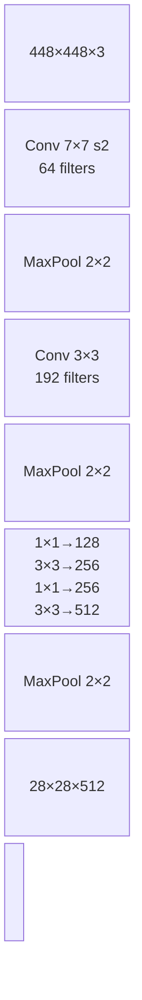
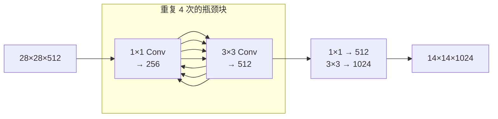
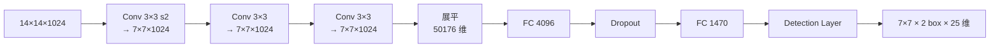
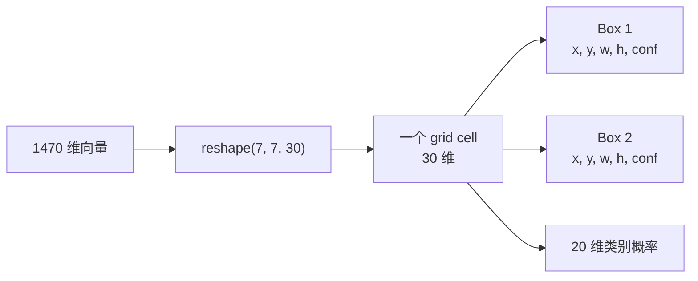
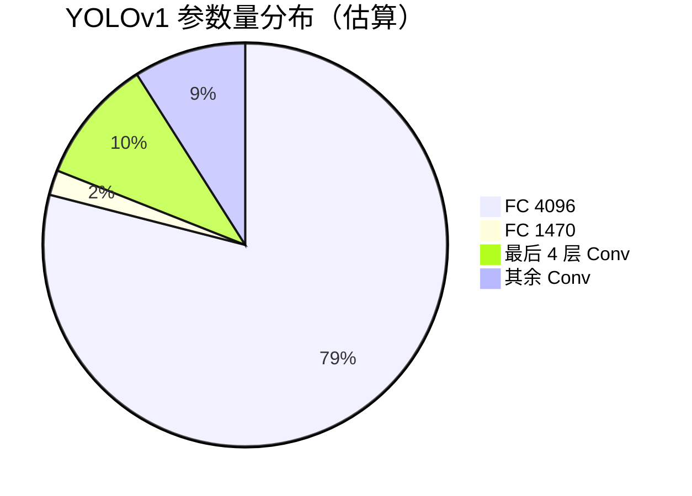

# YOLOv1 架构逐层图解

这一页把 YOLOv1 的 24 个卷积层 + 2 个全连接层 + 1 个 Detection 层**逐层展开**，每层都给出：输入/输出 tensor shape、参数量、源码对应位置、以及一句白话解释。

> 所有代码片段来自 `source/yolov1/snapshot/`（commit `8322a58`），cfg 文件见 `cfg/yolo.cfg`。

---

## 1. 一眼看清：输入 → 输出的完整流程

```mermaid
flowchart LR
    IMG["🖼️ 输入图像<br/>448 × 448 × 3"]
    subgraph STEM["Stem：快速下采样"]
        S1["Conv 7×7 / s2<br/>→ 224×224×64"]
        P1["MaxPool 2×2"]
        S2["Conv 3×3<br/>→ 112×112×192"]
        P2["MaxPool 2×2"]
        S3["Conv 1×1→3×3<br/>→ 56×56×256"]
        P3["MaxPool 2×2"]
    end
    subgraph BODY["Body：特征提炼"]
        B1["交替 256/512<br/>→ 28×28×512"]
        P4["MaxPool 2×2"]
        B2["1024 瓶颈<br/>→ 14×14×1024"]
    end
    subgraph HEAD["Head：检测专用"]
        H1["Conv 3×3 s2<br/>→ 7×7×1024"]
        H2["Conv 3×3 ×2<br/>→ 7×7×1024"]
        H3["FC 4096 + Dropout"]
        H4["FC 1470"]
        H5["Detection Layer"]
    end
    OUT["98 个框<br/>每个框：x,y,w,h,conf + 20 类"]

    IMG --> S1 --> P1 --> S2 --> P2 --> S3 --> P3
    P3 --> B1 --> P4 --> B2
    B2 --> H1 --> H2 --> H3 --> H4 --> H5 --> OUT
```



**一句话总结**：前面 24 层卷积把 448×448 的图压成 7×7×1024 的特征立方体；最后两个全连接层把这个立方体拍平成 1470 个数字；Detection 层再把 1470 个数字切成 49 个网格、每个网格 2 个框。

---

## 2. 29 层逐层明细表

| 层号 | cfg 配置 | kernel | filters | stride | 输入 shape | 输出 shape | 源码位置 | 参数量 |
|-----|----------|--------|---------|--------|-----------|-----------|----------|--------|
| 1 | `[convolutional]` size=7 | 7×7 | 64 | 2 | 448×448×3 | 224×224×64 | `parser.c` 解析 | 9,472 |
| 2 | `[maxpool]` size=2 | 2×2 | — | 2 | 224×224×64 | 112×112×64 | `maxpool_layer.c` | 0 |
| 3 | `[convolutional]` size=3 | 3×3 | 192 | 1 | 112×112×64 | 112×112×192 | `convolutional_layer.c` | 110,784 |
| 4 | `[maxpool]` size=2 | 2×2 | — | 2 | 112×112×192 | 56×56×192 | `maxpool_layer.c` | 0 |
| 5 | `[convolutional]` size=1 | 1×1 | 128 | 1 | 56×56×192 | 56×56×128 | — | 24,704 |
| 6 | `[convolutional]` size=3 | 3×3 | 256 | 1 | 56×56×128 | 56×56×256 | — | 295,168 |
| 7 | `[convolutional]` size=1 | 1×1 | 256 | 1 | 56×56×256 | 56×56×256 | — | 65,792 |
| 8 | `[convolutional]` size=3 | 3×3 | 512 | 1 | 56×56×256 | 56×56×512 | — | 1,180,032 |
| 9 | `[maxpool]` size=2 | 2×2 | — | 2 | 56×56×512 | 28×28×512 | `maxpool_layer.c` | 0 |
| 10 | `[convolutional]` size=1 | 1×1 | 256 | 1 | 28×28×512 | 28×28×256 | — | 131,328 |
| 11 | `[convolutional]` size=3 | 3×3 | 512 | 1 | 28×28×256 | 28×28×512 | — | 1,180,032 |
| 12 | `[convolutional]` size=1 | 1×1 | 256 | 1 | 28×28×512 | 28×28×256 | — | 131,328 |
| 13 | `[convolutional]` size=3 | 3×3 | 512 | 1 | 28×28×256 | 28×28×512 | — | 1,180,032 |
| 14 | `[convolutional]` size=1 | 1×1 | 256 | 1 | 28×28×512 | 28×28×256 | — | 131,328 |
| 15 | `[convolutional]` size=3 | 3×3 | 512 | 1 | 28×28×256 | 28×28×512 | — | 1,180,032 |
| 16 | `[convolutional]` size=1 | 1×1 | 512 | 1 | 28×28×512 | 28×28×512 | — | 262,656 |
| 17 | `[convolutional]` size=3 | 3×3 | 1024 | 1 | 28×28×512 | 28×28×1024 | — | 4,719,616 |
| 18 | `[maxpool]` size=2 | 2×2 | — | 2 | 28×28×1024 | 14×14×1024 | `maxpool_layer.c` | 0 |
| 19 | `[convolutional]` size=1 | 1×1 | 512 | 1 | 14×14×1024 | 14×14×512 | — | 524,288 |
| 20 | `[convolutional]` size=3 | 3×3 | 1024 | 1 | 14×14×512 | 14×14×1024 | — | 4,719,616 |
| 21 | `[convolutional]` size=1 | 1×1 | 512 | 1 | 14×14×1024 | 14×14×512 | — | 524,288 |
| 22 | `[convolutional]` size=3 | 3×3 | 1024 | 1 | 14×14×512 | 14×14×1024 | — | 4,719,616 |
| 23 | `[convolutional]` size=3 | 3×3 | 1024 | **2** | 14×14×1024 | **7×7×1024** | — | 9,438,208 |
| 24 | `[convolutional]` size=3 | 3×3 | 1024 | 1 | 7×7×1024 | 7×7×1024 | — | 9,438,208 |
| 24b | `[convolutional]` size=3 | 3×3 | 1024 | 1 | 7×7×1024 | 7×7×1024 | — | 9,438,208 |
| 25 | `[connected]` output=4096 | — | 4096 | — | 7×7×1024=50176 | 4096 | `connected_layer.c` | 205,524,992 |
| 26 | `[dropout]` probability=.5 | — | — | — | 4096 | 4096 | `dropout_layer.c` | 0 |
| 27 | `[connected]` output=1470 | — | 1470 | — | 4096 | 1470 | `connected_layer.c` | 6,023,680 |
| 28 | `[detection]` | — | — | — | 1470 | 7×7×30 | `detection_layer.c` | 0 |

**总参数量估算**：≈ **260 M**（卷积 ≈47 M + 全连接 ≈212 M）。注意论文报告的约 70 M 通常指可学习的权重；Darknet v1 实现因 FC 巨大实际更高。不同统计口径会出入。

---

## 3. 四个阶段的「原理图 + 白话 + 代码」

### 3.1 Stem：把图像从大变小（层 1-8）

**原理图**：



**白话**：
- 正常人看图是 448×448 像素，机器直接看这么大太累。
- 第 1 层用一个 7×7 的大卷积核，把图片横竖各砍一半，变成 224×224。
- 后面再跟 4 次 MaxPool，每次再砍一半，最后变成 28×28。
- 通道数从 3（RGB）一路涨到 512，相当于“空间换通道”：位置信息变粗糙，语义信息变丰富。

**对应代码**（`cfg/yolo.cfg` 第 24-77 行）：

```cfg
[convolutional]
filters=64
size=7
stride=2
pad=1
activation=leaky

[maxpool]
size=2
stride=2
```

---

### 3.2 Body：反复提炼（层 9-22）

**原理图**：



**白话**：
- 这里用的是 GoogLeNet 的“1×1 压缩通道、3×3 提取特征”套路。
- 256 和 512 像拉抽屉一样交替：先压缩减少计算，再扩展提取更多模式。
- 经过 4 轮后，特征图还是 28×28，但语义信息已经比 Stem 末端丰富得多。
- 最后再用一次 3×3 把通道扩到 1024，为下一步进入 Head 做准备。

**对应代码**（`cfg/yolo.cfg` 第 78-178 行，节选）：

```cfg
[convolutional]
filters=256
size=1
stride=1
pad=1
activation=leaky

[convolutional]
filters=512
size=3
stride=1
pad=1
activation=leaky
# 该模式重复 4 次
```

---

### 3.3 Head：从特征到预测（层 23-28）

**原理图**：



**白话**：
- 这一步是关键：把特征图从 14×14 压到 **7×7**，正好对应论文里的 7×7 grid。
- 每个 7×7 的格子要负责预测“中心落在我这里的物体”。
- FC 4096 先把 50176 维的特征压缩到 4096，再映射到 1470。
- 1470 是怎么来的？见下一节。

**对应代码**（`cfg/yolo.cfg` 第 180-229 行）：

```cfg
[convolutional]
size=3
stride=2
pad=1
filters=1024
activation=leaky

[connected]
output=4096
activation=leaky

[dropout]
probability=.5

[connected]
output= 1470
activation=linear

[detection]
classes=20
coords=4
rescore=1
side=7
num=2
softmax=0
sqrt=1
```

---

## 4. 1470 维输出的可视化切分

Detection 层把 `FC 1470` 的输出 reshape 成一个 7×7×30 的张量：



**30 维的明细**：

| 维度 | 含义 | 范围 | 训练目标 |
|-----|------|------|---------|
| 0-3 | Box 1 的 (x, y, w, h) | x,y∈[0,1] 相对 grid；w,h∈[0,1] 相对全图 | GT box 的相对坐标 |
| 4 | Box 1 的 confidence | 任意，训练时为 P(Object)·IoU | P(Object)·IoU |
| 5-9 | Box 2 的 (x, y, w, h, conf) | 同上 | 同上 |
| 10-29 | 该 cell 的 20 类概率 | Softmax 后 ∈[0,1] | one-hot GT 类别 |

> **注意**：第二组 box 只复用 5 维（x,y,w,h,conf），不重复 20 维类别。因为同一 cell 内两个 box 预测的类别本应一致。这是工程优化，让总输出从 2450 降到 1470。

**对应源码**（`src/detection_layer.c` 前向切分逻辑）：

```c
// 简化示意：从网络输出中取出每个 cell 的预测
int locations = l.side * l.side;          // 7*7=49
for (i = 0; i < locations; ++i) {
    int row = i / l.side;
    int col = i % l.side;
    for (n = 0; n < l.n; ++n) {          // l.n = 2 个 box
        int index = i*l.n + n;
        // b.xywh 位于 output 的特定偏移
        boxes[index].x = (predictions[offset + 0] + col) / l.side;
        boxes[index].y = (predictions[offset + 1] + row) / l.side;
        boxes[index].w = predictions[offset + 2] * predictions[offset + 2];
        boxes[index].h = predictions[offset + 3] * predictions[offset + 3];
        if (l.sqrt) {
            boxes[index].w = pow(boxes[index].w, .5);
            boxes[index].h = pow(boxes[index].h, .5);
        }
    }
}
```

---

## 5. 参数量为什么这么大？

YOLOv1 的参数量主要被 FC 4096 吃掉：



**FC 4096 的计算**：

```
输入维度 = 7 × 7 × 1024 = 50,176
输出维度 = 4096
参数量 = 50,176 × 4096 + bias 4096 ≈ 205,525,504 ≈ 196 M
```

这就是 v1 被诟病“模型大、慢”的核心原因。v2 起完全去掉 FC，改用全卷积 + anchor，参数量骤降到 v2 的约 50 M、v3-tiny 的 6 M。

---

## 6. 与 v2/v3 的架构对比

| 特性 | v1 | v2 | v3 |
|------|-----|-----|-----|
| 下采样次数 | 5（4 pool + 1 conv s2） | 5 | 5 |
| Head 类型 | 2 层 FC | 全卷积 + anchor | 全卷积 + FPN 三头 |
| 输出 | 7×7×30 | 13×13×5×(5+C) | 13×13 + 26×26 + 52×52 |
| 类别预测 | 每 grid 共享 | 每 anchor 独立 | 每 anchor 独立 |
| 参数量 | ~260 M（FC 占大头） | ~50 M | ~62 M |

---

## 7. 常见误区

1. **“v1 有 Local 层”**：这是早期 Darknet 教程的误传。`8322a58` 快照的 `cfg/yolo.cfg` 里只有 convolutional + maxpool + connected + detection，没有 `[local]`。
2. **“1470 = 7×7×30 是 30 类”**：不是 30 类，是 2×5（两个 box 各 5 维）+ 20 类 = 30 维。
3. **“FC 1470 直接输出 98 个框”**：FC 先输出 1470 维向量，Detection 层再切分成 49×2 = 98 个候选框。

---

## 8. 延伸阅读

- [论文精读](/versions/v1/paper)
- [理论 Concept](/versions/v1/concepts)
- [损失函数](/versions/v1/losses)
- [训练技巧](/versions/v1/tricks)
- [源码走读](/versions/v1/code-walkthrough)
- [架构与层](/versions/v1/layers) — 按层类型组织的速查表
- [痛点追踪](/versions/v1/painpoints)
