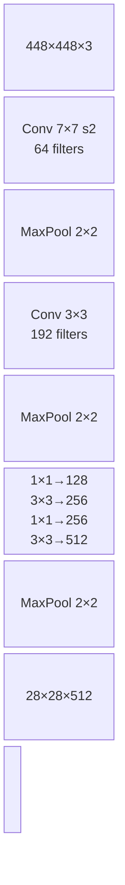
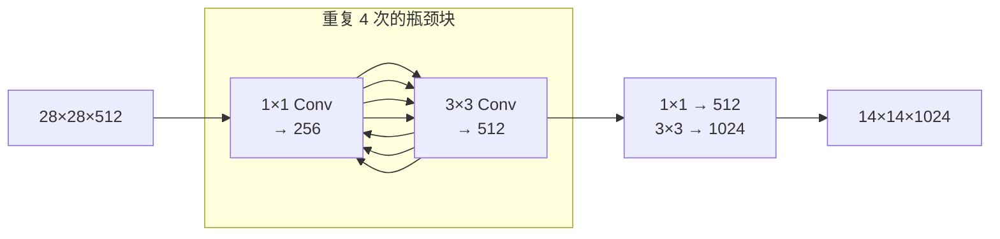
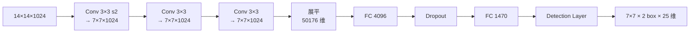
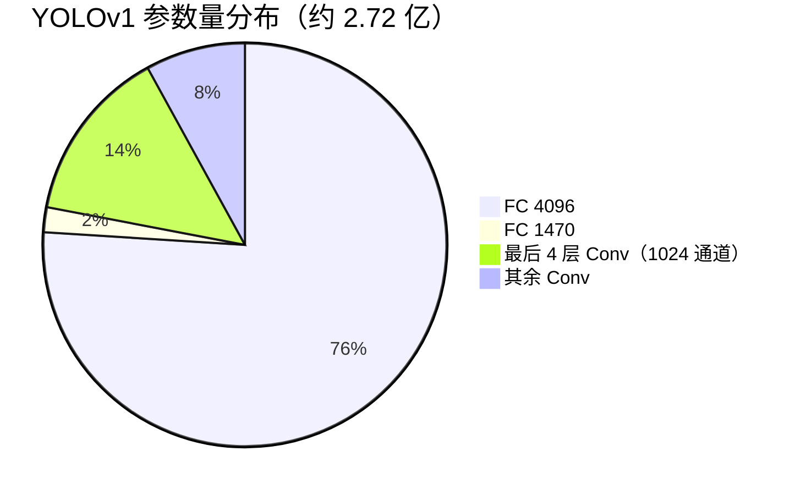

# YOLOv1 架构逐层图解

这一页把 YOLOv1 的 24 个卷积层 + 2 个全连接层 + 1 个 Detection 层**逐层展开**，每层都给出：输入/输出 tensor shape、参数量、源码对应位置、以及一句白话解释。

> 所有代码片段来自 `source/yolov1/snapshot/`（commit `8322a58`），cfg 文件见 `cfg/yolo.cfg`。

::: tip TL;DR：只想带走三件事
1. **448 → 7 靠 6 次空间减半**：4 个 maxpool + 2 个 stride-2 卷积，最终输出 7×7×1024。
2. **参数全压在尾部 FC**：FC4096 单层约 2.06 亿参数（占全网约 3/4）——v2 砍掉 FC 就是冲它来的。
3. **没有 BN、没有 anchor、输出层无激活**——这三个"没有"正是 v2 的改进清单。
:::

---

## 1. 一眼看清：输入 → 输出的完整流程

<DiagramArch />

**一句话总结**：前面 24 层卷积把 448×448 的图经 6 次空间减半压成 7×7×1024 的特征立方体；最后两个全连接层把这个立方体拍平成 1470 个数字；Detection 层再把 1470 个数字切成 49 个网格、每个网格 2 个框。

---

## 2. 逐层明细表（按快照 cfg 顺序，共 24 conv + 4 pool + 2 FC）

cfg 起始行均可点击直达：<SrcLink file="cfg/yolo.cfg" :line="24" />。所有卷积后直接接 Leaky ReLU——**快照 cfg 没有启用 batch_normalize**（BN 是 YOLOv2 才引入的改进，勿把 v2 结构投射到 v1）。

| # | 类型 | kernel / stride | 输出通道 | 特征图尺寸 | cfg 行 | 参数量 |
|---|------|-----------------|---------|-----------|--------|--------|
| 1 | conv | 7×7 / 2 | 64 | 224×224 | <SrcLink file="cfg/yolo.cfg" :line="24" /> | 9,472 |
| 2 | maxpool | 2×2 / 2 | 64 | 112×112 | <SrcLink file="cfg/yolo.cfg" :line="31" /> | 0 |
| 3 | conv | 3×3 / 1 | 192 | 112×112 | <SrcLink file="cfg/yolo.cfg" :line="35" /> | 110,784 |
| 4 | maxpool | 2×2 / 2 | 192 | 56×56 | <SrcLink file="cfg/yolo.cfg" :line="42" /> | 0 |
| 5 | conv | 1×1 / 1 | 128 | 56×56 | <SrcLink file="cfg/yolo.cfg" :line="46" /> | 24,704 |
| 6 | conv | 3×3 / 1 | 256 | 56×56 | <SrcLink file="cfg/yolo.cfg" :line="53" /> | 295,168 |
| 7 | conv | 1×1 / 1 | 256 | 56×56 | <SrcLink file="cfg/yolo.cfg" :line="60" /> | 65,792 |
| 8 | conv | 3×3 / 1 | 512 | 56×56 | <SrcLink file="cfg/yolo.cfg" :line="67" /> | 1,180,032 |
| 9 | maxpool | 2×2 / 2 | 512 | 28×28 | <SrcLink file="cfg/yolo.cfg" :line="74" /> | 0 |
| 10 | conv | 1×1 / 1 | 256 | 28×28 | <SrcLink file="cfg/yolo.cfg" :line="78" /> | 131,328 |
| 11 | conv | 3×3 / 1 | 512 | 28×28 | <SrcLink file="cfg/yolo.cfg" :line="85" /> | 1,180,032 |
| 12 | conv | 1×1 / 1 | 256 | 28×28 | <SrcLink file="cfg/yolo.cfg" :line="92" /> | 131,328 |
| 13 | conv | 3×3 / 1 | 512 | 28×28 | <SrcLink file="cfg/yolo.cfg" :line="99" /> | 1,180,032 |
| 14 | conv | 1×1 / 1 | 256 | 28×28 | <SrcLink file="cfg/yolo.cfg" :line="106" /> | 131,328 |
| 15 | conv | 3×3 / 1 | 512 | 28×28 | <SrcLink file="cfg/yolo.cfg" :line="113" /> | 1,180,032 |
| 16 | conv | 1×1 / 1 | 256 | 28×28 | <SrcLink file="cfg/yolo.cfg" :line="120" /> | 131,328 |
| 17 | conv | 3×3 / 1 | 512 | 28×28 | <SrcLink file="cfg/yolo.cfg" :line="127" /> | 1,180,032 |
| 18 | conv | 1×1 / 1 | 512 | 28×28 | <SrcLink file="cfg/yolo.cfg" :line="134" /> | 262,656 |
| 19 | conv | 3×3 / 1 | 1024 | 28×28 | <SrcLink file="cfg/yolo.cfg" :line="141" /> | 4,719,616 |
| 20 | maxpool | 2×2 / 2 | 1024 | 14×14 | <SrcLink file="cfg/yolo.cfg" :line="148" /> | 0 |
| 21 | conv | 1×1 / 1 | 512 | 14×14 | <SrcLink file="cfg/yolo.cfg" :line="152" /> | 524,288 |
| 22 | conv | 3×3 / 1 | 1024 | 14×14 | <SrcLink file="cfg/yolo.cfg" :line="159" /> | 4,719,616 |
| 23 | conv | 1×1 / 1 | 512 | 14×14 | <SrcLink file="cfg/yolo.cfg" :line="166" /> | 524,288 |
| 24 | conv | 3×3 / 1 | 1024 | 14×14 | <SrcLink file="cfg/yolo.cfg" :line="173" /> | 4,719,616 |
| 25 | conv | 3×3 / 1 | 1024 | 14×14 | <SrcLink file="cfg/yolo.cfg" :line="182" /> | 9,438,208 |
| 26 | conv | 3×3 / **2** | 1024 | **7×7** | <SrcLink file="cfg/yolo.cfg" :line="189" /> | 9,438,208 |
| 27 | conv | 3×3 / 1 | 1024 | 7×7 | <SrcLink file="cfg/yolo.cfg" :line="196" /> | 9,438,208 |
| 28 | conv | 3×3 / 1 | 1024 | 7×7 | <SrcLink file="cfg/yolo.cfg" :line="203" /> | 9,438,208 |
| 29 | connected | — | 4096 | 1 | <SrcLink file="cfg/yolo.cfg" :line="210" /> | 205,524,992 |
| 30 | dropout .5 | — | — | 1 | <SrcLink file="cfg/yolo.cfg" :line="214" /> | 0 |
| 31 | connected | — | 1470 | 1 | <SrcLink file="cfg/yolo.cfg" :line="217" /> | 6,022,590 |
| 32 | detection | — | — | reshape 7×7×30 | <SrcLink file="cfg/yolo.cfg" :line="221" /> | 0 |

**空间下采样共 6 次**：层 1（conv s2）、层 2/4/9/20（4 次 pool）、层 26（conv s2），448 / 2⁶ = 7。

**总参数量 ≈ 2.72 亿**：卷积约 60 M + FC 约 212 M。FC4096 一层（50,176×4096）就占约 2.06 亿，是 v1 模型巨大的根源；v2 去掉 FC 后参数降到约 50 M 量级。

---

## 3. 四个阶段的「原理图 + 白话 + 代码」

### 3.1 Stem：把图像从大变小（层 1-8）

**原理图**：



**白话**：
- 正常人看图是 448×448 像素，机器直接看这么大太累。
- 第 1 层用一个 7×7 的大卷积核把分辨率砍半（448→224）。
- Stem 段再跟 3 次 MaxPool（224→112→56→28）。
- 通道数从 3（RGB）一路涨到 512，相当于“空间换通道”：位置信息变粗糙，语义信息变丰富。

**对应代码**（<SrcLink file="cfg/yolo.cfg" :line="24" :end="33" />，原文）：

<SrcSnippet file="cfg/yolo.cfg" :start="24" :end="33" hl="25-27" />

---

### 3.2 Body：反复提炼（层 9-22）

**原理图**：



**白话**：
- 这里用的是 GoogLeNet 的“1×1 压缩通道、3×3 提取特征”套路。
- 256 和 512 像拉抽屉一样交替：先压缩减少计算，再扩展提取更多模式。
- 经过 4 轮后，特征图还是 28×28，但语义信息已经比 Stem 末端丰富得多。
- 最后再用一次 3×3 把通道扩到 1024，为下一步进入 Head 做准备。

**对应代码**（<SrcLink file="cfg/yolo.cfg" :line="78" :end="90" />，256/512 成对在 @28 段重复 4 次，末尾再接 512/1024 一对）：

<SrcSnippet file="cfg/yolo.cfg" :start="78" :end="90" hl="79-80,86-87" />

---

### 3.3 Head：从特征到预测（层 23-28）

**原理图**：



**白话**：
- 这一步是关键：把特征图从 14×14 压到 **7×7**，正好对应论文里的 7×7 grid。
- 每个 7×7 的格子要负责预测“中心落在我这里的物体”。
- FC 4096 先把 50176 维的特征压缩到 4096，再映射到 1470。
- 1470 是怎么来的？见下一节。

**对应代码**：先有一层 s1 conv 保持 14×14（<SrcLink file="cfg/yolo.cfg" :line="182" />），s2 降维在 <SrcLink file="cfg/yolo.cfg" :line="189" />，其后还有两层 s1 conv：

<SrcSnippet file="cfg/yolo.cfg" :start="189" :end="207" hl="190" />

FC、dropout 与 detection 头：

<SrcSnippet file="cfg/yolo.cfg" :start="209" :end="228" hl="210,214,217,224-228" />

---

## 4. 1470 维输出的可视化切分

Detection 层把 `FC 1470` 的输出 reshape 成一个 7×7×30 的张量（内存真实顺序：20 类 → 2 conf → 2×4 坐标）：

<DiagramTensor30 />

**30 维的明细**：

论文视角的逻辑分组（内存物理顺序相反，见上图底部标注）：

| 逻辑段 | 含义 | 范围/激活 | 训练目标 |
|-------|------|-----------|---------|
| Box 1 的 4 坐标 | (x, y, w, h) | x,y∈[0,1] 相对 cell；w,h 为 √ 空间、相对全图 | GT 归一化坐标（w,h 取 √） |
| Box 1 confidence | P(Object)·IoU | 线性（cfg `softmax=0`，不做 sigmoid/softmax） | 无目标 0；有目标 1 或 IoU |
| Box 2 的 5 维 | 同上 | 同上 | 仅 best box 受坐标/物体监督 |
| 20 类概率 | 每格一套、两 box 共享 | 线性输出（**不做 softmax**） | one-hot，L2 拟合 |

> **注意 1**：第二组 box 不重复 20 维类别——同一 cell 的两个 box 共享类别，输出从 2450 降到 1470。
> **注意 2**：`softmax=0` 时类别头是裸线性输出，靠 L2 拟合 one-hot，并不保证概率归一；推理时直接 `conf × class_prob` 比大小（<SrcLink file="src/yolo.c" :line="104" />）。

**推理解码的真实实现**在 <SrcLink file="src/yolo.c" :line="86" :end="112" />（不在 detection_layer），坐标加 cell 偏移、宽高平方，**没有再做一次 √**：

<DiagramDecode />

<SrcSnippet file="src/yolo.c" :start="90" :end="106" hl="98-101,104" />

---

## 5. 参数量为什么这么大？

YOLOv1 的参数量主要被 FC 4096 吃掉：



**FC 4096 的计算**：

```
输入维度 = 7 × 7 × 1024 = 50,176
输出维度 = 4096
参数量 = 50,176 × 4096 + bias 4096 = 205,524,992 ≈ 196 M
```

这就是 v1 被诟病“模型大、慢”的核心原因。v2 起完全去掉 FC，改用全卷积 + anchor，参数量骤降到 v2 的约 50 M、v3-tiny 的 6 M。

---

## 6. 与 v2/v3 的架构对比

| 特性 | v1 | v2 | v3 |
|------|-----|-----|-----|
| 下采样次数 | **6**（4 pool + 2 conv s2，448/64=7） | 5（416/32=13） | 5 |
| Head 类型 | 2 层 FC | 全卷积 + anchor | 全卷积 + FPN 三头 |
| 输出 | 7×7×30 | 13×13×5×(5+C) | 13×13 + 26×26 + 52×52 |
| 类别预测 | 每 grid 共享、softmax=0 | 每 anchor 独立 | 每 anchor 独立 |
| 参数量 | ~272 M（FC 占大头） | ~50 M | ~62 M |

---

## 7. 常见误区

1. **“v1 有 Local 层”**：这是早期 Darknet 教程的误传。`8322a58` 快照的 `cfg/yolo.cfg` 里只有 convolutional + maxpool + connected + detection，没有 `[local]`。
2. **“1470 = 7×7×30 是 30 类”**：不是 30 类，是 2×5（两个 box 各 5 维）+ 20 类 = 30 维。
3. **“FC 1470 直接输出 98 个框”**：FC 先输出 1470 维向量，Detection 层再切分成 49×2 = 98 个候选框。

---

## 8. 延伸阅读

- [论文精读](/versions/v1/paper)
- [理论 Concept](/versions/v1/concepts)
- [损失函数](/versions/v1/losses)
- [训练技巧](/versions/v1/tricks)
- [源码走读](/versions/v1/code-walkthrough)
- [架构与层](/versions/v1/layers) — 按层类型组织的速查表
- [痛点追踪](/versions/v1/painpoints)
