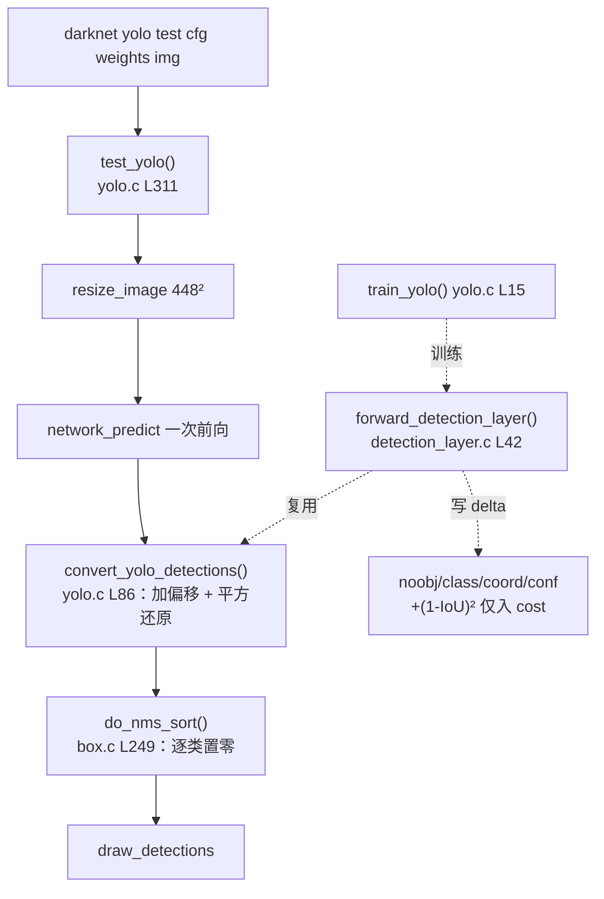

# YOLOv1 源码走读

基于仓库内 darknet 快照 `source/yolov1/snapshot/`（锁定 v1 时期 commit），走读四个关键文件。**本页所有代码均为快照原文截取**，头部可跳转[完整源码页](/versions/v1/source/detection-layer)或 GitHub 对应行。

> 快照与上游的差异：当前 pjreddie/darknet 的 `cfg/yolov1.cfg` 已被 v2+ 实验值覆盖（如 `num=3`），研究 v1 一律以快照 `cfg/yolo.cfg` 为准。

## 文件清单

| 文件 | 行数 | 作用 | 完整源码 |
|------|------|------|----------|
| `cfg/yolo.cfg` | 240 | 网络结构 + 训练超参 | [浏览](/versions/v1/source/yolo-cfg) |
| `src/detection_layer.c` | 253 | 检测头：前向里算 loss/delta | [浏览](/versions/v1/source/detection-layer) |
| `src/yolo.c` | 389 | 训练/推理入口、输出解码 | [浏览](/versions/v1/source/yolo) |
| `src/box.c` | ~430 | IoU/RMSE、NMS | [浏览](/versions/v1/source/box) |

---

## 1. `yolo.cfg` — 网络与训练配置

`[net]` 段：输入 448、lr warmup + 两级衰减、HSV 增强系数。

<SrcSnippet file="cfg/yolo.cfg" :start="1" :end="15" hl="10,12,14" />

检测头参数决定输出张量形状（7×7×30）与损失权重：

<SrcSnippet file="cfg/yolo.cfg" :start="221" :end="234" hl="225,226,228,231-234" />

- `side=7, num=2` → 7×7 grid × 2 box = 98 个候选
- `coords=4, classes=20` → 每候选 4 坐标，每格共享 20 类
- `softmax=0` → 类别不做 softmax（直接 L2 拟合 one-hot）
- `sqrt=1` → 宽高在 √ 空间回归
- `rescore=1` → confidence 目标取 IoU（关键，见 §2.5）
- `coord_scale=5` / `noobject_scale=.5` → 损失四项权重

尾部两层 FC 与 dropout：<SrcLink file="cfg/yolo.cfg" :line="210" :end="219" />。

---

## 2. `detection_layer.c` — 前向即损失

YOLOv1 没有独立的 loss 文件：训练时 **`forward_detection_layer()` 一边前向一边写 `l.delta`**，`backward_detection_layer()` 只做一次 axpy 把 delta 传给上一层（<SrcLink file="src/detection_layer.c" :line="215" :end="218" />）。

### 2.1 输出布局：classes → conf → coords

函数开头把网络输入拷进 `l.output`，`locations = side² = 49`（<SrcLink file="src/detection_layer.c" :line="42" :end="46" />）。每个 cell 的 30 维在内存中的实际顺序是 **20 类 → 2 个 conf → 2×4 坐标**，与论文图示的「box+class」次序不同：

<DiagramTensor30 />

### 2.2 所有 box 先背 no-object 债

对每个 cell 的 `n=2` 个 box，confidence delta 先全部写成 no-object（后面负责物体的 box 会被冲掉重写），同时累加 cost：

<SrcSnippet file="src/detection_layer.c" :start="72" :end="80" hl="76-78" />

### 2.3 有物体的 cell：class delta + 解码候选框

类别项是朴素 L2，目标直接取 truth 里的 one-hot（注意 **softmax=0**，这里没有对数概率）：

<SrcSnippet file="src/detection_layer.c" :start="90" :end="96" hl="92-93" />

随后把 truth 与两个预测框都换算到**全图归一化坐标系**（x,y 除以 side；预测的 √w/√h 平方还原），计算 IoU 与 RMSE：

<SrcSnippet file="src/detection_layer.c" :start="98" :end="115" hl="99,100,108-111,113" />

### 2.4 best box：IoU 优先，RMSE 兜底，再随机 warmup

<DiagramIou />

选择逻辑（<SrcLink file="src/detection_layer.c" :line="116" :end="138" />）：

1. 只要曾经出现过正 IoU，就按 **IoU 最大**选；
2. 两个框与 GT 完全不相交（IoU 全为 0）时，退化为按 **RMSE 最小**选——这是论文没写的工程兜底；
3. `forced` 按 GT 面积强制指定（快照 cfg 未开启）；
4. **训练前 10 万张图（`net.seen < 100000`）无条件随机指定 box**，保证两个 predictor 都能得到监督，不会一个box 永远饿死。

<SrcSnippet file="src/detection_layer.c" :start="129" :end="138" hl="136-138" />

> 常见误读：随机 warmup 的计数器是网络级的 `*(state.net.seen)`（已见图片数），不是 layer 的 count；阈值是 **100000**。

### 2.5 confidence：rescore 是 v1 的分水岭

先把该 box 的 no-object cost 撤回，写入 object 项；delta 的目标默认是 1，而 `rescore=1` 时改写为 **当前预测框与 GT 的 IoU**——这一行让 confidence 真正学到 `P(Object)·IoU` 而不只是「有没有物体」：

<SrcSnippet file="src/detection_layer.c" :start="153" :end="161" hl="157,159-161" />

### 2.6 坐标项与 sqrt 技巧

坐标 delta 是纯 L2；`sqrt=1` 时宽高的**目标**换成 `√truth_w`，预测空间本就是 √ 空间，所以 delta 里不需要再乘链式因子：

<SrcSnippet file="src/detection_layer.c" :start="163" :end="172" hl="163-166,167-170,172" />

注意 <SrcLink file="src/detection_layer.c" :line="172" /> 的 `pow(1-iou, 2)` **只累加进 `l.cost`（日志展示），从不写 delta**——它不参与反向传播。v1 定位误差占全部错误的 57%，这是根因之一；可学习的 IoU 类损失要等到 v4 的 CIoU 才补上。完整推导见[反向传播推导](/versions/v1/loss-gradient)。

---

## 3. `yolo.c` — 推理流水线

### 3.1 单图入口 `test_yolo()`

真实的推理入口是 `test_yolo()`（由 `run_yolo` 的 `test` 子命令分派，<SrcLink file="src/yolo.c" :line="384" />），核心只有五步：

<SrcSnippet file="src/yolo.c" :start="339" :end="350" hl="343,345,346,348" />

1. `resize_image` 到 448×448（**letterbox 是后来才有的，v1 直接拉伸**）；
2. `network_predict` 一次前向；
3. `convert_yolo_detections` 解码 98 个框；
4. `do_nms_sort` 逐类 NMS；
5. `draw_detections` 画框保存。

> 勘误：早期版本的走读页声称 v1 推理会调用 `border_image` 加 128 灰边。核对快照 `test_yolo()` 并无此调用——那是其他工程的做法，v1 论文实现只做 resize。

### 3.2 输出解码 `convert_yolo_detections()`

<DiagramDecode />

真实解码公式（与上图一一对应）：col/row 是 cell 的列行，`square` 即 cfg 的 `sqrt`，宽高在解码时平方：

<SrcSnippet file="src/yolo.c" :start="90" :end="106" hl="98,99,100,101,104" />

类别分数 = `confidence × class_prob`，低于阈值直接清零（<SrcLink file="src/yolo.c" :line="102" :end="106" />）。

---

## 4. `box.c` — IoU 与 NMS

### 4.1 box 表示与 IoU

darknet 的 box 是**中心点格式** `(x, y, w, h)`，`float_to_box` 直接读连续 4 个 float：

<SrcSnippet file="src/box.c" :start="6" :end="14" />

IoU = 一维 overlap 的乘积 / 并集：

<SrcSnippet file="src/box.c" :start="67" :end="96" hl="78-84,93-96" />

### 4.2 `do_nms_sort()`：逐类排序 + 置零

<DiagramNms />

真实实现**不是**把框「标记删除」，而是：对每个类别，用 `qsort` 按该类分数降序，从最高分框开始，把与它 IoU 超阈值的框的**该类概率直接置 0**（框还在，别的类不受影响）：

<SrcSnippet file="src/box.c" :start="249" :end="277" hl="260,264,270-271" />

98 个候选时 O(classes·n²)≈20×9604 次 IoU，开销不大；但 v3 起候选数上千，NMS 成为显著瓶颈，后续才有 Soft-NMS 与 v10 的 NMS-free 头。

---

## 5. 完整调用链

::: figure 图：训练（橙）与推理（绿）两条路径在 detection_layer / convert / NMS 处的对应关系

:::

## 延伸阅读

- [反向传播推导](/versions/v1/loss-gradient) — 每个 delta 的公式推导
- [损失函数](/versions/v1/losses) — 四项权重与实验现象
- [Architecture 逐层图解](/versions/v1/architecture) — 29 层 shape 与参数量
- [训练技巧](/versions/v1/tricks) — warmup、jitter 等技巧的源码定位
- [痛点追踪](/versions/v1/painpoints) — 源码暴露的实现局限
