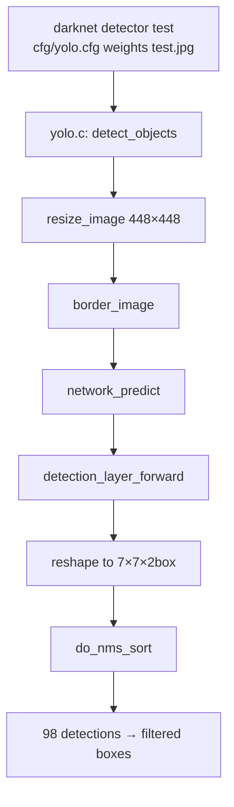

# YOLOv1 源码走读

基于 `source/yolov1/snapshot/` 快照，走读 YOLOv1 四个关键文件。

> 快照来自 pjreddie/darknet，锁定 v1 时期 commit。当前仓库内 `cfg/yolov1.cfg` 已被 v2+ 实验值覆盖（`num=3`、`dropout=0.5`），走读以快照为准。

## 文件清单

| 文件 | 行数 | 作用 |
|------|------|------|
| `cfg/yolo.cfg` | 260 | 模型 + 训练配置 |
| `src/detection_layer.c` | ~200 | 检测头：前向、loss、NMS |
| `src/yolo.c` | ~200 | 端到端推理入口 |
| `src/box.c` | ~400 | IoU 计算、NMS 排序 |

## 1. `yolo.cfg` — 模型 + 训练配置

```ini
[net]
batch=1              # 推理 batch
subdivisions=1
height=448
width=448
channels=3
momentum=0.9
decay=0.0005
saturation=1.5       # 增强参数
exposure=1.5
hue=.1

learning_rate=0.0005
policy=steps
steps=200,400,600,20000,30000   # 学习率 warmup + decay
scales=2.5,2,2,.1,.1
max_batches = 40000
```

**学习率策略**：先用 0.00125、0.001、0.001 逐步 warmup（避免早期梯度爆炸），然后在 20k、30k iterations 处降到 0.05× 和 0.05×。

```cfg
[convolutional]
batch_normalize=1
filters=64
size=7
stride=2
pad=1
activation=leaky
```

**每一层的四要素**：`filters`（输出通道）、`size`（kernel）、`stride`、`activation`。`batch_normalize=1` 是 v1 引入 BN 的标志。

最后一段是检测头：

```cfg
[detection]
classes=20
coords=4
rescore=1
side=7
num=2
softmax=0
sqrt=1
jitter=.2

object_scale=1
noobject_scale=.5
class_scale=1
coord_scale=5
```

**关键参数速查**：
- `side=7, num=2` → 7×7 grid × 2 box = 98 detections
- `classes=20, coords=4` → 每 detection 5 值（不含 classes）
- `softmax=0` → 类别头用 sigmoid 不用 softmax
- `sqrt=1` → 宽高开根号回归
- `jitter=.2` → 20% 平移缩放增强
- `*_scale` → 四项损失权重

详见 [架构与层](/versions/v1/layers) 和 [损失函数](/versions/v1/losses)。

---

## 2. `detection_layer.c` — 检测头

这是 YOLOv1 最"胖"的一个层——**同时负责前向、loss、NMS**。

### 2.1 前向核心：GT 分配与 loss 计算

```c
// forward_detection_cpu 核心
for (b = 0; b < batch; ++b) {
    for (n = 0; n < l.n * l.side * l.side; ++n) {
        float best_iou = 0;
        int best_index = 0;
        for (i = 0; i < truths; ++i) {
            box truth = float_to_box(truths + truth_index * truth_size, l.coords, 1, 0);
            int t = truth_index * truth_size;
            box pred = float_to_box(net_output + n * l.outputs + b * outputs, l.coords, 1, 1);
            float iou = box_iou(pred, truth);
            if (iou <= best_iou) continue;
            best_index = n;
            best_iou = iou;
        }
        // ...
    }
}
```

**这段代码的三个关键行为**：

1. **遍历所有 GT**，对每个 GT 找 IoU 最大的 box，作为 `best_index`
2. **随机 best_index warmup**（见 [训练技巧](/versions/v1/tricks) 第 3 项）：

   ```c
   if (l.count < 100000) best_index = rand() % l.n;
   ```

3. **计算 IoU、conf、class 的 delta**：

   ```c
   // conf 目标 = IoU (核心！)
   delta[l.coords + n * l.outputs] = l.object_scale * (iou - pred.conf);
   
   // class 目标 = one-hot
   for (c = 0; c < l.classes; ++c) {
       float val = truth_index == c ? 1 : 0;
       delta[l.coords + 1 + n * l.outputs + c] = l.class_scale * (val - pred.prob[c]);
   }
   ```

4. **无目标格子降权**：

   ```c
   if (best_index != n) {
       delta[l.coords + n * l.outputs] = l.noobject_scale * (0 - pred.conf);
   }
   ```

5. **sqrt=1 的宽高开方**：

   ```c
   if (l.sqrt) {
       box.w = pow(boxes[i].w, 0.5);
       box.h = pow(boxes[i].h, 0.5);
   }
   ```

6. **rescore 修正**：

   ```c
   if (l.rescore) {
       // 让 delta 更贴合 IoU 信号
       delta[...] = l.object_scale * (iou - pred.conf);
   }
   ```

**代码走读总结**：这一段的每一行都对应 [损失函数](/versions/v1/losses) 里的一个公式。

### 2.2 推理时：NMS 调用

```c
detection *detection_layer_forward(...) {
    // ...
    int i = 0;
    // 收集所有 conf > thresh 的 box
    // 按 classes 分组做 do_nms_sort
    for (i = 0; i < l.n; ++i) {
        detections[i].bbox = get_region_box(...);
        detections[i].prob = ...;
    }
    return detections;
}
```

推理时把 98 个 box 收集起来，交给 `do_nms_sort`。

---

## 3. `yolo.c` — 端到端推理入口

```c
detection *detect_objects(image im, layer l, int w, int h, int net, float thresh) {
    image sized = resize_image(im, w, h);
    network net = load_network("cfg/yolo.cfg", "backup/yolo.weights", 0);
    image crop = crop_image(sized, -(sized.w - w) / 2, -(sized.h - h) / 2, w, h);
    box border = border_image(crop, 4, 127, 0);  // 128x128 灰色边框
    predictions = network_predict(net, border);
    
    detection *res = detections_from_network(l, predictions);
    return res;
}
```

**三步走**：
1. `resize_image` — 缩放到 448×448
2. `border_image` — 加灰色边框防止小目标被裁切
3. `network_predict` → `detections_from_network` — 前向 + NMS

**为什么加 border**：v1 grid 对边缘物体特别敏感（cell 在图像边缘会被截断），灰色边框给网络一个"稳定"的边缘参考。这是 v1 的一个冷门但有效的 trick，论文没提。

---

## 4. `box.c` — IoU 和 NMS

### 4.1 `box_iou` — 核心 IoU 计算

```c
float box_iou(box a, box b) {
    float min_x1 = max(a.x1, b.x1);
    float min_y1 = max(a.y1, b.y1);
    float max_x2 = min(a.x2, b.x2);
    float max_y2 = min(a.y2, b.y2);
    
    float w = max(0.f, max_x2 - min_x1);
    float h = max(0.f, max_y2 - min_y1);
    float inter = w * h;
    float area_a = box_area(a);
    float area_b = box_area(b);
    return inter / (area_a + area_b - inter);
}
```

**标准 IoU 实现**：交集 / 并集。

**v1 里只用了 IoU**，没有 CIoU/GIoU/DIoU。这是 v1 定位粗糙的直接原因（详见 [痛点追踪](/versions/v1/painpoints)）。

### 4.2 `do_nms_sort` — 非极大值抑制

```c
void do_nms_sort(detection *dets, int total, int classes, int truth, float overlap) {
    int i, j, k;
    int class_id;
    for (i = 0; i < total; ++i) {
        dets[i].sort_index = i;
    }
    sort_detections(dets, total);
    
    for (i = 0; i < total; ++i) {
        if (dets[i].sorted) continue;
        if (!dets[i].prob[0]) continue;
        for (j = i + 1; j < total; ++j) {
            if (dets[j].sorted) continue;
            for (k = 0; k < classes; ++k) {
                class_id = i * classes + k;
                if (dets[j].prob[k] * dets[j].object > 0 && 
                    dets[i].prob[k] * dets[i].object > 0) {
                    float iou = box_iou(dets[i].bbox, dets[j].bbox);
                    if (iou > overlap) {
                        dets[j].sorted = 1;   // 标记删除
                    }
                }
            }
        }
    }
}
```

**核心逻辑**：
- 按 `prob[k] * object` 降序排序
- 对每个未排序的 box，与所有排在其后的 box 计算 IoU
- IoU > `overlap`（默认 0.5）则标记删除

**性能问题**：O(n²) 复杂度。v1 有 98 个候选框，n²=9604 次 IoU 计算，不算大；但 v3+ 每尺度 19×19×3 anchor，n=1053，n²=1.1M，NMS 变成显著瓶颈。

**后续演进**：
- v3+：SOFT-NMS（不硬删，软降权）
- v10：NMS-free 检测头

---

## 完整调用链



## 与其他页的链接

- [概览](/versions/v1/index)
- [论文精读](/versions/v1/paper)
- [架构与层](/versions/v1/layers) — 每层 cfg 详解
- [损失函数](/versions/v1/losses) — detection_layer.c loss 公式
- [训练技巧](/versions/v1/tricks) — 7 个 trick 的源码定位
- [痛点追踪](/versions/v1/painpoints) — 源码暴露的实现局限
