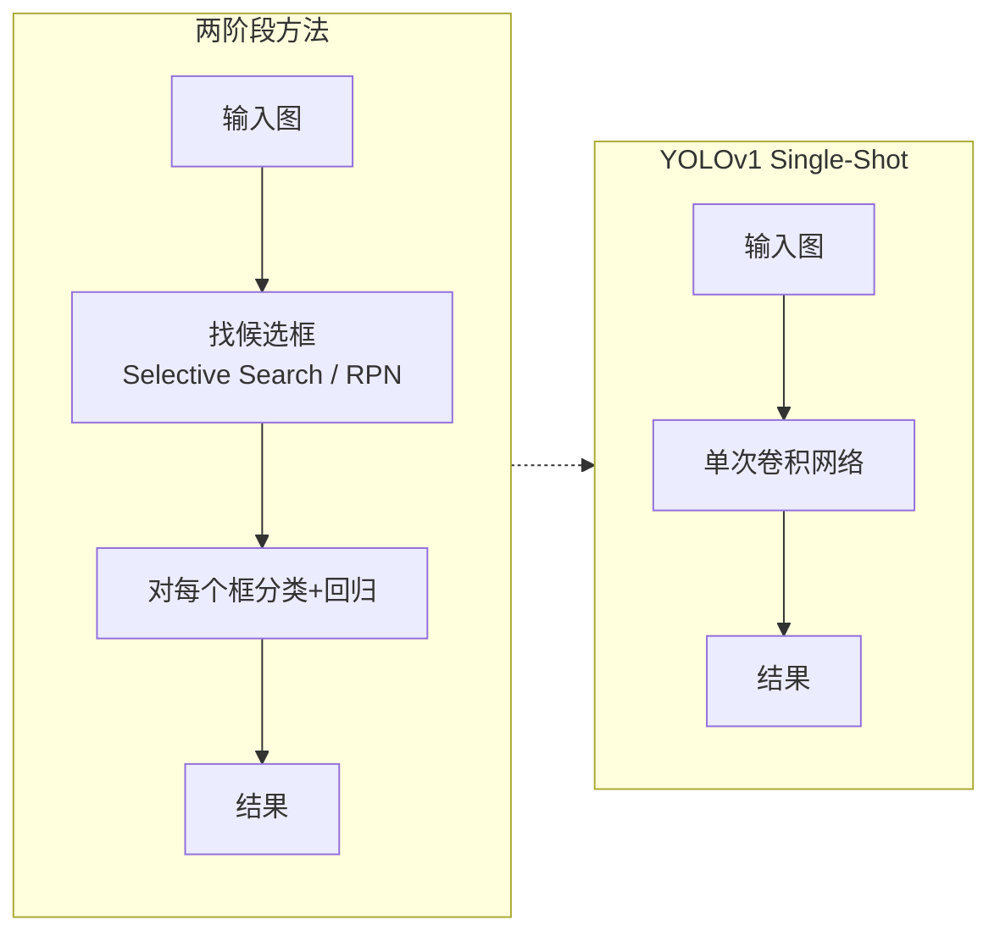
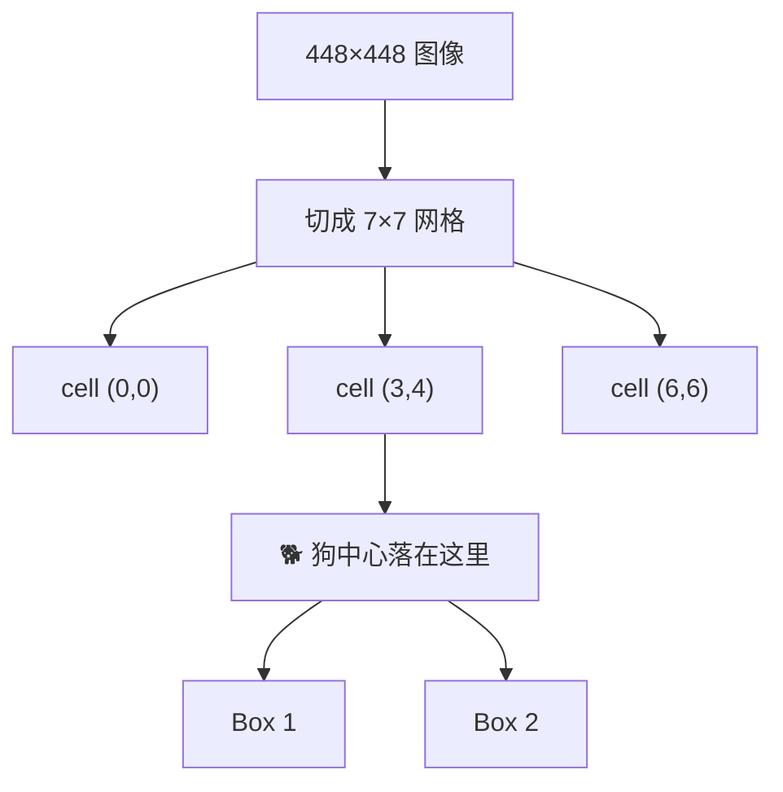
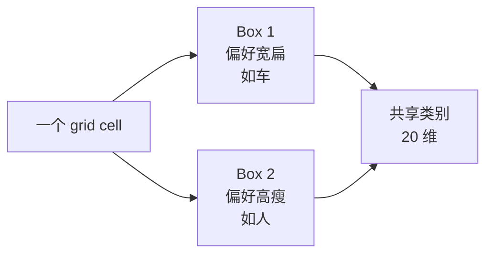
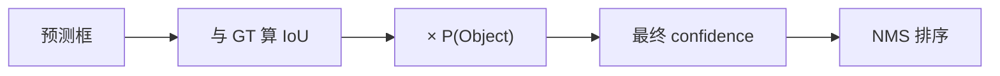
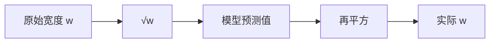
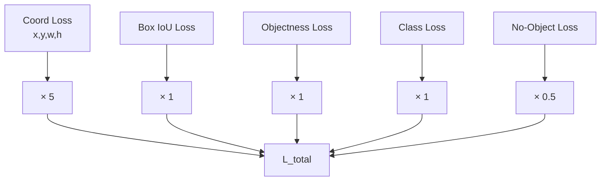
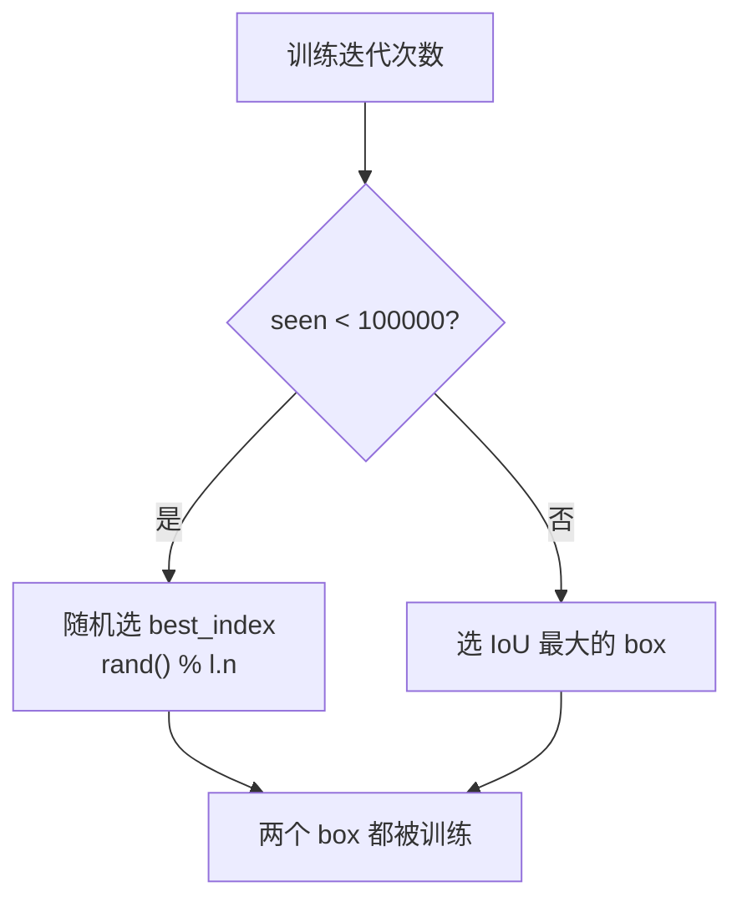
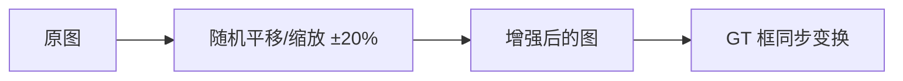
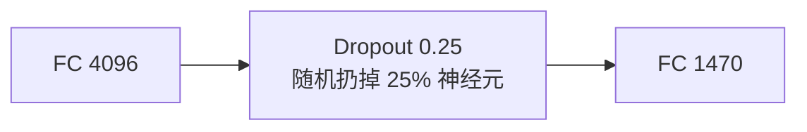
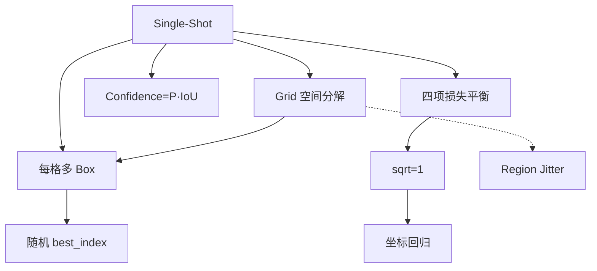

# YOLOv1 理论 Concept

YOLOv1 的 9 个核心 Concept。每个都配**原理图 + 白话 + 源码对应**。

---

## 1. Single-Shot 端到端检测 (`concept-single-shot`)

### 原理图



### 白话

> 以前检测要分两口气：先找框，再看框里是什么。YOLO 改成一口气：图过一次网络，直接出所有框和类别。

### 形式化

```
N = S × S × B = 7 × 7 × 2 = 98  个候选框
每个预测 = (x, y, w, h, confidence) + 20 维类别
```

### 源码对应

```c
// src/yolo.c 推理入口：一次 predict 搞定
network_predict(net, X);
```

---

## 2. Grid 空间分解 (`concept-grid-spatial-decomposition`)

### 原理图



### 白话

> 把大图切成 49 个小格子，每个格子只关心“中心在我这里的物体”。这样就把全局检测拆成 49 个局部小任务，搜索空间变小了，速度就上来了。

### 关键约束

- 每个 cell 固定 **2 个 box**
- 每个 cell 固定 **20 维类别**
- 物体的中心必须落在某个 cell 内，否则没人负责

### 源码对应

```c
// src/detection_layer.c:44
int locations = l.side*l.side;   // 49
```

```cfg
# cfg/yolo.cfg
side=7
num=2
classes=20
```

---

## 3. 每格多 Box 预测 (`concept-multi-box-per-cell`)

### 原理图



### 白话

> 一个格子里可能同时有车（宽）和人（高）。让两个 box 自由竞争，它们会自然分化：一个爱预测宽框，一个爱预测高框。

### 输出维度

每个 cell 输出 30 维：

```
Box 1: x, y, w, h, conf   → 5 维
Box 2: x, y, w, h, conf   → 5 维
Class prob × 20           → 20 维
----------------------------
合计                      → 30 维
```

### 源码对应

```c
// src/detection_layer.c:75-79
for (j = 0; j < l.n; ++j) {      // l.n = 2 个 box
    int p_index = index + locations*l.classes + i*l.n + j;
    l.delta[p_index] = l.noobject_scale*(0 - l.output[p_index]);
}
```

---

## 4. Confidence = P(Object) × IoU (`concept-confidence-as-poc`)

### 原理图



### 白话

> confidence 不只是说“我觉得有物体”，而是“我觉得有物体 **并且** 这个框还挺准”。这样 NMS 排序时，定位差的框会自动被挤下去。

### 两种情形

| 情形 | P(Object) | IoU | confidence |
|------|-----------|-----|-----------|
| 框得很准 | 0.9 | 0.9 | **0.81** |
| 看着像但位置偏 | 0.9 | 0.3 | **0.27** |

### 源码对应

```c
// src/detection_layer.c:154-161
*(l.cost) += l.object_scale * pow(1-l.output[p_index], 2);
if(l.rescore){
    l.delta[p_index] = l.object_scale * (iou - l.output[p_index]);
}
```

---

## 5. sqrt=1 Loss (`concept-sqrt-loss`)

### 原理图



### 白话

> 直接回归 \( w, h \)，大物体的误差会碾压小物体。改成回归 \( \sqrt{w}, \sqrt{h} \)，大目标和小目标的损失量级就接近了。

### 例子

| 目标 | 原始 w | √w | 预测 √w | 复原 w | 误差 |
|------|--------|----|---------|--------|------|
| 小狗 | 25 px | 5.0 | 5.2 | 27 px | 2 px |
| 汽车 | 400 px | 20.0 | 20.2 | 408 px | 8 px |

没有开方时，小狗的 L2 误差 = 4，汽车的 L2 误差 = 64；开方后都 ≈ 0.04。

### 源码对应

```c
// src/detection_layer.c:108-111
if (l.sqrt){
    out.w = out.w*out.w;
    out.h = out.h*out.h;
}
```

```cfg
# cfg/yolo.cfg
sqrt=1
```

---

## 6. 四项损失加权平衡 (`concept-balance-loss`)

### 原理图



### 白话

> 四类 loss 的量级不一样。坐标那项天然很小，要乘 5 放大；背景格子太多，要乘 0.5 压着，不然模型就只学会“这里没东西”了。

### 源码对应

```cfg
# cfg/yolo.cfg
object_scale=1
noobject_scale=.5
class_scale=1
coord_scale=5
```

```c
// src/detection_layer.c 中多处使用这些 scale
l.delta[box_index+0] = l.coord_scale*(state.truth[tbox_index + 0] - l.output[box_index + 0]);
l.delta[p_index] = l.noobject_scale*(0 - l.output[p_index]);
```

---

## 7. 随机 best_index Warmup (`concept-random-best-index-warmup`)

### 原理图



### 白话

> 训练刚开始时，两个 box 都很菜。如果每次都让 IoU 高的那个 box 独占 GT，另一个 box 永远学不到东西。前 10 万次迭代随机选，保证两个 box 都参与训练。

### 源码对应

```c
// src/detection_layer.c:136-138
if(1 && *(state.net.seen) < 100000){
    best_index = rand()%l.n;
}
```

---

## 8. Region Jitter 数据增强 (`concept-region-jitter-aug`)

### 原理图



### 白话

> 每次训练随机把图挪一挪、缩一放。物体中心相对 grid cell 的位置就变了，模型被迫学会“不管物体偏左还是偏右，我都能框中”。

### 源码对应

```cfg
# cfg/yolo.cfg
jitter=.2
```

```c
// src/data.c 中 random_distort 相关实现
```

---

## 9. FC 前 Dropout (`concept-dropout-fc`)

### 原理图



### 白话

> 检测数据集比 ImageNet 小得多，全连接层参数又极多，很容易过拟合。训练时随机关掉 25% 的神经元，迫使网络不要依赖某一条路径。

> 注意：cfg 快照里 probability 是 0.5，论文报告的是 0.25；推理时 dropout 自动关闭。

### 源码对应

```cfg
# cfg/yolo.cfg
[dropout]
probability=.5    # 仓库快照值；论文值 0.25
```

```c
// src/dropout_layer.c 中 forward_dropout_layer()
if (!state.train) return;   // 推理时跳过
```

---

## Concept 依赖图



---

## 延伸阅读

- [论文精读](/versions/v1/paper)
- [Architecture 逐层图解](/versions/v1/architecture)
- [损失函数](/versions/v1/losses)
- [训练技巧](/versions/v1/tricks)
- [源码走读](/versions/v1/code-walkthrough)
- [痛点追踪](/versions/v1/painpoints)
