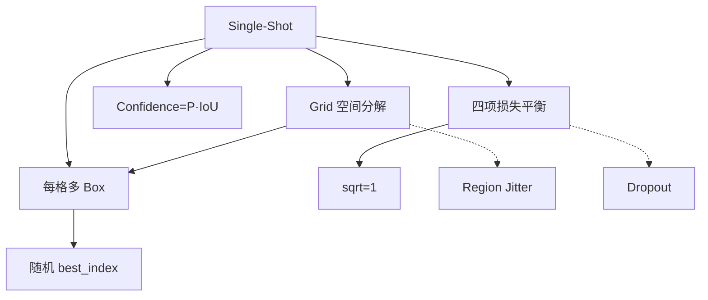

# YOLOv1 理论 Concept

YOLOv1 的 9 个核心 Concept，从论文中提炼。每个 Concept 都有：定义、形式化表达、为什么有效、权衡、落地影响。

## 1. Single-Shot 端到端检测 (`concept-single-shot`)

**定义**：把目标检测重定义为单次前向的回归问题。

```
输入 I → 网络 f → 输出 R^(N, 4+1+C)
N = 7² × 2 = 98
每预测 = (cx, cy, w, h, confidence, p_1...p_20)
```

**为什么有效**：去掉两阶段方法的分类器，把空间分解和类别预测合并到同一个网络。

**权衡**：
- (+) FPS 35+，为实时检测打开大门
- (-) 位置精度下降，边界框粗糙
- (-) 小目标召回差
- (-) 相似形状不同类混淆

**落地影响**：这个范式选择贯穿整个 YOLO 系列，是 v1-v12 从未变的核心承诺。

---

## 2. Grid 空间分解 (`concept-grid-spatial-decomposition`)

**定义**：把输入图像划分成 7×7=49 个 cell，每 cell 负责检测其中心区域的物体。

```
grid_size = 7, boxes_per_cell = 2
total = 49 × 2 = 98
每格预测: [cx, cy, w, h, confidence, class_probs(20)]
```

**为什么有效**：全局检测 → 49 个局部任务，每 cell 显式的位置先验降低搜索空间。

**权衡**：
- (+) 显式位置先验
- (-) 物体太大或跨多 cell 时精度下降
- (-) 每格固定 2 box，重叠物体无法区分
- (-) 物体中心必须落在 grid 中心

**落地影响**：7×7 grid 是 v1 速度/精度的硬约束，v2 引入 anchor 突破每格 2 box。

---

## 3. 每格多 Box 预测 (`concept-multi-box-per-cell`)

**定义**：每个 grid cell 预测 2 个 box，学到不同尺寸/长宽比的偏好。

**源码**：`yolo.cfg: num=2`

**输出维度**：`7×7×(4+1+20+2×5) = 1470`
- 第一组 box 是完整 [4+1+20]
- 第二组只复用 [4+1]，不重复 20 类（优化：同 cell 内类别基本相同）

**权衡**：简单扩展，不改结构；但 2 是启发式，非全局最优。

**落地影响**：v2 被 anchors 取代。

---

## 4. Confidence = P(Object)·IoU (`concept-confidence-as-poc`)

**定义**：每个 box 输出一个 confidence，含义不是简单的 P(Object)，而是 **P(Object)·IoU(pred, GT)**。

```
confidence = P(Object) · IoU(pred, GT)
```

**为什么有效**：让 NMS 前的排序自动惩罚定位差的框，无需显式的定位分支。

**权衡**：
- (+) 训练时 IoU 信号注入 objectness
- (+) NMS 前自动降权定位差
- (-) 推理时无法计算 IoU，退化为 learned P(Object)
- (-) 与分类概率耦合，训练信号复杂

**落地影响**：v3+ 拆出独立的 objectness 头，IoU 由 anchors 吸收。

---

## 5. sqrt=1 Loss (`concept-sqrt-loss`)

**定义**：训练时对 w 和 h 的开方值回归。

```c
if (l.sqrt) {
  box.w = pow(boxes[i].w, 0.5);
  box.h = pow(boxes[i].h, 0.5);
}
```

**为什么有效**：让大目标和小目标在损失里的量级接近，避免大目标主导梯度。

**权衡**：
- (+) 一行配置即可
- (+) 显著加快早期收敛
- (-) 只在 v1 L2 loss 下有效
- (-) v3+ 转 CIoU 后不再需要

**落地影响**：`yolo.cfg` 里的一行 trick，论文未解释，pjreddie 的实践技巧。

---

## 6. 四项损失加权平衡 (`concept-balance-loss`)

**定义**：总损失 = 5·L_coord + 1·L_box + 1·L_class + 0.5·L_noobj。

```
L = 5·Σ(box_rmse_wx,wx)² + Σ(1 - IoU)²·√w·√h
  + Σ(p_c - t_c)² + 0.5·Σp_c²·[no object]
```

**为什么有效**：
- Coord 权重 5：coord 最难优化
- No-Object 权重 0.5：背景格子占绝大多数，不加权会淹没信号

**权衡**：
- (+) 简单直观
- (-) 手工调，不同数据集可能需重搜
- (-) 无理论最优性

**落地影响**：v2 anchor 后 loss 结构变为 CIoU + focal + objectness，无需 5/0.5 手工平衡。

---

## 7. 随机 best_index Warmup (`concept-random-best-index-warmup`)

**定义**：训练前 100k 迭代，随机选一个 box 作为 GT 归属，而不是 IoU 最大的。

```c
if (l.count < 100000) best_index = rand() % l.n
else best_index = argmax(IoU)
```

**为什么有效**：强制两个 box 都训练到，防止梯度塌缩到一个 box。

**权衡**：
- (+) 缓解多 box 训练不稳定
- (-) 100k 是硬编码魔数
- (-) v2 anchor 后彻底删掉

**落地影响**：`detection_layer.c:73-75` 里唯一的魔数 trick。

---

## 8. Region Jitter 数据增强 (`concept-region-jitter-aug`)

**定义**：训练时对每个 batch 随机平移、缩放 20%。

```
dx = random(0.8, 1.2)
dy = random(0.8, 1.2)
```

**为什么有效**：改变 grid cell 分配，缓解 grid 对位置的敏感性。

**权衡**：
- (+) 提升泛化
- (-) 增强幅度有限
- (-) v4 被 Mosaic 取代

**落地影响**：`data.c: random_distort` 是 v1 主要增强。

---

## 9. FC 前 Dropout (`concept-dropout-fc`)

**定义**：在 fc(4096) 和 fc(1470) 之间插一层 dropout，p=0.25。

**为什么有效**：缓解检测任务数据量小的过拟合。

**权衡**：
- (+) 简单有效
- (-) 推理时需额外处理
- (-) v2+ 去掉全连接后不再需要

**落地影响**：v2 起全部换回卷积 + BN。

---

## Concept 依赖图


