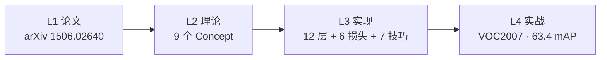
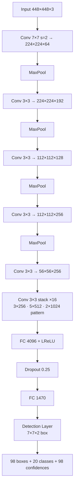

# YOLOv1 (2015)

**You Only Look Once: Unified, Real-Time Object Detection**

- 📄 论文：[arXiv:1506.02640](https://arxiv.org/abs/1506.02640) · ECCV 2016
- 🏛️ 作者：Joseph Redmon, Santosh Divvala, Ross Girshick, Ali Farhadi
- 💻 源码：[pjreddie/darknet](https://github.com/pjreddie/darknet) commit `8322a58`
- 🎯 里程碑：**首个 single-shot 端到端检测器**，35 FPS 开创实时检测时代

## 四层闭环视图

## 核心贡献

1. **Single-Shot 端到端检测范式**：把检测从两阶段压缩为一次前向
2. **网格化空间分解**：7×7 grid cell，每格 2 box，共 98 个候选
3. **置信度 = P(Object)·IoU**：把定位质量嵌入到分类分数里
4. **在 VOC 2007 达到 63.4 mAP，35 FPS**

## 关键指标

| 数据集 | 输入 | mAP@0.5 | FPS |
|--------|------|---------|-----|
| Pascal VOC 2007 | 448×448 | **63.4** | 35 |
| Pascal VOC 2007 | 224×224 | 58.4 | 155 |
| Pascal VOC 2012 | 448×448 | 67.5 | — |
| PASCAL VOC + 8115 | — | YOLO9000 48.3 | 50 |

对比：Faster R-CNN 69.9% @ 7 FPS，YOLOv1 用速度换了约 6.5 个点的精度。

## 网络架构

- **24 层 Conv + 2 层 FC**
- **输出 1470 = 7×7×(4+1+20+2×5)**：第一组 box 是 [x,y,w,h,conf]+20 类；第二组只复用 [x,y,w,h,conf]，不重复 20 类
- **全连接保留了 v1 的特征**，v2 起全部换回卷积

## 核心 Concept 一览

| Concept | 一句话 | 对应代码位置 |
|---------|--------|-------------|
| Single-Shot | 检测 = 单次前向回归 | `src/yolo.c` |
| Grid 空间分解 | 49 grid × 2 box | `yolo.cfg: side=7, num=2` |
| Confidence = P·IoU | 定位质量嵌入分类分数 | `detection_layer.c:82-83` |
| sqrt=1 | 宽高开根号加速收敛 | `yolo.cfg: sqrt=1` |
| 损失 5/1/1/0.5 | 手工平衡量级 | `yolo.cfg: *_scale` |
| 随机 best_index | 前 100k 迭代防塌缩 | `detection_layer.c:73-75` |
| Region Jitter | 20% 平移缩放增强 | `data.c: random_distort` |
| Dropout 0.25 | 全连接间正则 | `yolo.cfg: dropout` |
| NMS IoU=0.5 | 后处理去重 | `box.c: do_nms_sort` |

## 与传统 CV 的关系

- 继承：**NMS**、**AlexNet backbone**、**R-CNN 候选框 + 分类回归建模**
- 改造：**滑窗检测** → 卷积并行扫描、**R-CNN 两阶段** → 单阶段
- 抛弃：**Selective Search 外部区域提议**、**HOG/SVM 手工特征**

## 暴露的痛点

| 痛点 | 严重度 | 后续版本的解法 |
|------|--------|---------------|
| 小目标召回差 | Critical | v3 FPN → v7 P2 anchor |
| 边界框粗糙 | High | v2 anchor → v4 CIoU |
| 相似形状混淆 | Medium | v2 anchor |
| NMS 阈值敏感 | Medium | v10 NMS-free |

## 深入阅读

- [论文精读](/versions/v1/paper)
- [Architecture 逐层图解](/versions/v1/architecture)
- [理论 Concept](/versions/v1/concepts)
- [架构与层速查](/versions/v1/layers)
- [损失函数](/versions/v1/losses)
- [训练技巧](/versions/v1/tricks)
- [源码走读](/versions/v1/code-walkthrough)
- [痛点追踪](/versions/v1/painpoints)
