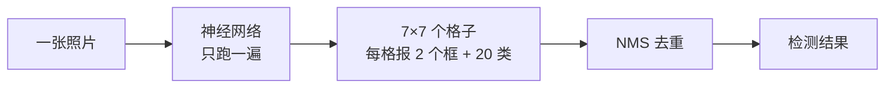
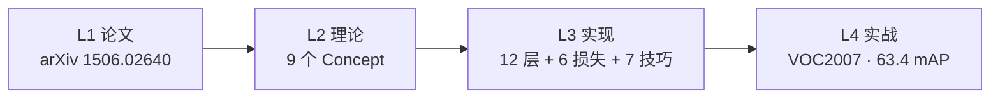

# YOLOv1 (2015)

**You Only Look Once: Unified, Real-Time Object Detection**

- 📄 论文：[arXiv:1506.02640](https://arxiv.org/abs/1506.02640) · ECCV 2016
- 🏛️ 作者：Joseph Redmon, Santosh Divvala, Ross Girshick, Ali Farhadi
- 💻 源码：[pjreddie/darknet](https://github.com/pjreddie/darknet) commit `8322a58`
- 🎯 里程碑：**首个 single-shot 端到端检测器**，35 FPS 开创实时检测时代

## 3 分钟电梯演讲

1. **在 YOLO 之前**，检测要分两步：先猜"哪里可能有东西"（候选区域），再逐个细看分类——慢，几秒一张。
2. **YOLOv1 的做法**：整张照片只过一遍网络，把图划成 7×7 个 [格子](/glossary#grid-cell-网格-格子)，每个格子直接报出"我这有没有物体、[框](/glossary#bbox-边界框)在哪、是什么"。
3. **结果**：从几秒一张到每秒 35 张，实时检测时代开始。代价是框得不够准、小物体容易漏——这正是 [v2](/versions/v2/index) 要解决的。

> 第一次接触检测？先去[术语表](/glossary)混个脸熟再回来。

## 四层闭环视图

## 核心贡献

1. **Single-Shot 端到端检测范式**：把检测从两阶段压缩为一次前向
2. **网格化空间分解**：7×7 grid cell，每格 2 box，共 98 个候选
3. **置信度 = P(Object)·IoU**：把定位质量嵌入到分类分数里
4. **在 VOC 2007 达到 63.4 mAP，35 FPS**

## 推理效果一览

<DiagramPipeline />

## 关键指标

| 数据集 | 输入 | mAP@0.5 | FPS |
|--------|------|---------|-----|
| Pascal VOC 2007 | 448×448 | **63.4** | 35 |
| Pascal VOC 2007 | 224×224 | 58.4 | 155 |
| Pascal VOC 2012 | 448×448 | 67.5 | — |
| PASCAL VOC + 8115 | — | YOLO9000 48.3 | 50 |

对比：Faster R-CNN 69.9% @ 7 FPS，YOLOv1 用速度换了约 6.5 个点的精度。

## 网络架构

<DiagramArch />

- **24 层 Conv + 4 次 MaxPool + 2 层 FC + 1 Detection**（2 次 stride-2 卷积，共 6 次空间减半；无 BN，BN 是 v2 才加的）
- **输出 1470 = 7×7×(20 + 2×5) = 49×30**：20 类两框共享，每个 box 各出 [x,y,w,h,conf] 共 5 维
- **全连接是 v1 的标志也是参数巨怪**（FC4096 约 2.05 亿参数），v2 起全部换回卷积

逐层明细见 [Architecture 逐层图解](/versions/v1/architecture)。

## 核心 Concept 一览

| Concept | 一句话 | 对应代码位置 |
|---------|--------|-------------|
| Single-Shot | 检测 = 单次前向回归 | <SrcLink file="src/yolo.c" :line="343" /> |
| Grid 空间分解 | 49 grid × 2 box | <SrcLink file="cfg/yolo.cfg" :line="225" :end="226" /> |
| Confidence = P·IoU | 定位质量嵌入分类分数 | <SrcLink file="src/detection_layer.c" :line="159" :end="161" /> |
| sqrt=1 | 宽高在 √ 空间回归 | <SrcLink file="cfg/yolo.cfg" :line="228" /> |
| 损失 5/1/1/0.5 | 手工平衡量级 | <SrcLink file="cfg/yolo.cfg" :line="230" :end="234" /> |
| 随机 best_index | 前 10 万张图防塌缩 | <SrcLink file="src/detection_layer.c" :line="136" :end="138" /> |
| Region Jitter | 20% 平移缩放+翻转增强 | <SrcLink file="src/data.c" :line="622" /> |
| Dropout 0.5 | 全连接间正则（论文写 0.25） | <SrcLink file="cfg/yolo.cfg" :line="213" :end="214" /> |
| NMS IoU=0.5 | 后处理去重 | <SrcLink file="src/box.c" :line="249" /> |

## 与传统 CV 的关系

- 继承：**NMS**、**AlexNet backbone**、**R-CNN 候选框 + 分类回归建模**
- 改造：**滑窗检测** → 卷积并行扫描、**R-CNN 两阶段** → 单阶段
- 抛弃：**Selective Search 外部区域提议**、**HOG/SVM 手工特征**

## 暴露的痛点

| 痛点 | 严重度 | 后续版本的解法 |
|------|--------|---------------|
| 小目标召回差 | Critical | v3 FPN → v7 P2 anchor |
| 边界框粗糙 | High | v2 anchor → v4 CIoU |
| 相似形状混淆 | Medium | v2 anchor |
| NMS 阈值敏感 | Medium | v10 NMS-free |

> **v3 路标**：表里的 FPN 解法在 v3 落地——13/26/52 三尺度检测头 + Darknet-53 残差骨干，小目标召回显著改善（见 [v3 概览](/versions/v3/index)）。
>
> **v4 路标**：表里的 CIoU 解法在 v4 落地——坐标损失从 SSE 换成 CIoU（IoU 直接可导），再加 Mosaic 增强 + 多正样本分配，COCO AP 冲到 43.5（见 [v4 概览](/versions/v4/index)）。

## 后续演进速览

- **v2（2017）**：换 DenseNet + BN + 5 anchors + YOLO9000，把 objectness 与类别合并
- **v3（2018）**：Darknet-53 + FPN 三头 9 anchors，小目标召回显著改善
- **v4（2020）**：anchor-free + CIoU + Mosaic，COCO AP 首破 50
- **v5-v9（2020-2024）**：anchor-free 主流化 → 大核 + 三尺度 anchor → 学术重构 → Ultralytics 官方化 → 双头可编程梯度

> **v10-v13 已上线本站**：NMS-free / AGPL / HyperACE 等新一轮演进，详见 [v10 概览](/versions/v10/index) 起。

## 深入阅读

- [论文精读](/versions/v1/paper)
- [Architecture 逐层图解](/versions/v1/architecture)
- [理论 Concept](/versions/v1/concepts)
- [架构与层速查](/versions/v1/layers)
- [损失函数](/versions/v1/losses) — 4 项 loss 的公式与作用域
- [反向传播推导](/versions/v1/loss-gradient) — 从公式到 delta 的完整梯度推导（最硬核）
- [训练技巧](/versions/v1/tricks)
- [源码走读](/versions/v1/code-walkthrough)
- [痛点追踪](/versions/v1/painpoints)
