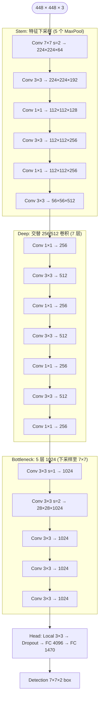
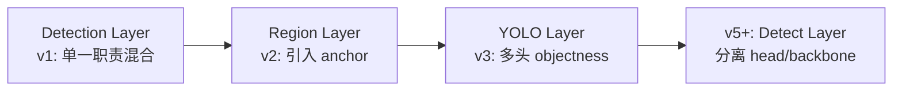

# YOLOv1 架构与层

YOLOv1 用 **24 层 Conv + 1 层 Local + 1 层 Dropout + 2 层 FC + 1 层 Detection** 构成完整检测网络。本文逐层拆解。

## 整体架构



## 全层清单

| # | 层 | 尺寸 | Filters | Stride | 输出分辨率 | 位置 |
|---|-----|------|---------|--------|-----------|------|
| 1 | Conv | 7×7 | 64 | 2 | 224×224 | Stem |
| 2 | MaxPool | 2×2 | — | 2 | 112×112 | Stem |
| 3 | Conv | 3×3 | 192 | 1 | 112×112 | Stem |
| 4 | MaxPool | 2×2 | — | 2 | 56×56 | Stem |
| 5 | Conv | 1×1 | 128 | 1 | 56×56 | Stem |
| 6 | Conv | 3×3 | 256 | 1 | 56×56 | Stem |
| 7 | Conv | 1×1 | 256 | 1 | 56×56 | Stem |
| 8 | Conv | 3×3 | 512 | 1 | 56×56 | Stem |
| 9 | MaxPool | 2×2 | — | 2 | 28×28 | Stem |
| 10-15 | Conv 交替 | 1×1 / 3×3 | 256/512 | 1 | 28×28 | Deep |
| 16 | Conv | 3×3 | 1024 | 1 | 28×28 | Deep |
| 17 | MaxPool | 2×2 | — | 2 | 14×14 | Deep |
| 18-20 | Conv | 3×3 | 1024 | 1 | 14×14 | Bottleneck |
| 21 | Conv | 3×3 | 1024 | 1 | 14×14 | Bottleneck |
| 22 | Conv | 3×3 | 1024 | **2** | 7×7 | Bottleneck |
| 23-24 | Conv | 3×3 | 1024 | 1 | 7×7 | Bottleneck |
| 25 | Local | 3×3 | 256 | 1 | 7×7×(7×7×256) | Head |
| 26 | Dropout | — | 0.5 | — | — | Head |
| 27 | FC | — | 4096 | — | — | Head |
| 28 | FC | — | **1470** | — | — | Head |
| 29 | Detection | — | side=7, num=2, classes=20, coords=4 | — | 98 boxes | Head |

> 注：仓库里 `yolov1.cfg` 里 `num=3`、`dropout=0.5` 是 pjreddie 后期实验值，论文 v1 报告的是 `num=2`、`dropout=0.25`。参见 [痛点追踪](/versions/v1/painpoints)。

## 关键层详解

### Conv 7×7 Stride 2 (`layer-conv-7x64`)

```cfg
[convolutional]
filters=64
size=7
stride=2
pad=1
activation=leaky
```

**设计意图**：直接借鉴 AlexNet 第一层，用大 kernel 一步完成 (a) 感受野扩张 (b) 空间下采样，避免小 stride-1 卷积在原始分辨率上做太多冗余计算。

**尺寸变化**：448×448 → 224×224，第一次下采样。

**在 YOLO 系列里的地位**：v2/v3/v4 沿用至今，是"第一层大 kernel"这一约定的源头。

---

### Conv 交替堆叠模式 (`layer-conv-3x256` / `layer-conv-3x512`)

```
[Conv 1×1 → 256] → [Conv 3×3 → 512] → [Conv 1×1 → 256] → [Conv 3×3 → 512] ...
```

**设计意图**：借鉴 GoogLeNet 的 "inception 分解"思想，用 1×1 压缩通道、3×3 提取空间特征，比堆 3×3 更省计算。

**在 v1 里出现 7 次**，占整个网络一半以上层数。

---

### Conv 3×3 Stride 2 (`layer-conv-3x256` stride=2 变体)

论文 Bottleneck 段的 **唯一一次 conv stride-2 下采样**，把 14×14 降到 **7×7**。这是把空间分辨率锁到 grid size 的关键一步。

**为什么不用 MaxPool**：AlexNet 惯例是池化，但 GoogLeNet 之后卷积下采样已能给出更好特征。v1 保留了 MaxPool，只有最后一步用 conv。

**后果**：7×7 = 49 个 cell，每 cell 感受野约 64×64 像素。小目标（<32 像素）直接被吞掉，是 v1 最大痛点。

---

### Local 3×3 (`source/yolov1/snapshot/src/local_layer.c`)

```cfg
[local]
size=3
stride=1
pad=1
filters=256
```

**作用**：把 7×7 特征图卷成 7×7×256 的**局部性表达**——每个 grid cell 独立拿到自己的 7×7 邻域作为描述子，替代 FC 前的空间打平。

**为什么重要**：让 FC 前面保留空间结构。相当于"软化的 reshape"。

**后续版本**：v2/v3 全部替换成纯 Conv + BN + Reorg。

---

### Dropout 0.25 (`layer-dropout-025`)

```cfg
[dropout]
probability=.25   # 论文值；仓库现版为 .5
```

**位置**：只在两个 FC 之间。

**为什么有效**：检测任务训练数据远小于分类，FC 层特别容易过拟合。

**代价**：v2 起去掉所有 FC，此层消失。

---

### FC 1470 (`layer-fc-1470`)

**输出维度的数学**：

```
1470 = 7 × 7 × (4 + 1 + 20 + 2 × 5)
     = 49 × (5 + 20 + 10)
     = 49 × 35
```

- `4 + 1` = box 坐标 + confidence（每个 box 5 个）
- `20` = 类别概率
- `2 × 5` = 第二个 box 只复用坐标 + conf，**不重复 20 类**（工程优化：同一 cell 内两 box 类别基本相同）

**参数量**：`4096 × 1470 ≈ 6.02M`，占 v1 全部参数约 30%。

**这是 v1 最大的架构特征**——v2/v3 全部换回卷积，去掉全连接。

---

### Detection Layer (`layer-detection-v1`)

```cfg
[detection]
classes=20
coords=4
rescore=1
side=7
num=2
softmax=0
sqrt=1
jitter=.2
object_scale=1
noobject_scale=.5
class_scale=1
coord_scale=5
```

**这是 v1 的"检测头"**——一个既做前向输出切分、又做 loss 计算、又做 NMS 的杂合层。源码在 `src/detection_layer.c`。

**三大职责**：

1. **前向**：把 FC 1470 输出 reshape 成 `7×7×(5 + 20 + 2×5)` 张量，反 sigmoid 得到 box 和 confidence
2. **Loss**：调用 [6 个损失函数](/versions/v1/losses) 加权求和
3. **推理**：调用 `do_nms_sort` 做 NMS 后处理

**演进路径**：



参见 [源码走读](/versions/v1/code-walkthrough)。

---

### Leaky ReLU (`layer-activation-leakyrelu`)

**整个 v1 都用 LReLU**，slope=0.1（默认值）。

**为什么不用 ReLU**：AlexNet/VGG 时代的常见选择，LReLU 的负斜率让梯度不会完全消失。

**后续版本**：v2 引入 BN 后，LReLU 逐渐被 ReLU 取代；v4 起大量使用 Mish；v6+ 使用 SiLU。

## 参数量估算

| 段 | 参数量 |
|----|--------|
| Stem (5 conv + 2 pool) | ≈ 0.9M |
| Deep (7 conv) | ≈ 3.0M |
| Bottleneck (5 conv) | ≈ 12.6M |
| Local | ≈ 0.5M |
| FC 4096 | ≈ 47.2M |
| FC 1470 | ≈ 6.0M |
| **合计** | **≈ 70M** |

**主要瓶颈在 FC 4096**——7×7×1024=50176 展平后接 4096，参数爆炸。这也是 v2/v3 全部换回卷积的直接原因。

## 与其他页的链接

- [概览](/versions/v1/index)
- [论文精读](/versions/v1/paper)
- [理论 Concept](/versions/v1/concepts)
- [损失函数](/versions/v1/losses)
- [训练技巧](/versions/v1/tricks)
- [源码走读](/versions/v1/code-walkthrough)
- [痛点追踪](/versions/v1/painpoints)
