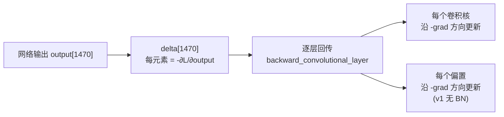
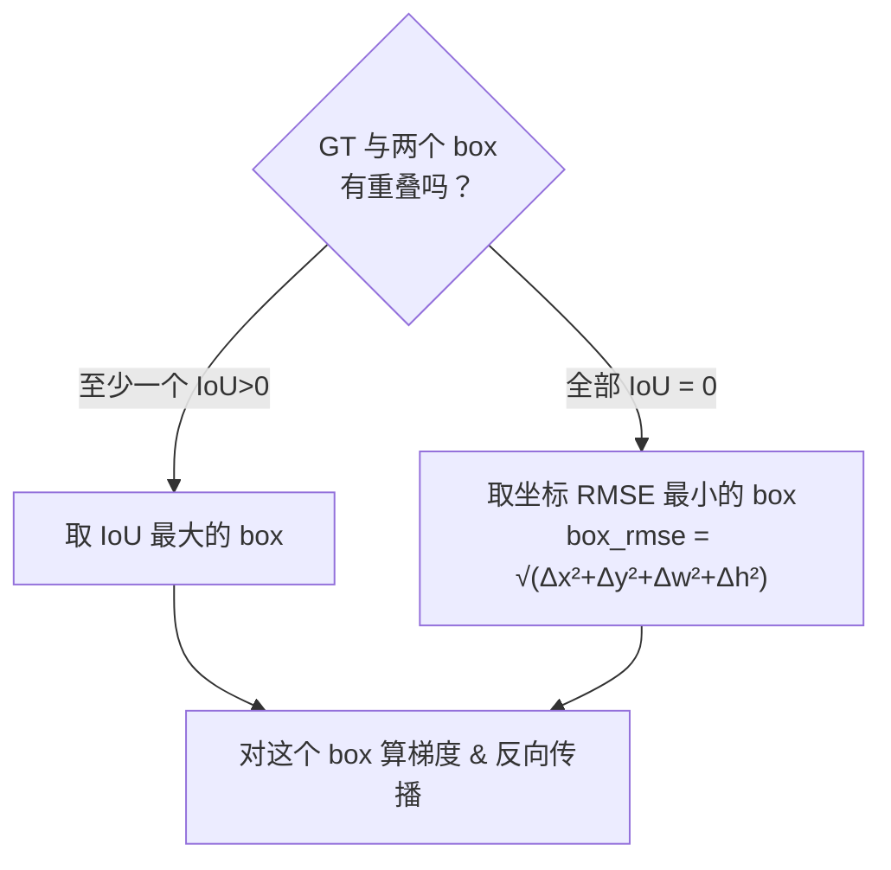
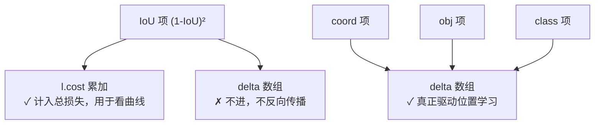
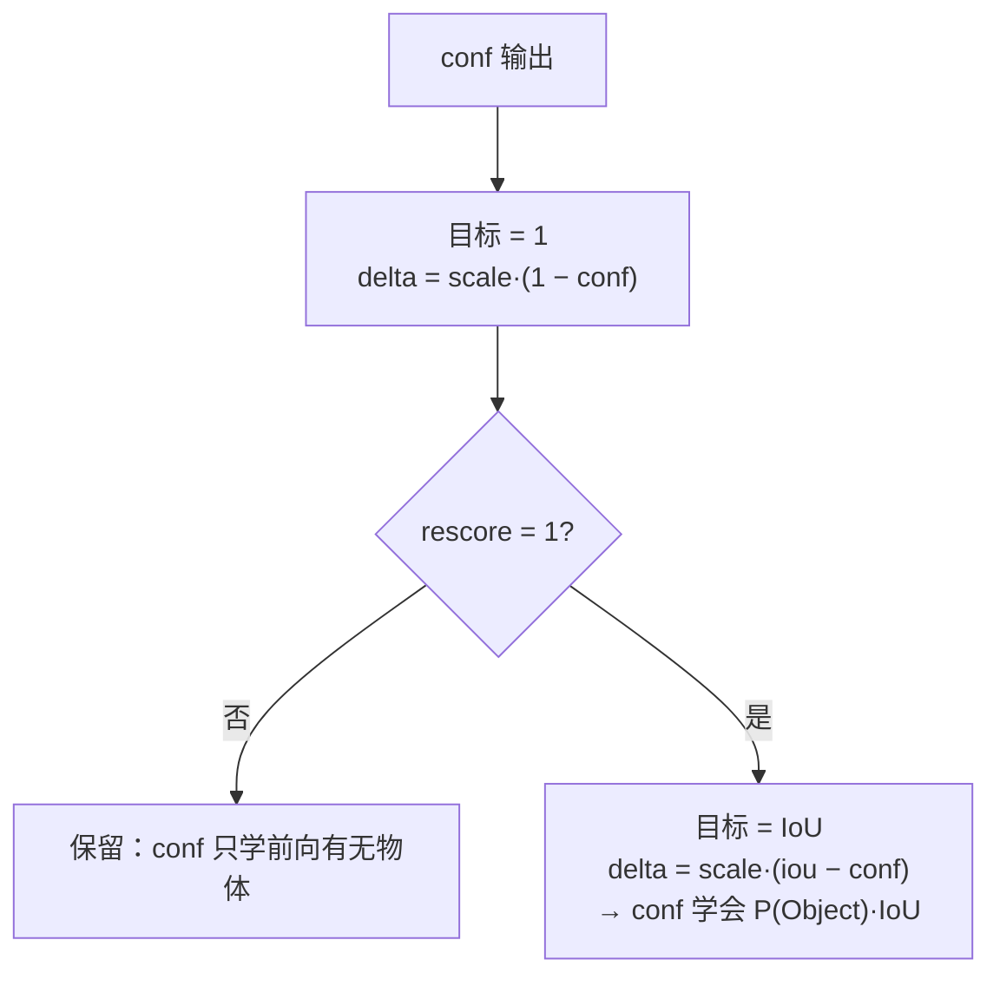
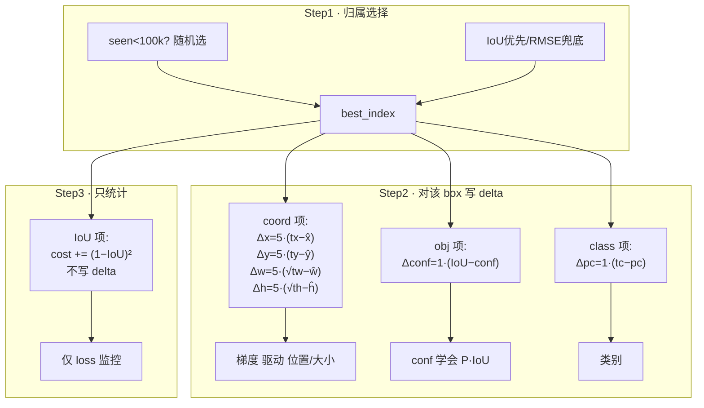

# YOLOv1 反向传播精解：从公式到 delta 的完整推导

> 这是 v1 最"硬核"的一页。前面的[损失函数](/versions/v1/losses)讲了"损失长什么样"，这一页讲"**梯度怎么一步步算出来**"——也就是 `forward_detection_layer()` 里那几十行 delta 赋值，在数学上到底对应什么。
>
> 全程对照真实源码：<SrcLink file="src/detection_layer.c" :line="42" /> 起的 `forward_detection_layer()`，行号以快照为准；也可直接打开 [detection_layer.c 整文件浏览](/versions/v1/source/detection-layer)。

::: tip TL;DR：只想带走三件事
1. **delta 约定**：`delta = −∂L/∂output`，每行赋值都是"差多少、反着传、乘上 scale"。
2. **√w√h 不乘额外因子**：损失定义在 √ 空间，对网络输出求导天然干净——换的是目标，不是空间。
3. **(1−IoU)² 只写 cost 不写 delta**，不参与反传；真正把"框不准"传回去的是 rescore：拿实时 IoU 当 conf 的目标。
:::

---

## 0. 先搞懂 darknet 的"梯度约定"

PyTorch 里我们习惯 `loss.backward()`，梯度存在 `.grad`。darknet 的手写 C 里没有自动求导，它是**手搓**的，用一个数组 `l.delta[]` 来放每个输出神经元的"误差信号"。

关键约定：

$$\delta_i = -\frac{\partial L}{\partial output_i}$$

即 delta 是**损失对输出梯度的相反数**。（因为优化器往损失下降方向走，直接对 `-gradient` 做梯度下降。）

**所以我们要推的"反向传播"，就是回答一个问题：**

> 对每一个输出神经元 `output[i]`，它应该携带多大的误差 delta？这个误差 delta 会一路往前传，让前面每一层卷积核都往减小损失的方向动。



**白话**：`detection_layer` 的输出是网络的最后一层。它算出的 `l.delta` 就是整个反向传播的"起跑信号"。这个信号对不对、准不准，直接决定了前面 24 层学得对不对。

---

## 1. 总损失回顾

训练时每个 batch，对**每个 grid cell** 独立地累加误差：

```
每一格的处理：
  ┌─ 对 2 个 box 先无条件写 noobject 项          （本页 §5.1）
  ├─ 若是【有目标格】：
  │     ├─ class 项     → delta[class] = scale·(t_c − p_c)   （§5.4）
  │     ├─ 选 best box：
  │     │     · 前 100k 迭代 → 随机选                 （§2.1）
  │     │     · 之后       → IoU 优先、RMSE 兜底      （§2.2）
  │     ├─ coord 项     → delta[0..3] 含 sqrt 链式    （§3）
  │     ├─ obj 项       → delta[conf] = scale·(t − conf)（§4）
  │     └─ IoU 项       → 只加 cost，不进 delta        （§3.4）
  └─ 若是【无目标格】→ 什么都不做，保持 noobject       （§5.2）
```

下面逐个拆开讲。

---

## 2. 有目标格的第一件事：选"哪个 box 该背锅"

一个 cell 有 2 个 box，损失只惩罚"最像"的那个（`best_index`）。选法是有讲究的。

### 2.1 前 100k 张训练图：随机选（强制公平）

真实三行 <SrcLink file="src/detection_layer.c" :line="136" :end="138" />：

```c
if(1 && *(state.net.seen) < 100000){
    best_index = rand()%l.n;      // 随机挑一个 box
}
```

**白话**：训练刚起步时梯度噪声大，如果一上来就按最大 IoU 选，往往**同一个 box 总被选中、另一个 box 饿死**（梯度塌缩）。前 10 万张图随机指定（`net.seen` 是图片计数），逼两个 box 都"被迫营业"，把各自的能力练出来。

### 2.2 之后：IoU 优先、RMSE 兜底

真实循环 <SrcLink file="src/detection_layer.c" :line="102" :end="127" />：

```c
for(j = 0; j < l.n; ++j){
    ...
    float iou  = box_iou(out, truth);
    float rmse = box_rmse(out, truth);
    if(best_iou > 0 || iou > 0){
        if(iou > best_iou){ best_iou = iou; best_index = j; }   // 有重叠用 IoU 比
    }else{
        if(rmse < best_rmse){ best_rmse = rmse; best_index = j; } // 全无重叠用 RMSE 比
    }
}
```

**这里藏着 v1 一个少有人讲的小心思**：

- 如果某个 box 和 GT **有重叠**（IoU>0），优先让**IoU 最大**的 box 去负责——定位质量高的框去学。
- 如果**两个 box 都和 GT 完全不相交**（IoU=0），此时 IoU 区分度失效（都是 0），退而用 **RMSE（坐标欧氏距离）** 选最近的去背锅，先让这个 box 靠近 GT 再说。



> **反例/注意**：这个 `best_iou>0 || iou>0` 的判断，配合 `float_to_box` 把输出直接当中心点 (x,y,w,h)，意味着**所有坐标都没经过归一化/激活**，网络输出裸值。这跟现代 anchor 方案（sigmoid 输出偏移）完全不同，也是 v1 定位不稳的一个根源。详见[痛点追踪](/versions/v1/painpoints)。

---

## 3. coord 项：位置回归的梯度（含 sqrt 链式法则）

选好 `best_index` 后（真实偏移计算 <SrcLink file="src/detection_layer.c" :line="143" />）：

```c
int box_index = index + locations*(l.classes + l.n) + (i*l.n + best_index) * l.coords;
// box_index 指向网络里这段输出的起始：
//   output[box_index+0] = x̂
//   output[box_index+1] = ŷ
//   output[box_index+2] = ŵ
//   output[box_index+3] = ĥ
```

### 3.1 目标是什么？

**注意**：网络头 4 个输出里，**后两个是 ŵ、ĥ（开方后的值）**，不是 w、h。所以损失其实是在"开方空间"里算 L2。

训练时要让：

$$\hat{x} \to x_{truth}, \qquad \hat{y} \to y_{truth}, \qquad \hat{w} \to \sqrt{w_{truth}}, \qquad \hat{h} \to \sqrt{h_{truth}}$$

### 3.2 delta 的直接写法

真实赋值 <SrcLink file="src/detection_layer.c" :line="163" :end="170" />：

```c
l.delta[box_index+0] = l.coord_scale*(state.truth[tbox_index + 0] - l.output[box_index + 0]);  // x
l.delta[box_index+1] = l.coord_scale*(state.truth[tbox_index + 1] - l.output[box_index + 1]);  // y
l.delta[box_index+2] = l.coord_scale*(state.truth[tbox_index + 2] - l.output[box_index + 2]);  // 先按 w 算
l.delta[box_index+3] = l.coord_scale*(state.truth[tbox_index + 3] - l.output[box_index + 3]);  // 先按 h 算
if(l.sqrt){
    l.delta[box_index+2] = l.coord_scale*(sqrt(state.truth[tbox_index + 2]) - l.output[box_index + 2]);
    l.delta[box_index+3] = l.coord_scale*(sqrt(state.truth[tbox_index + 3]) - l.output[box_index + 3]);
}
```

**白话**：先一股脑按普通 L2 写 4 个方向的 delta；如果开了 `sqrt`，就**只把 w、h 这两个的目标从 `w_truth` 改成 `√w_truth`**。x、y 保持原样。

### 3.3 为什么 delta 写成 `(target − output)`？

这是纯 L2 的梯度，推导非常简单：

$$L_i = coord\_scale \cdot (y - t)^2$$

$$\frac{\partial L_i}{\partial y} = 2 \cdot coord\_scale \cdot (y - t) \quad \leftarrow \; \text{链式法则：对 } y \text{ 求导}$$

$$\delta = -\frac{\partial L_i}{\partial y} = -2 \cdot coord\_scale \cdot (y - t) = 2 \cdot coord\_scale \cdot (t - y)$$

常数 2 被吸收进学习率（darknet 不关心梯度缩放常数），于是：

$$\delta \propto (target - output) \qquad \bigstar \ \text{这就是每行代码的原型}$$

> **白话记忆法**：**"输出离目标差多少，就按差多少回传；方向相反。"** 输出低了就往高推，高了就往低拉。`gradient = target − output`。

### 3.4 sqrt 的链式法则——为什么是 `√w_truth` 而不是别的

这是最值得讲清楚的地方。设：

$$\text{网络输出 } \hat{w}\text{，实际用的 } w = \hat{w}^2 \quad \text{（sqrt=1 时）}$$

$$L_w = coord\_scale \cdot (\hat{w} - \sqrt{w_{truth}})^2$$

$$\frac{\partial L_w}{\partial \hat{w}} = 2 \cdot coord\_scale \cdot (\hat{w} - \sqrt{w_{truth}})$$

$$\delta_w = coord\_scale \cdot (\sqrt{w_{truth}} - \hat{w}) \quad \leftarrow \; \text{就是代码里那行}$$

**关键点**：因为损失**本来就写在 ŵ 空间**，链式法则里**不需要**再乘 `∂w/∂ŵ = 2ŵ`。如果误以为"输出是 w、损失也是 w"，硬乘一个 `2ŵ`，梯度就错了。源码正确地**只把目标从 w_truth 换成 √w_truth**，而不额外乘因子。

$$\hat{w}\ \text{空间：} \; L = (\hat{w}-\sqrt{t})^2 \;\Rightarrow\; \frac{\partial L}{\partial \hat{w}} = (\hat{w}-\sqrt{t}) \quad \text{直接可回传，无需再乘}$$

$$w\ \text{空间：} \; L = (\sqrt{w}-\sqrt{t})^2 \;\Rightarrow\; \frac{\partial L}{\partial w} = (\sqrt{w}-\sqrt{t}) \cdot \frac{1}{2\sqrt{w}} \quad \text{还需要除 } 2\sqrt{w}$$

v1 选择了**前者**——在开方空间回归，省掉除法，数值也更稳。这就是 `sqrt=1` 的全部真相。

> **反例**：`ŵ = 0.5` 还原成 `w = 0.25`；若目标 `w_truth = 1`（√=1），delta = coord_scale·(1 − 0.5)，正 → 把 `ŵ 从 0.5 往上推`。若错写成 `(w_truth − ŵ²) = (1 − 0.25) = 0.75`，方向对了但量级错，且丢失了开方带来的"大目标梯度自动变小"的平衡效果。

### 3.5 有个"统计项"只进 cost、不进 delta

紧接着（<SrcLink file="src/detection_layer.c" :line="172" />）：

```c
*(l.cost) += pow(1-iou, 2);      // 只看 loss 数值，不写 delta！
```

**白话**：`(1-IoU)²` 被加进了总损失 `l.cost`（用于打印/监控 loss 曲线），但**它没有给任何 delta 赋值**——也就是**这个 IoU 项不参与反向传播**！



**这解释了 v1 的一个矛盾现象**：论文公式里写着 `+ (√w−√ŵ)² + (√h−√ĥ)²`，代码里 coord 项确实反传了；但**IoU 项只是"装饰性"的 loss**，真正的定位优化完全靠 coord 项(§3)和 obj 项的 IoU 信号(§4)来兜。位置精度低（57% 错误率）的根本原因之一，就是**没有让 IoU 梯度直接流入坐标**——一直要等到 v4 的 CIoU loss 才补上这个洞。

---

## 4. conf 项：conf 分支的两个梯度目标（rescore 分水岭）

真实片段 <SrcLink file="src/detection_layer.c" :line="153" :end="161" />：

```c
int p_index = index + locations*l.classes + i*l.n + best_index;

// 先按"有没有物体"给梯度：目标 = 1
*(l.cost) -= l.noobject_scale * pow(l.output[p_index], 2);   // 撤销之前那格的 noobject cost
*(l.cost) += l.object_scale * pow(1-l.output[p_index], 2);   // 改计 object cost
l.delta[p_index] = l.object_scale * (1.-l.output[p_index]);  // 梯度：推向 1

if(l.rescore){
    l.delta[p_index] = l.object_scale * (iou - l.output[p_index]);  // 覆盖：目标改成真实 IoU
}
```

**白话（rescore=1 时的真实行为）**：

1. 先想让 conf → **1**（"这里有物体"）。
2. 但 `rescore=1`，立刻**覆盖**成 conf → **IoU(pred, gt)**（"这里有个物体，而且这个框准，给你打高分 IoU"）。

两个"目标"都是 `L = scale·(target − conf)²`，梯度 `delta = scale·(target − conf)`，只是 **target 从 1 换成 iou**。



> **深度理解**：`rescore=1` 才是让 conf 真正学到 `P(Object)·IoU` 语义的那一行。没有它，conf 最多学到二分类的"有没有"。有它，conf 顺带把**框的定位质量**也编码进去——这正是推理时 `conf × class` 排序能天然压低差框的原因（见[论文精读 §4](/versions/v1/paper))。**这个 IoU 信号是除了 §3 之外，第二个把"定位好坏"注入网络的地方。**

---

## 5. 另外三项梯度

### 5.1 noobject：每个 box"出生"就先写一行

在选 best_index **之前**，对 cell 的**每一个** box 先写（真实片段 <SrcLink file="src/detection_layer.c" :line="75" :end="80" />）：

```c
int p_index = index + locations*l.classes + i*l.n + j;      // j = 0, 1
l.delta[p_index] = l.noobject_scale*(0 - l.output[p_index]);  // 目标 = 0
*(l.cost) += l.noobject_scale*pow(l.output[p_index], 2);
```

**白话**：**先假定这个 cell 的 2 个 box 都是"无物体"，把 conf 往 0 压。** 后面若确认它有物体（§4），会撤销 cost 并覆盖 delta。这个"先抑后扬"的顺序，是代码里 noobject/object 梯度能和平共处的原因。

$$\text{梯度：} \; \delta = 0.5 \cdot (0 - conf) = -0.5 \cdot conf \quad \text{（往低压）}$$

### 5.2 无目标格：什么都不发生

若 `!is_obj`（<SrcLink file="src/detection_layer.c" :line="86" :end="88" /> 的 `continue`），这个 cell 就**只有** §5.1 那行 noobject，其余各项都不执行。绝大多数格子（49 里通常 <5 个有物体）走这条路径。

### 5.3 class 项

真实循环 <SrcLink file="src/detection_layer.c" :line="90" :end="96" />：

```c
for(j = 0; j < l.classes; ++j) {
    l.delta[class_index+j] = l.class_scale * (state.truth[truth_index+1+j] - l.output[class_index+j]);
    *(l.cost) += l.class_scale * pow(state.truth[truth_index+1+j] - l.output[class_index+j], 2);
}
```

**白话**：每个类别输出单独做 L2，目标 `t_c` 是 one-hot（只有正确类=1）。仍然是 `delta = scale·(t_c − p_c)`。注意**没有 softmax 也没有 sigmoid**（`softmax=0`），类别头是**裸线性 logits** 上的 L2 回归，而非"互斥 softmax 分类"。

---

## 6. 全流程串起来：一个带物体 cell 的完整反向路径



**最终 `l.delta` 里，这个 cell 有非零梯度的位置**：

| 通道 | 输出序号 | delta |
|------|---------|-------|
| x | box_index+0 | `5·(t_x − x̂)` |
| y | box_index+1 | `5·(t_y − ŷ)` |
| w | box_index+2 | `5·(√t_w − ŵ)` |
| h | box_index+3 | `5·(√t_h − ĥ)` |
| conf | p_index | `1·(IoU − conf)` |
| class | p_index 偏移 | `1·(t_c − p_c)` |

其余 **1470 − 这 6 维 × 有物体格子数** 的位置保持 §5.1 的 noobject 值（或 0）。

---

## 7. 一张表速记：每个 delta 背后的"目标"

| 损失项 | 目标值 target | delta = scale·(target − out) | scale | 反传? |
|--------|--------------|------------------------------|-------|-------|
| coord.x | `t_x` | `5·(t_x − x̂)` | 5 | ✅ |
| coord.y | `t_y` | `5·(t_y − ŷ)` | 5 | ✅ |
| coord.w (sqrt) | `√t_w` | `5·(√t_w − ŵ)` | 5 | ✅ |
| coord.h (sqrt) | `√t_h` | `5·(√t_h − ĥ)` | 5 | ✅ |
| object | `IoU`（rescore=1）| `1·(IoU − conf)` | 1 | ✅ |
| class | `t_c`（one-hot）| `1·(t_c − p_c)` | 1 | ✅ |
| noobject | `0` | `0.5·(0 − conf)` | 0.5 | ✅ |
| (1−IoU)² | — | — | 1 | ❌ 只入 cost |

> 记忆口诀：**"差多少、反着传"** —— `delta = scale·(target − output)`，八个字贯穿全页。

---

## 8. 与推理端如何衔接

这些 delta 只在**训练时**算（<SrcLink file="src/detection_layer.c" :line="60" /> 的 `if(state.train)`）。**推理时**该函数几乎直接返回（仅累加统计量），解码发生在层外：<SrcLink file="src/yolo.c" :line="86" /> 的 `convert_yolo_detections()` 把 98 个 box 解成像素框、按 `conf × class` 阈值清零（<SrcLink file="src/yolo.c" :line="102" :end="106" />），再由 <SrcLink file="src/yolo.c" :line="346" /> 调 `do_nms_sort` 去重。完整推理管线见[源码走读](/versions/v1/code-walkthrough)。

---

## 与其他页的链接

- [损失函数公式版](/versions/v1/losses) — 本页是它的"梯度推导版"，两者对照看
- [训练技巧](/versions/v1/tricks) — sqrt、权重 5/1/0.5、随机 best_index 的实现出处
- [源码走读](/versions/v1/code-walkthrough) — detection_layer.c 逐段
- [痛点追踪](/versions/v1/painpoints) — IoU 不进 delta 导致定位粗糙的根因
- [论文精读](/versions/v1/paper) — §5 损失公式的论文角
