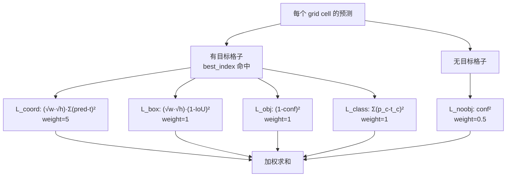
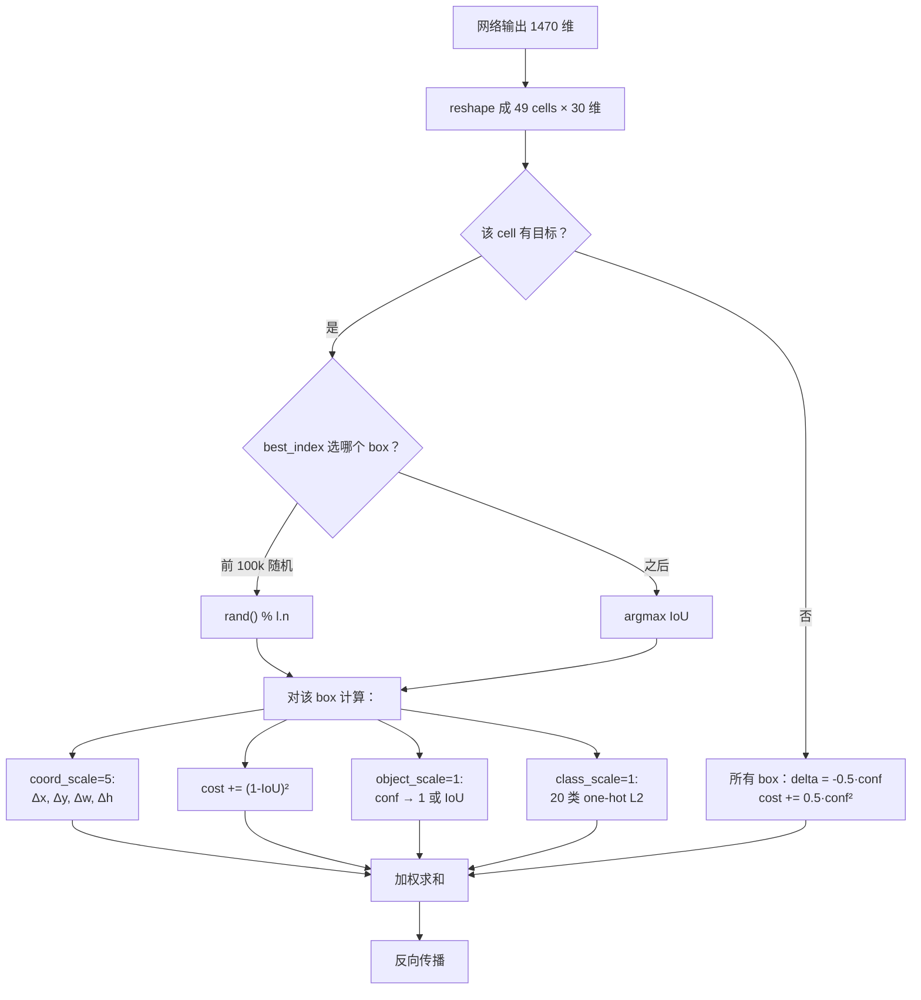

# YOLOv1 损失函数

YOLOv1 的 loss 是 **4 项 L2 加权之和**，全部在 `src/detection_layer.c` 的 `forward_detection_layer()` 中计算。

> 论文原文（§3.2）："We optimize for sum-squared error in the output of our model."

```
L_total = 5 · L_coord + 1 · L_box + 1 · L_obj + 0.5 · L_noobj + 1 · L_class
```

- coord / box / obj / class：只在**有目标且 best_index 命中**的格子上算
- noobj：在**所有格子的所有 box** 上算


## 全景图



## 1. 坐标回归 L2 (`loss-coord-l2`)

**公式**：

```
L_coord = Σ_best (√w · √h) · [ (pred_x - t_x)² + (pred_y - t_y)² ]
```

**weight = 5**

**白话**：预测框中心点 (x, y) 离真实框中心点有多远。因为 x、y 的值域只有 [0,1]，平方后梯度很小，所以权重给 5 强行放大。

**要点**：
- 只对 **best_index 那一个 box** 计算 coord 项（每个 cell 只有一个 box 被归为"命中"）
- 乘上 `√w · √h` 是因为 `sqrt=1` 时预测的是开方值，反传要乘回去做尺度校正
- 权重 5 是 pjreddie 手工调的——coord 空间是连续 [0,1]，梯度天然小；乘 5 拉平到与其他项同量级

**源码对应**（`src/detection_layer.c:163-166`）：

```c
l.delta[box_index+0] = l.coord_scale*(state.truth[tbox_index + 0] - l.output[box_index + 0]);
l.delta[box_index+1] = l.coord_scale*(state.truth[tbox_index + 1] - l.output[box_index + 1]);
l.delta[box_index+2] = l.coord_scale*(state.truth[tbox_index + 2] - l.output[box_index + 2]);
l.delta[box_index+3] = l.coord_scale*(state.truth[tbox_index + 3] - l.output[box_index + 3]);
```

**源码位置**：`source/yolov1/snapshot/src/detection_layer.c:163-166`

---

## 2. Box IoU L2 (`loss-box-iou-l2`)

**公式**：

```
L_box = Σ_best (√w · √h) · (1 - IoU(pred, gt))²
```

**weight = 1**

**白话**：不光中心要对，框的大小和形状也要对。用 `(1-IoU)²` 把宽、高、位置打包成一个几何相似度指标。

**要点**：
- 与 L_coord 同时作用于 best_index
- `(1-IoU)²` 是二阶段检测里常见的 IoU 损失表达
- 与 coord loss 形成互补：coord 精调 x/y，IoU 保证 w/h 合理
- **不引入 CIoU/GIoU**——这是 v1 定位粗糙的根源之一，见 [痛点追踪](/versions/v1/painpoints)

**源码对应**（`src/detection_layer.c:172`）：

```c
*(l.cost) += pow(1-iou, 2);
```

**源码位置**：`detection_layer.c:172`

---

## 3. Objectness L2 (`loss-object-l2`)

**公式**：

```
L_obj = (1 - conf_pred)²     # 有目标格子
```

**weight = 1**

**白话**：这个格子"是不是真的有物体"。注意 v1 的目标不是 1，而是 `IoU(pred, gt)`，也就是说定位差的框 confidence 也会低。

**要点**：
- confidence 的目标是 **IoU(pred, gt)**，不是 1（这是 v1 最独特之处）
- 论文原话：`confidence = P(Object) · IoU(pred, GT)`，训练中 conf 分支同时吸收 objectness 和定位信号
- 与 [Concept 4: Confidence = P·IoU](/versions/v1/concepts) 呼应

**源码对应**（`src/detection_layer.c:154-157, 159-161`）：

```c
// 基础 objectness：希望 confidence → 1
*(l.cost) += l.object_scale * pow(1-l.output[p_index], 2);
l.delta[p_index] = l.object_scale * (1.-l.output[p_index]);

// 如果 rescore=1，把真实 IoU 作为目标
if(l.rescore){
    l.delta[p_index] = l.object_scale * (iou - l.output[p_index]);
}
```

**源码位置**：`detection_layer.c:154-161`

---

## 4. No-Object L2 (`loss-noobject-l2`)

**公式**：

```
L_noobj = 0.5 · conf²        # 无目标格子
```

**weight = 0.5**

**白话**：告诉模型"这些格子没物体，confidence 给我压到 0"。因为没物体的格子太多，权重只给 0.5，防止它们霸占整个梯度。

**要点**：
- 无目标格子占绝大多数（49 cell 里通常 <5 个有目标），不加权会淹没有目标格的梯度
- 0.5 是 pjreddie 的实验值，论文未给出理论最优
- **不是焦点损失**——v1 用的是纯 L2，v2 起引入 Focal Loss

**源码对应**（`src/detection_layer.c:76-78`）：

```c
int p_index = index + locations*l.classes + i*l.n + j;
l.delta[p_index] = l.noobject_scale*(0 - l.output[p_index]);
*(l.cost) += l.noobject_scale*pow(l.output[p_index], 2);
```

**源码位置**：`detection_layer.c:76-78`

---

## 5. Class L2 (`loss-class-l2`)

**公式**：

```
L_class = Σ_c (p_c - t_c)²   # 有目标格子，c ∈ [0, 20)
```

**weight = 1**

**白话**：这个格子里的物体是什么类别。v1 把 20 类做成 one-hot，直接对每一类做 L2。

**要点**：
- **softmax=0**（`yolo.cfg` 显式指定），类别头用独立 sigmoid 而非 softmax
- 训练时 `t_c` 是 one-hot，只有正确类是 1
- 与 conf 分离：conf 只负责"这里有没有"，class 负责"是什么"

**源码对应**（`src/detection_layer.c:91-96`）：

```c
int class_index = index + i*l.classes;
for(j = 0; j < l.classes; ++j) {
    l.delta[class_index+j] = l.class_scale * (state.truth[truth_index+1+j] - l.output[class_index+j]);
    *(l.cost) += l.class_scale * pow(state.truth[truth_index+1+j] - l.output[class_index+j], 2);
}
```

**源码位置**：`detection_layer.c:91-96`

---

## 6. Rescore 项 (`loss-rescore-objectness`)

**公式**：

```
delta_conf = object_scale · (IoU - conf_pred)   # 训练时反传修正
```

**白话**：普通的 objectness 只告诉模型"有物体"，rescore 进一步告诉模型"这个框和真实框的 IoU 是多少"。这样 confidence 就学成了 `P(Object)·IoU`。

**要点**：
- 只在 `rescore=1` 时启用
- 作用在 conf 分支的 delta 上，把 IoU 信号显式注入到 objectness 反传
- 这是 v1 让 confidence 学会 P·IoU 语义的关键 trick
- v2 起被独立的 objectness 头取代，rescore 消失

**源码对应**（`src/detection_layer.c:159-161`）：

```c
if(l.rescore){
    l.delta[p_index] = l.object_scale * (iou - l.output[p_index]);
}
```

**源码位置**：`detection_layer.c:159-161`

---

## 7. 损失计算流程图



---

## 权重平衡总表

| 项 | 权重 | 作用域 | 为什么是这个值 |
|----|------|--------|---------------|
| Coord L2 | **5** | best_index box | coord 值域小，梯度弱 |
| Box IoU | 1 | best_index box | 与 coord 同量级 |
| Object L2 | 1 | 有目标格 | 与 class 同重要性 |
| No-Object L2 | **0.5** | 无目标格 | 背景格子数量压倒，需降权 |
| Class L2 | 1 | 有目标格 | 基线 |

## 与其他页的链接

- [概览](/versions/v1/index)
- [论文精读](/versions/v1/paper)
- [理论 Concept](/versions/v1/concepts) — Concept 4/5/6 直接对应这里
- [架构与层](/versions/v1/layers)
- [训练技巧](/versions/v1/tricks)
- [源码走读](/versions/v1/code-walkthrough) — detection_layer.c 逐段解析
- [痛点追踪](/versions/v1/painpoints) — loss 结构导致的边界框粗糙问题
