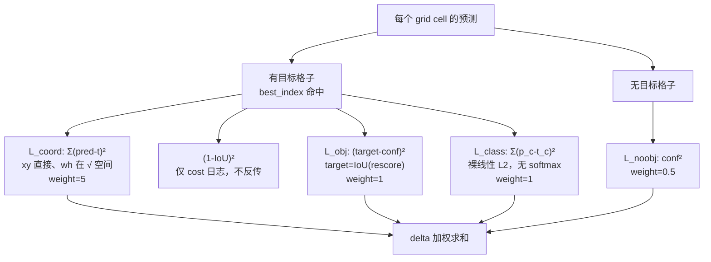
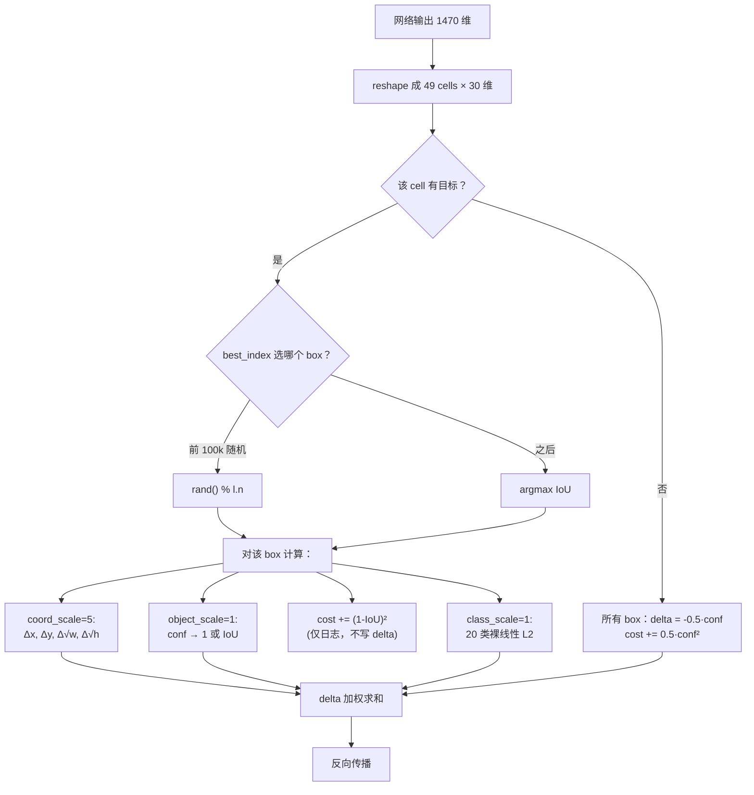

# YOLOv1 损失函数

YOLOv1 的 loss 是 **4 项 L2 加权之和**，全部在 <SrcLink file="src/detection_layer.c" :line="42" /> 的 `forward_detection_layer()` 中计算。

> 论文原文（§3.2）："We optimize for sum-squared error in the output of our model."

$$L_{total} = 5 \cdot L_{coord} + 1 \cdot L_{obj} + 0.5 \cdot L_{noobj} + 1 \cdot L_{class}$$

- coord / obj / class：只在**有目标且 best_index 命中**的格子上算
- noobj：在**所有格子的所有 box** 上先算（<SrcLink file="src/detection_layer.c" :line="75" :end="80" />），命中的 box 随后被 object/coord delta 覆盖
- 另有一项 `(1-IoU)²` 只累加到 `l.cost` 用于**日志显示**（<SrcLink file="src/detection_layer.c" :line="172" />），**不写 delta、不参与反传**——不要把它当成第 5 个真实损失项

## 全景图

## 1. 坐标回归 L2 (`loss-coord-l2`)

**公式**：

$$L_{coord} = 5 \sum_{best} \Big[ (x-t_x)^2 + (y-t_y)^2 + (\sqrt{w}-\sqrt{t_w})^2 + (\sqrt{h}-\sqrt{t_h})^2 \Big]$$

**weight = 5**

**白话**：预测框中心点离真实框有多远；宽高在 **√ 空间**比较，让大小目标的误差量级接近。

**要点**：
- 只对 **best_index 那一个 box** 计算 coord 项（每个 cell 只有一个 box 被归为"命中"）
- xy 直接做差；wh 的真值先取 `sqrt()`（`sqrt=1` 时，见 <SrcLink file="src/detection_layer.c" :line="167" :end="170" />），**没有额外的 √w·√h 权重因子**——那是后人物料里以讹传讹的说法
- 权重 5 是手工调的——coord 项数量少、值域小，乘 5 拉平到与其他项同量级（<SrcLink file="cfg/yolo.cfg" :line="234" />）

**源码对应**：

<SrcSnippet file="src/detection_layer.c" :start="163" :end="170" hl="163-166,167-170" />

---

## 2. (1-IoU)²：只显示、不反传 (`loss-box-iou-l2`)

$$cost \mathrel{+}= (1 - IoU(pred,\ gt))^2$$

**白话**：训练日志里那个 loss 数值包含框与 GT 的几何偏差，方便人观察"框得准不准"。

**要点（快照层面的重要事实）**：
- 这一项只写 `*(l.cost)`，<SrcLink file="src/detection_layer.c" :line="172" /> **没有对应 `l.delta` 赋值，优化器收不到它的梯度**
- 因此它**不是真正参与训练的损失项**，与 coord 项也不构成"互补双损失"
- 真正把"框不准"信号传回去的路径是 rescore：IoU 成为 confidence 的目标（见第 3/6 节）
- v1 没有任何 IoU 类损失（CIoU/GIoU/DIoU 都没有），这是定位粗糙的根源之一，见 [痛点追踪](/versions/v1/painpoints)

<SrcSnippet file="src/detection_layer.c" :start="171" :end="173" />

---

## 3. Objectness L2 (`loss-object-l2`)

**公式**：

$$L_{obj} = (1 - conf_{pred})^2 \quad \text{（有目标格子）}$$

**weight = 1**

**白话**：这个格子"是不是真的有物体"。注意 v1 的目标不是 1，而是 `IoU(pred, gt)`，也就是说定位差的框 confidence 也会低。

**要点**：
- confidence 的目标是 **IoU(pred, gt)**，不是 1（这是 v1 最独特之处）
- 论文原话：`confidence = P(Object) · IoU(pred, GT)`，训练中 conf 分支同时吸收 objectness 和定位信号
- 与 [Concept 4: Confidence = P·IoU](/versions/v1/concepts) 呼应

**源码对应**：

<SrcSnippet file="src/detection_layer.c" :start="153" :end="161" hl="155,157,159-161" />

---

## 4. No-Object L2 (`loss-noobject-l2`)

**公式**：

$$L_{noobj} = 0.5 \cdot conf^2 \quad \text{（无目标格子）}$$

**weight = 0.5**

**白话**：告诉模型"这些格子没物体，confidence 给我压到 0"。因为没物体的格子太多，权重只给 0.5，防止它们霸占整个梯度。

**要点**：
- 无目标格子占绝大多数（49 cell 里通常 <5 个有目标），不加权会淹没有目标格的梯度
- 0.5 是实验值（<SrcLink file="cfg/yolo.cfg" :line="231" />），论文未给出理论最优
- **不是焦点损失**——v1 用的是纯 L2；顺带澄清：官方 v2/v3/v4/v5 也都没有采用 Focal Loss（RetinaNet 提出后 YOLO 主线长期未用，v8 等才引入相关变体）

**源码对应**（注意 cost 与 delta 在同一循环内，先对两个 box 都置 noobj，命中者后面再被覆盖）：

<SrcSnippet file="src/detection_layer.c" :start="75" :end="80" hl="76-78" />

---

## 5. Class L2 (`loss-class-l2`)

**公式**：

$$L_{class} = \sum_c (p_c - t_c)^2 \quad \text{（有目标格子，} c \in [0, 20) \text{）}$$

**weight = 1**

**白话**：这个格子里的物体是什么类别。v1 把 20 类做成 one-hot，直接对每一类做 L2。

**要点**：
- **softmax=0**（<SrcLink file="cfg/yolo.cfg" :line="227" />）：类别头是**裸线性输出**，既无 softmax 也无 sigmoid，训练直接对 20 个 logits 做 L2（推理时再与 confidence 相乘并按阈值清零）
- 训练时 `t_c` 是 one-hot，只有正确类是 1
- 与 conf 分离：conf 只负责"这里有没有"，class 负责"是什么"

**源码对应**：

<SrcSnippet file="src/detection_layer.c" :start="90" :end="96" hl="92-93" />

---

## 6. Rescore 项 (`loss-rescore-objectness`)

**公式**：

$$\delta_{conf} = object\_scale \cdot (IoU - conf_{pred}) \quad \text{（训练时反传修正）}$$

**白话**：普通的 objectness 只告诉模型"有物体"，rescore 进一步告诉模型"这个框和真实框的 IoU 是多少"。这样 confidence 就学成了 `P(Object)·IoU`。

**要点**：
- 只在 `rescore=1` 时启用
- 作用在 conf 分支的 delta 上，把 IoU 信号显式注入到 objectness 反传
- 这是 v1 让 confidence 学会 P·IoU 语义的关键 trick
- v2 起被独立的 objectness 头取代，rescore 消失

**源码对应**（rescore 覆盖上一行的常数 1 目标）：

<SrcSnippet file="src/detection_layer.c" :start="153" :end="161" hl="159-161" />

---

## 7. 损失计算流程图

---

## 权重平衡总表

| 项 | 权重 | 作用域 | 为什么是这个值 |
|----|------|--------|---------------|
| Coord L2 | **5** | best_index box | coord 值域小、项数少，梯度弱 |
| (1-IoU)² | — | 仅 `l.cost` | **不反传**，只用于训练日志观察 |
| Object L2 | 1 | 命中 box | 与 class 同重要性；rescore 时目标为 IoU |
| No-Object L2 | **0.5** | 无目标格 | 背景格子数量压倒，需降权 |
| Class L2 | 1 | 有目标格 | 基线；裸线性 L2 |

## 与其他页的链接

- [概览](/versions/v1/index)
- [论文精读](/versions/v1/paper)
- [理论 Concept](/versions/v1/concepts) — Concept 4/5/6 直接对应这里
- [架构与层](/versions/v1/layers)
- [训练技巧](/versions/v1/tricks)
- [源码走读](/versions/v1/code-walkthrough) — detection_layer.c 逐段解析
- [痛点追踪](/versions/v1/painpoints) — loss 结构导致的边界框粗糙问题
