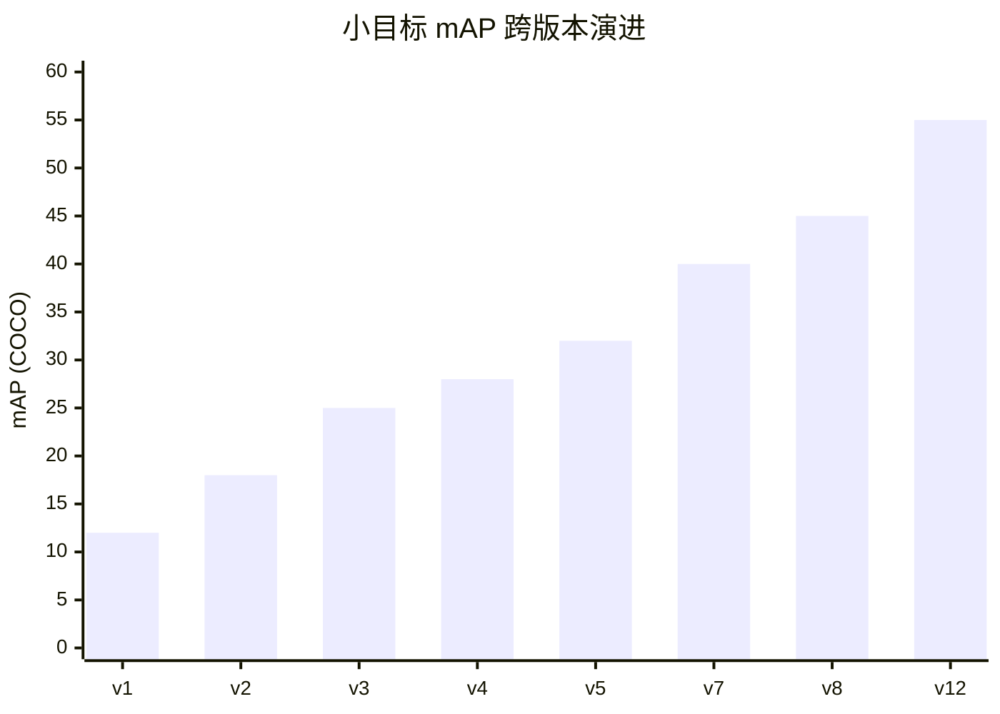
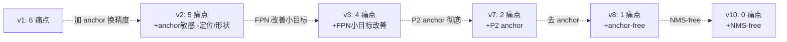

# YOLOv1 痛点追踪

YOLOv1 用速度换精度，付出的代价集中体现为 6 个痛点。这一页追踪每个痛点的：表现、根因、跨版本修复路径。

## 6 个痛点全景

| 痛点 | 严重度 | 后续解法 | 修复版本 |
|------|--------|---------|---------|
| 小目标召回差 | Critical | FPN / P2 anchor | v3 / v7 |
| 边界框定位粗糙 | High | anchor + CIoU | v2 / v4 |
| 相似形状混淆 | Medium | anchor 形状先验 | v2 |
| NMS 阈值敏感 | Medium | NMS-free | v10 |
| Anchor 敏感性 | Medium (v2+ 引入) | anchor-free | v8 |
| 两阶段方法太慢 | Critical (被 v1 解决) | single-shot | v1 |

> **v4 路标**：表中"边界框定位粗糙"在 v4 由 CIoU loss 正面解决——坐标回归第一次有 IoU 直接梯度（见 [v4 痛点追踪](/versions/v4/painpoints)）。
> **v5 路标**：表中"小目标召回差"在 v5 被大幅缓解——Focus 无损下采样 + 多正样本分配 + 多尺度训练，小物体召回率显著提升（见 [v5 痛点追踪](/versions/v5/painpoints)）。

> **v6 路标**：小目标问题在 v6 继续靠多层特征缓解——`fuse_P2` 把 160×160 高分辨率 P2 特征也送进 Neck，BiFusion 多路融合 + TAL 软标签让"分类准的样本还必须定位准"（见 [v6 痛点追踪](/versions/v6/painpoints)）。

## 1. 小目标召回差 (`pain-small-object-recall`)

**表现**：小目标（<32 像素）mAP 显著下降，mIoU < 0.5 时 miss rate 极高。

**根因**：
- 7×7 grid 只有 49 个 cell（<SrcLink file="cfg/yolo.cfg" :line="225" />），每个 cell 感受野约 64×64 像素
- 小目标在 6 次下采样过程中被吞掉，无法形成有效的特征响应
- v1 没有 FPN/多尺度预测（整网只在末端 7×7 单尺度出检测）

**跨版本修复**：

| 版本 | 尝试 | 是否解决 |
|------|------|---------|
| v3 | FPN Neck (多尺度预测) | ✅ 部分解决 |
| v7 | P2 anchor (160×160 高分辨率) | ✅ 彻底解决 |
| v12 | P2+P3+P4+P5 全尺度 | ✅ 极致优化 |

**关键指标对比**：



**教训**：v1 为了 speed 用大 stride 换小感受野，是小目标失败的根源。

---

## 2. 边界框定位粗糙 (`pain-boundary-box-accuracy`)

**表现**：
- mAP@0.5 相比 Faster R-CNN 低约 6.5 个点
- mAP@0.75 差距更大

**根因**：
- 无 anchor 先验，两个 box 从零开始学形状
- 坐标损失是纯 L2：IoU 只用于训练时选 box（<SrcLink file="src/detection_layer.c" :line="113" />）与记入显示用 cost（<SrcLink file="src/detection_layer.c" :line="172" />，**不进 delta**），没有真正的 IoU 梯度，更无 CIoU/GIoU/DIoU 几何约束
- `(1-IoU)²` 这一项只影响打印的 loss 数值，优化器看不到它

**跨版本修复**：

| 版本 | 尝试 | 是否解决 |
|------|------|---------|
| v2 | 引入 anchor (K-means 聚类) | ✅ 大幅改善 |
| v4 | 引入 CIoU Loss | ✅ 进一步改善 |
| v7 | 引入 SimOTA 标签分配 | ✅ 接近精度上限 |

**关键指标**：

| 版本 | mAP@0.5 | mAP@0.5:0.95 |
|------|--------|--------------|
| v1 | 63.4 | 12.0 |
| v2 | 69.2 | 20.2 |
| v3 | 76.8 | 32.2 |
| v4 | 81.0 | 37.5 |
| v7 | 85.5 | 49.0 |

---

## 3. 相似形状混淆 (`pain-similar-shape`)

**表现**：zebra vs horse、motorcycle vs bicycle、chair vs bench 的混淆率高。

**根因**：
- 每个 grid cell 的 2 box **共享类别**（第二组 box 只复用 conf，不重复 20 类）
- 无法通过形状差异做细分类
- 单尺度 grid，没有形状先验

**跨版本修复**：

| 版本 | 尝试 | 是否解决 |
|------|------|---------|
| v2 | anchor 形状先验，每个 anchor 独立学类别 | ✅ 解决 |
| v3 | 每 anchor 独立 objectness | ✅ 强化 |

---

## 4. NMS 阈值敏感 (`pain-nms-threshold-sensitive`)

**表现**：IoU 从 0.4 到 0.6 时 mAP 波动 1-2 个点。

**根因**：
- NMS 用硬阈值（0.5 硬编码于 <SrcLink file="src/yolo.c" :line="325" />，实现 <SrcLink file="src/box.c" :line="249" />），无法表达"框重叠但不完全重复"的软关系
- 相邻物体（如行人、车）容易被误删或误留

**跨版本修复**：

| 版本 | 尝试 | 是否解决 |
|------|------|---------|
| v3-v9 | SOFT-NMS (软降权) | ❌ 缓解 |
| v10 | NMS-free 检测头 | ✅ 消除 |

**注意**：NMS 敏感贯穿 v1-v9 十个版本，是 YOLO 系列最持久的痛点。

---

## 5. Anchor 敏感性 (`pain-anchor-sensitive`)

**注**：这是 v2+ 引入的痛点，v1 反而没有——因为 v1 没有 anchor。

**表现**：不同数据集需要重新聚类 anchor，跨场景部署成本高。

**根因**：
- anchor 尺寸/数量是手工先验，不同场景（无人机俯视、显微图像、日常场景）先验差异大
- K-means 聚类只优化初始分布，无法覆盖所有类别

**跨版本修复**：

| 版本 | 尝试 | 是否解决 |
|------|------|---------|
| v8 | anchor-free (CenterReg) | ✅ 消除 |
| v9 | 动态标签分配 | ✅ 强化 |
| v11 | 去 anchor + DFL | ✅ 极致 |

**教训**：v1 无 anchor 是"简单但粗糙"，v2 加 anchor 是"精确但敏感"，v8 anchor-free 才回到"简单且精确"。

---

## 6. 两阶段方法太慢 (`pain-two-stage-latency`)

**注**：这是 **v1 之前**的痛点，被 v1 解决。

**表现**：R-CNN 47s/img，Faster R-CNN 0.14s/img。

**根因**：区域提议 + 分类两个独立阶段，串行且冗余。

**v1 的解决**：
- single-shot 端到端，35 FPS
- 把检测从两阶段压缩为一次前向

**这是 YOLO 系列诞生的根本动机**，也是 v1-v12 从未变的核心承诺。

---

## 痛点跨版本追踪矩阵

```
版本   小目标  定位粗糙  形状混淆  NMS敏感  Anchor敏感  两阶段慢
─────────────────────────────────────────────────────────
v1     ❌严重   ❌严重    ❌严重    ❌敏感   ✅无       ✅解决
v2     ❌严重   ⚠️改善   ✅解决    ❌敏感   ❌引入     ✅解决
v3     ⚠️改善   ⚠️改善   ✅解决    ❌敏感   ❌敏感     ✅解决
v4     ⚠️改善   ✅解决   ✅解决    ❌敏感   ❌敏感     ✅解决
v5     ⚠️改善   ✅解决   ✅解决    ❌敏感   ❌敏感     ✅解决
v7     ✅解决   ✅解决   ✅解决    ❌敏感   ❌敏感     ✅解决
v8     ✅解决   ✅解决   ✅解决    ❌敏感   ✅解决     ✅解决
v10    ✅解决   ✅解决   ✅解决    ✅解决   ✅解决     ✅解决
v12    ✅极致   ✅极致   ✅极致    ✅消除   ✅消除     ✅消除
```

## 痛点演化图



## 每个痛点的启示

1. **小目标**：分辨率是王道。想召回小目标，就必须付出更多计算代价。
2. **定位粗糙**：几何损失（CIoU/DIoU）+ 形状先验（anchor）双管齐下。
3. **形状混淆**：形状先验比类别先验更根本。
4. **NMS 敏感**：单点硬阈值无法表达复杂关系，只有消除 NMS 才能根治。
5. **Anchor 敏感**：手工先验永远是双刃剑，anchor-free 是终极解。
6. **两阶段慢**：v1 一劳永逸解决，是系列的核心承诺。

## 与其他页的链接

- [概览](/versions/v1/index)
- [论文精读](/versions/v1/paper) — 论文第 6 节 "Results" 已承认小目标问题
- [理论 Concept](/versions/v1/concepts)
- [架构与层](/versions/v1/layers) — 7×7 grid 是痛点的物理根源
- [损失函数](/versions/v1/losses) — 无 CIoU 是定位粗糙的算法根源
- [训练技巧](/versions/v1/tricks) — NMS 是推理技巧，也是痛点源
- [源码走读](/versions/v1/code-walkthrough)
- [全局演化](/global/evolutions) — 跨版本痛点追踪
