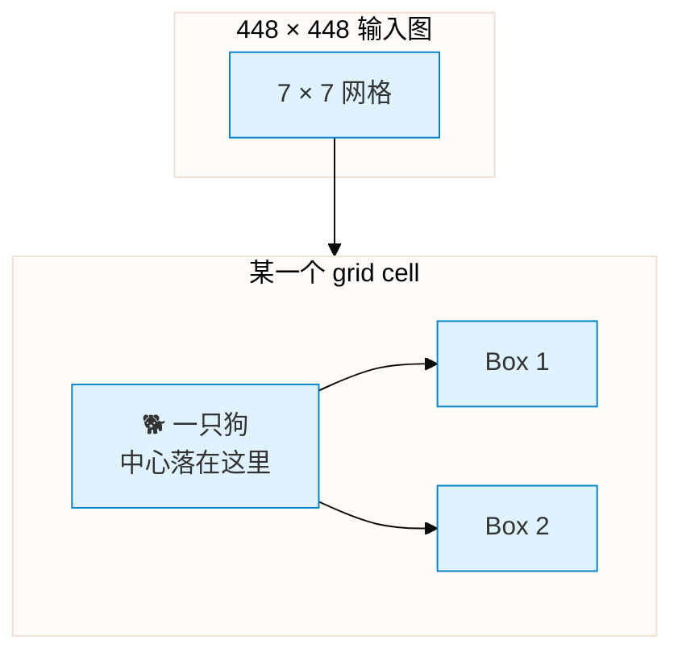
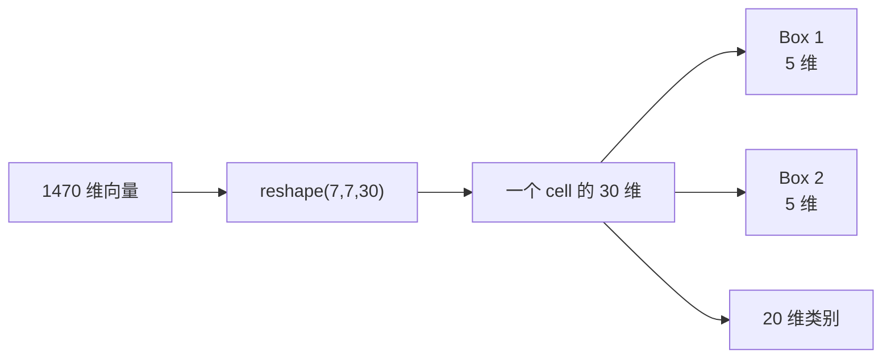
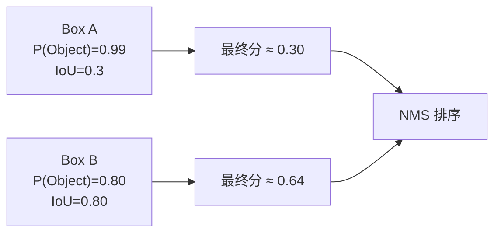
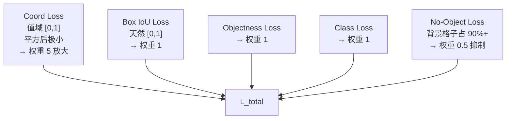
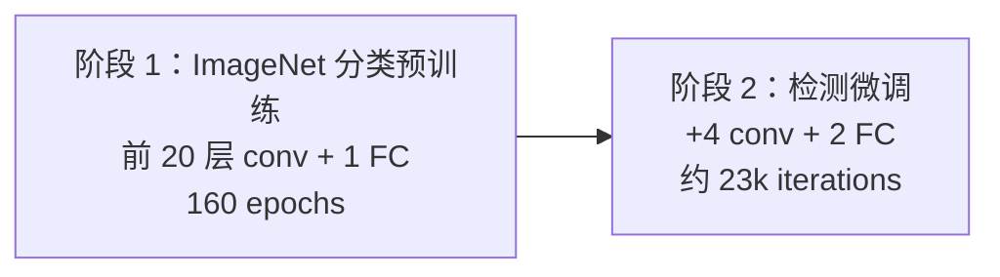
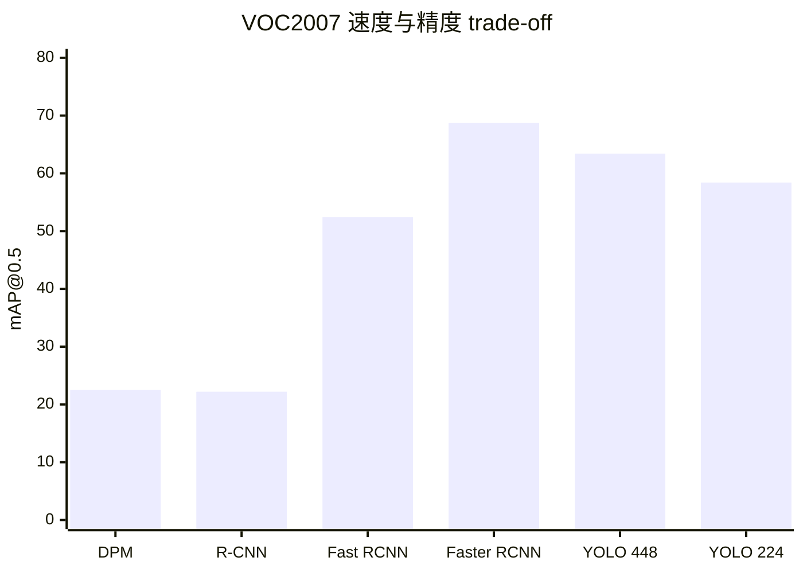
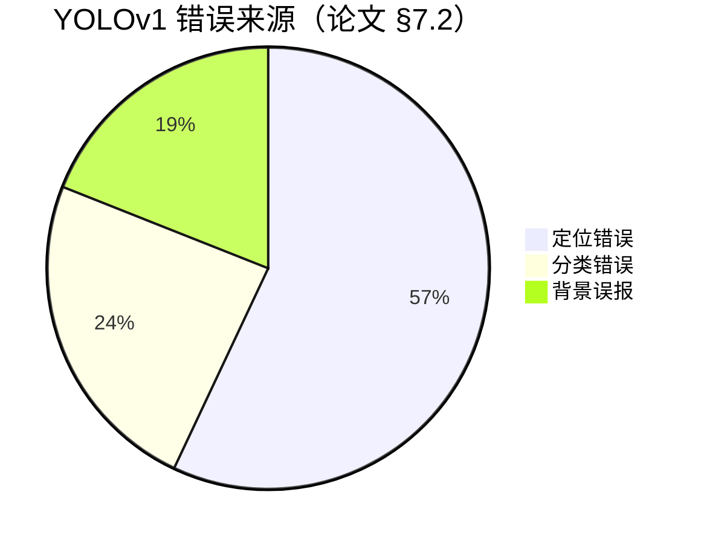
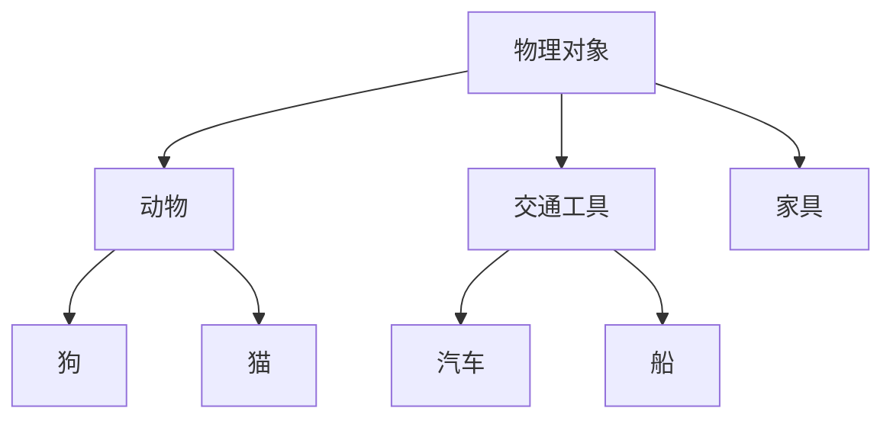

# YOLOv1 论文精读

**You Only Look Once: Unified, Real-Time Object Detection**

*Joseph Redmon, Santosh Divvala, Ross Girshick, Ali Farhadi · ECCV 2016 · [arXiv:1506.02640](https://arxiv.org/abs/1506.02640)*

---

## 1. 为什么要做 YOLO？（Motivation）

2015 年前后，目标检测被两阶段方法统治：


**问题**：

1. **太慢**：R-CNN 在 GPU 上也要 47 秒/张；最快的 Faster R-CNN 才 7 FPS。
2. **丢失全局上下文**：每个候选框只看到自己的小窗口，无法利用整幅图像的语义环境。
3. **流水线复杂**：区域提议、特征提取、分类、回归、NMS，每个模块都要单独调。

> 论文原话：*"Current detection systems repurpose classifiers to perform detection."*
> 作者想说：别再把分类器改造来改造去了，直接把它重新设计成检测器。

**YOLO 的解题思路**：


---

## 2. 核心 Idea：把检测变成单次回归

### 2.1 一句话定义

> 给定输入图像，网络直接输出每个物体的 \( (x, y, w, h) \)、confidence 和类别概率。

### 2.2 与传统方法的对比

| | 两阶段（Faster R-CNN） | YOLOv1 |
|--|------------------------|--------|
| 流程 | 先找框，再分类 | 一次前向，同时找框+分类 |
| 输入感受野 | 每个候选框局部 | 整图全局 |
| 速度 | ~7 FPS | **35 FPS** |
| VOC2007 mAP | 69.9 | **63.4** |

**YOLO 用约 6.5 个 mAP 点的精度，换来了 5 倍的速度**。

### 2.3 形式化表达

```
输入：448 × 448 × 3
输出：S × S × (B · 5 + C)

v1 中：S = 7, B = 2, C = 20
输出 = 7 × 7 × (2 × 5 + 20)
     = 7 × 7 × 30
     = 1470
```

**源码定位**：`cfg/yolo.cfg` 第 221-229 行定义了 Detection 头的参数：

```cfg
[detection]
classes=20
coords=4
rescore=1
side=7
num=2
softmax=0
sqrt=1
```

---

## 3. 网格化空间分解（Grid Decomposition）

### 3.1 什么叫 grid cell？

YOLOv1 把 448×448 的输入图划分成 **7×7 = 49 个格子**。每个格子只负责预测“中心落在自己内部的物体”。



### 3.2 每个 grid cell 输出什么？

每个 cell 输出 **2 个 bounding box**，每个 box 有 5 个数；再加上 20 维类别概率（两个 box 共享类别）：

```
30 维 = Box1(x,y,w,h,conf) + Box2(x,y,w,h,conf) + P(class_1)...P(class_20)
```

**可视化切分**：



### 3.3 为什么用 7×7？

- **速度**：7×7 是经过 5 次下采样后的自然终点（448 → 224 → 112 → 56 → 28 → **7**）。
- **精度代价**：每个 cell 感受野约 64×64 像素；小于这个尺寸的物体很难被检测到。这也是 v1 小目标召回差的根本原因。

**对应源码**：`src/detection_layer.c:44` 计算 grid 总数：

```c
int locations = l.side*l.side;   // 7*7 = 49
```

---

## 4. Confidence 的独特定义

### 4.1 论文公式

论文没有让 confidence 只表示“有没有物体”，而是定义为：

```
confidence = P(Object) × IoU(pred, GT)
```

### 4.2 为什么这样设计？



**效果**：定位差的框即使看起来“很有信心”，也会在 NMS 时被真正的准框压下去。

### 4.3 训练时的目标值

训练时 GT 已知，confidence 的**目标就是 IoU(pred, gt)**。代码中 `rescore=1` 会显式把 delta 写成：

```c
l.delta[p_index] = l.object_scale * (iou - l.output[p_index]);
```

> **注意推理时的退化**：测试阶段没有 GT，confidence 无法真正计算 IoU，只能退化为模型学到的 `P(Object)` 估计。

---

## 5. 损失函数（Loss Function）

总损失把四项 L2 加权相加：

```
L = λ_coord · Σ (x-x̂)² + (y-ŷ)² + (√w - √ŵ)² + (√h - ĥ)²
  + λ_obj   · Σ (conf - ÎoU)²
  + λ_noobj · Σ conf²
  + λ_cls   · Σ (p_c - p̂_c)²
```

论文给出的权重：\( \lambda_{coord}=5 \), \( \lambda_{obj}=1 \), \( \lambda_{noobj}=0.5 \), \( \lambda_{cls}=1 \)。

### 5.1 权重为什么这样设？



### 5.2 sqrt=1 技巧

对 \( w, h \) 回归的是开方值，而不是原始值：

```c
if (l.sqrt) {
    box.w = pow(boxes[i].w, 0.5);
    box.h = pow(boxes[i].h, 0.5);
}
```

**原因**：如果不做开方，大物体的 \( w \times h \) 残差会远远超过小物体，小物体的梯度被淹没。开方后大小目标在损失里更均衡。

### 5.3 源码对应

损失计算全部在 `src/detection_layer.c:42-213` 的 `forward_detection_layer()` 中：

| 代码行 | 功能 |
|--------|------|
| 76-78 | 所有 box 的 no-object loss |
| 91-96 | 有目标 cell 的 class loss |
| 102-127 | 用 IoU 或 RMSE 选 best_index |
| 136-138 | 前 100k 迭代随机选 best_index |
| 154-161 | objectness loss + rescore |
| 163-170 | coord loss，含 sqrt 分支 |
| 172 | box IoU loss |

---

## 6. 网络架构

论文给出的结构是 **24 层卷积 + 2 层全连接**，但源码 `cfg/yolo.cfg` 的卷积核配置更细致。

详见 [Architecture 逐层图解](/versions/v1/architecture)。这里只给出宏观流程：

```mermaid
flowchart LR
    IN["448×448×3"] --> C1["Conv 7×7 s2<br/>224×224×64"]
    C1 --> P1["MaxPool"] --> C2["Conv 3×3<br/>112×112×192"]
    C2 --> P2["MaxPool"] --> C3["Conv 1×1/3×3 stack<br/>56×56×256"]
    C3 --> P3["MaxPool"] --> C4["交替 256/512<br/>28×28×512"]
    C4 --> P4["MaxPool"] --> C5["1024 bottleneck<br/>14×14×1024"]
    C5 --> D["Conv 3×3 s2<br/>7×7×1024"]
    D --> FC1["FC 4096"] --> DROP["Dropout"] --> FC2["FC 1470"]
    FC2 --> DET["Detection Layer"] --> OUT["98 boxes"]
```



**关键**: FC 4096 把 7×7×1024 = 50,176 维特征映射到 4096，再映射到 1470。这一层就吃掉了约 2 亿参数，是 v1 又大又慢的主因。

---

## 7. 训练策略

### 7.1 两阶段训练



### 7.2 学习率调度

`cfg/yolo.cfg` 的学习率策略：

```cfg
learning_rate=0.001
policy=steps
steps=200,400,600,20000,30000
scales=2.5,2,2,.1,.1
max_batches=40000
```

| iterations | lr | 含义 |
|------------|----|------|
| 0-200 | 0.001 × 2.5 = 0.0025 | 热身，快速离开随机初始化 |
| 200-400 | 0.001 × 2 = 0.002 | 继续冲高 |
| 400-600 | 0.001 × 2 = 0.002 | 稳定 |
| 600-20000 | 0.001 | 主训练段 |
| 20000-30000 | 0.0001 | 衰减，精调 |
| 30000-40000 | 0.00001 | 进一步精调 |

### 7.3 数据增强

```cfg
jitter=.2          # 随机平移/缩放 20%
saturation=1.5     # HSV 饱和度
exposure=1.5       # HSV 曝光
```

增强代码在 `src/data.c:load_data_detection()` 中，通过 `random_distort()` 随机扰动。

---

## 8. 实验结果

### 8.1 Pascal VOC 2007

| 方法 | mAP@0.5 | FPS |
|------|---------|-----|
| DPM | 22.5 | 3 |
| R-CNN | 22.2 | 0.3 |
| SPP-Net | 41.4 | 5 |
| Fast R-CNN | 52.4 | 7 |
| Faster R-CNN | 68.7 | 7 |
| **YOLO (448)** | **63.4** | **35** |
| **YOLO (224)** | **58.4** | **155** |



### 8.2 错误来源分析

论文 §7.2 对错误做了分解：

| 错误类型 | 比例 | 说明 |
|----------|------|------|
| 定位错误 | **57%** | box 位置/大小不准，是最大错误源 |
| 分类错误 | 24% | 类别判断错（如 zebra vs horse） |
| 背景误报 | 19% | 把背景当成物体 |



### 8.3 与 Fast R-CNN 的互补性

论文做了一个有趣的实验：把 YOLO 和 Fast R-CNN 的预测做融合。因为 YOLO 背景误报少、Fast R-CNN 定位准，融合后 mAP 达到约 **70.5**，超过两者单独表现。

---

## 9. YOLO9000：扩展到 9000+ 类

论文 §8 提出 YOLO9000，把 ImageNet 分类标签和 VOC 检测标签整合成一棵树：



**训练策略**：
- 检测数据：VOC / COCO，提供 box 标注
- 分类数据：ImageNet，只提供类别标签
- 混合训练时，有 box 的图片走检测 loss，只有类别的图片只反传分类 loss

**结果**：在 VOC 2007 上达到 **48.3 mAP**，速度 **50 FPS**，可识别 9000+ 类。

---

## 10. 局限与后续版本解法

论文自己承认三大局限：

| 局限 | 论文原话大意 | 后续解法 |
|------|-------------|---------|
| 定位精度低 | 最主要错误源（57%） | v2 引入 anchor + K-means；v4 引入 CIoU |
| 小目标召回差 | 7×7 grid 分辨率不足 | v3 引入 FPN 多尺度预测 |
| 相似形状混淆 | 每格 2 box、共享类别 | v3 每 anchor 独立类别与 objectness |

---

## 11. 批判性评述

### 11.1 被高估的地方

- **mAP 并不高**：63.4 比 Faster R-CNN 低 5.3 点。YOLOv1 的伟大之处在于“证明实时检测可行”，而不在于 SOTA。
- **泛化能力有时被夸大**：论文说在艺术画上表现好，但这主要来自训练数据多样性，而非方法本身。

### 11.2 被低估的地方

- **全局上下文**：整张图一次前向，让 YOLO 对“场景-物体”关系更敏感（如沙滩上的椅子 vs 城市里的椅子）。
- **工程简洁性**：一个网络、一次 loss、一次 NMS。这种极简设计影响了后面所有单阶段检测器。

### 11.3 历史地位

YOLOv1 是目标检测从“两阶段”转向“单阶段”的里程碑。没有 v1，就没有后来的 SSD、RetinaNet、YOLOv2-v12 乃至整个 anchor-free 浪潮。

---

## 12. 参考与引用

> Redmon, J., Divvala, S., Girshick, R., & Farhadi, A. (2016). You only look once: Unified, real-time object detection. In *ECCV* (pp. 804–823).

**相关资源**：

- 论文 PDF：https://arxiv.org/pdf/1506.02640.pdf
- 源码仓库：https://github.com/pjreddie/darknet
- 本站源码快照：`source/yolov1/snapshot/`
- 继续深入：[Architecture 逐层图解](/versions/v1/architecture) · [损失函数](/versions/v1/losses) · [训练技巧](/versions/v1/tricks) · [源码走读](/versions/v1/code-walkthrough)
