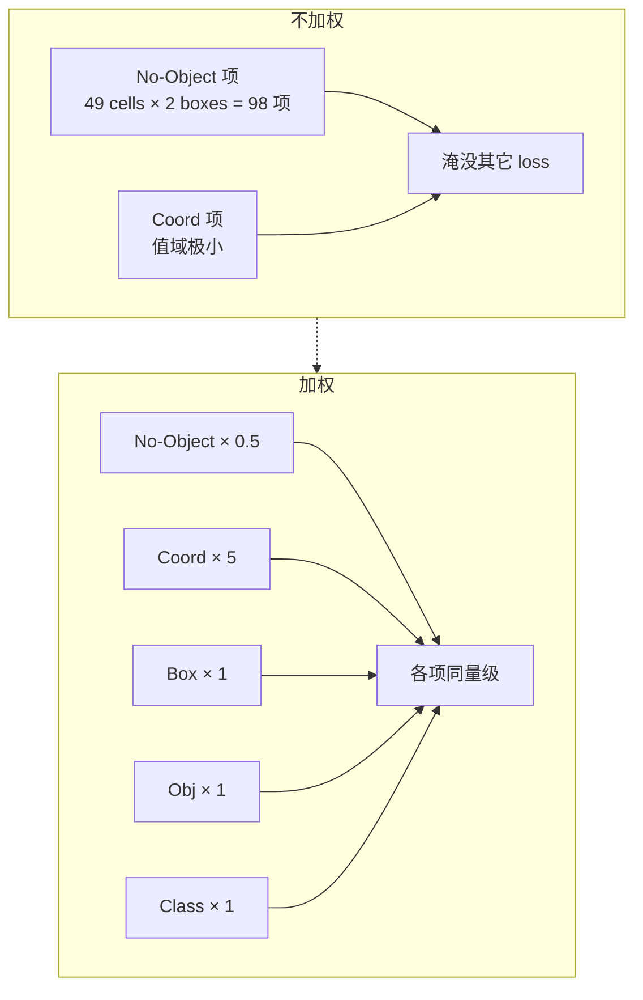
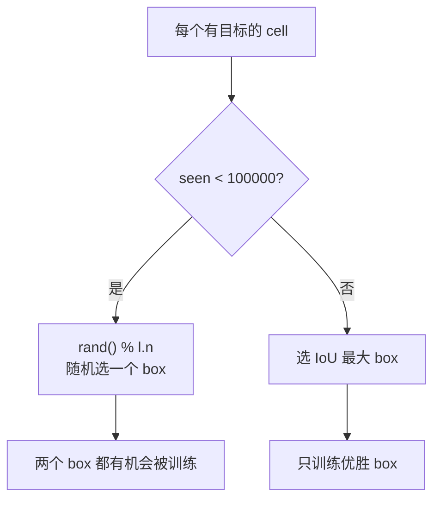
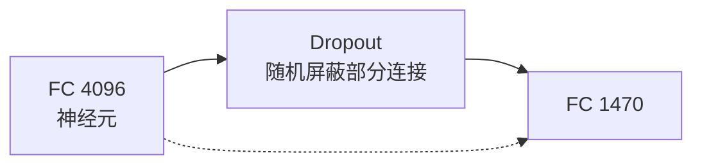
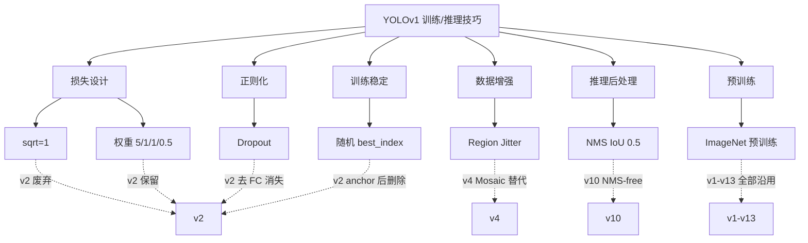

# YOLOv1 训练与推理技巧

YOLOv1 有 7 个关键 knob，全部通过 `cfg/yolo.cfg` 或源码几行代码实现。每个 trick 下面都有：**原理图、白话、源码、反例/演进**。

---

## 全部 7 个 Trick 速查

| # | Trick | 类别 | 位置 | 影响 |
|---|-------|------|------|------|
| 1 | sqrt=1 加速收敛 | 损失设计 | `yolo.cfg` | 大小目标损失均衡 |
| 2 | 权重 5/1/1/0.5 | 损失设计 | `yolo.cfg` | 平衡正负样本 |
| 3 | 前 100k 随机 best_index | 训练稳定 | <SrcLink file="src/detection_layer.c" :line="136" :end="138" /> | 防两个 box 抢同一个 GT |
| 4 | Region Jitter 0.2 | 数据增强 | `data.c` | 提升定位鲁棒性 |
| 5 | Dropout 0.25/0.5 | 正则化 | `yolo.cfg` | 缓解 FC 过拟合 |
| 6 | NMS IoU=0.5 | 推理后处理 | `box.c` | 去重 |
| 7 | ImageNet 预训练 | 初始化 | 权重加载 | 快速收敛 |

---

## 1. sqrt=1 加速收敛 (`trick-sqrt-one`)

### 原理图

<DiagramDecode />

### 白话

> 直接让模型预测宽高，大物体的误差会把小物体按在地上摩擦。改成预测“宽高的平方根”，误差量级就拉平了。

### 源码

开关：<SrcLink file="cfg/yolo.cfg" :line="228" />。两处落地——匹配 GT 时先把网络输出平方回全图归一尺寸（<SrcLink file="src/detection_layer.c" :line="108" :end="111" />），写坐标 delta 时把真值取 √（<SrcLink file="src/detection_layer.c" :line="167" :end="170" />）：

<SrcSnippet file="src/detection_layer.c" :start="163" :end="170" hl="167-170" />

### 反例

如果把 `sqrt=0`：
- 大物体（汽车）的 L2 误差是小物体（鸟）的几十倍
- 模型优先把大物体框准，小物体 recall 进一步下降
- 预期 mAP 下降 1~2 点

### 演进

v2 引入 anchor + K-means 后，宽高由 anchor 先验吸收，不再需要 sqrt 技巧。v3+ 改用 CIoU/GIoU，几何关系显式建模。

---

## 2. 损失权重 5/1/1/0.5 (`trick-loss-weight-balance`)

### 原理图



### 白话

> 背景格子太多了，不加权的话模型一天到晚只学会“这里没东西”。坐标那项又天然很小，要乘 5 才能被优化器看见。

### 源码

<SrcLink file="cfg/yolo.cfg" :line="230" :end="234" />：

<SrcSnippet file="cfg/yolo.cfg" :start="230" :end="234" />

### 反例

如果 `coord_scale=1, noobject_scale=1`：
- no-object 项（98 项）vs coord 项（<10 项），梯度比例约 10:1
- 模型大量输出低 confidence，_coord 收敛极慢_
- 预期 mAP 下降 2~3 点

---

## 3. 前 100k 随机 best_index (`trick-random-best-index`)

### 原理图



### 白话

> 刚开始两个 box 都是瞎猜的，如果始终让 IoU 最高的那个赢，另一个 box 永远学不到，最后变成一个 box 在干活。前 **10 万张训练图**（`net.seen`，图片计数而非 iteration）随机选，强制两个 box 都练起来。

### 源码

正常分配逻辑（IoU 优先、RMSE 兜底）在 <SrcLink file="src/detection_layer.c" :line="102" :end="127" />，紧接着 warmup 三行无条件覆盖：

<SrcSnippet file="src/detection_layer.c" :start="136" :end="138" />

### 反例

如果删掉 `rand()`：
- 一个 box 迅速学会预测常见形状，另一个 box 长期不更新
- 两个 box 退化为一个 box
- 模型对“一个格子里两种形状”束手无策

### 演进

v2 用 anchor 替代多 box 竞争，这个 trick 彻底删除。

---

## 4. Region Jitter 数据增强 (`trick-region-jitter`)

### 原理图


### 白话

> 每次训练都把图稍微挪一挪、缩一放。物体中心和 grid cell 的相对位置跟着变，模型不能只靠死记硬背“这个 cell 出狗”。

### 源码

jitter 系数：<SrcLink file="cfg/yolo.cfg" :line="229" />。真实增强在检测数据加载函数里——±20% 随机四边裁剪 + 缩放 + 50% 水平翻转（翻转标志同步传给 `fill_truth_detection` 改标签坐标）：

<SrcSnippet file="src/data.c" :start="622" :end="646" hl="622-628,636-643,646" />

> 快照实况：cfg `[crop]` 段还写了 `saturation=1.5 / exposure=1.5`（<SrcLink file="cfg/yolo.cfg" :line="16" :end="22" />），但这条检测数据路径**并没有调用任何色彩扰动函数**（`saturate_image/exposure_image` 在 <SrcLink file="src/image.c" :line="755" /> 仅被测试 main 引用）；也**没有 hue**。即真正生效的增强只有几何 jitter + flip。

### 反例

如果 `jitter=0`：
- 模型记忆绝对位置
- 测试时物体稍微偏一点，中心换 cell，直接漏检

### 演进

v4 引入 **Mosaic** 增强：把 4 张图拼成 1 张，增强幅度远超 jitter，v1 的 region jitter 基本退出历史舞台。

---

## 5. Dropout 0.25/0.5 (`trick-dropout-fc`)

### 原理图



### 白话

> FC 层参数有 2 亿多，检测数据又少，很容易对某些神经元产生依赖。训练时随机“掐掉”一些连接，模型被迫更泛化。

### 源码

cfg：<SrcLink file="cfg/yolo.cfg" :line="213" :end="214" />。前向（inverted dropout：保留的激活乘 `1/(1-p)`，推理时整段直接返回）：

<SrcSnippet file="src/dropout_layer.c" :start="34" :end="44" hl="37,41-42" />

### 反例

如果去掉 dropout：
- 在 VOC 这种小数据集上训练，FC 层对训练集过拟合
- 验证集 mAP 下降

### 演进

v2 去掉所有 FC，改用卷积 + BN。BN 本身有正则效果，不再需要显式 dropout。

---

## 6. NMS IoU=0.5 (`trick-nms-iou05`)

### 原理图

<DiagramNms />

### 白话

> 同一物体可能被多个格子预测出多个框。NMS 的逻辑是：每个类别内部，先按该类概率排序，然后把和当前最高分框 IoU>0.5 的框**该类概率清零**（不是物理删除框，一个框在别的类上仍可存活）。

### 源码

阈值 0.5 硬编码在推理入口 <SrcLink file="src/yolo.c" :line="325" />，调用在 <SrcLink file="src/yolo.c" :line="346" />；真实实现按类 qsort、重叠即置零概率：

<SrcSnippet file="src/box.c" :start="249" :end="277" hl="254-256,268-271" />

### 反例

- **IoU 阈值太高（0.7）**：相邻物体（如人群）容易被误删
- **IoU 阈值太低（0.3）**：同一物体的多个预测框去不干净，误报增多

### 演进

v10 引入 **NMS-free** 检测头，用 one-to-many / end-to-end 分配彻底不再需要 NMS。

---

## 7. ImageNet 预训练 (`trick-pretrained-from-imagenet`)

### 原理图


### 白话

> 从头训练 YOLOv1 的 backbone 太慢了。论文方案：先在 ImageNet 224×224 上预训练前 20 个卷积 + 分类 FC，再把输入提到 448 加随机初始化的检测层一起微调。

### 源码

快照里权重文件是命令行**可选**第三参，存在就整体加载（<SrcLink file="src/yolo.c" :line="25" :end="27" />），分派与用法字符串见 <SrcLink file="src/yolo.c" :line="376" :end="385" />：

```text
./darknet yolo train cfg/yolo.cfg [预训练权重，可选]
```

注意区分：`darknet19_448.conv.23` 是后来 **YOLOv2** 的 backbone 权重名，不要张冠李戴给 v1；v1 论文预训练的是 20 层卷积的分类网（即后来 darknet "extraction" 模型的前身）。

### 演进

这是整个 YOLO 系列乃至整个 CV 界的标准做法。v1-v13 全部沿用。

---

## 7 个 Trick 的谱系图



---

## 延伸阅读

- [论文精读](/versions/v1/paper)
- [Architecture 逐层图解](/versions/v1/architecture)
- [理论 Concept](/versions/v1/concepts)
- [损失函数](/versions/v1/losses)
- [源码走读](/versions/v1/code-walkthrough)
- [痛点追踪](/versions/v1/painpoints)
