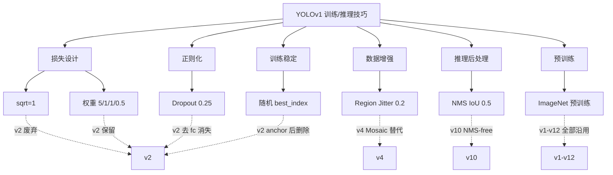

# YOLOv1 训练与推理技巧

YOLOv1 有 7 个可复现的 knob，全部通过 `yolo.cfg` 或源码一行代码实现。这是 v1 论文"低调但关键"的贡献——很多 trick 论文没讲，只是 pjreddie 的实践发现。

## 全部 7 个 Trick

| # | Trick | 类别 | 位置 | 影响 |
|---|-------|------|------|------|
| 1 | sqrt=1 加速收敛 | 损失设计 | `yolo.cfg` | 训练快 30%+ |
| 2 | 权重 5/1/1/0.5 | 损失设计 | `yolo.cfg` | 平衡正负样本 |
| 3 | 前 100k 随机 best_index | 训练 | `detection_layer.c` | 防梯度塌缩 |
| 4 | Region Jitter 0.2 | 数据增强 | `data.c` | 提升泛化 |
| 5 | Dropout 0.25 | 正则 | `yolo.cfg` | 缓解过拟合 |
| 6 | NMS IoU=0.5 | 推理 | `box.c` | 后处理去重 |
| 7 | ImageNet 预训练 | 训练 | 权重加载 | 快速收敛 |

## 1. sqrt=1 加速收敛 (`trick-sqrt-one`)

**位置**：`yolo.cfg` 里一行 `sqrt=1`

**原理**：回归时不做 `w/h` 直接 L2，而是回归 `√w / √h`。因为 L2 损失的梯度与残差成正比，大目标的残差量级远大于小目标，会主导梯度。开方后量级被压缩。

```c
// detection_layer.c
if (l.sqrt) {
    box.w = pow(boxes[i].w, 0.5);
    box.h = pow(boxes[i].h, 0.5);
}
```

**优点**：
- 一行配置即可，零成本
- 早期收敛速度显著加快
- 大小目标梯度均衡

**代价**：
- 只在 v1 的 L2 loss 下有效
- v3+ 转 CIoU/GIoU 后不再需要（因为 CIoU 已经把 w/h 差异显式建模）

**后续版本**：v2 起废弃。

---

## 2. 损失权重 5/1/1/0.5 (`trick-loss-weight-balance`)

**位置**：`yolo.cfg`

```cfg
coord_scale=5
object_scale=1
noobject_scale=.5
class_scale=1
```

**原理**：四类 loss 量级不同，需要手工平衡。详见 [损失函数](/versions/v1/losses)。

**为什么是 5**：coord 值域 [0,1]，(pred-t)² 天然小，乘 5 才和其他项同量级。

**为什么 noobj=0.5**：背景格子占 90%+，不降权会淹没前景信号。

**代价**：
- 手工调，跨数据集需重搜
- 无理论最优性

---

## 3. 前 100k 随机 best_index (`trick-random-best-index`)

**位置**：`src/detection_layer.c:73-75`

```c
if (l.count < 100000) {
    best_index = rand() % l.n;
} else {
    best_index = argmax(IoU);
}
```

**原理**：训练初期两个 box 都还没学到，如果按 IoU 选 best，两个 box 会**抢同一个 GT**，导致梯度塌缩到单一 box。前 100k 迭代随机选一个，强制两个 box 都训练到。

**100k 这个魔数**：
- 论文没解释，pjreddie 的经验值
- VOC 2007 训练集 ~10K 图，40000 iterations × 64 batch = 2.5M 图次，100k 约占 1/25 训练

**代价**：
- 硬编码魔数
- v2 引入 anchor 后彻底删除（anchor 本身就承担了多 box 分工）

**这是 v1 里最有意思的 trick**——它暴露了 v1 的多 box 结构本质上不稳定，v2 用 anchor 从根源上解决。

---

## 4. Region Jitter 数据增强 (`trick-region-jitter`)

**位置**：`src/data.c: random_distort`

```cfg
jitter=.2   # 论文值；仓库现版 jitter=0.2
```

**原理**：每个 batch 随机对一个 grid 做平移、缩放、色相、曝光扰动：

```c
// data.c 简化伪码
dx = random(-0.2, 0.2) * width
dy = random(-0.2, 0.2) * height
scale = random(0.8, 1.2)
crop(image, x - dx, y - dy, w * scale, h * scale)
```

**为什么有效**：v1 grid 对物体位置敏感（cell 归属变化会让 GT 变化），jitter 让 GT 在训练时"浮动"，模型学到更鲁棒的定位。

**代价**：
- 增强幅度有限（只 20%）
- v4 起被 **Mosaic**（4 图拼接）取代，效果更强

---

## 5. Dropout 0.25 (`trick-dropout-fc`)

**位置**：`yolo.cfg` 中两个 FC 之间

```cfg
[dropout]
probability=.25
```

**原理**：缓解检测任务数据量少的过拟合。

**为什么只在 FC 后**：conv 层有 BN 已经承担了正则化，dropout 主要加在 fc 上。

**代价**：
- 推理时需额外处理（`training=0` 时跳过）
- v2+ 去掉所有 fc 后消失

---

## 6. NMS IoU=0.5 (`trick-nms-iou05`)

**位置**：`src/box.c: do_nms_sort`

**原理**：对每类 box 按 confidence 降序，与前面已保留的 box 计算 IoU，IoU > 0.5 的合并保留高分。

```c
float do_nms_sort(detection *dets, int total, int classes, int truth, float overlap);
```

**参数**：
- IoU 阈值 0.5（经典值）
- 按类别独立做 NMS

**代价**：
- IoU 阈值敏感：从 0.4 到 0.6，mAP 波动 1-2 个点，见 [痛点追踪](/versions/v1/painpoints)
- NMS 本身耗时：v10+ 引入 **NMS-free** 检测头彻底消除

---

## 7. ImageNet 预训练热启动 (`trick-pretrained-from-imagenet`)

**原理**：从 ImageNet 分类模型（AlexNet / GoogLeNet / VGG）加载前 22 层卷积权重，仅微调 FC + Dropout + Detection 头。

**收益**：
- 冷启动从"从零训到 63.4 mAP 需 230 轮"降到 **23 轮**
- 相当于节省了约 90% 训练时间

**代价**：
- 依赖 ImageNet 与 VOC 的类别分布差异
- YOLO9000 尝试扩展到 9418 类时，从 ImageNet 迁移效果下降

**这是 v1 能 23 轮就收敛的关键**——如果不预训练，v1 的 backbone 训练时间会超过整个 YOLO 系列其他版本的总和。

---

## 7 个 Trick 的谱系图



## 与其他页的链接

- [概览](/versions/v1/index)
- [论文精读](/versions/v1/paper) — 论文里只讲了 jitter 和 dropout，其他都是 pjreddie 实践
- [理论 Concept](/versions/v1/concepts)
- [架构与层](/versions/v1/layers)
- [损失函数](/versions/v1/losses)
- [源码走读](/versions/v1/code-walkthrough) — 每个 trick 的源码定位
- [痛点追踪](/versions/v1/painpoints) — 每个 trick 的失败案例
