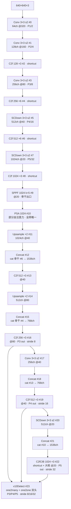
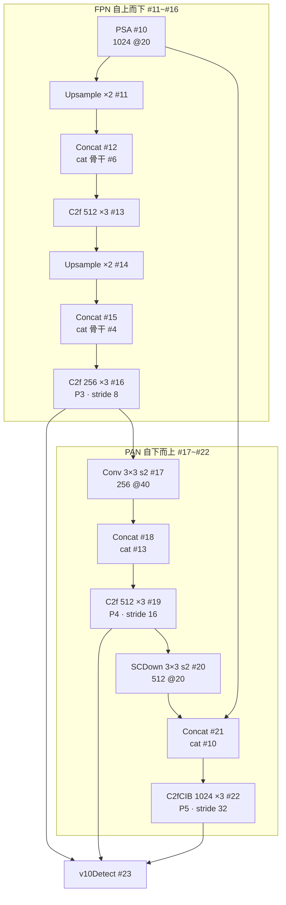
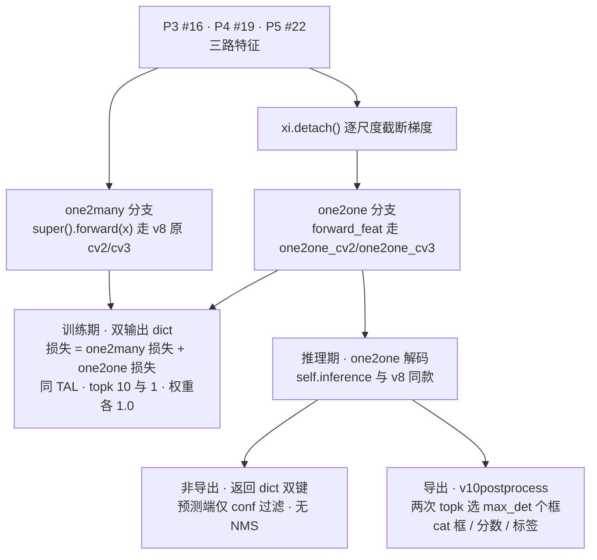

# YOLOv10 架构总览

> 以 `ultralytics/cfg/models/v10/yolov10n.yaml`（全文 40 行，C2f 骨干 + SCDown 下采样 + SPPF→PSA + PAN 头 + 双分配 v10Detect）为例；层号 #0~#23 与 yaml 逐行对应，本页通道数为缩放前的基准值。配置原文见 <SrcLink file="v10:ultralytics/cfg/models/v10/yolov10n.yaml" :line="1" :end="40" />，逐层明细与模块源码见 [YOLOv10 逐层图解](/versions/v10/layers)。

> **v8 读者路标**：这张 yaml 可以当作 yolov8.yaml 的 delta 阅读版——骨干 #0~#4 与 v8n 逐字符相同，真正的变化只有六处：#5/#7 下采样换成 SCDown、#10 新增 PSA、#20 回程下采样换成 SCDown、#22 C2f 换成 C2fCIB、#23 Detect 换成 v10Detect。为什么这样改，理论动机见 [YOLOv10 论文页](/versions/v10/paper)；去 NMS 的训练侧细节见 [损失函数详解](/versions/v10/losses)。

::: tip 只想带走三件事
1. **yaml 依旧极简**：整张网络 **24 个顶层条目（#0~#23）**——骨干 11 条（Conv×3 + SCDown×2 + C2f×4 + SPPF×1 + PSA×1）、头 13 条（Upsample×2 + Concat×4 + C2f×3 + Conv×1 + SCDown×1 + C2fCIB×1 + v10Detect×1），n/s/m/b/l/x 六档各持一份 yaml、共用同一张结构图；
2. **数据流**：Conv s2 三段 + SCDown 两段下采样 + C2f 提特征 → SPPF 收尾 → **PSA 补一刀全局注意力（全网络唯一一处）** → [FPN](/glossary#fpn-特征金字塔) 自上而下 + [PANet](/glossary#panet-路径聚合网络) 自下而上 → v10Detect（P3/P4/P5，输入 #16/#19/#22）**双头同出**：one2many 照走 v8 老路，one2one 每个 ground-truth 只保留一个最优预测；
3. **端到端去 [NMS](/glossary#nms-非极大值抑制)**：训练期同一个 [TAL](/glossary#tal-task-alignment-learning) 分配器对双头分别取 topk=10 与 topk=1 做**一致双分配**，推理/导出只走 one2one 分支——导出计算图里根本没有 NMS 算子，`v10postprocess` 两次 topk 直接选出 max_det 个框。
:::

## 1. 一眼看清：yolov10n.yaml 全图

> **v8 读者路标**：下面这张图和 v8 的全景图几乎逐行对得上——多出的 #10 PSA 把 head 整体顺移一层（v8 的 #10~#22 变成 #11~#23）；盯住图中 SCDown/PSA/C2fCIB/v10Detect 四个新面孔即可。

- 图中通道数为 yaml 声明的**基准宽度**；n 档 depth=0.33 / width=0.25 把 C2f/C2fCIB 重复数 ×3→1、×6→2、通道 ÷4（末级 1024→256），六档 scales 见 §5
- backbone 占 yaml L10~L20（#0~#10）、head 占 L24~L40（#11~#23）；yaml 行内注释只标到 #22（P5/32-large），v10Detect 落在 #23（<SrcLink file="v10:ultralytics/cfg/models/v10/yolov10n.yaml" :line="40" />）
- 三个出口 #16/#19/#22 直接进 v10Detect（L40 `[[16, 19, 22], 1, v10Detect, [nc]]`）——与 v8 同款的"无收口"接法，没有 v7 那样的 RepConv
- Concat 输出通道 = 两路之和（#12 是 1024+512=1536）；**注意 #21 回连的是 #10 PSA 输出而非 v8 的 SPPF #9**——PSA 挡在骨干出口与 PAN 顶点之间
- 骨干 C2f 显式传 `shortcut=True`，头部 C2f #13/#16/#19 不传、走签名默认 `False`；C2fCIB 的 `[1024, True, True]` 两个布尔分别是 `shortcut=True` 与 `lk=True`（启用大核），见 [逐层图解](/versions/v10/layers)

<SrcLink file="v10:ultralytics/cfg/models/v10/yolov10n.yaml" :line="1" :end="40" />

## 2. Backbone #0~#10：前半段照抄 v8，两处下采样换 SCDown，SPPF 后补 PSA

> **v8 读者路标**：#0~#4（stem + P2/P3 段）与 yolov8.yaml 完全一样，可以直接快进；先看 #5 把 Conv 换成了什么，再看 #10 的 PSA 为什么全网络只放一个。SPPF 还是那个 SPPF（v5 遗产，见 [v8 架构总览 §3](/versions/v8/architecture)）。

```mermaid
flowchart LR
    IMG["640×640×3"] --> L0["Conv 3×3 s2 #0<br/>64 @320 · P1/2"]
    L0 --> L1["Conv 3×3 s2 #1<br/>128 @160 · P2/4"]
    L1 --> L2["C2f 128 ×3 #2"]
    L2 --> L3["Conv 3×3 s2 #3<br/>256 @80 · P3/8"]
    L3 --> L4["C2f 256 ×6 #4"]
    L4 --> L5["SCDown 3×3 s2 #5<br/>512 @40 · P4/16"]
    L5 --> L6["C2f 512 ×6 #6"]
    L6 --> L7["SCDown 3×3 s2 #7<br/>1024 @20 · P5/32"]
    L7 --> L8["C2f 1024 ×3 #8"]
    L8 --> L9["SPPF k=5 #9<br/>1024 @20"]
    L9 --> L10["PSA #10<br/>一半通道过 Attention+FFN"]
```

- **前五层与 v8n 完全一致**：Conv 64 s2 → Conv 128 s2 → C2f×3 → Conv 256 s2 → C2f×6——小分辨率 / 浅层上动刀不划算，v10 的效率手术从 P4 才开始
- **#5/#7 SCDown 替换 Conv s2**（<SrcLink file="v10:ultralytics/cfg/models/v10/yolov10n.yaml" :line="15" />、<SrcLink file="v10:ultralytics/cfg/models/v10/yolov10n.yaml" :line="17" />）：v8 的 P4/P5 下采样是全密度 3×3 s2 卷积（在 256/512 输入通道上做完整卷积），SCDown 拆成「1×1 降维 → 深度卷积 s2」两步，卷积权重降到约原来的 1/9，结构细节见 [逐层图解 SCDown 一节](/versions/v10/layers)
- **#9 SPPF 原样保留**：串行 3 次 k=5 MaxPool 等效 SPP 5/9/13，骨干出口、PAN 顶点，与 v8 无异
- **#10 PSA 只挂这一个**（<SrcLink file="v10:ultralytics/cfg/models/v10/yolov10n.yaml" :line="20" />）：在 SPPF 输出（基准 1024 通道 @20×20）上做**部分自注意力**——一半通道过 Attention+FFN、另一半直通；此处序列长度只有 400、通道最宽，是全网络唯一放得起全局建模的位置。为什么是"部分"、key_dim 为什么砍半，见 [逐层图解 PSA/Attention 两节](/versions/v10/layers)

## 3. Head #11~#23：PAN 双向聚合，回程下采样一半换新

> **v7 读者路标**：v10 的头回到 v8 的简洁形态——没有 6 路 Concat ELAN、没有 RepConv 收口、没有辅助头；**v8 读者**只需盯三处：#17 仍是全密度 Conv、#20 换成 SCDown、#21 的 concat 对象从 SPPF 换成了 PSA。

- **FPN 上行 #11~#16**：Upsample×2 + Concat（骨干 #6、#4）+ C2f 融合，与 v8 完全同款；出口 #16（基准 256 通道 @80）是 P3 检测输入
- **PAN 下行 #17~#22**，两段下采样一新一旧：
  - #17 `Conv [256, 3, 2]`——P3→P4 **保留全密度卷积**（v8 同款）：仅一次降 2 倍步长、通道已窄，全密度仍划算
  - #20 `SCDown [512, 3, 2]`——P4→P5 换成 SCDown，与骨干 #5/#7 呼应，是回程唯一的结构改动
  - #21 `Concat` 回连 **#10 PSA**（<SrcLink file="v10:ultralytics/cfg/models/v10/yolov10n.yaml" :line="37" /> `cat head P5`）——v8 在同一位置回连的是 SPPF #9
  - #22 `C2fCIB [1024, True, True]`——P5 融合块换 C2fCIB：C2f 外壳不动、内部 Bottleneck 换成 CIB，且 `lk=True` 启用 RepVGGDW 大核，是 head 里唯一的"新模块"
- 三个出口 #16/#19/#22 喂给 #23 v10Detect，stride 8/16/32、640 输入共 **8400 个预测位置**（$80^2+40^2+20^2$）——anchor-free、网格中心即 anchor point，与 v8 相同

<SrcLink file="v10:ultralytics/cfg/models/v10/yolov10n.yaml" :line="23" :end="40" />

## 4. 与 v8n 的结构差异对照

> **v9 读者路标**：v9 的下采样走 [ADown](/glossary#adown)（多分支混合卷积）、检测头是 DualDDetect 多头互查；v10 的 SCDown 是"1×1 + DW"的极简解耦，双头 v10Detect 是为**一致双分配 / 去 NMS** 服务，不是辅助监督——同样是"双头"，动机完全不同。

把两份 yaml 逐行 diff，改动就是下表 6 行：

| 位置 | v8n（yolov8.yaml） | v10n（yolov10n.yaml） | 差异一句话 |
|------|--------------------|------------------------|------------|
| #5 P4 下采样 | `Conv [512, 3, 2]` | `SCDown [512, 3, 2]` | 全密度 3×3 → 1×1 + DW s2 |
| #7 P5 下采样 | `Conv [1024, 3, 2]` | `SCDown [1024, 3, 2]` | 同上 |
| #10 骨干出口后 | ——（SPPF 即骨干终点） | `PSA [1024]` | **新增**部分自注意力，全网唯一 |
| #0~#4 / #6 / #8 / #9 | Conv / C2f / SPPF | 完全一致 | 小分辨率、浅层不动刀 |
| #11~#16 FPN（v10 编号） | Upsample + Concat + C2f | 完全一致 | 上行路径原样顺移 |
| #17 P3→P4 | `Conv [256, 3, 2]` | `Conv [256, 3, 2]` | 保留全密度 |
| #20 P4→P5 | `Conv [512, 3, 2]` | `SCDown [512, 3, 2]` | 回程下采样也换 SCDown |
| #21 concat 对象 | 骨干 #9 SPPF | 头部 #10 PSA | PAN 顶点换成注意力输出 |
| #22 P5 融合 | `C2f [1024]` | `C2fCIB [1024, True, True]` | 内瓶换 CIB + 大核 RepVGGDW |
| #23 检测头 | `Detect` | `v10Detect` | 双头一致双分配、端到端去 NMS |

- v10n 共 24 条目，其中 #5/#7/#10/#20/#22/#23 这 6 行是改动或新增；其余 18 条里 17 条与 v8n 对应行逐字符相同，唯一例外是 #21 Concat 的回连目标因骨干多一层从 #9 顺移为 #10
- 一句话总结 v10 的取舍：**下采样能省则省（SCDown×3）、注意力只补一刀（PSA×1）、大核只给最大感受野处（C2fCIB×1）、检测头复制一份换分配（v10Detect）**
- 模型总装仍是 `DetectionModel` 家族：v10 新增 `YOLOv10DetectionModel(DetectionModel)`，只覆写 `init_criterion` 返回 `v10DetectLoss`（<SrcLink file="v10:ultralytics/nn/tasks.py" :line="640" :end="642" />）

## 5. 参数量与六档分档

> **所有读者路标**：v10 是 v8 家族里第一个带 **B 档** 的（v8 只有 n/s/m/l/x）；本页参数、GFLOPs、AP、延迟一律用快照 README 口径（640 输入、COCO AP val、T4 TensorRT FP16 batch1），不与论文正文口径混排。

| Model | 参数 | GFLOPs | AP val | 延迟（T4 TRT FP16） |
|-------|------|--------|--------|---------------------|
| N | 2.3M | 6.7G | 38.5% | 1.84ms |
| S | 7.2M | 21.6G | 46.3% | 2.49ms |
| M | 15.4M | 59.1G | 51.1% | 4.74ms |
| B | 19.1M | 92.0G | 52.5% | 5.74ms |
| L | 24.4M | 120.3G | 53.2% | 7.28ms |
| X | 29.5M | 160.4G | 54.4% | 10.70ms |

- **n 档 2.3M（README 口径），对照 v8n 的 3.2M**：SCDown×3 与轻量分类头省下的参数，部分被 one2one 分支的 deepcopy（头权重近似翻倍）和 PSA 抵消——但轻量 cv3 把"翻倍"的代价压窄了
- 六档 scales（每份 yaml 独立携带 `scales:` 块，<SrcLink file="v10:ultralytics/cfg/models/v10/yolov10n.yaml" :line="3" :end="5" />）：n `[0.33, 0.25, 1024]`、s `[0.33, 0.50, 1024]`、m `[0.67, 0.75, 768]`、**b `[0.67, 1.00, 512]`**、l `[1.00, 1.00, 512]`、x `[1.00, 1.25, 512]`——depth/width/max_channels 的作用机制与 v8 相同（[compound scaling](/glossary#compound-scaling-复合缩放)）
- 论文五项效率设计在本页的落点：轻量分类头 → v10Detect.cv3（§6）；空间-通道解耦下采样 → SCDown（§2/§3）；大核卷积 → RepVGGDW 经 C2fCIB 的 lk=True（#22）；部分自注意力 → PSA（#10）；秩引导块设计（rank-guided）是**纯论文级方法论**——用"优化误差-延迟一致性"指标选块型，快照代码里没有对应的 rank 模块
- 延迟口径说明：README 数字为快照口径（T4 TRT FP16 batch1）；论文正文另有复测值（如 N 档 1.56ms），本站统一用 README 口径，详见 [指标与测速口径](/versions/v10/painpoints)

## 6. v10Detect：one2many + one2one 双头

> **v8 读者路标**：one2many 分支就是 v8 的 Detect 原样（cv2/cv3 原封不动）；戏肉全在 one2one——deepcopy 出来的第二个头、detach 的梯度截断、导出期的无 NMS 后处理。分配与损失细节见[损失函数详解](/versions/v10/losses)。

- **双分支构造**（<SrcLink file="v10:ultralytics/nn/modules/head.py" :line="501" :end="509" />）：`v10Detect(Detect)` 先按 v8 原样建好 cv2/cv3，再把 **cv3 重写为三段 depthwise-separable 轻量分类头**（两个"DW 3×3 + 1×1"级联 + 1×1 出口），最后 `one2one_cv2 / one2one_cv3 = copy.deepcopy(cv2 / cv3)`——one2one 是 one2many 的完整复制、独立权重
- **训练：一致双分配**（`v10DetectLoss`，<SrcLink file="v10:ultralytics/utils/loss.py" :line="717" :end="727" />）：用 `v8DetectionLoss` 实例化两次——one2many `tal_topk=10`、one2one `tal_topk=1`，同一 TaskAlignedAssigner（α=0.5、β=6.0）只差 topk；两分支损失**权重各 1.0 直接相加**
- **梯度边界**（<SrcLink file="v10:ultralytics/nn/modules/head.py" :line="512" />）：one2one 的输入是 `[xi.detach() for xi in x]`——其损失梯度**不回传 neck/骨干**，只训练 one2one 头自身权重；neck/骨干的梯度全部由 one2many 分支承担
- **推理双态**（<SrcLink file="v10:ultralytics/nn/modules/head.py" :line="516" :end="523" />）：
  - 非导出：返回 `{"one2one": ..., "one2many": ...}` 字典；预测端取 one2one 做解码，**仅 conf 阈值过滤、无 NMS**
  - 导出：`ops.v10postprocess`（<SrcLink file="v10:ultralytics/utils/ops.py" :line="850" :end="863" />）先对最大类分做 topk、再对展平分数做第二次 topk，直接选出 max_det 个 (boxes, scores, labels)——**导出计算图里没有 NMS 算子**；`max_det` 由 exporter 在导出期注入（<SrcLink file="v10:ultralytics/engine/exporter.py" :line="232" :end="233" />，类属性默认 `max_det = -1`）
- **bias_init 覆写**（<SrcLink file="v10:ultralytics/nn/modules/head.py" :line="527" :end="535" />）：one2one 分支沿用 v8 先验——box 出口 bias 置 1.0、cls 出口按"每 640/s 格约 5 个目标"置 `log(5/nc/(640/s)²)`

<SrcLink file="v10:ultralytics/nn/modules/head.py" :line="497" :end="535" />

## 延伸阅读

- [YOLOv10 逐层图解](/versions/v10/layers)
- [YOLOv10 理论 Concept](/versions/v10/concepts)
- [YOLOv10 损失函数详解](/versions/v10/losses)
- [yolov10.yaml 源码页](/versions/v10/source/yolov10-yaml)
- [v8 架构总览（对照基线）](/versions/v8/architecture)
- [v8 逐层图解（对照基线）](/versions/v8/layers)
