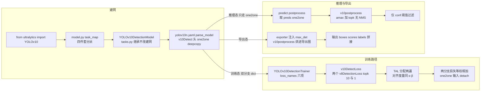

# YOLOv10 源码走读

本页沿 YOLOv10（清华 THU-MIG，2024-05-23；快照 THU-MIG/yolov10 @ 8d9f45a「add yolov10」首发 commit，ultralytics 8.1.34 fork）的一条端到端链路走读源码：**入口 `from ultralytics import YOLOv10` → 建模型 → 训练双分配 → 前向双分支 → 推理 topk 后处理 → 评估 → 导出端到端图**。所有行号均以站内快照 `source/yolov10/snapshot/` 为准，可点击 SrcLink 跳转核对。单库提示：v10 是 ultralytics 8.1.34 的 fork，目录布局同 v8 快照（`ultralytics/` 子包），v10 专属增量集中在 `models/yolov10/` 四件套，以及 head / loss / tal / ops / tasks / exporter 的接缝处。

> **这条链路与 v8 推理链的差异**：v8 是「Detect 解码 → [NMS](/glossary#nms-非极大值抑制) 后处理」两段式——conf 0.25 预筛接 torchvision NMS（见 [v8 源码走读](/versions/v8/code-walkthrough) 第 9-10 节）；v10 推理只走 one2one 分支，后处理换成纯 topk 的 v10postprocess，无 IoU、无 NMS，导出时这步 topk 直接烘进计算图。训练侧则比 v8 多一套 one2one 头与一份 topk=1 的 [TAL](/glossary#tal-task-alignment-learning) 分配，损失总装从 v8 的三分量变成两组三分量等权相加。

## 文件清单

| 文件 | 行数 | 功能 |
| --- | --- | --- |
| `ultralytics/models/yolov10/model.py` | 18 | YOLOv10 入口类：task_map 四件套分派 |
| `ultralytics/models/yolov10/train.py` | 20 | YOLOv10DetectionTrainer：损失名六项 + get_model |
| `ultralytics/models/yolov10/predict.py` | 38 | YOLOv10DetectionPredictor：取 one2one + 仅 conf 过滤 |
| `ultralytics/models/yolov10/val.py` | 20 | YOLOv10DetectionValidator：无 conf 无 NMS 后处理 |
| `ultralytics/nn/modules/head.py` | ~535 | v10Detect 双分支头（L497-535） |
| `ultralytics/utils/loss.py` | ~727 | v10DetectLoss 双分配总装（L717-727） |
| `ultralytics/utils/tal.py` | 328 | TaskAlignedAssigner（v8 原版结构，tal_topk 可调） |
| `ultralytics/utils/ops.py` | — | v10postprocess 纯 topk（L851-864） |
| `ultralytics/nn/tasks.py` | — | YOLOv10DetectionModel 接线与 yaml 加载特判 |
| `ultralytics/engine/exporter.py` | — | 导出时向 v10Detect 注入 max_det |
| `ultralytics/cfg/models/v10/yolov10n.yaml` | 40 | n 档结构：SCDown / PSA / C2fCIB / v10Detect |

## 调用链总览

## 1. 入口：`from ultralytics import YOLOv10` — task_map 四件套

顶层包直接导出 YOLOv10（<SrcLink file="v10:ultralytics/__init__.py" :line="6" :end="6" />，`__all__` 在 <SrcLink file="v10:ultralytics/__init__.py" :line="26" :end="26" />）。入口类只有 18 行——继承 v8 的 YOLO 高层入口，唯一职责是换任务分派表：

<SrcSnippet file="v10:ultralytics/models/yolov10/model.py" :start="7" :end="18" hl="9-17" />

::: details 逐行注释（L7-L18）
- L7 `class YOLOv10(YOLO)`：predict / train / val / export 的流水线全部复用父类，只换 task_map。
- L8-9 `task_map` property：父类 YOLO 在加载权重或按 yaml 建模型时按 task 查这张表。
- L11-17 detect 一项：model=YOLOv10DetectionModel（建网 + 损失挂钩）、trainer=YOLOv10DetectionTrainer（训练）、validator=YOLOv10DetectionValidator（评估）、predictor=YOLOv10DetectionPredictor（推理）——四件套全是 v10 专属类。
- L18 表里只有 "detect" 一个键：首发 commit 只做了检测任务。
:::

对比 v8：v8 用统一的 YOLO 类按任务查出 DetectionModel / DetectionPredictor；v10 把类名级替换压在一个子类的 task_map 里，上层 API（`YOLOv10('yolov10n.yaml')`、`model.predict()`）零改动。

## 2. 建模型：YOLOv10DetectionModel 读 yolov10n.yaml

tasks.py 的 v10 建模类只有三行——继承 DetectionModel、只改损失挂钩：

<SrcSnippet file="v10:ultralytics/nn/tasks.py" :start="640" :end="642" />

yaml 加载的 v10 特判（<SrcLink file="v10:ultralytics/nn/tasks.py" :line="945" :end="963" /> 中的关键四行）：

<SrcSnippet file="v10:ultralytics/nn/tasks.py" :start="955" :end="958" />

::: details 逐行注释（L640-L642 与 L955-L958）
- L640-642：YOLOv10DetectionModel 不改建网逻辑——parse_model、stride 探测全继承，唯一覆写 init_criterion 返回 v10DetectLoss。损失总装是 v10 与 v8 建模的唯一差异点。
- L955：路径含 "v10" 的判断——v10 六个档位（n/s/m/b/l/x）各是一份独立 yaml 且自带 scales 块（yolov10n.yaml L3-5），b 档是 v10 特有。
- L956：v8 的归并逻辑——`yolov8x.yaml` 这类档位文件名会被正则改写成统一的 `yolov8.yaml`；v10 走 L957-958 跳过归并，直接用原路径。
- 接线三处：parse_model 把 v10Detect 与 Detect / Segment / Pose / OBB 同组处理（<SrcLink file="v10:ultralytics/nn/tasks.py" :line="916" :end="917" />，收集各来源通道）；stride 探测时 v10Detect 的 forward 取 `["one2many"]`（<SrcLink file="v10:ultralytics/nn/tasks.py" :line="305" :end="306" />，训练 / 评估非导出态恒存在）；末层来自 yaml L40 `[[16, 19, 22], 1, v10Detect, [nc]]`。
- 结构速览（yolov10n.yaml）：backbone 两处 SCDown 下采样（L15 / L17）+ SPPF（L19）+ PSA（L20）；head 回程 P3→P4 用 Conv s2（L32）、P4→P5 用 SCDown（L36）、P5 融合 C2fCIB 大核（L38）。逐层表见 architecture 页。
:::

## 3. 训练：YOLOv10DetectionTrainer → v10DetectLoss 双分配

训练器也只有两条钩子（20 行全文的实质内容）：

<SrcSnippet file="v10:ultralytics/models/yolov10/train.py" :start="7" :end="20" hl="10,15-20" />

损失总装 v10DetectLoss——v10 的全部训练创新落在这 11 行：

<SrcSnippet file="v10:ultralytics/utils/loss.py" :start="717" :end="727" hl="719-720,727" />

::: details 逐行注释（L7-L20 与 L717-L727）
- train.py L10：loss_names 六项——box_om / cls_om / dfl_om（one2many）+ box_oo / cls_oo / dfl_oo（one2one），训练日志从 v8 的 3 条变 6 条。
- train.py L15-20：get_model 返回 YOLOv10DetectionModel，nc 来自数据集、权重加载沿用父类——建模型部分与 v8 无异。
- loss.py L718-720：v8DetectionLoss 是 ultralytics 8.1.34 的现成类，`__init__` 本就带 tal_topk 形参（<SrcLink file="v10:ultralytics/utils/loss.py" :line="150" :end="150" />），内部实例化 `TaskAlignedAssigner(topk=tal_topk, num_classes=self.nc, alpha=0.5, beta=6.0)`（<SrcLink file="v10:ultralytics/utils/loss.py" :line="166" :end="166" />）——v10 用 10 与 1 各实例化一次，没有写任何新损失类。
- loss.py L722-727：`__call__` 分别对 `preds["one2many"]` 与 `preds["one2one"]` 算 v8 式三分量损失；L727 两分支 `loss[0]` 等权 1.0 相加、loss items cat 成 6 项——论文的「一致双分配」在代码里就是 topk 10 vs 1 之差。
- TAL 侧（tal.py，v8 原版结构未改）：分配流水线整体在 `@torch.no_grad` 下（<SrcLink file="v10:ultralytics/utils/tal.py" :line="38" :end="39" />）；对齐度量 `align_metric = bbox_scores^α × CIoU^β`（<SrcLink file="v10:ultralytics/utils/tal.py" :line="120" :end="120" />）；topk=1 时 select_topk_candidates 逐 GT 只留对齐度量最高的 1 个 anchor（<SrcLink file="v10:ultralytics/utils/tal.py" :line="145" :end="156" />）。
:::

## 4. 前向双分支：v10Detect.forward — detach 的 one2one

v10Detect（<SrcLink file="v10:ultralytics/nn/modules/head.py" :line="497" :end="535" />，类名小写 v 开头）的 `__init__`：

<SrcSnippet file="v10:ultralytics/nn/modules/head.py" :start="497" :end="509" hl="503-506,508-509" />

forward 是训练图 / 推理图 / 导出图的三叉分界：

<SrcSnippet file="v10:ultralytics/nn/modules/head.py" :start="511" :end="525" hl="512,517,522-523" />

::: details 逐行注释（L497-L525）
- L499 `max_det = -1`：类属性占位，导出时由 exporter 注入真值（见第 7 步）。
- L503-506：cv3 重写为深度可分离三段（DW 3×3 + 1×1 两组，再 1×1 出 nc），对照基线 Detect 的两层 dense 3×3（<SrcLink file="v10:ultralytics/nn/modules/head.py" :line="42" :end="42" />）——论文的轻量分类头。
- L508-509：one2one_cv2 / one2one_cv3 是 cv2 / cv3 的完整 deepcopy——训练图双头参数翻倍，部署图只留 one2one。
- L512：one2one 分支对 neck 输出逐层 detach——梯度只更新 one2one 头自身，骨干 / neck 由 one2many 分支供梯度（机制代价见 [痛点 3](/versions/v10/painpoints#_3-detach-头依赖-one2many-特征质量-pain-detach-ceiling)）。forward_feat 继承自 Detect（<SrcLink file="v10:ultralytics/nn/modules/head.py" :line="73" :end="77" />，逐尺度 cat(cv2, cv3)）。
- L513-514：非 export 态才算 one2many = super().forward(x)——v8 Detect 原逻辑，训练态返回特征列表、评估态走解码（<SrcLink file="v10:ultralytics/nn/modules/head.py" :line="79" :end="86" />）。
- L516-519：推理态 one2one 过 self.inference()——v8 同款解码（make_anchors + DFL 期望值 + dist2bbox，<SrcLink file="v10:ultralytics/nn/modules/head.py" :line="45" :end="71" />），与 one2many 一起打包成 dict 返回。
- L520-523：导出态先 assert max_det 已注入，one2one.permute(0, 2, 1) 后直接调 ops.v10postprocess，输出 cat([boxes, scores, labels])——导出图里没有 NMS 算子。
- L524-525：训练态返回 {"one2many": 特征列表, "one2one": 特征列表}，交给 v10DetectLoss。
- 另有 bias_init 覆写（<SrcLink file="v10:ultralytics/nn/modules/head.py" :line="527" :end="535" />）：one2one 分支 box bias 置 1.0（L534）、cls bias 置 log(5/nc/(640/s)²)（L535）——给稀疏监督一个不冷启动的先验。
:::

## 5. 推理：postprocess → v10postprocess — 仅 conf 阈值

预测器的后处理（<SrcLink file="v10:ultralytics/models/yolov10/predict.py" :line="8" :end="38" />）：

<SrcSnippet file="v10:ultralytics/models/yolov10/predict.py" :start="8" :end="27" hl="10,15-16,19,23" />

核心算子 v10postprocess——14 行，无 IoU、无 NMS：

<SrcSnippet file="v10:ultralytics/utils/ops.py" :start="851" :end="864" hl="854-855,860-862" />

::: details 逐行注释（predict.py L8-L27 与 ops.py L851-L864）
- predict.py L10：preds 是头返回的 dict，只取 one2one——one2many 在推理态算完即弃。
- L12-13：非 dict 输入（list / tuple）取首元素，兼容父类调用方式。
- L15-16：导出图的输出已经是 (b, max_det, 6)，直接透传跳过 topk——图内已做完。
- L18-21：transpose 成 (b, 8400, 4+nc) 后调 v10postprocess，得 boxes / scores / labels，xywh2xyxy 转 corner 格再拼回 (b, max_det, 6)。
- L23：唯一的一层筛选——conf 阈值（预测默认 0.25，见 <SrcLink file="v10:ultralytics/cfg/default.yaml" :line="49" :end="49" /> 注释）；没有 iou 参数、没有 NMS。
- L29-37：scale_boxes 映射回原图、包成 Results——与 v8 完全相同的收尾。
- ops.py L852-853：assert 4+nc 通道，split 成 boxes (b, 8400, 4) 与 scores (b, 8400, nc)。
- L854-855：max_scores = scores.amax(-1)（每 anchor 取最高类分），topk(max_det) 选出 max_det=300（<SrcLink file="v10:ultralytics/cfg/default.yaml" :line="51" :end="51" />）个候选 anchor——用「每类最高分」代替 NMS 的「按分排序逐个抑制」。
- L856-858：unsqueeze 后 gather，把候选 anchor 的 boxes / scores 收出来。
- L860-862：scores.flatten(1) 后第二次 topk——在 anchor × class 展平维度上选最优（box, class）对，labels = idx % nc、box 索引 = idx // nc；同一 anchor 可以为不同类别各出一框。
- L863-864：按类别索引 gather boxes，返回（boxes, scores, labels）三元组。
:::

## 6. 评估：val postprocess — 无 conf 无 NMS

验证器的后处理（<SrcLink file="v10:ultralytics/models/yolov10/val.py" :line="10" :end="20" />）比推理更激进：

<SrcSnippet file="v10:ultralytics/models/yolov10/val.py" :start="10" :end="20" hl="18" />

::: details 逐行注释（L10-L20）
- L8：`save_json |= self.is_coco`——COCO 评估自动开 JSON 保存，其余初始化与 v8 一致。
- L10-15：与 predict 同样的 dict / list 解包，取 one2one。
- L17-19：transpose 后直接 v10postprocess——没有 conf 预筛（v8 的评估是 conf=0.001 预筛接 NMS 的组合，见 [v8 源码走读](/versions/v8/code-walkthrough)），top-max_det（默认 300）候选全量进入 mAP 统计。
- L20：返回 (b, max_det, 6) 张量，mAP 计算交回父类 DetectionValidator。
:::

## 7. 导出：exporter 注入 max_det → 端到端图

导出器对 v10Detect 的专属处理（<SrcLink file="v10:ultralytics/engine/exporter.py" :line="226" :end="233" />）：

<SrcSnippet file="v10:ultralytics/engine/exporter.py" :start="227" :end="233" hl="232-233" />

::: details 逐行注释（L227-L233）
- L226：fuse 后的 deepcopy 模型准备导出。
- L227-231：逐模块检查，Detect 子类（Segment / Pose / OBB 均在其中，v10Detect 继承 Detect 自然命中）统一置 dynamic / export / format。
- L232-233：v10Detect 专属一步——把 `args.max_det`（默认 300）写进头，替换 L499 的 -1 占位。
- 回到 head.py L520-523：导出态 forward 走 assert(max_det != -1) → ops.v10postprocess → cat([boxes, scores, labels])。topk / amax / gather 全是标准算子，被 trace 进计算图——最终导出图输入图像、输出 (b, max_det, 6)，中间没有 NMS 节点。
- 用户侧 predict 拿到 (b, max_det, 6) 后走 predict.py L15-16 的透传分支，再过 conf 过滤——这就是「端到端」在代码里的完整含义：训练期学出无冗余输出，图内 topk 收尾，图外只剩阈值。
:::

## 阅读路线建议

1. **先读 18 行的 model.py**：task_map 一张表看清四件套，上层 API 与 v8 完全同构。
2. **再读 train.py（20 行）与 loss.py L717-727**：训练增量全部在这 30 行里——两个 v8DetectionLoss、topk 10 vs 1、等权相加。
3. **读 head.py L497-535**：v10Detect 是全页核心，重点 L512 detach 与 L520-523 导出分支。
4. **读 ops.py L851-864**：14 行的 v10postprocess，对照 v8 的 non_max_suppression 体会「无 NMS」。
5. **配套源码页**：head-py / loss-py / tal-py / yolov10-yaml 四个源码页有逐行注解，本页负责「代码在哪一行、调用链怎么走」。

## 延伸阅读

- [YOLOv10 痛点追踪](/versions/v10/painpoints) — 稀疏监督、效率代价与 detach 依赖的机制分析
- [YOLOv10 nn/modules/head.py 源码页](/versions/v10/source/head-py) — v10Detect 双分支逐行
- [YOLOv10 utils/loss.py 源码页](/versions/v10/source/loss-py) — v10DetectLoss 与双分配
- [YOLOv10 utils/tal.py 源码页](/versions/v10/source/tal-py) — topk=1 分配的代码细节
- [YOLOv10 cfg/models/v10/yolov10n.yaml 源码页](/versions/v10/source/yolov10-yaml) — SCDown / PSA / C2fCIB 结构配置
- [YOLOv8 源码走读](/versions/v8/code-walkthrough) — NMS 两段式推理链的对照
- [术语表](/glossary) — TAL、NMS、anchor-free 等术语索引
