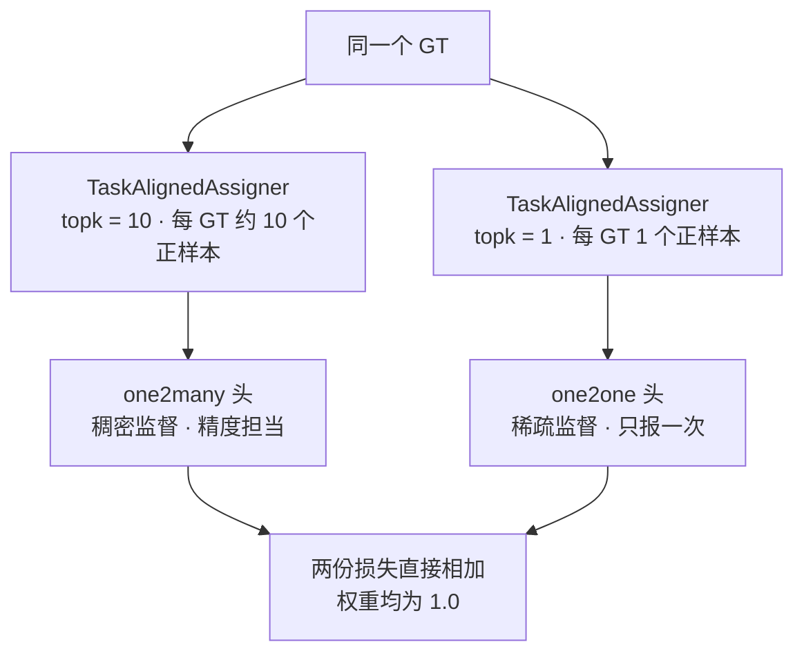
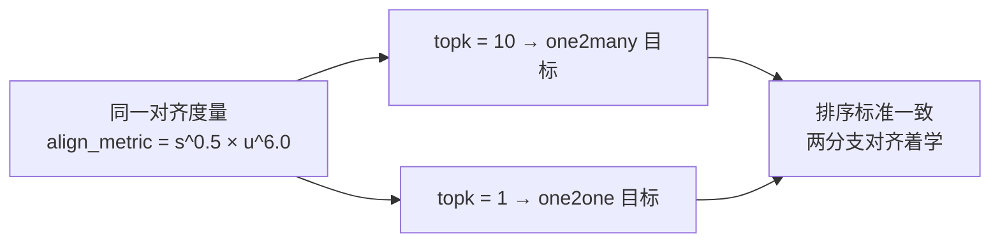
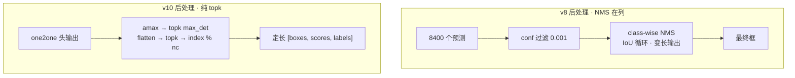
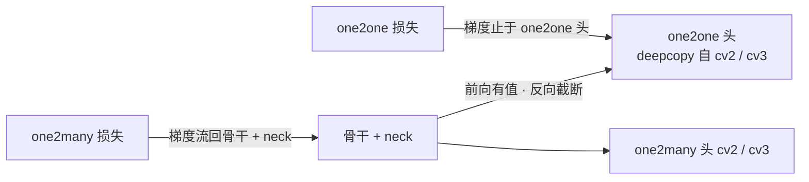
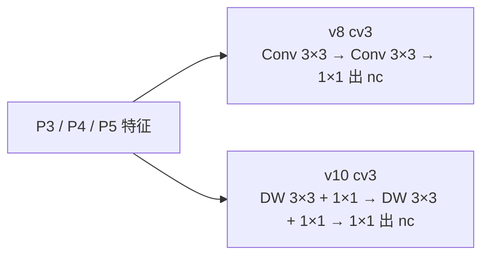
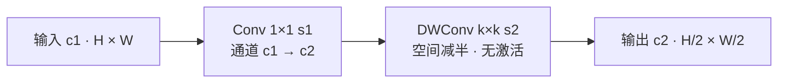
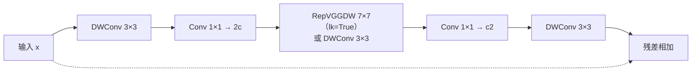
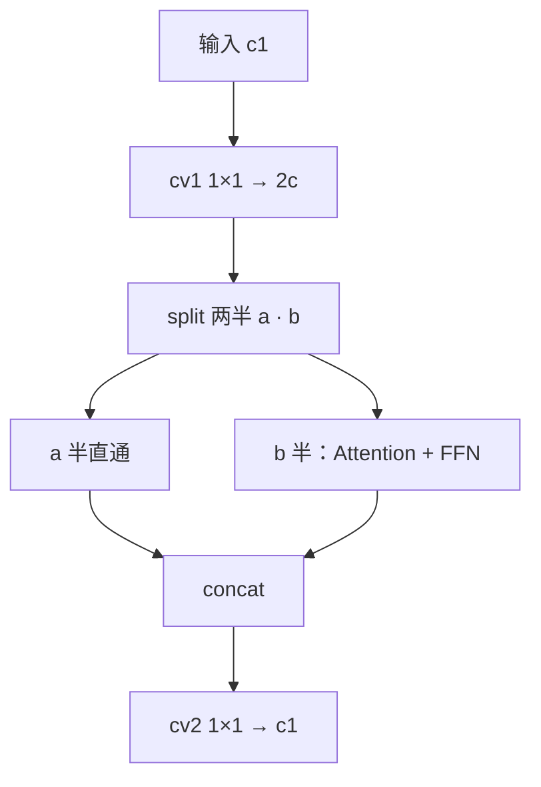
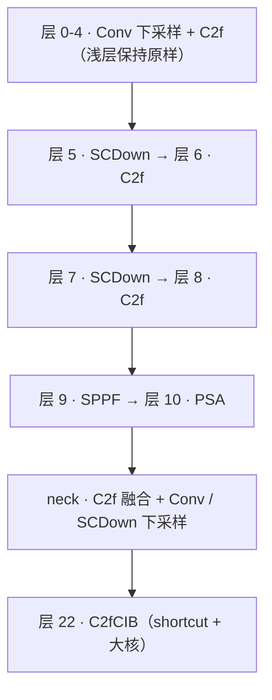

# YOLOv10 理论 Concept

::: tip 只想带走三件事
1. **双分配端到端**：同一个 [TAL](/glossary#tal-task-alignment-learning) 分配器、同一组 α=0.5/β=6.0，只把 topk 从 10 拧到 1——one2many 分支管「学得好」，one2one 分支管「推理免 [NMS](/glossary#nms-非极大值抑制)」，两份损失直接相加（权重均为 1.0）；
2. **NMS-free 是代码事实，不是口号**：v10postprocess 里没有一行 [IoU](/glossary#iou-交并比) 计算，只有 amax 加两次 topk；导出图端到端输出 [boxes, scores, labels]，predict 只剩一道 conf 阈值，val 连 conf 都不过；
3. **结构创新全部服务延迟**：轻量分类头（depthwise-separable）、SCDown 解耦下采样、CIB + 大核 RepVGGDW、PSA 只吃半通道——每一项都能在模块源码里指着行号看。
:::

## 1. 一对多 vs 一对一分配 (`concept-dual-assign`)

> **v1~v9 读者路标**：v7 的双头分配（lead/aux 粗细粒度，见 [v7 损失](/versions/v7/losses)）与 v9 的 DualDDetect 双头（见 [DualDDetect 词条](/glossary#dualddetect)）都还是「多头都稠密、推理靠 NMS」；v10 第一次让「一对一」分支真正接管推理。

**定义**：训练时每个 GT 同时产生两种密度的正样本——one2many 用 topk=10（每个 GT 约 10 个正样本，稠密监督），one2one 用 topk=1（每个 GT 只有对齐度量最高的 1 个 anchor 拿到正样本，稀疏监督）。`v10DetectLoss` 内部就是两个 `v8DetectionLoss` 实例，唯一区别是 `tal_topk` 形参：

```python
class v10DetectLoss:
    def __init__(self, model):
        self.one2many = v8DetectionLoss(model, tal_topk=10)
        self.one2one = v8DetectionLoss(model, tal_topk=1)
```

<SrcLink file="v10:ultralytics/utils/loss.py" :line="717" :end="727" />

**动机**：推理要免 NMS，就得让「一个物体只有一个预测」——也就是一对一标签。但一对一监督信号太稀疏，从零训不出现有检测器的精度；一对多的冗余预测精度好，代价是推理期必须用 NMS 去重。v10 的答案是两个分支同时训练：冗余分支负责把特征学扎实，一对一分支负责学会「只报一次」。

**实现**：



- `__call__` 返回 `loss_one2many[0] + loss_one2one[0]`，两分支没有任何权重系数（loss.py:727）
- topk 的消费点在 `select_topk_candidates`：`torch.topk(metrics, self.topk)` 之后循环 scatter_add 计数（tal.py:144、tal.py:153-155）；topk=1 时循环只跑一轮，每 GT 恰好一个正样本
- 训练日志里的 6 项损失名 `box_om, cls_om, dfl_om, box_oo, cls_oo, dfl_oo` 就来自这两个分支（train.py:10）

<SrcLink file="v10:ultralytics/utils/tal.py" :line="144" />
<SrcLink file="v10:ultralytics/utils/tal.py" :line="153" :end="155" />
<SrcLink file="v10:ultralytics/models/yolov10/train.py" :line="10" />

**与上版差异**：v7 的双头是「粗细两档正样本」都偏稠密、推理仍走 lead 头加 NMS；v9 的双头是主/辅监督（PGI，见 [PGI 词条](/glossary#pgi-可编程梯度信息)）；v10 的双头第一次以「稠密 vs 稀疏」分工，并让稀疏头接管全部推理路径。

## 2. 一致性双分配 (`concept-consistent-dual`)

> **v1~v9 读者路标**：v6~v8 的 [TAL](/glossary#tal-task-alignment-learning) 一直只有一种 topk（v6 用 13、v8 检测用 10，见 [v8 TAL 概念](/versions/v8/concepts#_3-tal-任务对齐标签分配-concept-tal)）；v10 把「同一分配器、两种 topk」写进了训练目标。

**定义**：论文里的「一致双分配（consistent dual assignments / consistent matching metric）」，落到代码里极其朴素——两个分支共用同一个 `TaskAlignedAssigner` 类、同一组 α=0.5/β=6.0，对齐度量公式一行不差，**只差 topk**。分配器在 `v8DetectionLoss.__init__` 里实例化，one2many 与 one2one 各建一份，只是 `tal_topk` 形参分别传 10 和 1：

$$t = s^{0.5} \cdot u^{6.0}$$

```python
self.assigner = TaskAlignedAssigner(topk=tal_topk, num_classes=self.nc, alpha=0.5, beta=6.0)
```

<SrcLink file="v10:ultralytics/utils/loss.py" :line="166" />
<SrcLink file="v10:ultralytics/utils/tal.py" :line="119" :end="120" />

**动机**：如果两个分支用不同的排序标准，one2one 分支学到的「哪张预测最好」与 one2many 分支的表征就会各说各话；一致的对齐度量让两个分支对「好预测」的定义完全相同——one2one 头等于站在 one2many 头的肩膀上学排序，稀疏监督才撑得起精度。

**实现**：



- 对齐度量 `align_metric = bbox_scores.pow(self.alpha) * overlaps.pow(self.beta)`（tal.py:120），overlaps 是 clamp 到 0 的 [CIoU](/glossary#ciou-loss)（tal.py:124）
- 类默认参数是 topk=13、α=1.0、β=6.0（tal.py:28），v10 两次实例化只覆盖 topk，α/β 原封不动
- 「双分配」的全部实现成本：**一个类、两行实例化**——没有第二个分配器类，没有新超参

<SrcLink file="v10:ultralytics/utils/tal.py" :line="122" :end="124" />
<SrcLink file="v10:ultralytics/utils/tal.py" :line="28" />

**与上版差异**：v8 想改正样本密度只能改 topk 一个数（仍是一个分支）；v10 用「同度量、双 topk」同时喂两个头——分配机制的演进在 v10 这里走的是「复用到底」的极简路线，而不是发明新分配器。

## 3. NMS-free 推理 (`concept-nms-free`)

> **v1~v9 读者路标**：从 v1 起，每代推理图的终点都是「一堆冗余预测 + 框外 NMS」（见 [NMS 词条](/glossary#nms-非极大值抑制)）；v8 的后处理是 conf 过滤加 class-wise NMS（见 [v8 tricks §2](/versions/v8/tricks#_2-anchor-free-与-tal-全面落地-trick-tal)）。v10 是第一个把去重搬进训练目标、让推理图终点即最终结果的版本。

**定义**：`v10postprocess`（ops.py:851-864）没有任何 IoU 计算：先 `amax` 取每个框的最大类分，`topk(max_det)` 选出分数最高的候选；再把 (box, cls) 展平后做第二次 topk，`labels = index % nc` 还原类别、gather 收回框坐标。predict、val、export 三条链全部只走它：

```python
max_scores = scores.amax(dim=-1)
max_scores, index = torch.topk(max_scores, max_det, axis=-1)
...
scores, index = torch.topk(scores.flatten(1), max_det, axis=-1)
labels = index % nc
```

<SrcLink file="v10:ultralytics/utils/ops.py" :line="851" :end="864" />

**动机**：NMS 是检测部署的老大难——IoU 循环是动态算子，ONNX/TensorRT 支持差、batch 不友好。v10 把「去重」变成训练期学出来的能力（词条 1、2），推理期的后处理就退化成「取前 max_det 个」这种纯张量运算。

**实现**：



- **predict 链**：取 `preds["one2one"]` → v10postprocess → 仅 conf 阈值一道过滤（predict.py:10、predict.py:19、predict.py:23），没有 NMS
- **val 链**：v10postprocess 之后直接 return，无 conf 阈值也无 NMS，候选全量进 COCO 评估（val.py:10-20）
- **export 链**：v10Detect 在 export 模式下图内直接调 `ops.v10postprocess`（head.py:521-523）——导出图里根本没有 NMS 节点

<SrcLink file="v10:ultralytics/models/yolov10/predict.py" :line="19" :end="23" />
<SrcLink file="v10:ultralytics/models/yolov10/val.py" :line="10" :end="20" />
<SrcLink file="v10:ultralytics/nn/modules/head.py" :line="521" :end="523" />

**与上版差异**：v1~v9 的「免 NMS」尝试都停留在改损失或加约束；v10 是第一次三条推理链（predict/val/export）的代码里都搜不到 non_max_suppression——这是「端到端」三个字在快照里的可验证含义。

## 4. one2one 输入 detach 的设计 (`concept-detach`)

> **v1~v9 读者路标**：v7 的辅助头（见 [partial auxiliary head 词条](/glossary#partial-auxiliary-head-部分辅助头)）和 v9 的辅助可逆分支（见 [v9 辅助分支概念](/versions/v9/concepts#_2-辅助可逆分支与-cblinear-cbfuse-路由-concept-aux-branch)）都是「额外加一路监督」；v10 的 one2one 是「复制一份头，但掐断它流回主干的梯度」。

**定义**：v10Detect.forward 里，one2one 分支的输入特征先过 `detach()`：

```python
one2one = self.forward_feat([xi.detach() for xi in x], self.one2one_cv2, self.one2one_cv3)
```

<SrcLink file="v10:ultralytics/nn/modules/head.py" :line="511" :end="514" />

**动机**：one2one 头的权重是 one2many 头的完整 deepcopy（head.py:508-509），两者输入同一份骨干/neck 特征。若不截断梯度，一对一分配产生的稀疏监督（每 GT 只有 1 个正样本，梯度方差大）会直接灌回骨干与 neck，和 one2many 的稠密监督在共享特征上打架。detach 之后：**one2one 的损失梯度只更新 one2one 头自身的卷积核，骨干与 neck 只听 one2many 的**——两个头各学各的，互不拖累。

**实现**：



- 前向时 one2one 依然**读**这份特征（推理头看得到骨干输出），只是反向时 `detach()` 把梯度挡在 neck 之外
- 非 export 模式下 one2many 照常前向（head.py:513-514），训练返回 `{"one2many": ..., "one2one": ...}` 两个分支的原始输出
- `bias_init` 也为 one2one 分支重建同款先验 bias（box bias 1.0、cls bias log(5/nc/(640/s)²)，head.py:533-535）——复制来的头连初始化都保持一致

<SrcLink file="v10:ultralytics/nn/modules/head.py" :line="508" :end="509" />
<SrcLink file="v10:ultralytics/nn/modules/head.py" :line="533" :end="535" />

**与上版差异**：v7/v9 的辅助路径都是「让主干也吃到辅助监督的梯度」；v10 反着来——新分支的梯度**不许**碰主干。代价是训练多一份头的显存与计算，收益是骨干/neck 的梯度路径与 v8 完全一致，one2one 学坏了也不会传染。

## 5. 轻量分类头 (`concept-lightweight-cls`)

> **v1~v9 读者路标**：v8 的解耦头（见 [解耦检测头词条](/versions/v8/concepts#_2-解耦检测头与无-objectness-设计-concept-decoupled-head)）里 cv3 是两段标准 3×3 卷积；v10 把这段换成 depthwise-separable——而且是在「头要被 deepcopy 一份」的前提下换的。

**定义**：v10Detect 构造函数重写 cv3：两段 depthwise-separable 卷积（DW 3×3 + 1×1）再接 1×1 出 nc；中间通道 `c3 = max(ch[0], min(nc, 100))`：

```python
c3 = max(ch[0], min(self.nc, 100))  # channels
self.cv3 = nn.ModuleList(nn.Sequential(nn.Sequential(Conv(x, x, 3, g=x), Conv(x, c3, 1)), \
                                       nn.Sequential(Conv(c3, c3, 3, g=c3), Conv(c3, c3, 1)), \
                                        nn.Conv2d(c3, self.nc, 1)) for i, x in enumerate(ch))
```

<SrcLink file="v10:ultralytics/nn/modules/head.py" :line="503" :end="506" />

**动机**：one2one 分支把整个头 deepcopy 一份（head.py:508-509），头部参数与 FLOPs 直接翻倍。检测头里分类分支通常比回归分支贵（nc 通道对 64 通道 DFL），是砍 FLOPs 的首选位置；先把分类头换成 DW-separable 再复制，双头总预算才可控。

**实现**：

$$\text{标准 }3\times 3\text{：} 9 \cdot c_{in} \cdot c_{out} \quad\text{vs}\quad \text{DW+PW：} 9 \cdot c_{in} + c_{in} \cdot c_{out}$$



- 以 P3 层（x=64 → c3=80）单段为例：标准 3×3 是 9×64×80 = 46,080 个权重，DW+PW 是 9×64 + 64×80 = 5,696 个，约 8 倍差距；两段累计，分类头的卷积开销大幅下降
- 对比基线就在同一个文件里：fork 内 Detect 基类的 cv3 是 `Conv(x, c3, 3) → Conv(c3, c3, 3) → 1×1`（head.py:42），通道公式 `max(ch[0], min(self.nc, 100))`（head.py:38）
- 注意通道公式里 v10 的差异是 `min(nc, 100)` 封顶：v8（8.0.100 快照）是 `max(ch[0], self.nc)`，类别数超过 100 时 v10 的分类头通道不再跟着膨胀

<SrcLink file="v10:ultralytics/nn/modules/head.py" :line="38" :end="42" />

**与上版差异**：v8 头的「重」在分类分支的标准 3×3；v10 用 depthwise-separable 把它削薄，再 deepcopy 出 one2one——「先瘦身、再翻倍」，两头加起来才没有把头部开销抬回去。

## 6. SCDown 空间-通道解耦下采样 (`concept-scdown`)

> **v1~v9 读者路标**：v8 的下采样是单个标准 Conv s2；v9 换成 ADown 双路（见 [ADown 词条](/glossary#adown)）；v10 走最短路径——1×1 降升通道 + depthwise 大步长。

**定义**：SCDown（block.py:820-827）只有两个卷积：`cv1 = Conv(c1, c2, 1, 1)`（1×1 s1，只管通道变换），`cv2 = Conv(c2, c2, k=k, s=s, g=c2, act=False)`（depthwise k×k s2，只管空间减半，不带激活）。forward 一行：`self.cv2(self.cv1(x))`。

**动机**：标准下采样卷积 k×k s2 同时干「空间减半」和「通道变换」两件事，核尺寸 k×k×c1×c2 一次性付账——「大空间核 × 大通道数」的乘积项最贵。解耦后账单变成 1×1 的 c1·c2 加 DW 的 9·c2，乘积项被拆掉。

**实现**：



- v10n 的 yaml 落点：骨干 P4、P5 两次下采样（yolov10n.yaml:15、yolov10n.yaml:17）与 neck 回程 P4→P5 下采样（yolov10n.yaml:36）共 3 处
- 骨干 P1/P2 的前两次下采样仍是标准 Conv（yolov10n.yaml:10-11）——浅层分辨率高、通道窄，标准卷积不贵，解耦的收益集中在深层

<SrcLink file="v10:ultralytics/nn/modules/block.py" :line="820" :end="827" />
<SrcLink file="v10:ultralytics/cfg/models/v10/yolov10n.yaml" :line="15" :end="17" />
<SrcLink file="v10:ultralytics/cfg/models/v10/yolov10n.yaml" :line="36" />

**与上版差异**：v8 的 `Conv[c2, 3, 2]` 一层卷积包办两件事；v9 的 ADown 是「平均池化 + 双路卷积」的复合方案；v10 的 SCDown 是把 MobileNet 式 separable 下采样请进骨干——三个版本对同一个算子的三种成本假设。

## 7. CIB 与大核 (`concept-cib`)

> **v1~v9 读者路标**：RepVGG 式「训练多分支、推理单路」是 v6 的全网策略（见 [RepVGG 词条](/glossary#repvgg-结构重参数化)）；v10 把它收缩成一个定点工具——只用在 CIB 中段的 depthwise 大核上，且全网只开一处。

**定义**：CIB（block.py:737-758）是全 depthwise 化的瓶颈：DW 3×3 → 1×1 升到 2c_ → 中段（`lk=True` 时换 RepVGGDW 7×7 大核，否则 DW 3×3）→ 1×1 降回 c2 → DW 3×3，`shortcut and c1 == c2` 时残差相加。C2fCIB（block.py:760-768）= C2f 的内瓶换成 CIB（e=1.0）。RepVGGDW（block.py:702-735）：7×7 DW 与 3×3 DW 并行相加后过 SiLU；`fuse()` 时把 3×3 权重 pad 成 7×7 相加，融成单路 7×7。

**动机**：大核是涨 [感受野](/glossary#感受野-receptive-field) 的便宜招，但直接用 7×7 标准卷积太贵——depthwise 把它变成可负担的；训练时 7×7 + 3×3 双分支比单路稳，部署又要单路——RepVGG 重参数化正好补上最后一环。

**实现**：



```python
# RepVGGDW.fuse()：3×3 分支 pad 成 7×7 后权重相加
conv1_w = torch.nn.functional.pad(conv1_w, [2, 2, 2, 2])
final_conv_w = conv_w + conv1_w
```

- yaml 落点只有一个：层 22 的 `[-1, 3, C2fCIB, [1024, True, True]]`——第三个 True 就是 `lk=True` 大核开关，第二个 True 是 CIB 的 shortcut（yolov10n.yaml:38）
- 也就是说：全网只有 P5 最深层的大核是 7×7+3×3 双分支，其余 C2fCIB 场景（本 yaml 只有这一处）与全部骨干 C2f 都不付大核的钱

<SrcLink file="v10:ultralytics/nn/modules/block.py" :line="737" :end="758" />
<SrcLink file="v10:ultralytics/nn/modules/block.py" :line="702" :end="735" />
<SrcLink file="v10:ultralytics/nn/modules/block.py" :line="760" :end="768" />
<SrcLink file="v10:ultralytics/cfg/models/v10/yolov10n.yaml" :line="38" />

**与上版差异**：v6 的重参数化覆盖全网、v9 干脆不用；v10 让它以「RepVGGDW」的形态存活在 CIB 中段，配合「只有 P5 开 lk」的克制用法——大核与重参数化从卖点降级为按需取用的零件。

## 8. PSA 部分自注意力 (`concept-psa`)

> **v1~v9 读者路标**：v1~v9 的官方 yaml 里从未出现过自注意力块；v10 是第一次——但全网只放一个，且只喂半边通道。

**定义**：PSA（block.py:799-818）=「部分自注意力」：cv1 用 1×1 出 2c 通道，split 成两半，a 半直通，b 半依次过 Attention 和 FFN，concat 后 cv2 收拢回 c1。Attention（block.py:771-797）里 `num_heads = c // 64`、`key_dim = head_dim × 0.5`（attn_ratio=0.5），q/k/v 由同一个 1×1 卷积合并产出，位置编码是一个 DWConv 3×3。

**动机**：自注意力的 O(N²) 全局建模只对小分辨率深层特征划算——SPPF 之后特征图已是 20×20（N=400），注意力矩阵 400×400 可负担；「部分」二字同时指两处：通道减半让注意力只在一半维度的子空间里发生，全网只在骨干尾部放一个。

**实现**：



- yaml 落点：层 10，紧跟 SPPF（yolov10n.yaml:19-20）——骨干在拿到最强语义特征之后，才花这一次全局建模的钱
- qkv 合并出、`attn_ratio=0.5` 把 key 维度砍半（block.py:777-781），注意力本身的参数与计算也被压过一轮

<SrcLink file="v10:ultralytics/nn/modules/block.py" :line="799" :end="818" />
<SrcLink file="v10:ultralytics/nn/modules/block.py" :line="771" :end="783" />
<SrcLink file="v10:ultralytics/cfg/models/v10/yolov10n.yaml" :line="19" :end="20" />

**与上版差异**：v9 靠 PGI/GELAN 纯卷积路线守住精度；v10 在骨干尾部开了注意力这个「单点外挂」——不是架构转向注意力，而是给它划了一个成本上限（半通道、单实例、最深位置）。

## 9. 秩引导块设计 (`concept-rank-guided`)

> **v1~v9 读者路标**：v8/v9 的层表靠手工设计加消融说话；v10 论文给了一套「按指标选块」的方法论叙事——但请记住，它只活在论文里。

**定义**：论文提出用「优化误差-延迟不一致性」指标指导各阶段的块选型：统计每个位置的块把误差降到目标所需的优化步数（优化误差排名）与它的延迟排名，两者不一致的位置——比如误差降得慢却花了大延迟——就换成高效块（CIB、SCDown 等）。**这是论文级方法论，快照代码里没有对应模块**：没有实现该指标的脚本或模块，它的最终产出就是 `yolov10{nsblmx}.yaml` 这张静态层表。

**动机**：与 NAS 不同，它不搜拓扑、只选块型——层表骨架还是人写的，方法论回答的是「哪些位置值得换高效块」。

**实现**（yaml 落点即证据）：



- 可验证的分布规律：浅层与 neck 大部分位置保持 C2f 原样，SCDown 集中在深层下采样，C2fCIB + 大核只在 P5 尾部（yolov10n.yaml:10-20、yolov10n.yaml:38）
- 本条无法给 SrcLink 到「秩引导」本体——如实注明，别在二手资料里把它当成某个 nn.Module

<SrcLink file="v10:ultralytics/cfg/models/v10/yolov10n.yaml" :line="10" :end="20" />
<SrcLink file="v10:ultralytics/cfg/models/v10/yolov10n.yaml" :line="38" />

**与上版差异**：v8 的 yaml 是「设计直觉 + 消融表」；v10 论文为同一张层表补了一套可复述的选块叙事——读代码时请把这一条当作论文语境，本站其余八条 Concept 的每句话都能落到某一行源码上。

## 延伸阅读

- [训练技巧](/versions/v10/tricks)（训练配方与 v8 完全一致，创新在分配与结构）
- [v8 理论 Concept](/versions/v8/concepts)（TAL/DFL/解耦头的 v8 版叙事）
- [v9 理论 Concept](/versions/v9/concepts)（PGI/GELAN 的对比路线）
- [术语表](/glossary)
