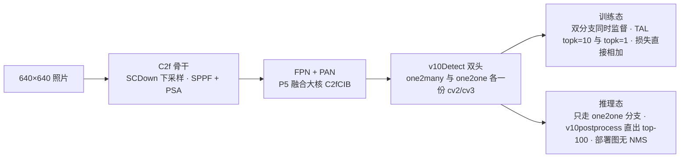
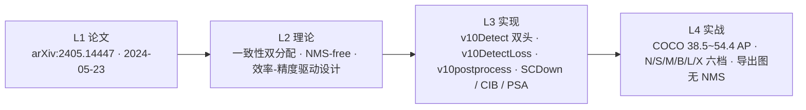

# YOLOv10 (2024-05)

**清华 THU-MIG 的 NMS-free 端到端之作——一致性双分配训出双头，one2one 分支推理直出 top-100**

- 📄 论文：arXiv:2405.14447《YOLOv10: Real-Time End-to-End Object Detection》（2024-05-23，详见[论文精读](/versions/v10/paper)）
- 🏛️ 作者：清华大学 THU-MIG（Ao Wang、Hui Chen、Lihao Liu、Kai Chen、Zijia Lin、Jungong Han、Guiguang Ding）
- 💻 源码：[THU-MIG/yolov10](https://github.com/THU-MIG/yolov10)（快照取自论文日首发 commit `8d9f45a`「add yolov10」，586 文件，AGPL-3.0）——**ultralytics 8.1.34 fork**，目录与 v8 快照同构
- 🎯 里程碑：**部署图里第一次没有 [NMS](/glossary#nms-非极大值抑制)**——同一个 [TAL](/glossary#tal-task-alignment-learning) 分配器实例化两次（topk=10 / topk=1）训出双头，推理只走 one2one 分支、后处理只剩 topk 截断；再配 4 项效率设计，同 [AP](/glossary#map-mean-average-precision) 下延迟大降（README 摘要口径：同性能 v10-B 比 v9-C 延迟低 46%、参数少 25%）

## 3 分钟电梯演讲



1. **一致性双分配**：同一个 [TAL](/glossary#tal-task-alignment-learning) 分配器、同 α=0.5 / β=6.0，实例化两次只差 topk——one2many 分支 topk=10 照 v8 一样「一个 GT 监督多个 anchor」保训练质量，one2one 分支 topk=1「一个 GT 只给一个正样本」对齐推理需求，两分支损失权重均为 1.0 直接相加<SrcLink file="v10:ultralytics/utils/loss.py" :line="717" :end="727" />
2. **NMS-free 推理**：one2one 分支输入 detach（损失梯度不回传骨干，只练头自身权重）<SrcLink file="v10:ultralytics/nn/modules/head.py" :line="512" />，推理走 `v10postprocess`——全程无 [IoU](/glossary#iou-交并比)、无 NMS：`amax` 取最高类分 → `topk(max_det)` → `labels = index % nc`；predict 链只留 conf 阈值，val 链 top-100 全进 COCO [mAP](/glossary#map-mean-average-precision) 评估<SrcLink file="v10:ultralytics/utils/ops.py" :line="851" :end="864" />
3. **效率-精度驱动设计**：轻量分类头（两段 depthwise-separable）<SrcLink file="v10:ultralytics/nn/modules/head.py" :line="503" :end="506" />、SCDown 空间-通道解耦下采样<SrcLink file="v10:ultralytics/nn/modules/block.py" :line="820" :end="827" />、CIB + 大核颈（RepVGGDW）<SrcLink file="v10:ultralytics/nn/modules/block.py" :line="760" :end="768" />、PSA 部分自注意力（全网只在 SPPF 后放 1 个）<SrcLink file="v10:ultralytics/nn/modules/block.py" :line="799" :end="818" />——外加论文级的「秩引导块设计」方法论（代码无对应模块）；N 档 2.3M 参数 / 1.84ms，X 档 54.4% AP / 10.70ms（T4 TRT FP16 口径）

> **v1~v9 读者路标**：[v8 读者](/versions/v8/index)——v10 保留你的 Detect 头并把它复制成两份，`one2one_cv2/one2one_cv3` 就是 `copy.deepcopy(cv2/cv3)`<SrcLink file="v10:ultralytics/nn/modules/head.py" :line="508" :end="509" />，头结构对照 [v8 解耦检测头](/versions/v8/concepts#_2-解耦检测头与无-objectness-设计-concept-decoupled-head)；[v9 读者](/versions/v9/index)——DualDDetect 的双头管**梯度**（主辅各一份分配、推理拆辅助），v10 的双头管**去 NMS**（一对多训练 + 一对一推理），对照 [v9 双头概念](/versions/v9/concepts#_7-dualddetect-双头解耦-concept-dual-ddetect)；术语不熟先查[术语表](/glossary)。

## 四层闭环视图



## 核心贡献一览

v10 的改动高度集中：「ultralytics 8.1.34 的底子 + 一个新头 + 一套效率积木」。核心贡献与代码落点：

| 贡献 | 一句话 | 代码落点 |
|------|--------|---------|
| **一致性双分配匹配** | 同一 TAL 分配器、同 α/β，只差 topk（10 vs 1）；两分支损失权重均为 1.0 相加 | <SrcLink file="v10:ultralytics/utils/loss.py" :line="717" :end="727" /> |
| **NMS-free 推理** | one2one 头出框后 `amax → topk → labels = index % nc`，导出图里没有 NMS 算子 | <SrcLink file="v10:ultralytics/utils/ops.py" :line="851" :end="864" /> |
| **轻量分类头** | cv3 重写为两段 depthwise-separable（深度卷积 + 1×1），出口仍是 1×1 → nc | <SrcLink file="v10:ultralytics/nn/modules/head.py" :line="503" :end="506" /> |
| **SCDown 下采样** | 空间-通道解耦：1×1 s1 降维 → DWConv k×k s2（无激活）；骨干 P4/P5 与 neck P4→P5 使用 | <SrcLink file="v10:ultralytics/nn/modules/block.py" :line="820" :end="827" /> · <SrcLink file="v10:ultralytics/cfg/models/v10/yolov10n.yaml" :line="15" :end="17" /> |
| **CIB + 大核颈** | C2f 内瓶换成 CIB，P5 融合用 `C2fCIB [1024, True, True]`——lk=True 启用 RepVGGDW 大核 | <SrcLink file="v10:ultralytics/nn/modules/block.py" :line="760" :end="768" /> · <SrcLink file="v10:ultralytics/cfg/models/v10/yolov10n.yaml" :line="38" /> |
| **PSA 部分自注意力** | cv1 拆半，attn + FFN 只吃一半通道（key_dim 减半、qkv 1×1 合并）；整个网络只在 SPPF 后放 1 个 | <SrcLink file="v10:ultralytics/nn/modules/block.py" :line="799" :end="818" /> · <SrcLink file="v10:ultralytics/cfg/models/v10/yolov10n.yaml" :line="20" /> |
| **秩引导块设计** | 论文级方法论：按「优化误差-延迟一致性」指标给各层定秩选块——**代码无对应模块**，yaml 只能看到结果 | 见[论文精读 · 效率-精度驱动设计](/versions/v10/paper) |

> **v8 读者**：轻量分类头的对照在这里——你的 cv3 是 `Conv(x, c3, 3) → Conv(c3, c3, 3) → 1×1` 两个全 3×3 卷积<SrcLink file="v10:ultralytics/nn/modules/head.py" :line="42" />，v10 把两个 3×3 换成「深度卷积 + 1×1」的可分离对，通道宽度公式 `c3 = max(ch[0], min(nc, 100))` 未变；[C2f](/glossary#c2f) 与 [compound scaling](/glossary#compound-scaling-复合缩放) 原样保留，[SPPF](/glossary#sppf) 后多了个 PSA。

## 关键指标

**检测（COCO val，输入 640，README 快照口径；延迟为 T4 TensorRT FP16、batch 1）**

| 模型 | #Params | FLOPs | AP<sup>val</sup> | Latency |
|------|---------|-------|------------------|---------|
| YOLOv10-N | 2.3M | 6.7G | 38.5% | 1.84ms |
| YOLOv10-S | 7.2M | 21.6G | 46.3% | 2.49ms |
| YOLOv10-M | 15.4M | 59.1G | 51.1% | 4.74ms |
| YOLOv10-B | 19.1M | 92.0G | 52.5% | 5.74ms |
| YOLOv10-L | 24.4M | 120.3G | 53.2% | 7.28ms |
| YOLOv10-X | 29.5M | 160.4G | 54.4% | 10.70ms |

- 口径提醒：延迟是 **T4 TRT FP16**——与 v8 README 的 CPU ONNX / A100 TRT 双延迟列、v9 README 的无延迟表**均不可直接比**；AP 为 val 口径
- **B 档是 v10 特有**（v8/v9 无 b）；论文正文另有复测延迟数字（如 N 档 1.56ms），本站统一用 README 快照口径并注明差异
- README 摘要的横向对比（摘要原文口径）：同 AP 下 **v10-S 比 RT-DETR-R18 快 1.8×、参数与 FLOPs 小 2.8×**；同性能下 **v10-B 比 v9-C 延迟低 46%、参数少 25%**

> **v1~v9 读者路标**：跨版本比延迟先对环境——v6/v7 用 V100 FPS、v8 用 CPU ONNX 与 A100 TRT、v9 只给 AP、v10 用 T4 TRT FP16；同一张表里只能比参数量与 [mAP](/glossary#map-mean-average-precision)。

## 快速上手

```python
from ultralytics import YOLOv10  # 顶层导出，与 YOLO 并列

model = YOLOv10("yolov10n.yaml")  # 从 yaml 构建随机初始化的 v10-n
# model = YOLOv10("yolov10n.pt")  # 或加载官方预训练权重

results = model.train(data="coco8.yaml", epochs=10, imgsz=640)  # 训练语义与 v8 完全一致
preds = model.predict("https://ultralytics.com/images/bus.jpg")  # 后处理只含 conf 阈值
model.export(format="onnx")  # 导出图里没有 NMS——top-100 直出
```

- `YOLOv10` 在顶层导出（`ultralytics/__init__.py` 与 YOLO 并列），`task_map` 接到 `YOLOv10DetectionModel` / `YOLOv10DetectionPredictor` / `YOLOv10DetectionValidator`<SrcLink file="v10:ultralytics/models/yolov10/model.py" :line="7" :end="9" />
- 训练超参全套沿用 v8.1.34 的 default.yaml：box 7.5 / cls 0.5 / dfl 1.5、close_mosaic 10——**v10 没有新增任何训练 trick，创新在分配与结构**<SrcLink file="v10:ultralytics/cfg/default.yaml" :line="97" :end="99" />
- 导出时 exporter 给 `v10Detect` 注入 `args.max_det`（默认 300）<SrcLink file="v10:ultralytics/engine/exporter.py" :line="232" :end="233" />——导出图里的收口就是这一行 top-100 截断

> **v1~v9 读者路标**：把 v8 代码里的 `from ultralytics import YOLO` 换成 `from ultralytics import YOLOv10`，其余训练/预测/导出脚本一行不用改——这是 fork 基线的直接好处；[v9](/versions/v9/index) 读者注意 v9 是独立仓库脚本入口（train_dual.py），v10 回到了 ultralytics 的统一 API。

## 与 v8 / v9 的关系定位

v10 不是从零写的第三套框架——它是 **ultralytics 8.1.34 的 fork**（快照 `ultralytics/__init__.py` 里 `__version__ = "8.1.34"`<SrcLink file="v10:ultralytics/__init__.py" :line="3" />），做的正是 v8 缺的「端到端化改造」：

- **底子全是 v8 的**：C2f 骨干、FPN+PAN、[anchor-free](/glossary#anchor-free-无锚框) 网格中心回归、[DFL](/glossary#dfl-distribution-focal-loss) 分布表示、TAL 分配器（tal.py 结构未改）、Mosaic/MixUp 全套增强、default.yaml 超参——训练配方与 v8 完全一致；
- **首发 commit 的 delta 高度集中**：新增 `ultralytics/models/yolov10/{model,predict,train,val}.py` 与 `ultralytics/cfg/models/v10/yolov10{nsblmx}.yaml` 六份结构文件；修改集中在 `nn/modules/{head,block}.py`（v10Detect + SCDown/CIB/PSA）、`nn/tasks.py`（接线）、`utils/{loss,ops,tal,torch_utils}.py` 与 `engine/{trainer,validator,exporter}.py`（损失/后处理/导出适配）；
- **v9 的双头和 v10 的双头不是一回事**：v9 DualDDetect 的辅助头解决「梯度可不可靠」（[PGI](/versions/v9/concepts#_1-pgi-可编程梯度信息总览-concept-pgi)），v10 的 one2one 头解决「推理要不要 NMS」。

| 维度 | YOLOv8（2023-01） | YOLOv9（2024-02） | YOLOv10（2024-05） |
|------|-------------------|-------------------|--------------------|
| 代码基座 | ultralytics 单库 | v7 仓库 fork | **ultralytics 8.1.34 fork** |
| 检测头 | Detect 单头 | DualDDetect 主辅双头 | **v10Detect 双头**（one2many + one2one deepcopy） |
| 标签分配 | TAL topk=10 | 双 TAL topk=10（主辅独立） | **TAL topk=10 + topk=1**（同一分配器两次实例化） |
| 推理后处理 | NMS | NMS | **v10postprocess（无 NMS）** |
| 双头用途 | — | 训练期辅助梯度，推理拆除 | one2many 管训练，one2one 管推理 |
| 骨干 | C2f | GELAN + ADown | C2f 保留 + **SCDown** + **PSA** |
| 下采样 | Conv 3×3 s2 | ADown | P4/P5 与 neck 末段 **SCDown**，其余 Conv s2 |
| 骨干尾 | SPPF | SPPELAN | SPPF + **PSA** |
| 新档位 | n/s/m/l/x | s/m/c/e | **n/s/m/b/l/x**（B 档特有） |
| 论文 | 无 | arXiv:2402.13616 | **arXiv:2405.14447** |
| 许可证 | AGPL-3.0 | 无 LICENSE 文件 | AGPL-3.0（随 ultralytics） |

> **v1~v9 读者路标**：v10 的 [C2f](/glossary#c2f) 与 v8 逐字同款（骨干 shortcut=True、head 不带），骨干尾部的 [SPPF](/glossary#sppf) 也原样保留——读 v10 架构时把「v8 部件清单」当底表，只盯新增的 SCDown / PSA / C2fCIB 三件；[复合缩放](/versions/v8/concepts#_11-复合缩放-scales-concept-compound-scaling)照旧驱动 N~X 六档。

## 深入阅读

- [论文精读：一致双分配、无 NMS 推理与效率设计](/versions/v10/paper)
- [Architecture 逐层图解](/versions/v10/architecture)
- [理论 Concept](/versions/v10/concepts)
- [架构与层速查](/versions/v10/layers)
- [损失函数（双分支 TAL）](/versions/v10/losses)
- [反向传播推导](/versions/v10/loss-gradient)
- [训练技巧（与 v8 完全一致的配方）](/versions/v10/tricks)
- [痛点追踪](/versions/v10/painpoints)
- [源码走读](/versions/v10/code-walkthrough)
- [源码页：head.py](/versions/v10/source/head-py) · [loss.py](/versions/v10/source/loss-py) · [tal.py](/versions/v10/source/tal-py) · [yolov10n.yaml](/versions/v10/source/yolov10-yaml)
- [系列家族对照](/global/family) · [术语表](/glossary)
