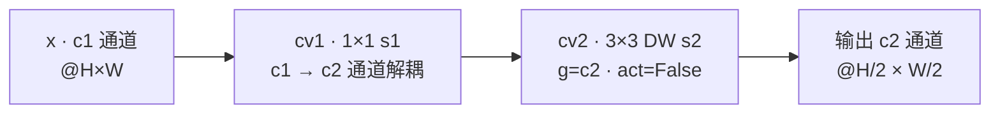
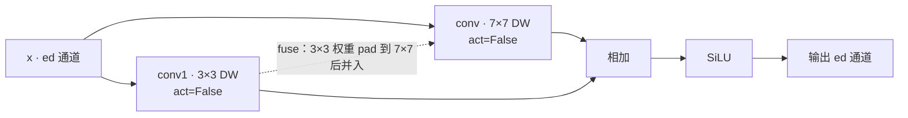
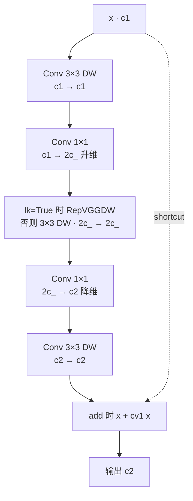
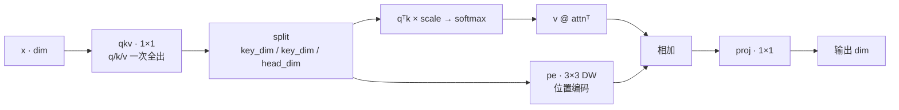
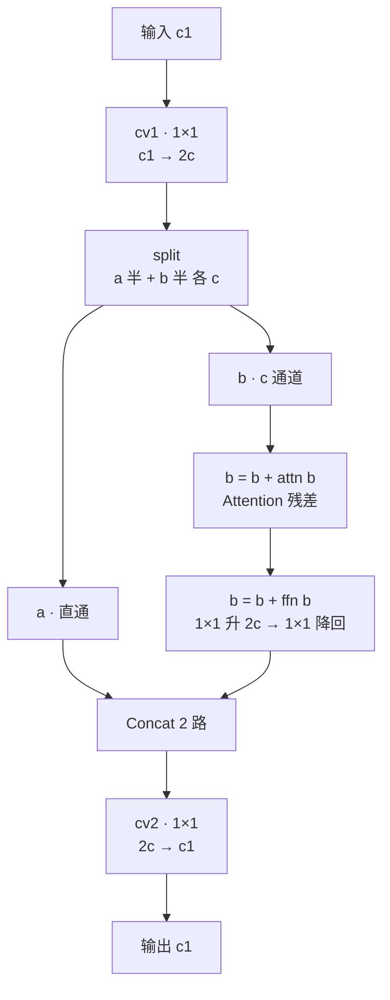
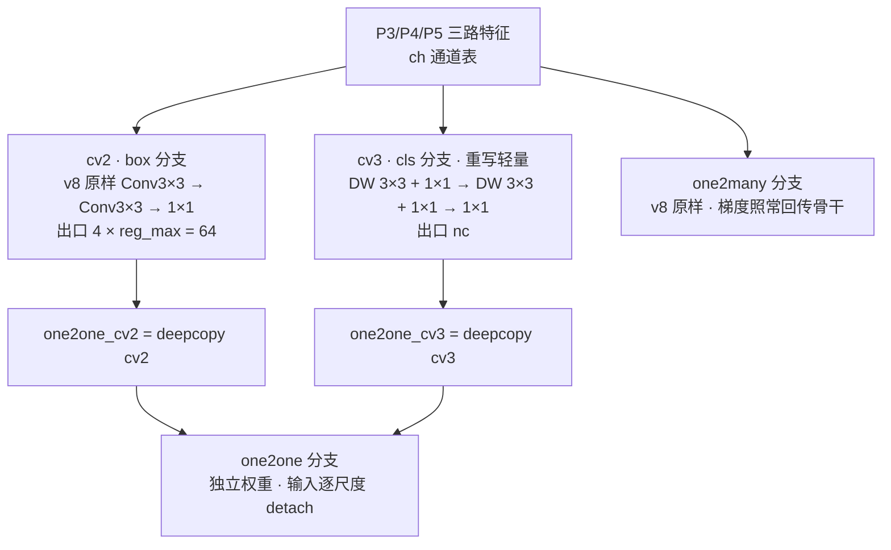

# YOLOv10 逐层图解

> 以 `ultralytics/cfg/models/v10/yolov10n.yaml` 全文 40 行为准：backbone + head 共 **24 个顶层条目（#0~#23）**。本页通道数为 yaml 声明的**基准值**（缩放前），n 档缩放规则见 §1 末注。配置原文见 <SrcLink file="v10:ultralytics/cfg/models/v10/yolov10n.yaml" :line="1" :end="40" />。

> **读者路标**：想先看整体数据流、与 v8n 的差异对照与六档分档，去 [YOLOv10 架构总览](/versions/v10/architecture)；本页专注 v10 新模块的源码级结构——SCDown / RepVGGDW / CIB / C2fCIB / Attention / PSA / v10Detect 七件套，外加两个配套函数 v10postprocess 与 v10DetectLoss。

## 1. 逐层明细表（yolov10n.yaml #0~#23，基准宽度 @640 输入）

> **v8 读者路标**：这张表可以直接与 [v8 逐层图解 §1](/versions/v8/layers) 逐行对照——只有 6 行不同：#5/#7 换 SCDown、#10 新增 PSA、#20 换 SCDown、#22 换 C2fCIB、#23 换 v10Detect，其余 18 行原样顺移。

| # | from | module | 参数（yaml 原文） | 输出（基准 @640） | 说明 |
|-----|------------|--------------|----------------------|--------------------|------|
| 0 | -1 | `Conv` | 64, 3, 2 | 64×320×320 | stem 下采样 · P1/2 |
| 1 | -1 | `Conv` | 128, 3, 2 | 128×160×160 | P2/4 |
| 2 | -1 | `C2f` | 128, True ×3 | 128×160×160 | 骨干 C2f 带 shortcut |
| 3 | -1 | `Conv` | 256, 3, 2 | 256×80×80 | P3/8 |
| 4 | -1 | `C2f` | 256, True ×6 | 256×80×80 | FPN 回连点二 |
| 5 | -1 | `SCDown` | 512, 3, 2 | 512×40×40 | **P4/16 · v10 换装** |
| 6 | -1 | `C2f` | 512, True ×6 | 512×40×40 | FPN 回连点一 |
| 7 | -1 | `SCDown` | 1024, 3, 2 | 1024×20×20 | **P5/32 · v10 换装** |
| 8 | -1 | `C2f` | 1024, True ×3 | 1024×20×20 | |
| 9 | -1 | `SPPF` | 1024, 5 | 1024×20×20 | 骨干出口 |
| 10 | -1 | `PSA` | 1024 | 1024×20×20 | **v10 新增 · 部分自注意力** |
| 11 | -1 | `nn.Upsample` | None, 2, nearest | 1024×40×40 | FPN 上行 |
| 12 | [-1, 6] | `Concat` | 1 | 1536×40×40 | cat 骨干 P4 |
| 13 | -1 | `C2f` | 512 ×3 | 512×40×40 | 头部 C2f 无 shortcut |
| 14 | -1 | `nn.Upsample` | None, 2, nearest | 512×80×80 | |
| 15 | [-1, 4] | `Concat` | 1 | 768×80×80 | cat 骨干 P3 |
| 16 | -1 | `C2f` | 256 ×3 | 256×80×80 | **P3 检测输入 · stride 8** |
| 17 | -1 | `Conv` | 256, 3, 2 | 256×40×40 | PAN 下行（全密度保留） |
| 18 | [-1, 13] | `Concat` | 1 | 768×40×40 | cat 头部 P4 |
| 19 | -1 | `C2f` | 512 ×3 | 512×40×40 | **P4 检测输入 · stride 16** |
| 20 | -1 | `SCDown` | 512, 3, 2 | 512×20×20 | **PAN 下行 · v10 换装** |
| 21 | [-1, 10] | `Concat` | 1 | 1536×20×20 | cat PSA 输出 #10（v8 是 SPPF #9） |
| 22 | -1 | `C2fCIB` | 1024, True, True ×3 | 1024×20×20 | **P5 检测输入 · shortcut + 大核** |
| 23 | [16, 19, 22] | `v10Detect` | nc | 三尺度双头输出 | one2many + one2one · 收官 |

- 重复数 ×3/×6 是基准值：n 档 depth=0.33 缩放后变 1/2，b 档 depth=0.67 变 2/4，l/x 档不变——机制与 v8 的 [compound scaling](/glossary#compound-scaling-复合缩放) 完全相同
- 骨干 C2f 的 `True` 是 shortcut；头部 C2f #13/#16/#19 不传、走签名默认 `False`；C2fCIB 的两个 `True` 分别是 `shortcut` 与 `lk`（大核开关）
- `from` 支持负索引（上一层）与显式层号：#12/#15 回连骨干 #6/#4，#18 回连头部 #13，**#21 回连 #10 PSA** 而非 SPPF
- Concat 输出通道 = 两路之和；Upsample 保持通道不变——与 v8 相同
- v10 每个分档 yaml 独立携带 `scales:` 块（6 个文件 n/s/m/b/l/x 各一份），路径含 "v10" 时不做文件名归并

## 2. v10 新模块速查表

> **v1~v9 读者路标**：下表 9 个条目全部是 YOLOv10 首发（2024-05，THU-MIG/yolov10 @ 8d9f45a，基于 ultralytics 8.1.34 fork）新增或重写——没有任何一个能在 v8/v9 的 block.py / head.py 里找到同名类。

| 模块 | 代码位置 | 一句话作用 | 首次出现 |
|------|----------|------------|----------|
| `SCDown` | <SrcLink file="v10:ultralytics/nn/modules/block.py" :line="820" :end="827" /> | 1×1 降维 + 深度卷积大步长——空间-通道解耦下采样 | YOLOv10 |
| `RepVGGDW` | <SrcLink file="v10:ultralytics/nn/modules/block.py" :line="702" :end="735" /> | 7×7 + 3×3 双路深度卷积，推理期重参数化为单 7×7 | YOLOv10 |
| `CIB` | <SrcLink file="v10:ultralytics/nn/modules/block.py" :line="737" :end="758" /> | 全 DW 化瓶颈块，lk=True 时中段换大核 RepVGGDW | YOLOv10 |
| `C2fCIB` | <SrcLink file="v10:ultralytics/nn/modules/block.py" :line="760" :end="768" /> | C2f 外壳不动，内部 Bottleneck 全换 CIB | YOLOv10 |
| `Attention` | <SrcLink file="v10:ultralytics/nn/modules/block.py" :line="771" :end="797" /> | 极简线性注意力：qkv 一次 1×1 全出 + DW 位置编码 | YOLOv10 |
| `PSA` | <SrcLink file="v10:ultralytics/nn/modules/block.py" :line="799" :end="818" /> | 部分自注意力——一半通道过 Attention+FFN，另一半直通 | YOLOv10 |
| `v10Detect` | <SrcLink file="v10:ultralytics/nn/modules/head.py" :line="497" :end="535" /> | 双分配检测头：one2many + one2one，端到端去 NMS | YOLOv10 |
| `v10postprocess` | <SrcLink file="v10:ultralytics/utils/ops.py" :line="850" :end="863" /> | 无 NMS 后处理：两次 topk 直接选出 max_det 个框 | YOLOv10 |
| `v10DetectLoss` | <SrcLink file="v10:ultralytics/utils/loss.py" :line="717" :end="727" /> | 双损失包装：同一 TAL、topk 10/1、权重 1:1 相加 | YOLOv10 |

- 论文五项效率设计的代码落点：轻量分类头 → `v10Detect.cv3`（§9.1）；空间-通道解耦下采样 → `SCDown`（§3）；大核卷积 → `RepVGGDW`（经 CIB 的 lk=True 启用，§4/§5）；部分自注意力 → `PSA`（§8）；**秩引导块设计（rank-guided）没有代码对应物**——它是纯方法论（用"优化误差-延迟一致性"指标为各阶段选块型），CIB/C2fCIB 是选型结果而非 rank 模块
- yaml 使用次数：SCDown×3（#5/#7/#20）、C2fCIB×1（#22）、PSA×1（#10）、v10Detect×1（#23）；RepVGGDW 与 Attention 不单独出现在 yaml——分别藏在 CIB 中段与 PSA 内部

## 3. SCDown：空间-通道解耦下采样

> **v8/v9 读者路标**：v8 的下采样是一个全密度 3×3 s2 Conv（在全部输入通道上做完整卷积）；v9 换成 ADown 多分支混合。v10 的 SCDown 最彻底——先用 1×1 把通道砍到输出宽度，再用无激活的深度卷积走步长。

**结构**：`cv1 = Conv(c1, c2, 1, 1)` 负责**通道解耦**（c1 → c2 降维），`cv2 = Conv(c2, c2, k, s, g=c2, act=False)` 负责**空间下采样**（深度卷积 k×k、s=2、无激活）；forward 一行：`cv2(cv1(x))`。yaml 写法 `SCDown [512, 3, 2]` 与 Conv 同构——c2、k=3、s=2，替换时 yaml 其余一字不改。

**省在哪**：以基准宽度 256→512 为例（未缩放、只算卷积权重）——v8 全密度 Conv 3×3 s2 为 256×512×9 ≈ 1.18M；SCDown 是 256×512（1×1）+ 512×9（DW）≈ 0.14M，**约 1/9**。空间卷积从"全密度卷积在 256 通道上滑"变成"深度卷积在 512 通道上滑"，FLOPs 同步大降——这就是论文"空间-通道解耦下采样（SCDD）"的全部含义。

<SrcSnippet file="v10:ultralytics/nn/modules/block.py" :start="820" :end="827" hl="826-827" />

- yaml 使用 3 处：#5（P4 下采样）、#7（P5 下采样）、#20（PAN 回程 P4→P5）；#17（P3→P4）保留全密度 Conv——效率手术只做在大步长、多通道处
- 与 Conv 的对照：签名 `(c1, c2, k, s)` 一致、padding 交给内部 Conv 的 autopad；差异是无 `act` 参数（cv2 显式 `act=False`，两段之间无激活）

## 4. RepVGGDW：7×7 大核的双路训练 + 单路推理

> **v3/v6 读者路标**：RepVGG 式"训练多分支、推理融合单路"你在 v3 见过（[RepVGG 结构重参数化](/glossary#repvgg-结构重参数化)）；v10 把它做成深度卷积版——两路都是 DW，一大一小，融合后等效单个 7×7 DW。

**结构**：`conv`（7×7 DW、act=False）与 `conv1`（3×3 DW、act=False）并联，前向是 `SiLU(conv(x) + conv1(x))`；`fuse()` 把 3×3 权重 zero-pad 到 7×7（四周各补 2）逐元素加进大核，推理走 `forward_fuse` 只算一个 7×7 DW。v10 里它**不单独出现在 yaml**——作为 CIB 的中段被 `lk=True` 启用。

<SrcSnippet file="v10:ultralytics/nn/modules/block.py" :start="702" :end="735" hl="710-714" />

- 唯一启用点：#22 `C2fCIB [1024, True, True]` 经 `lk=True` 引入——大核只加在 P5 融合块（20×20 特征、感受野需求最大处），骨干与浅层一概不用
- 融合合法性来自"两个卷积同尺寸输出、同群组 DW、线性叠加"：pad 后 3×3 与 7×7 是同一算子的两种权重，可直接相加

## 5. CIB：全 DW 化的瓶颈块

> **v8 读者路标**：把 CIB 和 C2f 内部的 Bottleneck 摆在一起看——v8 是两个全密度 3×3；CIB 是五段 DW/1×1 混合，中段可换 RepVGGDW 大核。残差判据 `add = shortcut and c1 == c2` 与 v8 Bottleneck 同款。

**结构**（`c_ = int(c2 × e)`，默认 e=0.5），cv1 是一个五段 Sequential：

1. `Conv(c1, c1, 3, g=c1)`——3×3 DW
2. `Conv(c1, 2c_, 1)`——1×1 升维（全密度）
3. `lk ? RepVGGDW(2c_) : Conv(2c_, 2c_, 3, g=2c_)`——中段：大核或 3×3 DW
4. `Conv(2c_, c2, 1)`——1×1 降维（全密度）
5. `Conv(c2, c2, 3, g=c2)`——3×3 DW

<SrcSnippet file="v10:ultralytics/nn/modules/block.py" :start="737" :end="758" hl="746-754" />

- 与 Bottleneck 对照：v10 快照里 Bottleneck（<SrcLink file="v10:ultralytics/nn/modules/block.py" :line="327" />）仍是 Conv 3×3 + Conv 3×3 两个全密度层；CIB 五段里两段 1×1 全密度、三段 DW，密度卷积只出现在升降维的 1×1 上——参数大头让位给逐通道卷积
- C2fCIB 内部以 `e=1.0` 实例化（c_ = c2，中段宽度 2c），不另做内部降维——宽度策略交给 C2f 外壳的 0.5 折半管

## 6. C2fCIB：C2f 换芯不换壳

> **v8 读者路标**：继承关系一句话——`class C2fCIB(C2f)`，你在 v8 学的 [C2f](/glossary#c2f) 图（chunk 拆半 → 串行 → 全拼接）直接适用，只把 `self.m` 里的 Bottleneck 换成 CIB。

**结构**：`super().__init__(c1, c2, n, shortcut, g, e)` 先建 C2f 外壳——`self.c = int(c2 × 0.5)`、cv1 出 2c、cv2 收拢 (2+n)×c——然后一行换芯：`self.m = nn.ModuleList(CIB(self.c, self.c, shortcut, e=1.0, lk=lk) for _ in range(n))`。

**文字结构图**：cv1 1×1 出 2c → chunk 拆成 y0/y1 两半 → y0 直通、y1 串行过 n 个 CIB（每级输出都汇入）→ Concat 共 n+2 路 → cv2 1×1 收拢到 c2。与 v8 C2f 唯一的差别是中间串行的模块身份。

<SrcSnippet file="v10:ultralytics/nn/modules/block.py" :start="760" :end="768" hl="767-768" />

- 继承自 C2f（<SrcLink file="v10:ultralytics/nn/modules/block.py" :line="216" />，与 v8.1.34 同款、未被修改）——所以 yaml 里 `C2fCIB [1024, True, True]` 的前四个参数语义与 C2f 完全一致，最后追加的 `lk` 是唯一新参数
- yaml 仅 #22 一处：n 档缩放后 1024→256 通道、重复数 ×3→1，即 1 个 shortcut=True + lk=True 的 CIB 串在 C2f 外壳里
- shortcut 语义双层：外壳层（C2f 拼接路径）与内瓶层（CIB 的 `x + cv1(x)`）各由各自的布尔控制，yaml 的第一个 True 同时传给两者

## 7. Attention：为 PSA 定制的极简注意力

> **Transformer 读者路标**：这是单层多头注意力的瘦身版——qkv 一个 1×1 全出、softmax 相似度、DW 卷积当位置编码；没有 LayerNorm、没有 FFN（FFN 在外层 PSA 里）、没有 mask。

**关键参数**（`dim=c`、`attn_ratio=0.5`、`num_heads` 由外层传入）：

- `head_dim = dim // num_heads`，`key_dim = int(head_dim × 0.5)`——**key/query 比 value 窄一半**，softmax 打分用的维度减半
- `qkv = Conv(dim, dim + 2 × key_dim × num_heads, 1, act=False)`——q/k/v 用一个 1×1 全部产出，无独立投影矩阵
- `attn = softmax((qᵀk) × key_dim⁻⁰·⁵)`；输出 `v @ attnᵀ + pe(v)`——`pe = Conv(dim, dim, 3, 1, g=dim, act=False)` 是 3×3 DW **位置编码，加在 value 上**而不是 q/k 上
- `proj = Conv(dim, dim, 1, act=False)` 1×1 收口

n 档实际值：dim=128（PSA 拆半后）、num_heads=128//64=2、head_dim=64、key_dim=32、qkv 出 128+2×32×2=256 通道。

<SrcSnippet file="v10:ultralytics/nn/modules/block.py" :start="771" :end="797" hl="777-783" />

- 只服务 PSA，不独立出现；序列长度是特征图格点数（#10 处 20×20=400），注意力矩阵 400×400——放得起，也不必做窗口分块

## 8. PSA：部分自注意力，全网唯一

> **v8 读者路标**：v8 骨干里没有任何注意力模块；v10 第一次把注意力放进主干，但**只放一个、且只吃一半通道**——"部分"（partial）二字就是省算力的关键。位置在 SPPF 之后（#10），20×20 的特征图上序列长度只有 400。

**结构**（e=0.5）：`assert c1 == c2`——PSA 不改通道、只提特征。cv1 1×1 出 2c 后 split 两半：**a 半直通**；**b 半**走 `b = b + self.attn(b)`（残差）再 `b = b + self.ffn(b)`（FFN = 1×1 升 2c + 1×1 降回 c，标准两段式，带激活差）；最后 `cat(a, b)` 经 cv2 1×1 收拢回 c1。两路各算各的，一半通道永远不过注意力。

<SrcSnippet file="v10:ultralytics/nn/modules/block.py" :start="799" :end="818" hl="814-818" />

- yaml 仅 #10 一处（SPPF 之后、FPN 之前）——骨干出口、空间分辨率最小、通道最宽的位置；再往下（FPN 上行）特征图变大、再往上没有更深的层了
- `num_heads = self.c // 64` 由通道自动推导（n 档 c=128 → 2 头），yaml 无需传头数
- 与 v8 差异对照：v8n 同位置（SPPF #9）直接进 FPN；v10n 在中间垫了这一层 PSA——全景图里 #9→#10→#11 的多出来的一跳

## 9. v10Detect：双分配检测头

> **v8 读者路标**：cv2（box 分支）与 v8 完全一样；差异全部集中在两处——cv3 被重写为轻量 depthwise-separable、多了一个 deepcopy 出来的 one2one 分支。训练/推理双态的全景叙述见[架构总览 §6](/versions/v10/architecture)，损失侧见[损失函数详解](/versions/v10/losses)。

### 9.1 轻量分类头（cv3 重写）

- v8 基线 cv3（<SrcLink file="v10:ultralytics/nn/modules/head.py" :line="42" />）：`Conv(x, c3, 3) → Conv(c3, c3, 3) → Conv2d(c3, nc, 1)`——两个**全密度** 3×3
- v10 重写（head.py L503-506）：`[Conv(x, x, 3, g=x) + Conv(x, c3, 1)] → [Conv(c3, c3, 3, g=c3) + Conv(c3, c3, 1)] → Conv2d(c3, nc, 1)`——两个"DW 3×3 + 1×1"级联加 1×1 出口，全 depthwise-separable
- 算一笔账（n 档 P3，x=64、c3=max(64, min(80, 100))=80、nc=80，只算卷积权重）：同宽全密度版 ≈110K（64×80×9 + 80×80×9 + 80×80），v10 版 ≈19K（576 + 5120 + 720 + 6400 + 6400），**约 1/6**
- `c3 = max(ch[0], min(nc, 100))` 公式与 8.1.34 基线 Detect 相同——省参数靠换结构，不靠砍宽度；box 分支 cv2 一字未动

### 9.2 one2one 分支与梯度边界

- 构造：`one2one_cv2 / one2one_cv3 = copy.deepcopy(cv2 / cv3)`（L508-509）——one2many 头的完整复制、独立权重，两个头结构完全对称
- 前向（L511-514）：`one2one = self.forward_feat([xi.detach() for xi in x], ...)`——**one2one 的输入逐尺度 detach**，其损失梯度不回传 neck/骨干，只训练 one2one 头自身；one2many 走 `super().forward(x)` 原样回传，承担"把 neck/骨干训好"的职责
- 训练损失（`v10DetectLoss`，<SrcLink file="v10:ultralytics/utils/loss.py" :line="717" :end="727" />）：`v8DetectionLoss(model, tal_topk=10)` 与 `tal_topk=1` 各实例化一次——同一个 TaskAlignedAssigner（α=0.5、β=6.0），只差 topk；两分支损失**权重各 1.0 直接相加**。这就是论文"一致双分配（consistent dual assignments）"的全部代码形态
- 先验初始化（L527-535）：`bias_init` 覆写 one2one 分支——box bias 1.0、cls bias `log(5/nc/(640/s)²)`，公式与 v8 相同、对象换成 one2one_cv2/one2one_cv3

### 9.3 推理与导出：NMS 从图里消失

- 非导出推理（L516-519）：one2one 过 `self.inference()`（v8 同款解码：DFL 期望值 + dist2bbox + sigmoid），与 one2many 一起装进 `{"one2one", "one2many"}` 字典返回；预测端只取 one2one、仅做 conf 阈值过滤，**无 NMS**
- 导出（L520-523）：`ops.v10postprocess(one2one.permute(0, 2, 1), max_det)`（<SrcLink file="v10:ultralytics/utils/ops.py" :line="850" :end="863" />）——无 IoU、无 NMS：先对最大类分 topk 选候选，再对展平分数第二次 topk，`labels = idx % nc` 取回类别，输出 cat([boxes, scores, labels])
- `max_det = -1` 是类属性哨兵（L499），由 exporter 在导出期注入真实值（<SrcLink file="v10:ultralytics/engine/exporter.py" :line="232" :end="233" />）；模型总装由 `YOLOv10DetectionModel` 接管（<SrcLink file="v10:ultralytics/nn/tasks.py" :line="640" :end="642" />）
- 推理输出仍是 8400 个预测位置（stride 8/16/32，$80^2+40^2+20^2$）——one2one 不减少预测数，只靠"每 GT 一个正样本"的 topk=1 分配教会头输出**互不重叠**的框，从而免去 NMS

<SrcSnippet file="v10:ultralytics/nn/modules/head.py" :start="497" :end="509" hl="503-509" />

<SrcSnippet file="v10:ultralytics/nn/modules/head.py" :start="511" :end="525" hl="512" />

<SrcSnippet file="v10:ultralytics/nn/modules/head.py" :start="527" :end="535" />

## 10. 与 v8 模块的继承 / 对照关系

> **v1~v9 读者路标**：v10 的模块哲学是"不发明新积木，只改积木内部"——两个新类直接继承 v8 同名类，两个新函数复用 v8 损失与后处理的骨架。先看继承，再看对照。

| v10 模块 | 关系 | v8 模块 | 差异要点 |
|----------|------|---------|----------|
| `C2fCIB` | **继承** `C2f`（block.py L760 `class C2fCIB(C2f)`） | [C2f](/glossary#c2f) | 只换 `self.m`：Bottleneck → CIB(e=1.0)；chunk/串行/全拼接主干与 cv1/cv2 原样 |
| `v10Detect` | **继承** `Detect`（head.py L497 `class v10Detect(Detect)`） | Detect | `super().__init__` 建全套 cv2/cv3/dfl 后：重写 cv3（轻量）、deepcopy 出 one2one 双分支、覆写 forward/bias_init |
| `SCDown` | **对照** `Conv s2` | Conv | 签名 `(c1, c2, k, s)` 一致（yaml 可直接互换），实现从一段全密度变两段解耦，且无激活 |
| `CIB` | **对照** `Bottleneck`（<SrcLink file="v10:ultralytics/nn/modules/block.py" :line="327" />，v8 同款） | Bottleneck | 双全密度 3×3 → 五段 DW/1×1 混合，中段可选 RepVGGDW 大核；`add = shortcut and c1==c2` 判据相同 |
| `Attention` / `PSA` | **无对应物** | —— | v8 骨干无注意力；v10 首次引入且仅 #10 一处、只吃一半通道 |
| `v10postprocess` | **对照** NMS 后处理 | `non_max_suppression` | topk 两连发替代"按类 + IoU 抑制"，导出图无 NMS 算子 |
| `v10DetectLoss` | **复用** `v8DetectionLoss` | v8DetectionLoss | 同一个类实例化两次（topk 10/1），损失 1:1 相加——分配器、损失公式零改动 |

- 继承链上没有任何"第三层"：C2fCIB ⊂ C2f、v10Detect ⊂ Detect，都是一层继承 + 少量覆写，v8 的模块知识全部平移可用
- yaml 兼容性最直观的证据：v10n.yaml 与 v8 的 yolov8.yaml 用同一套四元组 `[from, repeats, module, args]` 与同一台 parse_model——差异只在上表模块的内部实现

## 延伸阅读

- [YOLOv10 架构总览](/versions/v10/architecture)
- [YOLOv10 理论 Concept](/versions/v10/concepts)
- [YOLOv10 损失函数详解](/versions/v10/losses)
- [head.py 源码页](/versions/v10/source/head-py)
- [loss.py 源码页](/versions/v10/source/loss-py)
- [v8 逐层图解（对照基线）](/versions/v8/layers)
- [v8 架构总览（对照基线）](/versions/v8/architecture)
