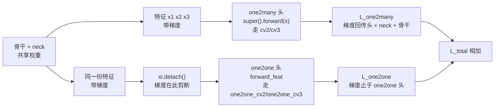
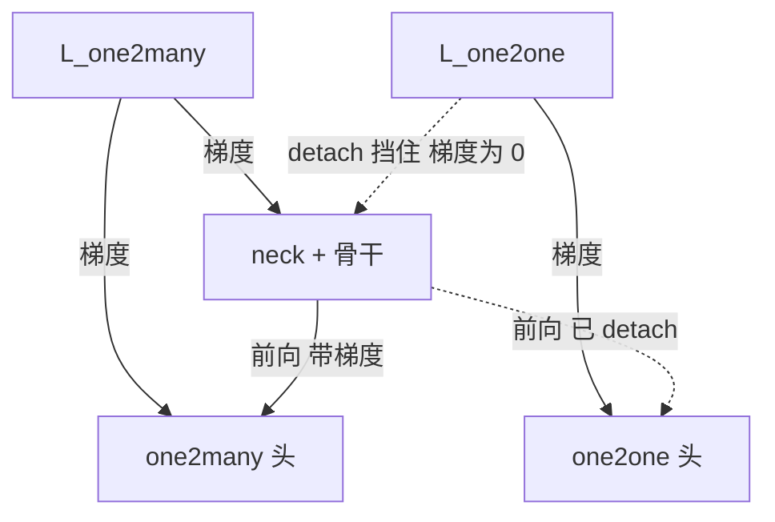

# YOLOv10 反向传播推导

::: tip 只想带走三件事
1. **detach 是 v10 梯度图里唯一的结构性新东西**：`xi.detach()`（<SrcLink file="v10:ultralytics/nn/modules/head.py" :line="512" />）把 one2one 分支的损失梯度挡在头内——neck/骨干只从 one2many 分支获得更新，one2one 头则在「one2many 优化出的特征」上独立收敛；
2. **topk=1 是最稀疏的正样本监督**：每 GT 只有 1 个 anchor 拿到 cls/box 正样本梯度（topk=10 是 ≤10 个），正样本量约 1/10；但 ÷Σq 的分母同步变小，单个正样本的话语权被放大；
3. **分配依旧不可微、被多层切断**：`@torch.no_grad()` + 预测侧 detach 是 v8 同款，v10 再加一层特征 detach——梯度闸门一共三层，两层全站通用、一层 one2one 专属。
:::

## 0. 记号与前向数据流 (`grad-flow`)

> **v1~v9 读者路标**：v1–v8 的前向是「neck → Detect → 一套预测」；v9 训练态输出主辅两套预测（辅助头吃 backbone 内部特征，[v9 梯度页](/versions/v9/loss-gradient)）；v10 训练态输出 `{"one2many", "one2one"}` 两个字典项——两支吃的是**同一份 neck 输出**，但其中一份在进头之前被 detach 了。



本页记号：

- $\theta_{\text{back}}$：骨干 + neck 参数；$\theta_m$：one2many 头参数；$\theta_o$：one2one 头参数
- $x$：neck 输出的三尺度特征；one2many 头吃 $x$，one2one 头吃 $\mathrm{detach}(x)$
- $L_m$：one2many 分支损失；$L_o$：one2one 分支损失；$L = L_m + L_o$
- $q$：TAL 软标签质量（detach 常量）；$\Sigma_q = \max(\sum \text{target\_scores},\ 1)$ 归一化分母
- 分支内部：$z$ 分类/DFL logit，$p = \sigma(z)$；与 [v8 梯度页](/versions/v8/loss-gradient#_0-梯度来源与记号) 同一套记号

## 1. detach 的梯度分水岭 (`grad-detach`)

> **v9 读者路标**：v9 主辅两支的监督**都**回传特征——辅助头存在的意义就是给 backbone 一条额外梯度通路（PGI）；v10 相反：one2one 分支的监督**刻意不**回传 neck/骨干，两支的关系从「互相救梯度」变成「单向供养」。

<SrcSnippet file="v10:ultralytics/nn/modules/head.py" :start="511" :end="525" hl="512-514,524-525" title="v10Detect.forward：detach 分流与双输出" />

::: details 逐行注释（L511–L525）
- **L512**：`one2one = self.forward_feat([xi.detach() for xi in x], self.one2one_cv2, self.one2one_cv3)` —— 对三尺度特征逐个 `detach` 再喂 one2one 头。detach 切断的是「特征 → neck → 骨干」的反传链：$L_o$ 对 $\theta_o$ 的梯度照算，但对 $\theta_{\text{back}}$ 的梯度为 0。**这是 v10 训练图里唯一一处结构性 detach**。
- **L513-514**：非 export 时 `one2many = super().forward(x)` —— 走 v8 `Detect` 的原装 `cv2/cv3`，输入**不带 detach**，$L_m$ 的梯度正常回传 neck/骨干。
- **L516-519**：推理态走 `self.inference(one2one)`（v8 同款解码）并返回双输出字典；one2many 在推理时仍是「陪跑」输出，predict 管线只取 `one2one`。
- **L520-523**：export 态直接 `ops.v10postprocess` 出 `cat([boxes, scores, labels])`——导出图里没有 NMS（见 [painpoints 页](/versions/v10/painpoints)）。
- **L524-525**：训练态返回字典 `{"one2many": ..., "one2one": ...}`——v10DetectLoss 按这两个键拆包（loss.py L723、L725）。
:::

对总损失 $L = L_m(x;\theta_m) + L_o(\mathrm{detach}(x);\theta_o)$ 求导。detach 的语义是：梯度流过它时被置零，数学上等价于把 $x$ 在 $L_o$ 这一支里当**常量**：

$$\frac{\partial L}{\partial \theta_{\text{back}}} = \frac{\partial L_m}{\partial x}\cdot\frac{\partial x}{\partial \theta_{\text{back}}} + \underbrace{\frac{\partial L_o}{\partial\, \mathrm{detach}(x)}\cdot\frac{\partial\, \mathrm{detach}(x)}{\partial \theta_{\text{back}}}}_{=\ 0} = \frac{\partial L_m}{\partial x}\cdot\frac{\partial x}{\partial \theta_{\text{back}}}$$

$$\frac{\partial L}{\partial \theta_m} = \frac{\partial L_m}{\partial \theta_m}, \qquad \frac{\partial L}{\partial \theta_o} = \frac{\partial L_o(\mathrm{detach}(x);\ \theta_o)}{\partial \theta_o}$$

三句话总结这张梯度图：

- **neck/骨干只听 one2many 的**：$\partial L/\partial \theta_{\text{back}}$ 只含 $L_m$ 的贡献——特征表示完全由 one2many 分支（每 GT 10 个正样本的富监督）塑造
- **one2one 头自食其力**：$\theta_o$ 只从 $L_o$ 更新，输入是常量——它在「one2many 优化出的特征分布」上独立收敛
- **这正是论文 consistency 的工程落点**：论文的 consistent matching 要求两支用同一匹配准则选样本，one2one 的 topk=1 恰是该准则下全场最优的 1 个；代码里没有任何两支之间的一致性损失项，「一致」由三件事拼出——同一 assigner 类与 α/β（准则一致）+ 共享特征（表示一致，单向）+ 头结构对称（容量一致）。one2one 头无需自己学特征，只需在好特征上学会「每 GT 挑一根针」，所以弱监督也能收敛



- **v9 → v10 的双头梯度对比**：v9 主支 ×1.0 + 辅支 ×0.25 都回传 backbone（辅助监督加权）；v10 是 $L_m$ 全额回传 + $L_o$ 零回传——「1.0 + 0」替代「1.0 + 0.25」，共享特征的梯度来源更纯粹
- **loss.py 里的两支各跑各的 detach**：TAL 调用处 `pred_scores.detach()` / `pred_bboxes.detach()`（<SrcLink file="v10:ultralytics/utils/loss.py" :line="221" :end="228" />）是分配常量化，与 head.py 的特征 detach 是两个不同层面的切断，别混为一谈

## 2. 单分支内三条梯度通路 v8 同款 (`grad-single`)

> **v1~v9 读者路标**：本节的三个公式与 [v8 梯度页](/versions/v8/loss-gradient) 第 1–3 节完全相同（v10 fork 自 8.1.34 零改动）；v9 页面多讲一层「0.25 权重怎么缩放梯度」，v10 两支权重都是 1.0，梯度公式原样各跑一遍。

| 梯度闸门 | 位置 | 作用 | 适用分支 |
|---------|------|------|---------|
| 1. `@torch.no_grad()` | tal.py L38 | 分配全程不建图，输出全是常量 | 两支 |
| 2. 预测侧 `.detach()` | loss.py L222-223 | 分配输入常量化，目标不随预测「作弊」 | 两支 |
| 3. 特征 `xi.detach()` | head.py L512 | $L_o$ 不回传 neck/骨干 | **仅 one2one** |

**分类梯度**（软标签 BCE，正类通道 $y=1$、目标 $t = q\,y$）：

$$\boxed{\ \frac{\partial L_{\text{cls}}}{\partial z} = \sigma(z) - q\,y\ }$$

正类通道平衡点从 1 降到 $q$——分类分数的天花板就是对齐质量；背景通道梯度就是 $p$，纯压制。topk=1 分支只有全场最优的 1 个 anchor 拿到 $p - q$ 型正样本梯度，其余 8399 个位置全是背景压制（完整推导见 [v8 梯度页第 4 节](/versions/v8/loss-gradient#_4-软标签下的分类梯度-grad-soft-label)）。

**回归梯度**（CIoU × q，期望距离线性）：

$$L_{\text{box}} = \frac{\sum_i (1 - \mathrm{CIoU}_i)\, q_i}{\Sigma_q}, \qquad \frac{\partial\, \mathrm{box}}{\partial d} = \pm 1$$

预测框是 ltrb 期望距离的线性函数（无 $2\sigma(1-\sigma)$ 自我限幅），梯度 $\times\, q_i / \Sigma_q$——对齐质量高的正样本话语权大。

**DFL 梯度**（双 bin 插值 CE）：

$$\boxed{\ \frac{\partial L_{\text{dfl}}}{\partial z_k} = w_l\,(p_k - \delta_{[k=t_l]}) + w_r\,(p_k - \delta_{[k=t_r]})\ }$$

梯度把 16 bin 分布质量往目标两侧相邻 bin 上押，最优分布的期望恰等于目标距离（推导与「期望恒等式」见 [v8 梯度页第 3 节](/versions/v8/loss-gradient#_3-dfl-的期望值梯度-grad-dfl)）。

两支合成：

$$\frac{\partial L}{\partial \theta_{\text{back}}} = \frac{\partial L_m}{\partial \theta_{\text{back}}}\ \text{（仅 one2many 路径）}, \qquad \frac{\partial L}{\partial \theta_m}\ \text{与}\ \frac{\partial L}{\partial \theta_o}\ \text{分别更新两个头}$$

## 3. TAL 单正样本的梯度稀疏性 (`grad-topk1`)

> **v8 读者路标**：v8 的 topk=10 是「每 GT 10 个正样本分摊监督」；v10 的 one2one 把 topk 拧到 1 后，正样本梯度的分布从「撒网」变成「押注」。分配机制本身（[losses 页第 4 节](/versions/v10/losses#_4-tal-分配与-topk-双值-loss-tal)）不变，变的是梯度的稀疏结构。

<SrcSnippet file="v10:ultralytics/utils/tal.py" :start="144" :end="161" hl="145,154-156,159" title="select_topk_candidates 核心行：topk=1 只留下全场最大" />

::: details 逐行注释（L144–L161）
- **L145**：`torch.topk(metrics, self.topk)` —— topk=1 时返回每个 GT 的 argmax（值 + 索引）；这就是「每 GT 只留全场 align metric 最高的 1 个 anchor」的实现，一行 `topk` 参数搞定。
- **L149**：无效 GT 的索引填 0。
- **L154-156**：`for k in range(self.topk)` 循环 scatter_add——topk=1 时只 scatter 一次，`count_tensor` 里每 GT 最多一个 1。
- **L159**：重复计数过滤（详见 [losses 页逐行注释](/versions/v10/losses#_4-tal-分配与-topk-双值-loss-tal)）。
:::

| 监督维度 | one2many（topk=10） | one2one（topk=1） |
|---------|--------------------|--------------------|
| 每 GT 拿到 cls 正样本梯度的 anchor | ≤ 10 | **1** |
| 每 GT 拿到 box/dfl 梯度的 anchor | ≤ 10 | **1** |
| cls 背景压制梯度 | 全 8400 位置 | 全 8400 位置（两支都铺满） |
| Σq 量级（单 GT 例） | ≈ 3.05（见[第 4 节](#_4-数值示例-一个-gt-的-10-vs-1-grad-example)） | ≈ 0.90 |
| 单正样本回归梯度系数 | $q_i/\Sigma_q$，分母被 10 份摊薄 | $q_i/\Sigma_q$，分母只有自己——**放大约 3.4×** |
| 梯度方差 | 10 个样本平均，较稳 | 单样本主导，对 top1 的 CIoU 质量更敏感 |

- **稀疏的是正样本，不是梯度总量**：cls 的 BCE 在两支里都铺满全 8400 位置（背景压制梯度一个不少）；box/dfl 经 `fg_mask` 布尔索引只流向正样本（<SrcLink file="v10:ultralytics/utils/loss.py" :line="74" :end="82" />）——topk=1 时这份「集中投资」的梯度全部押在每 GT 的唯一 anchor 上
- **÷Σq 的自动补偿**：分母 `max(target_scores.sum(), 1)` 随正样本数同步缩小，单样本的梯度权重不因稀疏而消失，反而按比例放大——one2one 分支的 loss 数值更高、曲线更抖，是这套归一化的直接观测结果
- **对 top1 选择本身的梯度为 0**：哪个 anchor 当 top1 由 align metric 决定，而 align metric 在 `@torch.no_grad()` 里算出（tal.py L38）——「选中谁」是离散决策，选中的样本才拿到梯度。这与 v6–v8 的分配不可微是同一条边界，v10 没有也没有必要引入可微分配（如 Gumbel/软 topk）

## 4. 数值示例 一个 GT 的 10 vs 1 (`grad-example`)

> **v1~v9 读者路标**：v8/v9 梯度页只给公式与符号推导；这一节用一张手算表把「topk 拧动梯度」演给你看——数值为构造示意，α=0.5/β=6.0 与快照一致。

设 640 输入下某个 GT（类别 c）在 P3 层有 10 个中心落点在框内的 anchor 候选，训练中期预测分数 $s$ 与 CIoU 如下。align metric $t = s^{0.5} \times \mathrm{CIoU}^{6}$：

| 排名 | anchor | 预测分数 s | CIoU | $s^{0.5}$ | $\mathrm{CIoU}^6$ | align $t$ | one2many 软标签 $q = t/t_{\max} \cdot 0.90$ | one2one |
|------|--------|-----------|------|-----------|-------------------|-----------|--------------------------------------------|---------|
| 1 | a1 | 0.81 | 0.90 | 0.90 | 0.531 | **0.478** | 0.900 | **q = 0.90 ✓** |
| 2 | a2 | 0.72 | 0.88 | 0.85 | 0.464 | 0.394 | 0.742 | 0 |
| 3 | a3 | 0.64 | 0.85 | 0.80 | 0.377 | 0.302 | 0.568 | 0 |
| 4 | a4 | 0.49 | 0.82 | 0.70 | 0.304 | 0.213 | 0.400 | 0 |
| 5 | a5 | 0.36 | 0.78 | 0.60 | 0.225 | 0.135 | 0.254 | 0 |
| 6 | a6 | 0.25 | 0.71 | 0.50 | 0.128 | 0.064 | 0.121 | 0 |
| 7 | a7 | 0.16 | 0.64 | 0.40 | 0.069 | 0.028 | 0.052 | 0 |
| 8 | a8 | 0.09 | 0.55 | 0.30 | 0.028 | 0.008 | 0.016 | 0 |
| 9 | a9 | 0.04 | 0.42 | 0.20 | 0.005 | 0.001 | 0.002 | 0 |
| 10 | a10 | 0.01 | 0.25 | 0.10 | 0.0002 | 0.00002 | 0.00005 | 0 |

（单 GT 场景 $q = t/t_{\max} \times \max \mathrm{CIoU} = t / 0.478 \times 0.90$；多 GT 时再跨 GT 取 max，见 [losses 页第 4 节](/versions/v10/losses#_4-tal-分配与-topk-双值-loss-tal)）

- **one2many 分支**：10 个 anchor 全部成为正样本（topk=10，且都满足 GT 内条件），$\Sigma_q \approx 0.900+0.742+\cdots+0.00005 \approx 3.05$——a1 的回归梯度系数 $0.90/3.05 \approx 0.30$，a10 之类边缘样本几乎不贡献
- **one2one 分支**：`torch.topk(t, 1)` 只留 a1，$\Sigma_q = 0.90$——a1 的回归梯度系数 $0.90/0.90 = 1.0$，是 one2many 里的约 3.4 倍；其余 9 个 anchor 的 box/dfl 梯度严格为 0，cls 目标也是 0（背景压制）
- **观察 β=6 的作用**：a2 与 a1 的预测分数只差 11%、CIoU 只差 2.2%，但经 6 次方放大后 align metric 拉开 17%——**定位质量在排序中的话语权被指数放大**，topk=1 时这个排序直接决定「唯一监督名额给谁」
- **两支合力的图景**：骨干从 a1–a10 十个样本学「这片区域能框准」，one2one 头只从 a1 学「把分数压到最高」——梯度互不串门（detach），但看的特征是同一份

## 5. 初始 bias 与训练初期的梯度 (`grad-bias`)

> **v8 读者路标**：公式与 v8 `Detect.bias_init` 逐字相同（v10 fork 自 8.1.34）；v10 的增量只有一件事——**one2one 头也要初始化一遍**（v9 的辅助头没有这个专属步骤，它复用主头逻辑）。

<SrcSnippet file="v10:ultralytics/nn/modules/head.py" :start="527" :end="535" hl="528,533-535" title="v10Detect.bias_init：两支各初始化一遍" />

::: details 逐行注释（L527–L535）
- **L528**：`super().bias_init()` —— 先按 v8 逻辑初始化 one2many 路径的 `cv2/cv3`（head.py L88-95）。
- **L533**：`zip(m.one2one_cv2, m.one2one_cv3, m.stride)` —— 再对 one2one 头做**完全相同**的初始化；此时 deepcopy 早已发生（`__init__` L508-509），两支的随机权重不同，但最后层 bias 在这里被统一覆盖。
- **L534**：`a[-1].bias.data[:] = 1.0` —— 回归末层 64 个 logit 全部置 1.0 → softmax 均匀分布 → 每条 ltrb 边的期望距离 = $\frac{1}{16}\sum_{k=0}^{15} k = 7.5$ 个 bin。
- **L535**：`b[-1].bias.data[: m.nc] = math.log(5 / m.nc / (640 / s) ** 2)` —— 分类末层按「每图 5 个物体 / nc 类 / 该层网格面积」的先验设定初始概率。
:::

**分类 bias 的数值**（nc=80）：

| 尺度 | stride | 网格面积 $(640/s)^2$ | 初始概率 $\sigma(b) = \frac{5}{80\cdot(640/s)^2}$ | bias $=\ln(\cdot)$ |
|------|--------|--------------------|------------------------------------------------|--------------------|
| P3 | 8 | 6400 | $9.77\times10^{-6}$ | −11.54 |
| P4 | 16 | 1600 | $3.91\times10^{-5}$ | −10.15 |
| P5 | 32 | 400 | $1.56\times10^{-4}$ | −8.76 |

- **作用一：压住训练初期的背景梯度洪峰**。8400 个位置里绝大多数是负样本，BCE 背景项梯度 $\sigma(z) \approx 10^{-5}$——若 bias 从 0 开始（$\sigma=0.5$），第一步就有几千个位置的 0.5 量级压制梯度叠加，loss 与权重都会剧烈震荡；小 bias 让「背景压制」从近零起步，随预测分化逐渐加码
- **作用二：让 align metric 初期由 CIoU 主导**。初期所有 anchor 的 $s^{0.5} \approx 3\times10^{-3}$ 且差异远小于 CIoU 差异，$t = s^{0.5}\mathrm{CIoU}^6$ 的排序几乎完全由 $\mathrm{CIoU}^6$ 决定——**topk=1 的「唯一名额」在训练早期实质是「当前框最准的 anchor」**，而不是分数最高者；随分类头分化，分数项才逐渐参与排序
- **作用三：给 DFL 一个中性起点**。box bias 全 1.0 → 均匀分布 → 每条边期望 7.5 bin，所有 anchor 画出同一尺寸的「中标框」；DFL 梯度 $w_l(p_k - \delta_{t_l}) + w_r(p_k - \delta_{t_r})$ 从均匀分布（每 bin 梯度 $1/16$）把质量推向目标 bin——起点对称、无偏置，收敛路径只由数据决定
- **两支同起点**：one2one 头与 one2many 头的 bias 初始完全一致，训练分岔只来自后续各自收到的梯度（10 份 vs 1 份监督）

## 6. 全流程串起来

```
Input → 骨干 → neck（梯度只来自 one2many 支）
  → 同一份三尺度特征 x
      ├─ x ──────────────→ one2many 头（cv2/cv3）→ L_m
      │    TAL topk=10：每 GT ≤10 正样本，Σq ≈ 3.05（单 GT 例）
      │    cls 梯度 p − qy 铺满 8400 位置；box/dfl 只进 10 个正样本
      └─ xi.detach() ───→ one2one 头（one2one_cv2/one2one_cv3）→ L_o
           TAL topk=1：每 GT 恰 1 正样本，Σq = 0.90（单 GT 例）
           cls 梯度 p − qy 同样铺满；box/dfl 只进 1 个 anchor
           detach：L_o 对 θ_back 梯度 = 0，对 θ_o 正常
  → L_total = L_m + L_o（权重均 1.0，loss.py L727）
  → backward：L_m 更新 θ_m + θ_back；L_o 只更新 θ_o
  → 推理：只用 one2one 头，v10postprocess 无 NMS
```

（总装 <SrcLink file="v10:ultralytics/utils/loss.py" :line="717" :end="727" />；前向分流 <SrcLink file="v10:ultralytics/nn/modules/head.py" :line="511" :end="525" />）

## 与其他页的链接

- [损失函数](/versions/v10/losses)——双分支总装、TAL align_metric、topk 10/1
- [loss.py 源码页](/versions/v10/source/loss-py)、[head.py 源码页](/versions/v10/source/head-py)
- [v8 反向传播推导（单分支三公式的完整推导）](/versions/v8/loss-gradient)
- [v9 反向传播推导（上一代双头梯度）](/versions/v9/loss-gradient)
