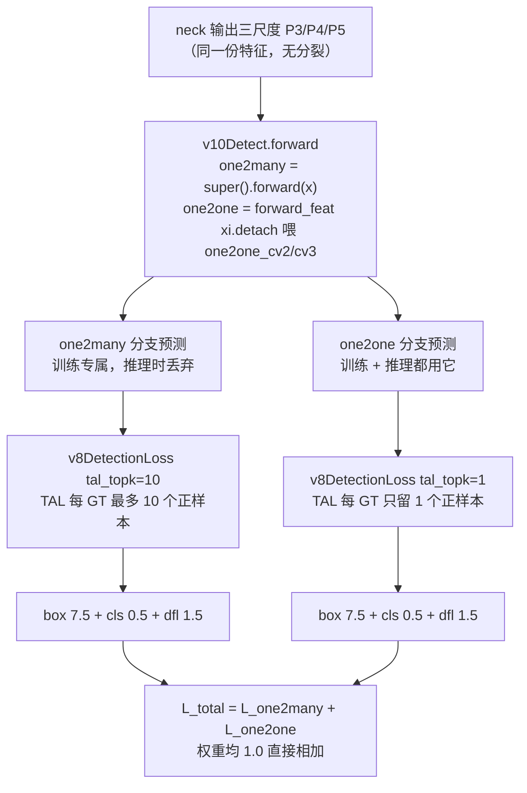

# YOLOv10 损失函数

::: tip 只想带走三件事
1. **总损失就是两支直接相加**：$L = L_{\text{one2many}} + L_{\text{one2one}}$，权重均 1.0、没有任何缩放系数（<SrcLink file="v10:ultralytics/utils/loss.py" :line="727" />）——论文的「一致双分配」在代码里只是一行加法；
2. **两支是同一个 `v8DetectionLoss` 的两次实例化，唯一差别是 `tal_topk=10` vs `1`**（<SrcLink file="v10:ultralytics/utils/loss.py" :line="719" :end="720" />）：同一个 [TAL](/glossary#tal-task-alignment-learning) 分配器类、同 α=0.5/β=6.0，topk=10 每 GT 最多 10 个正样本，topk=1 每 GT 只留全场 align metric 最高的 1 个 anchor；
3. **单分支三分量与 v8 逐行同款**：box（CIoU × 软标签加权，增益 7.5）+ cls（BCE × 软标签，0.5）+ dfl（1.5）——v10 是 ultralytics **8.1.34 fork**，这部分一行未改，新意全在「双分支 + topk=1」。
:::

## 全景图



## 1. 损失总装 两支直接相加 (`loss-total`)

> **v1~v9 读者路标**：v1–v8 一图一头一套损失；v9 的「双头」是主辅两支——辅助头吃 backbone 内部特征 A3/A4/A5、主头吃 neck 输出，各带 assigner，损失权重 0.25/1.0（主头梯度是辅助头的 4 倍，[v9 损失页](/versions/v9/losses)）。v10 的双分支是 **one2many 常规头 + one2one deepcopy 复制头并行吃同一份 neck 输出**、权重 1.0/1.0，而且 one2one 的输入还 detach——两代双头动机不同：v9 靠辅助监督救梯度（PGI），v10 靠一致双分配去 NMS。

$$L_{\text{total}} = L_{\text{one2many}} + L_{\text{one2one}}, \qquad L_{\text{branch}} = 7.5\,L_{\text{box}} + 0.5\,L_{\text{cls}} + 1.5\,L_{\text{dfl}} \;\; (\times\ \text{batch\_size})$$

两支的 $L_{\text{branch}}$ 结构完全相同（下一节展开），全部差异压缩到一个分配器参数 `topk` 上。

<SrcSnippet file="v10:ultralytics/utils/loss.py" :start="717" :end="727" hl="719-720,727" title="v10DetectLoss：双 v8DetectionLoss 实例化与直接相加" />

::: details 逐行注释（L717–L727）
- **L717**：`class v10DetectLoss:` —— 不继承 `nn.Module`，也不是 `v8DetectionLoss` 子类，就是一个纯组合器：内部持两个现成的损失实例。
- **L718**：`__init__(self, model)` —— 与 v8 同款约定：`model` 必须是 de-parallel 后的模型（去 DP 包装），从这里读 `model.args` 超参与 `model.model[-1]` 头结构。
- **L719**：`self.one2many = v8DetectionLoss(model, tal_topk=10)` —— one2many 分支：`tal_topk` 是 v10 在 `v8DetectionLoss.__init__` 上新增的形参（<SrcLink file="v10:ultralytics/utils/loss.py" :line="150" />），传 10 即 v8 原版行为。
- **L720**：`self.one2one = v8DetectionLoss(model, tal_topk=1)` —— one2one 分支：**唯一差异就是 topk 从 10 拧到 1**。两实例各持独立 assigner、独立 BCE、独立 BboxLoss，互不共享状态。
- **L722-723**：`__call__` 先取 `preds["one2many"]` —— v10Detect 训练态返回 `{"one2many": ..., "one2one": ...}` 字典（head.py L524-525），按键拆包。
- **L724**：`loss_one2many = self.one2many(one2many, batch)` —— 返回 `(标量总损失, detach 的 3 维分量向量)`，与 v8 的返回约定一致。
- **L725-726**：同样路径取 `preds["one2one"]` 喂 `self.one2one` —— 注意两支喂的是**各自头**的预测（one2one 预测来自 detach 后特征，见 [损失梯度页](/versions/v10/loss-gradient#_1-detach-的梯度分水岭-grad-detach)）。
- **L727**：`return loss_one2many[0] + loss_one2one[0], torch.cat((loss_one2many[1], loss_one2one[1]))` —— **标量部分直接相加，没有 × 系数**：两支权重均 1.0；分量部分 cat 成 6 维 `[box_m, cls_m, dfl_m, box_o, cls_o, dfl_o]` 供训练日志。
:::

- **「一致双分配」的最小实现**：论文提出的 consistent dual assignments——one2many 与 one2one 用同一匹配准则、只允许正样本数不同——落到代码就是「同一 `TaskAlignedAssigner` 类、同 α=0.5/β=6.0、只差 topk（10 vs 1）」。没有新分配器、没有新损失项、没有两支之间的一致性约束损失
- **日志口径翻倍**：`loss_items` 从 v8 的 3 维变 6 维，两支各自的 box/cls/dfl 都能分别监控——实操上 one2one 分支的 loss 曲线明显更高、下降更慢，这是 topk=1 监督稀疏的直接反映（数值演示见 [损失梯度页第 4 节](/versions/v10/loss-gradient#_4-数值示例-一个-gt-的-10-vs-1-grad-example)）

## 2. 双分支解剖 同一工厂两个 topk (`loss-dual`)

> **v9 读者路标**：v9 的双头是主辅两个 Detect 分支各带 assigner（两个 `TaskAlignedAssigner` 实例**参数完全相同**，同一套 GT 各跑各的分配）；v10 同样是两个 assigner 实例，但**参数本身不同**——topk 10 vs 1，分配准则的松紧才是双分支的灵魂。另外 v9 的辅助头监督要回传 backbone（PGI 全靠它），v10 的 one2one 监督**不**回传 neck/骨干（detach，[梯度页详谈](/versions/v10/loss-gradient#_1-detach-的梯度分水岭-grad-detach)）。

`tal_topk` 形参是 v10 对 `v8DetectionLoss` 唯一的接口改动——上游 ultralytics 8.1.34 里 `topk=10` 是写死在构造调用里的：

<SrcSnippet file="v10:ultralytics/utils/loss.py" :start="147" :end="168" hl="150,166-168" title="v8DetectionLoss.__init__：tal_topk 形参 + assigner 实例化" />

::: details 逐行注释（L147–L168）
- **L150**：`__init__(self, model, tal_topk=10)` —— **v10 新增形参**（8.1.34 原版没有）；默认 10 保持 v8 行为，v10DetectLoss 用 10/1 各调一次。
- **L152-157**：设备、`h = model.args` 超参、`m = model.model[-1]` 取头——v8 同款。
- **L156**：`self.bce = nn.BCEWithLogitsLoss(reduction="none")` —— 分类损失逐元素返回，加权归一在后。
- **L158-164**：stride、nc、no、reg_max、use_dfl（`reg_max > 1` 即 16 分箱 DFL 开启）——v8 同款。
- **L166**：`self.assigner = TaskAlignedAssigner(topk=tal_topk, num_classes=self.nc, alpha=0.5, beta=6.0)` —— **topk 是形参、α/β 硬编码不变**。类默认 topk=13（tal.py L28）在这里被显式覆盖。
- **L167**：`self.bbox_loss = BboxLoss(m.reg_max - 1, use_dfl=self.use_dfl)` —— reg_max-1 = 15 传给 DFL 的 clamp 上界。
- **L168**：`self.proj = torch.arange(m.reg_max)` —— DFL 期望积分的 bin 坐标 0..15。
:::

| 维度 | one2many 分支 | one2one 分支 |
|------|--------------|--------------|
| 损失实例 | `v8DetectionLoss(model, tal_topk=10)`（loss.py L719） | `v8DetectionLoss(model, tal_topk=1)`（loss.py L720） |
| assigner 参数 | `TaskAlignedAssigner(topk=10, α=0.5, β=6.0)` | `TaskAlignedAssigner(topk=1, α=0.5, β=6.0)` |
| 每 GT 正样本数 | ≤ 10（还要 ∩ GT 内中心） | **1**（align metric 全场最大者） |
| 监督头 | v8 `Detect` 原装 `cv2/cv3`（`super().forward(x)`，head.py L514） | `deepcopy(cv2/cv3)` 得到的 `one2one_cv2/one2one_cv3`（head.py L508-509） |
| 头结构 | 回归 `cv2` 原装 + 分类 `cv3` 轻量（depthwise-separable） | 与 one2many **结构对称**（deepcopy 自重写后的 cv2/cv3） |
| 输入特征 | neck 输出原样（带梯度） | `xi.detach()`（head.py L512） |
| 梯度路径 | 头 → neck → 骨干全通 | 只更新 one2one 头自身权重 |
| 损失权重 | 1.0 | 1.0 |
| 推理时 | 丢弃（训练专属辅助） | 保留，去 NMS 端到端输出 |

- **为什么两支要结构对称**：one2one 头是 `one2one_cv2/one2one_cv3 = copy.deepcopy(cv2/cv3)`——推理时它是唯一上场的头，必须和训练时被 one2many 充分「带练」的表示能力对齐；对称结构让 deepcopy 语义最干净
- **轻量分类头是双头的经济账**：`cv3` 被重写为两段 depthwise-separable（head.py L504-506），双头 deepcopy 翻倍的参数代价因此可控——这也是论文「轻量化分类头」与「双分配」两项设计的联动点（结构细节归 [layers 页](/versions/v10/layers)）

## 3. 单分支三分量 v8 同款 (`loss-core`)

> **v1~v9 读者路标**：本节与 [v8 损失页](/versions/v8/losses) 第 1–4 节逐行对应——v10 快照的 `loss.py` fork 自 ultralytics **8.1.34 且三分量零改动**；v9 改的是权重不对称（0.25/1.0），v10 连权重都没动。想看「v10 新在哪」的读者直接跳 [第 4 节](#_4-tal-分配与-topk-双值-loss-tal)。

<SrcSnippet file="v10:ultralytics/utils/loss.py" :start="196" :end="247" hl="221-230,234,243-247" title="v8DetectionLoss.__call__：单分支总装（两支各跑一遍）" :max-height="620" />

::: details 逐行注释（L196–L247）
- **L198**：`loss = torch.zeros(3)` —— `[box, cls, dfl]` 三分量向量，v6–v8 同款。
- **L199-202**：三分图 `cat` 成 `(b, no, 8400)` 再 `split` 出 `pred_distri`（64 维分布）与 `pred_scores`（nc 维分数）——one2many 与 one2one 头的输出通道布局一致，所以同一份总装代码通吃两支。
- **L204-205**：permute 到 `(b, 8400, ch)`，anchor 在前。
- **L209-210**：`imgsz` 由特征图 × stride 反推；`make_anchors` 生成网格中心（偏移 0.5）与 stride 张量。
- **L213-216**：目标标准化——`batch_idx/cls/bboxes` 拼表、按图填充成 `(b, n_max, 5)`、`xywh2xyxy` 到像素域；`mask_gt` 标记有效 GT。
- **L219**：`bbox_decode` —— 4×16 分布 softmax 后对 proj 求期望，`dist2bbox` 得到预测框（anchor-free 解码）。
- **L221-228**：**TAL 分配**——预测侧 `pred_scores.detach().sigmoid()` 与 `pred_bboxes.detach() × stride_tensor` 全部切断梯度（分配不可微，[梯度页第 2 节](/versions/v10/loss-gradient#_2-单分支内三条梯度通路-v8-同款-grad-single)），产出 `target_bboxes / target_scores / fg_mask` 三件常量。**两支各做一次分配**，正样本集合互不相同。
- **L230**：`target_scores_sum = max(target_scores.sum(), 1)` —— Σq，三项共同归一化分母；`max(...,1)` 防空图除零。**topk=1 分支的 Σq 显著更小**（每 GT 只贡献 1 个 q）。
- **L233-234**：cls = 软标签 BCE 全图求和 ÷ Σq——`reduction="none"` 后手动 `.sum()`；上一行 `# VFL way` 是 v6 时代 VarifocalLoss 的注释留档，未启用。
- **L237-241**：box 与 dfl 只在 `fg_mask.sum()` 非零时算；`target_bboxes /= stride_tensor` 从像素域拉回 feature 域。
- **L243-245**：增益 7.5 / 0.5 / 1.5 来自 default.yaml（<SrcLink file="v10:ultralytics/cfg/default.yaml" :line="97" :end="99" />）——与 v8 完全相同，两支共用同一套 `hyp`。
- **L247**：`return loss.sum() * batch_size, loss.detach()` —— 标量供反传、分量供日志。
:::

**box：CIoU × 软标签加权**（BboxLoss，<SrcLink file="v10:ultralytics/utils/loss.py" :line="72" :end="86" />）：

```python
weight = target_scores.sum(-1)[fg_mask].unsqueeze(-1)      # 软标签 q 压成每 anchor 标量
iou = bbox_iou(pred_bboxes[fg_mask], target_bboxes[fg_mask], xywh=False, CIoU=True)
loss_iou = ((1.0 - iou) * weight).sum() / target_scores_sum
```

$$\mathrm{CIoU} = \mathrm{IoU} - \frac{\rho^2}{c^2} - \alpha v, \qquad \text{\(\rho^2\) 中心距、\(c^2\) 最小包围框对角线平方、\(v\) 宽高比一致性}$$

[CIoU loss](/glossary#ciou-loss) 实现仍在 `utils/metrics.py`（`from .metrics import bbox_iou`，loss.py L10），逐项梯度推导见 [v8 梯度页](/versions/v8/loss-gradient#_2-ciou-的回归梯度-grad-ciou)——v10 完全复用。

**cls：软标签 BCE**（<SrcLink file="v10:ultralytics/utils/loss.py" :line="234" />）：全 8400 位置都算（负样本学背景），目标 $t = q \cdot y$ 是 TAL 归一化软标签；无 objectness 分支的设计与 v8 一致。

**dfl：双 bin 插值 CE**（`_df_loss`，<SrcLink file="v10:ultralytics/utils/loss.py" :line="88" :end="103" />）：目标距离落在相邻两 bin 之间，按小数部分线性插值两条 [softmax](/glossary#softmax) 交叉熵；× q → ÷ Σq。最优分布的期望恰等于目标——推导见 [v8 梯度页](/versions/v8/loss-gradient#_3-dfl-的期望值梯度-grad-dfl)。

## 4. TAL 分配与 topk 双值 (`loss-tal`)

> **v7 读者路标**：v7 SimOTA 用 cost = 分类 BCE + 3·(−log IoU) + dynamic-k 自适应正样本数；v8 的 TAL 用 align_metric + 固定 topk=10；v10 **完全复用 TAL**——「一致双分配」不需要新分配器，只需要把同一个分配器按 topk=10/1 实例化两次。对照：[v8 损失页 TAL 节](/versions/v8/losses#_5-tal-分配进入损失计算-loss-tal)。

对齐度量（`get_box_metrics`，<SrcLink file="v10:ultralytics/utils/tal.py" :line="102" :end="121" />）：

$$t_{ag} = s_{ag}^{\alpha} \times \mathrm{CIoU}_{ag}^{\beta}, \qquad \alpha = 0.5,\ \beta = 6.0$$

$s_{ag}$ 是 anchor $a$ 在 GT $g$ 类别通道上的预测分数、$\mathrm{CIoU}_{ag}$ 以 GT 为 box1（<SrcLink file="v10:ultralytics/utils/tal.py" :line="123" :end="125" />，`clamp(0)`）。$\beta=6$ 把定位质量差异放大到 6 次方——align metric 几乎由「框得多准」决定，分类分数只做温和加权。

<SrcSnippet file="v10:ultralytics/utils/tal.py" :start="90" :end="125" hl="96-98,113-120" title="get_pos_mask / get_box_metrics：三重掩码与对齐度量" />

::: details 逐行注释（L90–L125）
- **L92**：`mask_in_gts = select_candidates_in_gts(anc_points, gt_bboxes)` —— anchor 中心落在 GT 框内（L229 `bbox_deltas.amin(3).gt_(eps)` 四边全正）。
- **L94**：`get_box_metrics(..., mask_in_gts * mask_gt)` —— **align metric 只在「GT 内 ∩ 有效 GT」位置非零**，GT 外位置保持初始 0。
- **L96**：`select_topk_candidates(align_metric, topk_mask=mask_gt.expand(-1,-1,self.topk))` —— topk 从实例参数来（10 或 1）；topk_mask 把无效 GT 的候选清掉。
- **L98**：`mask_pos = mask_topk * mask_in_gts * mask_gt` —— 三重掩码相与。topk=1 时 top1 必然落在 GT 内（GT 外 align 已是 0，L145 的 `torch.topk` 不会选中全零行，除非该 GT 无任何有效候选），`mask_in_gts` 在数学上冗余、在代码上保持两分支同一条路径。
- **L113**：`bbox_scores[mask_gt] = pd_scores[ind[0], :, ind[1]][mask_gt]` —— 按 GT 类别索引取预测分数（只有本类通道参与度量）。
- **L116-118**：预测框与 GT 框广播配对，`iou_calculation` 算 CIoU。
- **L120**：`align_metric = bbox_scores.pow(self.alpha) * overlaps.pow(self.beta)` —— $s^{0.5}\times\mathrm{CIoU}^6$，本节公式本体。
:::

**topk 的作用点**（select_topk_candidates，<SrcLink file="v10:ultralytics/utils/tal.py" :line="127" :end="161" />）：

<SrcSnippet file="v10:ultralytics/utils/tal.py" :start="127" :end="161" hl="145,149,154-156,159" title="select_topk_candidates：topk=10 与 topk=1 的共同机制" />

::: details 逐行注释（L127–L161）
- **L145**：`topk_metrics, topk_idxs = torch.topk(metrics, self.topk, dim=-1, largest=True)` —— 对每个 GT 在全部 h*w 个 anchor 里取 align metric 最大的 topk 个。**topk=10：每 GT 10 个候选；topk=1：每 GT 只取全场最高的 1 个**——这是「one2one 分配」的全部机制，没有额外的特殊分支代码。
- **L146-147**：`topk_mask` 为 None 时按「最大 align 是否 > eps」兜底——本页两个调用点都显式传了 `mask_gt`，这段不触发。
- **L149**：`topk_idxs.masked_fill_(~topk_mask, 0)` —— 无效 GT 的候选索引一律填 0。
- **L152-156**：`count_tensor` 置零后 `for k in range(self.topk): scatter_add_` —— 把 topk 个索引位置各加 1。topk=1 时循环体只执行一次。
- **L159**：`count_tensor.masked_fill_(count_tensor > 1, 0)` —— 过滤重复计数：多个无效 GT 的索引都被填成 0，若某有效 GT 的 top1 恰好也是 anchor 0，叠加后 count>1，此行把该位置清零，避免「无效 GT 把 anchor 0 误提为正样本」。
- **L161**：返回 `(b, max_num_obj, h*w)` 的 0/1 掩码，参与 L98 的三重相与。
:::

- **正样本规模对比**：640 输入 8400 个位置，one2many 分支每 GT ≤ 10 个正样本（还需中心在 GT 内），one2one 分支每 GT **恰 1 个**——topk=1 时 `torch.topk(metrics, 1)` 的语义就是「全场 align metric 最大的那个 anchor 独占监督」
- **冲突消解与软标签归一两个分支共用**：一个 anchor 被多个 GT 争抢时 CIoU 最大者胜（<SrcLink file="v10:ultralytics/utils/tal.py" :line="231" :end="258" />）；正样本的 one-hot 目标按每个 GT 自己的最大 align 归一、再乘该 GT 的最大 CIoU（<SrcLink file="v10:ultralytics/utils/tal.py" :line="82" :end="86" />）得 $q \in (0,1]$：

$$q_{ag} = \frac{t_{ag}}{\max_{a'} t_{a'g}} \cdot \max_{a'} \mathrm{CIoU}_{a'g}$$

- **分配全程 `@torch.no_grad()`**（<SrcLink file="v10:ultralytics/utils/tal.py" :line="38" />）+ 调用处预测侧 detach——两分支的分配结果都是常量，梯度只回传网络输出
- 数值演示（一个 GT 在 10 vs 1 下的正样本与软标签对比）：[损失梯度页第 4 节](/versions/v10/loss-gradient#_4-数值示例-一个-gt-的-10-vs-1-grad-example)

## 与其他页的链接

- [反向传播推导](/versions/v10/loss-gradient)——detach 分水岭、topk=1 稀疏性、bias_init
- [loss.py 源码页](/versions/v10/source/loss-py)、[tal.py 源码页](/versions/v10/source/tal-py)
- [v8 损失函数（单分支的完整版解释）](/versions/v8/losses)
- [v9 损失函数（上一代双头）](/versions/v9/losses)
