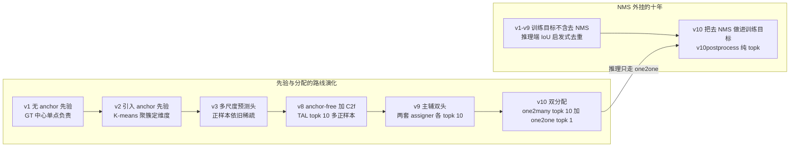
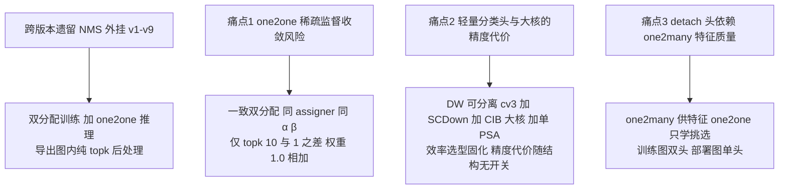

# YOLOv10 痛点追踪

YOLOv10（清华 THU-MIG，Ao Wang 等，论文 arXiv:2405.14447，2024-05-23；本站快照 THU-MIG/yolov10 @ 8d9f45a——「add yolov10」首发 commit，与论文同日；代码基线是 [ultralytics 8.1.34 fork](/versions/v8/code-walkthrough)，AGPL-3.0）的标题就是命题：**Real-Time End-to-End Object Detection**——把 [NMS](/glossary#nms-非极大值抑制) 从推理链路上摘掉。v1~v9 十代里 NMS 始终是训练完才挂上的推理后处理，v10 首次把「去 NMS」做进训练目标：[TAL](/glossary#tal-task-alignment-learning) 分配器复制成 topk=10 与 topk=1 两套，one2one 分支学会「无冗余输出」，推理只走这一支。本页先回看 v10 收掉的跨版本遗留痛点（NMS 外挂），再追踪它新引入的 3 个痛点，最后给出跨版本演化图。

## 跨版本遗留 NMS 外挂 — v10 的回应 (`pain-nms-external`)

> **v1~v9 读者路标**：NMS 阈值敏感从 [v1 痛点 4](/versions/v1/painpoints#_4-nms-阈值敏感-pain-nms-threshold-sensitive) 起（[v2 痛点 8](/versions/v2/painpoints#_8-nms-阈值敏感-遗留自-v1-pain-nms-threshold)、[v3 痛点 8](/versions/v3/painpoints#_8-nms-阈值敏感-遗留自-v1-pain-nms-sensitive) 一路遗留），到 [v9 痛点页的延续性表](/versions/v9/painpoints)里仍是「未回应，仍 greedy NMS」——这条线在 v10 第一次被正面处理。

**现象**：v1~v9 的检测训练目标里没有任何一项在学「少出重复框」。[多正样本](/glossary#multi-positive-多正样本)分配（TAL topk=10）天然让一个 GT 周围一片 anchor 都在预测几乎同一个框，去重完全压在推理末端的 NMS 上——v8 的推理链是 Detect 解码后接 non_max_suppression（见 [v8 源码走读](/versions/v8/code-walkthrough) 第 9-10 节），训练与推理之间隔着一个 IoU 启发式。部署侧的代价随之而来：NMS 是逐图、逐类、循环抑制的非规则计算，导出静态图时必须移出图外单独实现，batch 与动态形状下都难并行。

**原因**：多正样本分配与 NMS 是一体的——多正样本给足梯度，代价就是重复预测；改成单正样本能压重复，[v3 痛点 3](/versions/v3/painpoints#_3-gt-单-anchor-独占-正样本极度稀疏-pain-sparse-positives) 的稀疏监督问题立刻回来。这个两难在 v1~v9 靠「训练多正样本 + 推理 NMS」的组合绕开，去重从没进过训练目标。

**v10 解法**：双分配。同一个 TaskAlignedAssigner 类（<SrcLink file="v10:ultralytics/utils/tal.py" :line="13" :end="13" />）、同 α=0.5/β=6.0（<SrcLink file="v10:ultralytics/utils/loss.py" :line="166" :end="166" />），只差 topk——one2many 用 topk=10 维持 v8 式多正样本梯度（<SrcLink file="v10:ultralytics/utils/loss.py" :line="719" :end="719" />），one2one 用 topk=1 让每个 GT 只有对齐度量最高的 1 个 anchor 拿到正样本（<SrcLink file="v10:ultralytics/utils/loss.py" :line="720" :end="720" />），两分支损失等权 1.0 相加（<SrcLink file="v10:ultralytics/utils/loss.py" :line="727" :end="727" />）。推理只走 one2one（<SrcLink file="v10:ultralytics/models/yolov10/predict.py" :line="10" :end="10" />；<SrcLink file="v10:ultralytics/nn/modules/head.py" :line="517" :end="517" />），后处理 v10postprocess 是纯 topk——无 IoU、无 NMS（<SrcLink file="v10:ultralytics/utils/ops.py" :line="851" :end="864" />），导出时直接烘进计算图（<SrcLink file="v10:ultralytics/nn/modules/head.py" :line="522" :end="523" />；<SrcLink file="v10:ultralytics/engine/exporter.py" :line="232" :end="233" />）。

**遗留**：① 端到端只到「图内 topk」为止——Python 推理链仍保留 conf 阈值过滤（<SrcLink file="v10:ultralytics/models/yolov10/predict.py" :line="23" :end="23" />），评估链 top-max_det 候选全量进 mAP（<SrcLink file="v10:ultralytics/models/yolov10/val.py" :line="10" :end="20" />）；② one2one 头必须从头一起训，已训好的 v8/v9 权重不能靠换后处理升级成端到端；③ 训练图多一份 deepcopy 的检测头（<SrcLink file="v10:ultralytics/nn/modules/head.py" :line="508" :end="509" />），训练图与部署图的参数口径不同。

> **v11 路标**：v11 又把 v10 收掉的口子重新打开——v10Detect 换回 v8 的 Detect 单头、v10postprocess 换成 class-wise NMS、SCDown / C2fCIB / PSA 三件套全部撤回；骨干内瓶从 C2f 换成 C3k2、尾端从 PSA 换成 C2PSA；NMS 外挂这条系列最持久的痛点在 v10 收口后于 v11 又重新打开（见 [v11 痛点追踪](/versions/v11/painpoints)）。

## 3 个新痛点全景

> 已读过 [v9 痛点页](/versions/v9/painpoints)？v9 的痛点冲着梯度可靠性去，v10 的痛点全是「端到端化」的代价：为了摘掉 NMS，分配被拧成两套、分类头被砍瘦、梯度被 detach 隔离——每一步端到端化都在别处留下账单。

| 痛点 | 严重度 | 后续回应 |
| --- | --- | --- |
| [1. one2one 稀疏监督的收敛风险](#_1-one2one-稀疏监督的收敛风险-pain-one2one-sparse) | High | 一致双分配兜底：同 assigner 同 α β，只差 topk 10 与 1 |
| [2. 轻量分类头与大核的精度代价](#_2-轻量分类头与大核的精度代价-pain-efficiency-cost) | Medium | 效率选型固化进结构无开关；README 指标为唯一口径 |
| [3. detach 头依赖 one2many 特征质量](#_3-detach-头依赖-one2many-特征质量-pain-detach-ceiling) | High | one2many 供特征 one2one 学挑选；训练图双头部署图单头 |

> **v8/v9 路标**：v8 的 [TAL 超参敏感](/versions/v8/painpoints#_5-tal-超参敏感-topk-alpha-beta-pain-tal-hparams)在 v9 延续为[双 assigner 各一套 topk=10](/versions/v9/painpoints)；v10 变成 topk=10 与 topk=1 的不对称组合——分配敏感面没有缩小，只是两套分配的职责被彻底切开（见 [痛点 1](#_1-one2one-稀疏监督的收敛风险-pain-one2one-sparse)）。

## 1. one2one 稀疏监督的收敛风险 (`pain-one2one-sparse`)

> **v1~v9 读者路标**：[v3 痛点 3](/versions/v3/painpoints#_3-gt-单-anchor-独占-正样本极度稀疏-pain-sparse-positives)「GT 单 anchor 独占、正样本极度稀疏」曾是 TAL 多正样本要治的病；v10 在 one2one 分支上把 topk 拧回 1——同一种稀疏换了一副面孔回来，只是这次身后站着 one2many 兜底。

**现象**：topk=1 时每个 GT 只有对齐度量全场最高的 1 个 anchor 拿到正样本——select_topk_candidates 按 topk 取候选后逐 k scatter_add（<SrcLink file="v10:ultralytics/utils/tal.py" :line="145" :end="156" />），跨 GT 争抢同一 anchor 时由 select_highest_overlaps 归 IoU 最高者（<SrcLink file="v10:ultralytics/utils/tal.py" :line="232" :end="232" />）。正样本量比 one2many 少一个量级，one2one 头的 cls/box/dfl 监督信号天然稀薄，训练日志也多出 box_oo/cls_oo/dfl_oo 三项与之对应（<SrcLink file="v10:ultralytics/models/yolov10/train.py" :line="10" :end="10" />）。

**原因**：[TAL](/glossary#tal-task-alignment-learning) 的对齐度量 = 分类分数^α × [CIoU](/glossary#ciou-loss)^β（<SrcLink file="v10:ultralytics/utils/tal.py" :line="120" :end="120" />），训练早期两项都未训好——topk=10 靠「取前 10 名」摊平单点抖动，topk=1 等于把分配押在单点上，分配抖动直接传导为监督抖动。这是为「无冗余输出」付出的结构性代价：候选越少，越接近推理时「一框一物」的形态，但训练信号也越脆。

**v10 解法**：一致双分配（论文称 consistent dual assignments）在代码里就是三处取值——同一 TaskAlignedAssigner 类、同 α=0.5/β=6.0、只差 tal_topk 形参 10 vs 1（<SrcLink file="v10:ultralytics/utils/loss.py" :line="719" :end="720" />，形参入口在 <SrcLink file="v10:ultralytics/utils/loss.py" :line="150" :end="150" />）；one2many 分支按 v8 原配方给骨干/neck 供梯度，one2one 的损失以同权重 1.0 直接相加（<SrcLink file="v10:ultralytics/utils/loss.py" :line="727" :end="727" />）；外加 bias_init 给 one2one 分支预置先验——box bias 置 1.0、cls bias 置 log(5/nc/(640/s)²)（<SrcLink file="v10:ultralytics/nn/modules/head.py" :line="533" :end="535" />），让稀疏监督不必从冷启动开始。

**遗留**：快照里没有任何针对 one2one 的额外补偿——无独立损失权重、无 warmup 差异、无自适应 topk；稀疏监督的收敛风险由「双分支互相兜底」的整体设计吸收，one2one 单分支若被单独抽出训练，快照没有给出任何机制保证。本站按快照代码口径如实记录，不做收敛快慢的经验断言。

## 2. 轻量分类头与大核的精度代价 (`pain-efficiency-cost`)

> **v1~v9 读者路标**：v8 的 Detect 分类头是两层 dense 3×3（见 [v8 源码走读](/versions/v8/code-walkthrough) 第 9 节）；v10 的 v10Detect 把 cv3 重写成深度可分离三段，同时 backbone 换 SCDown、P5 换大核 CIB——论文的五项效率设计全部结构固化。

**现象**：v10Detect.__init__ 重写 cv3：`Conv(x,x,3,g=x)+Conv(x,c3,1)` → `Conv(c3,c3,3,g=c3)+Conv(c3,c3,1)` → `Conv2d(c3,nc,1)`（<SrcLink file="v10:ultralytics/nn/modules/head.py" :line="503" :end="506" />）——3×3 全换成 depthwise（分组数等于通道数），通道压缩交给 1×1；对照同快照基线 Detect 的 cv3 仍是两层 dense 3×3（<SrcLink file="v10:ultralytics/nn/modules/head.py" :line="42" :end="42" />）。yaml 侧配套三刀：P4/P5 下采样换 SCDown——1×1 降维接无激活 DW s2（<SrcLink file="v10:ultralytics/cfg/models/v10/yolov10n.yaml" :line="15" :end="17" />；实现 <SrcLink file="v10:ultralytics/nn/modules/block.py" :line="820" :end="827" />）；P5 融合换 C2fCIB 大核，CIB 的 lk=True 走 RepVGGDW 7×7（<SrcLink file="v10:ultralytics/cfg/models/v10/yolov10n.yaml" :line="38" :end="38" />；<SrcLink file="v10:ultralytics/nn/modules/block.py" :line="737" :end="758" />、<SrcLink file="v10:ultralytics/nn/modules/block.py" :line="702" :end="735" />）；SPPF 后仅放一个 PSA——只对一半通道做注意力（<SrcLink file="v10:ultralytics/cfg/models/v10/yolov10n.yaml" :line="20" :end="20" />；<SrcLink file="v10:ultralytics/nn/modules/block.py" :line="799" :end="818" />）。

**原因**：论文以「延迟-精度」为目标做秩引导的块选型——分类分支在推理里只是打分器，深度可分离足以承担；大核与注意力则只放在延迟占比最高的深层。注意秩引导块设计是论文级方法论，快照代码里没有对应模块（没有可选块清单与打分脚本），选型结果直接写死在 yaml 与头结构里。

**v10 解法**：效率选型固化进结构与配置，无需配置开关；训练图上 one2one 头是 one2many 的完整 deepcopy（<SrcLink file="v10:ultralytics/nn/modules/head.py" :line="508" :end="509" />），部署图只留一份——推理只走 one2one（<SrcLink file="v10:ultralytics/nn/modules/head.py" :line="516" :end="523" />）。

**遗留**：① 轻量化的精度代价没有开关可调——要精度只能换大档位，v10 特有 B 档 19.1M/92.0G/52.5% AP（README 口径，640 输入，T4 TRT FP16 batch1）；② 秩引导选块不可复算，复现实验只能整结构照搬；③ 跨代对比必须同口径——README 是快照唯一数字口径，论文正文另有复测延迟数字，两者存在差异，本站统一用 README 口径并注明。

## 3. detach 头依赖 one2many 特征质量 (`pain-detach-ceiling`)

> **v1~v9 读者路标**：v9 的辅助分支部署期要[手动裁剪](/versions/v9/painpoints#_7-dualddetect-推理仍输出双路-pain-dual-inference-output)；v10 的训练/推理分叉内建在头里——非 export 态才算 one2many（<SrcLink file="v10:ultralytics/nn/modules/head.py" :line="513" :end="514" />），部署图天然单路。代价转到了梯度侧。

**现象**：one2one 分支的输入被 detach：<SrcLink file="v10:ultralytics/nn/modules/head.py" :line="512" :end="512" /> `self.forward_feat([xi.detach() for xi in x], ...)`——one2one 头的损失梯度到 neck 特征处截断，不回传骨干与 neck；骨干/neck 的表征完全由 one2many 分支的损失塑形，one2one 分支只更新自己那套 one2one_cv2/one2one_cv3。

**原因**：同一份 neck 特征要伺候两种分配（topk=10 与 topk=1）。若不隔离，one2one 稀疏分配的梯度会按自己的偏好改写共享特征，与 one2many 的多正样本梯度互相拉扯；detach 把 one2one 头隔离成「消费方」，特征生产的责任全部交给 one2many。

**v10 解法**：职责分工——one2many 学「好特征」，one2one 只学「在这份特征上挑出无冗余的输出」；yaml 里只有一条 neck，头内双分支共享（<SrcLink file="v10:ultralytics/cfg/models/v10/yolov10n.yaml" :line="40" :end="40" />），部署图只走 one2one。

**遗留**：one2one 的精度上限被 one2many 的特征质量钉死——one2many 分支训不好，one2one 无力回天；快照不提供「冻结 one2many 只调 one2one」或「one2one 单独微调」的接口；训练图参数含双头 deepcopy（<SrcLink file="v10:ultralytics/nn/modules/head.py" :line="508" :end="509" />），与部署图口径不同——这是端到端改造在参数账上的固定税（对照上方「跨版本遗留 NMS 外挂」一节的遗留 ③）。

## 跨版本痛点演化与谱系图

> **v1~v9 读者路标**：演化图把 v1~v10 的分配路线与 NMS 外挂两条线并排画——读过 [v9 痛点页](/versions/v9/painpoints) 的读者可以把 v9 行当作 v10 的直接前像；谱系图只收 v10 的 1 个跨版本遗留与 3 个新痛点。

### 新痛点谱系图

## 延伸阅读

- [YOLOv10 源码走读](/versions/v10/code-walkthrough) — 本页痛点对应的调用链证据
- [YOLOv10 nn/modules/head.py 源码页](/versions/v10/source/head-py) — v10Detect 双分支逐行
- [YOLOv10 utils/loss.py 源码页](/versions/v10/source/loss-py) — v10DetectLoss 与双分配
- [YOLOv10 utils/tal.py 源码页](/versions/v10/source/tal-py) — topk=1 分配的代码细节
- [YOLOv8 痛点追踪](/versions/v8/painpoints) — 工程化默认的代价（上文）
- [YOLOv9 痛点追踪](/versions/v9/painpoints) — v1-v8 全谱系延续表（上文）
- [YOLOv11 痛点追踪](/versions/v11/painpoints) — 下代把 v10 的「去 NMS + 双头」整套撤回
- [YOLOv12 痛点追踪](/versions/v12/painpoints) — 再下代延续 NMS 单头、把注意力搬进骨干的新代价
- [术语表](/glossary) — TAL、DFL、NMS、multi-positive 等术语索引
