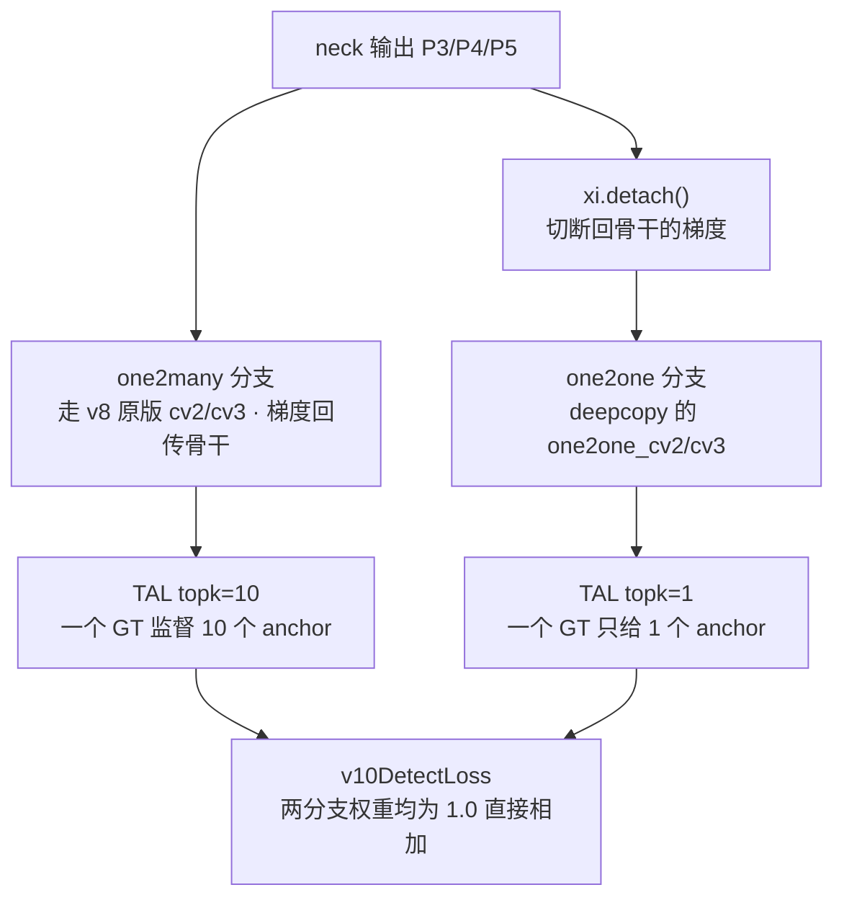
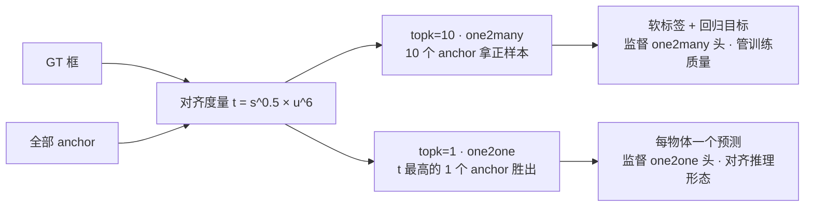
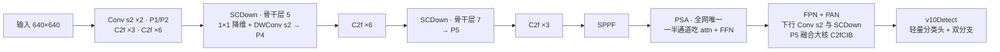

# YOLOv10 论文精读

> **arXiv:2405.14447《YOLOv10: Real-Time End-to-End Object Detection》（2024-05-23）**
> 作者：清华大学 THU-MIG——Ao Wang、Hui Chen、Lihao Liu、Kai Chen、Zijia Lin、Jungong Han、Guiguang Ding。
> 快照取自 [THU-MIG/yolov10](https://github.com/THU-MIG/yolov10) @ `8d9f45a`——论文日首发的「add yolov10」commit（586 文件），基线是 **ultralytics 8.1.34 fork**<SrcLink file="v10:ultralytics/__init__.py" :line="3" />。
> 本页按论文叙事精读：动机 → 一致双分配 → 无 NMS 推理 → 效率-精度驱动设计 → 实验 → 批判性评述，每个机制都对照快照源码定位「论文说法 ↔ 代码事实」。

## 1. Motivation：NMS 是延迟瓶颈，一对多分配是冗余之源

论文开篇点出 YOLO 系的两个老问题，一个在部署侧，一个在训练侧：

1. **NMS 拖累端到端部署**：README 摘要原文——"the reliance on the non-maximum suppression (NMS) for post-processing hampers the end-to-end deployment of YOLOs and adversely impacts the inference latency"。[NMS](/glossary#nms-非极大值抑制) 是部署链路里网络之外的串行后处理：带 [IoU](/glossary#iou-交并比) 阈值等超参、难以与网络一起优化、在端侧导出图里往往要靠特殊算子或 CPU 分支兜底；
2. **一对多分配制造冗余预测**：v8 的 [TAL](/glossary#tal-task-alignment-learning) 用 topk=10——一个 GT 给多个 anchor 当正样本。这正是训练稳定、精度高的原因，但也注定推理时同一物体会冒出一堆高重叠框，必须靠 NMS 收口。「分配策略」与「后处理需求」是一体两面：**要删 NMS，得先改分配**；
3. **直接改一对一也不行**：论文指出直接用一对一分配训练（每个 GT 只给一个正样本）会显著掉精度——监督信号太稀疏。于是有了本文的核心设计：**一对多与一对一两个分支同时训练，推理只用一对一**。

一句话：v8 回答「怎么把头做轻」，v10 追问「**推理为什么非得要 NMS**」——答案不在推理端，而在训练期的标签分配。

> **v1~v9 读者路标**：NMS 从 v1 起就是 YOLO 的固定收口（见 [NMS 术语](/glossary#nms-非极大值抑制)）；v8 的 TAL topk=10 出厂默认见 [v8 TAL 概念](/versions/v8/concepts#_3-tal-任务对齐标签分配-concept-tal)——v10 要动的正是这个 10。

## 2. 一致性双分配：一个 GT，两种监督

这是论文的方法核心（consistent dual assignments for NMS-free training）。快照代码里它的全部实现，是把同一个分配器实例化两次：

$$ t = s^{\alpha} \cdot u^{\beta}, \qquad \alpha = 0.5,\ \ \beta = 6.0 $$

其中 $s$ 是该 anchor 对 GT 类别的分类分数、$u$ 是预测框与 GT 的 [CIoU](/glossary#ciou-loss)。快照的 `get_box_metrics` 一行就是它：`align_metric = bbox_scores.pow(self.alpha) * overlaps.pow(self.beta)`<SrcLink file="v10:ultralytics/utils/tal.py" :line="102" :end="121" />。

- **同一分配器、同一超参、只差 topk**：`v10DetectLoss` 持有 `v8DetectionLoss(model, tal_topk=10)` 与 `v8DetectionLoss(model, tal_topk=1)` 两个实例<SrcLink file="v10:ultralytics/utils/loss.py" :line="717" :end="727" />；分配器构造在同一行——`TaskAlignedAssigner(topk=tal_topk, num_classes=self.nc, alpha=0.5, beta=6.0)`<SrcLink file="v10:ultralytics/utils/loss.py" :line="166" />。「一致性」在代码里的含义就是：**两分支用完全相同的对齐度量排序，只是一个取前 10、一个取前 1**；
- **topk=1 的实现**：`select_topk_candidates` 里 topk=1 时每个 GT 只有对齐度量最高的 1 个 anchor 通过 `count_tensor` scatter_add 拿到正样本<SrcLink file="v10:ultralytics/utils/tal.py" :line="127" :end="161" />——一对一分配没有「同 GT 多框」的冗余，推理自然不需要 NMS 去重；
- **两分支损失等权相加**：`__call__` 返回 `loss_one2many[0] + loss_one2one[0]`，loss items 拼接上报——**两分支权重均为 1.0，没有任何加权 trick**；
- **one2one 分支不回传骨干**（快照独有的代码事实）：`one2one = self.forward_feat([xi.detach() for xi in x], ...)`<SrcLink file="v10:ultralytics/nn/modules/head.py" :line="512" />——one2one 分支的损失梯度只更新自己这份头权重，不流回 neck/骨干；骨干与 neck 由 one2many 分支驱动训练。「一致双分配」在实现上是「**one2many 分支负责塑造特征，one2one 头在同源特征上搭车训练**」；
- **头是完整复制 + bias 覆写**：`one2one_cv2/one2one_cv3 = copy.deepcopy(cv2/cv3)`<SrcLink file="v10:ultralytics/nn/modules/head.py" :line="508" :end="509" />；`bias_init` 对 one2one 分支单独初始化（box bias=1.0、cls bias=$\log(5/n_c/(640/s)^2)$）<SrcLink file="v10:ultralytics/nn/modules/head.py" :line="527" :end="535" />。

> **论文说法 ↔ 代码事实**：论文把这叫「consistent dual assignments / consistent matching metric」，听起来是个新组件；快照里它就是**同一个 `TaskAlignedAssigner` 实例化两次（10 与 1）**——没有新类、没有新文件，创新在「同时训两个头」的训练策略与「推理用哪个头」的取舍。

> **v1~v9 读者路标**：v7 的 coarse-to-fine 双头也是「一个 GT 两种正样本」（lead 细 / aux 粗，见 [v7 损失](/versions/v7/losses)），v9 的主辅双头各做一次 topk=10 分配（见 [v9 双头概念](/versions/v9/concepts#_7-dualddetect-双头解耦-concept-dual-ddetect)）——它们的双头都服务于训练；v10 第一次让第二个头直接定义推理形态。

## 3. 无 NMS 推理：部署图里没有 NMS 算子

one2one 分支让「每物体一个框」在训练期就成立，推理端于是可以把 NMS 换成一次确定性 topk 截断：

$$ \text{labels} = \text{index} \bmod n_c $$

`v10postprocess` 全程无 [IoU](/glossary#iou-交并比)、无 NMS<SrcLink file="v10:ultralytics/utils/ops.py" :line="851" :end="864" />：把 4+nc 维预测拆成 boxes/scores → `max_scores = scores.amax(-1)` 取最高类分 → `topk(max_det)` 选出前 max_det 个候选 → flatten(box, cls) 再 topk 一次 → `labels = index % nc` 反解类别、`index // nc` 反解框。**排序即过滤**——没有重叠度判断，只有一个「取前 max_det」的硬截断。

- **三态 forward**：训练返回 `{one2many, one2one}` 双分支；eval 非 export 时同样返回 dict；**export 时直接 `cat([boxes, scores, labels])`**——导出图里根本没有 NMS 节点<SrcLink file="v10:ultralytics/nn/modules/head.py" :line="516" :end="523" />；
- **max_det 是导出期注入的**：`v10Detect.max_det` 默认 -1<SrcLink file="v10:ultralytics/nn/modules/head.py" :line="499" />，exporter 导出时写入 `m.max_det = self.args.max_det`（默认 300）<SrcLink file="v10:ultralytics/engine/exporter.py" :line="232" :end="233" />——跳过 exporter 直接导出会触发 assert；
- **predict 链**：取 `preds["one2one"]` → `v10postprocess` → **只做 conf 阈值过滤**<SrcLink file="v10:ultralytics/models/yolov10/predict.py" :line="8" :end="27" />——v8 时代的 NMS 调用整个消失；
- **val 链更激进**：`v10postprocess` 之后**直接返回，无 conf 阈值、无 NMS**<SrcLink file="v10:ultralytics/models/yolov10/val.py" :line="10" :end="20" />——top-100 全进 COCO [mAP](/glossary#map-mean-average-precision) 评估，分数排序完全交给 one2one 头自己；
- **训练配方零新增**：增强管线（Mosaic/MixUp/Perspective/HSV/Flip/LetterBox/CopyPaste）、损失增益（box 7.5 / cls 0.5 / dfl 1.5）、close_mosaic 全部与 v8.1.34 相同<SrcLink file="v10:ultralytics/cfg/default.yaml" :line="97" :end="99" />——v10 的「端到端」不靠训练 trick，靠分配与结构。

> **v1~v9 读者路标**：v8 读者的 NMS 调用链是 `non_max_suppression`（见 [v8 架构](/versions/v8/architecture)收口段）——v10 把它换成 `v10postprocess`；部署侧从「NMS 算子 + IoU 阈值调参」变成「一次 topk」，这就是「端到端」三个字的实际分量。

## 4. 效率-精度驱动设计：四项改造 + 一个方法论

论文第二个主张是「从效率与精度两个视角全面审视 YOLO 各组件的计算冗余」。落到快照代码，是四个可定位的模块加一个纯方法论：

1. **轻量分类头（lightweight classification head）**：v8 基类 Detect 的 cv3 是两个全 3×3 卷积加 1×1 出口<SrcLink file="v10:ultralytics/nn/modules/head.py" :line="42" />；v10 重写为两段 depthwise-separable——`Conv(x, x, 3, g=x) + Conv(x, c3, 1)` 与 `Conv(c3, c3, 3, g=c3) + Conv(c3, c3, 1)`，出口不变<SrcLink file="v10:ultralytics/nn/modules/head.py" :line="503" :end="506" />。通道宽度公式 `c3 = max(ch[0], min(nc, 100))` 与 v8 相同——**变轻的是卷积形态**（3×3 全卷积 → 深度卷积 + 逐点卷积）：分类头是检测头的 FLOPs 大头，这里省得最狠；
2. **SCDown 空间-通道解耦下采样（spatial-channel decoupled downsampling）**：先 1×1 s1 把通道从 c1 压到 c2，再 DWConv k×k s2 做空间下采样（无激活）<SrcLink file="v10:ultralytics/nn/modules/block.py" :line="820" :end="827" />。v8 的下采样是单发 3×3 s2 全卷积——通道压缩与空间压缩耦合在一起；解耦后两者各干各的，参数与 FLOPs 双降。落点：骨干 P4/P5（层 5/7）与 neck 下行 P4→P5<SrcLink file="v10:ultralytics/cfg/models/v10/yolov10n.yaml" :line="15" :end="17" />；P3 级下采样与 neck P3→P4 仍是普通 Conv；
3. **CIB 与大核颈（compact inverted blocks + large kernel）**：CIB 把 Bottleneck 的卷积串重排为「DWConv3×3 → 1×1 升维 → DWConv 或 RepVGGDW → 1×1 → DWConv3×3」的倒置结构，残差相加，`lk=True` 时中段启用 RepVGGDW<SrcLink file="v10:ultralytics/nn/modules/block.py" :line="737" :end="758" />。RepVGGDW 是「7×7 与 3×3 两条深度卷积分支并行相加」的重参数化块，部署前把 3×3 分支 pad 融合进 7×7 单分支<SrcLink file="v10:ultralytics/nn/modules/block.py" :line="702" :end="735" />——[RepVGG](/glossary#repvgg-结构重参数化) 思想在 v6 之后重新登场；`C2fCIB` 把 [C2f](/glossary#c2f) 的内瓶整体换成 CIB<SrcLink file="v10:ultralytics/nn/modules/block.py" :line="760" :end="768" />。落点收敛在 neck 最深处：P5 融合用 `C2fCIB [1024, True, True]`（shortcut 与大核全开）<SrcLink file="v10:ultralytics/cfg/models/v10/yolov10n.yaml" :line="38" />——深层分辨率最低，大核的延迟代价最小；
4. **PSA 部分自注意力（partial self-attention）**：`PSA` 先用 cv1 把通道劈两半，只有一半走 Attention + FFN，另一半直通，最后 concat 过 cv2<SrcLink file="v10:ultralytics/nn/modules/block.py" :line="799" :end="818" />。Attention 本身也做减法：qkv 用一个 1×1 合并出、key_dim 取 head_dim 的一半（`attn_ratio=0.5`）、位置编码用 3×3 深度卷积、`num_heads = c // 64`<SrcLink file="v10:ultralytics/nn/modules/block.py" :line="771" :end="797" />：

$$ \text{attn} = \text{softmax}\left( (Q^{\top} K) \cdot d_k^{-1/2} \right) $$

（代码实现是转置形式 `q.transpose(-2, -1) @ k`，数学上就是缩放点积注意力。）落点极克制：**整个网络只在 SPPF 之后放 1 个 PSA**<SrcLink file="v10:ultralytics/cfg/models/v10/yolov10n.yaml" :line="20" />——最深层 20×20 的 token 数最少，注意力开销可控；

5. **秩引导块设计（rank-guided block design）——纯论文方法论**：论文用「优化误差与延迟的一致性」指标衡量各层特征的「秩」，据此决定每层用便宜还是昂贵的块（深度可分离还是全卷积、是否大核）。**这条在快照里没有对应模块或脚本**——它是「设计方法」，不是「代码组件」：yaml 里只看得到结果（哪层放 SCDown、哪层放 C2fCIB），看不到决策过程。读代码时不要去找一个叫 rank 的东西。

> **v1~v9 读者路标**：四项设计没有一个凭空发明——轻量分类头延续了 v6 [EffiDeHead](/glossary#effidehead) 起的解耦轻量思路，「只吃一半通道」的 PSA 是 [CSP](/glossary#csp-跨阶段部分连接) 式的拆半做法，大核深度卷积配 [RepVGG](/glossary#repvgg-结构重参数化) 重参数化——v10 的贡献在于**用统一的效率-精度视角把它们放到对的层位**。

## 5. 实验结果：README 快照口径

**COCO val，输入 640，延迟为 T4 TensorRT FP16、batch 1（README 表口径）**

| 模型 | #Params | FLOPs | APval | Latency |
|------|---------|-------|------------------|---------|
| YOLOv10-N | 2.3M | 6.7G | 38.5% | 1.84ms |
| YOLOv10-S | 7.2M | 21.6G | 46.3% | 2.49ms |
| YOLOv10-M | 15.4M | 59.1G | 51.1% | 4.74ms |
| YOLOv10-B | 19.1M | 92.0G | 52.5% | 5.74ms |
| YOLOv10-L | 24.4M | 120.3G | 53.2% | 7.28ms |
| YOLOv10-X | 29.5M | 160.4G | 54.4% | 10.70ms |

- **B 档是 v10 特有**：v8 只有 n/s/m/l/x，v10 在 m 与 l 之间插入 b 档；六个 yaml 各带独立 scales 块（n 档 `[0.33, 0.25, 1024]`、b 档 `[1.00, 1.00, 1024]`）<SrcLink file="v10:ultralytics/cfg/models/v10/yolov10n.yaml" :line="3" :end="5" />；
- README 摘要的横向对比（摘要口径）：同 AP 下 **v10-S 比 RT-DETR-R18 快 1.8×、参数与 FLOPs 小 2.8×**；同性能下 **v10-B 比 v9-C 延迟低 46%、参数少 25%**；
- **口径差异声明**：论文正文另有复测延迟数字（如 N 档 1.56ms），与 README 表的 1.84ms 并不一致——本站以快照 README 为准，跨版本比较时只比同口径列；
- **没有训练 trick 的成绩单**：v10 的增益不来自训练配方（与 v8 完全一致），而来自「双分配训练 + one2one 推理 + 效率设计」三件事——这类改动可以原样叠加在任何 v8 式训练管线上；
- **评估链的激进取舍**：val 不做 conf 过滤，top-100 全进 COCO 评估<SrcLink file="v10:ultralytics/models/yolov10/val.py" :line="10" :end="20" />——mAP 的每一个候选都来自 one2one 头自己的排序，而不是「NMS 兜底 + conf 过滤」的组合。

> **v1~v9 读者路标**：v9 读者注意——v10-B 对 v9-C 的「延迟低 46%、参数少 25%（同性能）」是 README 摘要口径的论文叙事，v9 README 未给延迟列，跨论文数字只能当方向参考；v8 读者可拿本表与 [v8 指标表](/versions/v8/index)比参数量与 AP，延迟列环境不同勿直比。

## 6. 局限与批判性评述

快照给了我们比论文更诚实的视角，逐条列出：

1. **one2one 头是「搭车训练」**：`xi.detach()` 意味着一对一分支从不参与骨干与 neck 的优化<SrcLink file="v10:ultralytics/nn/modules/head.py" :line="512" />——「一致双分配」的一致性只存在于分配器超参层面，两个头并不联合塑造特征。one2one 头的精度上限受限于 one2many 分支学出的表征；
2. **导出路径有暗桩**：`v10Detect.max_det` 默认 -1<SrcLink file="v10:ultralytics/nn/modules/head.py" :line="499" />，不走 exporter 注入就导出会触发 `assert(self.max_det != -1)`——部署脚本必须走官方 export 流程<SrcLink file="v10:ultralytics/engine/exporter.py" :line="232" :end="233" />；
3. **秩引导设计不可复现于代码**：论文宣称的「秩引导块设计」没有留下任何脚本、指标实现或中间产物——想验证「哪层该放哪种块」只能信 yaml 的最终结果，方法论本身不可检验；
4. **指标口径有两套**：README 表（T4 TRT FP16）与论文正文复测延迟（N 档 1.56ms 等）不一致，对外引用务必注明口径——本站统一 README 快照口径；
5. **top-100 硬截断的分布依赖**：`v10postprocess` 没有 IoU 兜底<SrcLink file="v10:ultralytics/utils/ops.py" :line="851" :end="864" />，密集重叠场景下「每物体一框」的假设是否成立，依赖 one2one 头的分数校准——换数据集分布时值得单独验证；
6. **沿用 AGPL-3.0**：v10 fork 自 ultralytics，许可证一并继承——商用闭源仍受双轨约束，选型清单第一行照旧是许可证（背景见 [v8 论文精读 · 许可证](/versions/v8/paper)）。

详见[痛点追踪](/versions/v10/painpoints)。

> **v1~v9 读者路标**：v8 痛点表里「无论文、指标口径混杂」两条在 v10 以「有论文 + 双口径」的方式部分复发——历史问题会换形态回归，见 [v8 痛点追踪](/versions/v8/painpoints)。

## 延伸阅读

- [损失函数：双分支 TAL 与损失相加](/versions/v10/losses)
- [Architecture 逐层图解](/versions/v10/architecture)
- [理论 Concept](/versions/v10/concepts)
- [源码页：head.py](/versions/v10/source/head-py) · [loss.py](/versions/v10/source/loss-py) · [tal.py](/versions/v10/source/tal-py) · [yolov10n.yaml](/versions/v10/source/yolov10-yaml)
- [v8 论文精读（以代码为论文）](/versions/v8/paper) · [v9 论文精读](/versions/v9/paper)
- [系列家族对照](/global/family) · [术语表](/glossary)
- 论文入口：[arXiv:2405.14447](https://arxiv.org/abs/2405.14447) · [THU-MIG/yolov10](https://github.com/THU-MIG/yolov10)
