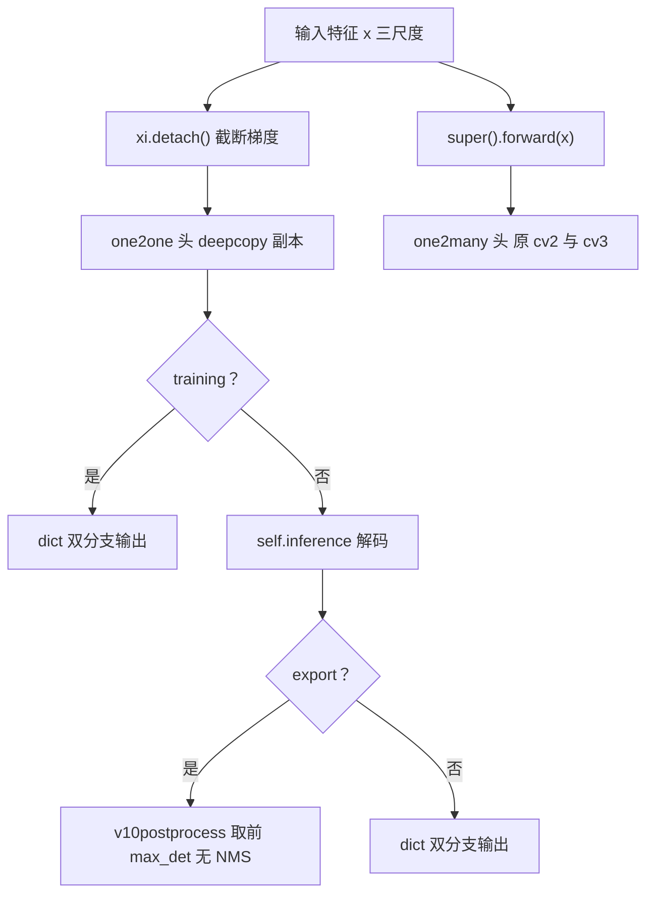

# ultralytics/nn/modules/head.py

YOLOv10 的检测头仓库：**前 495 行是 ultralytics 8.1.34 基线的全部头类（Detect/Segment/OBB/Pose/Classify/WorldDetect/RTDETRDecoder），文件末尾追加 39 行的 `v10Detect`**——one2one 双分支、轻量分类头、`detach` 梯度隔离与无 NMS 导出路径全在这 39 行里，是「端到端检测」在代码上的落点。

> 快照路径：`source/yolov10/snapshot/ultralytics/nn/modules/head.py`（535 行）。点击左侧行号可复制/分享行锚点。

**这个文件在 v10 里的角色**：v10 首发对这个文件的全部改动就是末尾新增一个类。`v10Detect(Detect)` 继承 v8 检测头的全部底座（anchor-free 网格中心回归、[DFL](/glossary#dfl-distribution-focal-loss) 分布表示），在此之上做四件事：

1. **轻量分类头**：把分类分支 `cv3` 的两个全 3×3 卷积换成两段 depthwise-separable（深度卷积 + 1×1）；
2. **one2one 分支**：`copy.deepcopy` 整份复制 cv2/cv3，得到一个权重独立、结构相同的「一对一」头；
3. **双分支 forward**：同时输出 one2many / one2one 两套预测——one2many 照走 v8 老路驱动骨干训练，one2one 的输入被 `xi.detach()` 掐断梯度，只训练头自身；
4. **无 [NMS](/glossary#nms-非极大值抑制) 导出**：导出图里用 `ops.v10postprocess` 两次 top-k 直接选出 max_det 个框。

其余任务头（Segment/OBB/Pose 等）原样保留，v10 论文不涉及。

## 关键行段速查

| 行段 | 内容 | 看点 |
|------|------|------|
| <SrcLink file="v10:ultralytics/nn/modules/head.py" :line="21" :end="101" /> | Detect 基类 | v10 双分支的全部底座，与 8.1.34 基线逐行同源 |
| <SrcLink file="v10:ultralytics/nn/modules/head.py" :line="30" :end="43" /> | Detect.__init__ | L38 通道公式 c2/c3——c3 与 v8 完全一致，v10 没动宽度 |
| <SrcLink file="v10:ultralytics/nn/modules/head.py" :line="45" :end="71" /> | Detect.inference | make_anchors → split → dist2bbox 解码一条龙 |
| <SrcLink file="v10:ultralytics/nn/modules/head.py" :line="73" :end="77" /> | forward_feat | 逐层 cat cv2/cv3；v10Detect 用它跑自己的头 |
| <SrcLink file="v10:ultralytics/nn/modules/head.py" :line="88" :end="95" /> | Detect.bias_init | box bias=1.0、cls bias=log(5/nc/(640/s)²) |
| <SrcLink file="v10:ultralytics/nn/modules/head.py" :line="97" :end="101" /> | decode_bboxes | 导出时 xywh=False、推理 xywh=True |
| <SrcLink file="v10:ultralytics/nn/modules/head.py" :line="497" :end="535" /> | **v10Detect 全类** | v10 在本文件的唯一增量 |
| <SrcLink file="v10:ultralytics/nn/modules/head.py" :line="499" /> | max_det = -1 | 类属性；导出时由 exporter 注入 args.max_det |
| <SrcLink file="v10:ultralytics/nn/modules/head.py" :line="503" :end="506" /> | 轻量分类头 cv3 | 两段 depthwise-separable 替换两个全 3×3 |
| <SrcLink file="v10:ultralytics/nn/modules/head.py" :line="508" :end="509" /> | one2one deepcopy | 整份复制 cv2/cv3，权重独立 |
| <SrcLink file="v10:ultralytics/nn/modules/head.py" :line="511" :end="525" /> | forward 双分支 | L512 detach 梯度隔离；L520-523 导出走 v10postprocess |
| <SrcLink file="v10:ultralytics/nn/modules/head.py" :line="527" :end="535" /> | bias_init 覆写 | 先跑基类，再对 one2one 分支同款初始化 |

<SourceViewer file="v10:ultralytics/nn/modules/head.py" />

## Detect 基类（L21-101）：双分支的底座

- **类属性**<SrcLink file="v10:ultralytics/nn/modules/head.py" :line="24" :end="28" />：`dynamic`/`export`/`shape`/`anchors`/`strides` 挂在类上做缓存——网格锚点只在输入尺寸变化时重算。
- **__init__**<SrcLink file="v10:ultralytics/nn/modules/head.py" :line="30" :end="43" />：L35 `reg_max = 16`（DFL 每边 16 个 bin）；L36 每锚点输出数 `no = nc + 4×reg_max`；L38 `c2, c3 = max((16, ch[0] // 4, reg_max*4)), max(ch[0], min(nc, 100))`——**注意 c3 公式与 v8 一字不差**，v10 的「轻量」不改通道宽度、只改卷积结构；L39-41 回归分支 cv2；L42 分类分支 cv3（两个全 3×3 + 1×1）；L43 挂 DFL 模块。
- **inference**<SrcLink file="v10:ultralytics/nn/modules/head.py" :line="45" :end="71" />：L48 把三尺度特征拉平拼接 → L50 `make_anchors` 生成网格 → L57 按通道 split 出 box/cls → L68 `decode_bboxes` 解码 → L70 与 sigmoid 分类分拼接。L53-68 那几段 `self.export and self.format in (...)` 全是给 TF/TFLite 等后端兜底的兼容分支，读的时候可以跳过。
- **forward_feat**<SrcLink file="v10:ultralytics/nn/modules/head.py" :line="73" :end="77" />：逐层 `torch.cat((cv2[i](x[i]), cv3[i](x[i])), 1)`。8.1.34 基线把这段从 forward 里拆成独立方法，正是为了让 v10Detect 能拿自己的 one2one 头复用同一份循环（见 L512）。
- **forward**<SrcLink file="v10:ultralytics/nn/modules/head.py" :line="79" :end="86" />：训练态直接返回逐层原始输出，推理态走 `inference()`；**bias_init**<SrcLink file="v10:ultralytics/nn/modules/head.py" :line="88" :end="95" />：box 通道 bias 置 1.0、分类 bias 置 `log(5 / nc / (640/s)²)`——让训练初期每格先验约 0.01 个目标；**decode_bboxes**<SrcLink file="v10:ultralytics/nn/modules/head.py" :line="97" :end="101" />：导出走 xyxy、推理走 xywh。

## v10Detect（L497-535）：39 行的全部增量

### max_det 与轻量分类头（L499-506）

- <SrcLink file="v10:ultralytics/nn/modules/head.py" :line="499" /> `max_det = -1`：哨兵默认值。训练/推理用不到它，只有导出时由 `engine/exporter.py` L232-233 把 `args.max_det`（默认 300）注入，L521 的 `assert(self.max_det != -1)` 就是防呆。
- <SrcLink file="v10:ultralytics/nn/modules/head.py" :line="503" :end="506" /> 先跑 `super().__init__` 造出 v8 原版 cv2/cv3，然后**立刻重写 cv3**：对每个尺度 `x`，分类头变成三段——`Conv(x, x, 3, g=x) + Conv(x, c3, 1)` → `Conv(c3, c3, 3, g=c3) + Conv(c3, c3, 1)` → `Conv2d(c3, nc, 1)`。对比基线 L42 的「两个全 3×3 + 1×1」，两组 3×3 都换成「深度卷积 + 逐点卷积」的可分离对，参数量大幅下降；回归分支 cv2 原样保留。

### one2one 分支（L508-509）

<SrcLink file="v10:ultralytics/nn/modules/head.py" :line="508" :end="509" /> `one2one_cv2/one2one_cv3 = copy.deepcopy(self.cv2/self.cv3)`：一对一头是 one2many 头的**完整复制**——不共享权重、独立初始化、独立训练。deepcopy 发生在 cv3 重写之后，所以 one2one 头复制的已经是轻量版。

### forward 双分支（L511-525）

- <SrcLink file="v10:ultralytics/nn/modules/head.py" :line="512" /> `one2one = self.forward_feat([xi.detach() for xi in x], ...)`：**detach 是整个 v10 训练设计里最关键的一行**——one2one 分支的损失梯度只更新这一份头权重，不流回 neck/骨干；骨干与 neck 完全由 one2many 分支塑造。
- <SrcLink file="v10:ultralytics/nn/modules/head.py" :line="513" :end="514" /> 非 export 时 `one2many = super().forward(x)`，原封不动走基类路径（含推理解码）。
- <SrcLink file="v10:ultralytics/nn/modules/head.py" :line="516" :end="525" /> 三种形态：训练态返回 `{"one2many": ..., "one2one": ...}` 字典（两套逐层原始输出）；普通推理态 one2one 过 `self.inference()` 后同样以字典返回（predict 取 `one2one` 键）；导出态走 `ops.v10postprocess(one2one.permute(0, 2, 1), self.max_det)`，输出 `cat([boxes, scores, labels])` 共 6 列——**导出计算图里没有 NMS 算子**。

### bias_init（L527-535）

<SrcLink file="v10:ultralytics/nn/modules/head.py" :line="527" :end="535" /> 先 `super().bias_init()` 初始化 one2many 分支，再用同款公式遍历 `one2one_cv2/one2one_cv3`：box bias=1.0、cls bias=`log(5 / nc / (640/s)²)`。两个分支拿同一套先验，对应论文里「一致双分配」的一致性起点。

## 与 v8 Detect 的对比

| 维度 | v8 Detect（本文件 L21-101） | v10 v10Detect（L497-535） |
|------|------------------------------|----------------------------|
| 分类头结构 | 两个全 3×3 Conv + 1×1（L42） | 两段 depthwise-separable（L504-506） |
| 通道公式 c3 | `max(ch[0], min(nc, 100))` | 同款，未改（L503） |
| 输出 | 单套预测 | one2many + one2one 双套（dict） |
| 权重 | 一份 cv2/cv3 | deepcopy 双份，互不共享（L508-509） |
| 梯度 | 全图回传 | one2one 输入 detach，不回传骨干/neck（L512） |
| 导出后处理 | 计算图外的 NMS | 图内 v10postprocess 两次 top-k（L520-523） |
| bias_init | 一遍（L88-95） | 基类一遍 + one2one 一遍（L527-535） |

分配与损失侧的配合见 [loss.py 源码页](/versions/v10/source/loss-py)（v10DetectLoss 双实例化）与 [tal.py 源码页](/versions/v10/source/tal-py)（topk=10/1）；结构逐层拆解见 [layers](/versions/v10/layers)，yaml 接线见 [yolov10n.yaml 源码页](/versions/v10/source/yolov10-yaml)，端到端推理链见 [code-walkthrough](/versions/v10/code-walkthrough)。`ops.v10postprocess`（utils/ops.py L851-864）与导出注入（engine/exporter.py L232-233）未设站内页，SrcLink 会回退 GitHub 快照外链。
