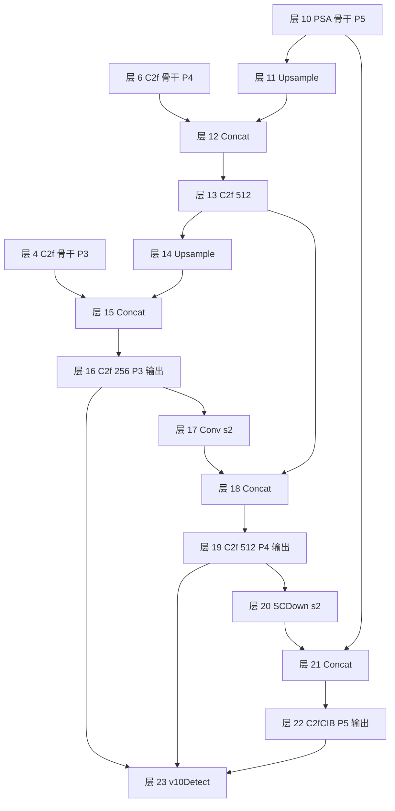

# ultralytics/cfg/models/v10/yolov10n.yaml

v10 最小档（n）的结构清单：**40 行 yaml，与 v8 的 yolov8.yaml 骨架高度同源**——[C2f](/glossary#c2f) 骨干、[FPN](/glossary#fpn-特征金字塔)/[PANet](/glossary#panet-路径聚合网络) 双向融合、三尺度检测头全部照搬，只做了六处替换：骨干两处 SCDown 下采样、SPPF 后一个 PSA、P5 的 C2fCIB 大核块、neck 回程一处 SCDown、末行 v10Detect 双分支头。

> 快照路径：`source/yolov10/snapshot/ultralytics/cfg/models/v10/yolov10n.yaml`（40 行）。点击左侧行号可复制/分享行锚点。

**这个文件在 v10 里的角色**：v10 没有共享的 `yolov10.yaml + scale` 机制——六个档位（n/s/m/b/l/x）各写一份独立 yaml，且**每份自带 `scales:` 块**（v10 还新增了 v8 没有的 b 档）；`yaml_model_load` 对路径含 "v10" 的模型不做 `yolov10b → yolov10` 归并（nn/tasks.py L955-958）。n 档 README 快照口径：2.3M 参数 / 6.7 GFLOPs / 38.5% AP / 1.84ms（T4 TRT FP16 batch1）。

## 关键行段速查

| 行段 | 内容 | 看点 |
|------|------|------|
| <SrcLink file="v10:ultralytics/cfg/models/v10/yolov10n.yaml" :line="2" /> | nc: 80 | 类别数 |
| <SrcLink file="v10:ultralytics/cfg/models/v10/yolov10n.yaml" :line="3" :end="5" /> | scales | n 档 `[depth=0.33, width=0.25, max_channels=1024]` |
| <SrcLink file="v10:ultralytics/cfg/models/v10/yolov10n.yaml" :line="10" :end="20" /> | backbone | 层 0-10：Conv/C2f 骨架 + 两处 SCDown + SPPF + PSA |
| <SrcLink file="v10:ultralytics/cfg/models/v10/yolov10n.yaml" :line="15" /> | 层 5 SCDown | P4 下采样：1×1 降维 → DW 3×3 s2 |
| <SrcLink file="v10:ultralytics/cfg/models/v10/yolov10n.yaml" :line="17" /> | 层 7 SCDown | P5 下采样，同上 |
| <SrcLink file="v10:ultralytics/cfg/models/v10/yolov10n.yaml" :line="19" /> | 层 9 SPPF | 与 v8 一字不差 |
| <SrcLink file="v10:ultralytics/cfg/models/v10/yolov10n.yaml" :line="20" /> | 层 10 PSA | 部分自注意力，**全网仅此一处** |
| <SrcLink file="v10:ultralytics/cfg/models/v10/yolov10n.yaml" :line="24" :end="38" /> | head | 层 11-22：v8 同款 PAN + SCDown/C2fCIB 两处替换 |
| <SrcLink file="v10:ultralytics/cfg/models/v10/yolov10n.yaml" :line="32" /> | 层 17 Conv s2 | P3→P4 回程仍是普通卷积（与 v8 同） |
| <SrcLink file="v10:ultralytics/cfg/models/v10/yolov10n.yaml" :line="36" /> | 层 20 SCDown | P4→P5 回程换成 SCDown（v8 是 Conv s2） |
| <SrcLink file="v10:ultralytics/cfg/models/v10/yolov10n.yaml" :line="38" /> | 层 22 C2fCIB | `[1024, True, True]`：shortcut + lk 大核 |
| <SrcLink file="v10:ultralytics/cfg/models/v10/yolov10n.yaml" :line="40" /> | 层 23 v10Detect | 三尺度收尾，参数仅 nc |

<SourceViewer file="v10:ultralytics/cfg/models/v10/yolov10n.yaml" />

## scales（L3-5）：n 档缩放

<SrcLink file="v10:ultralytics/cfg/models/v10/yolov10n.yaml" :line="3" :end="5" /> `n: [0.33, 0.25, 1024]`——[compound scaling](/glossary#compound-scaling-复合缩放) 三参数与 v8 机制完全相同：depth=0.33 缩 C2f 重复数（3→1、6→2），width=0.25 缩通道（64→16、128→32、256→64、512→128、1024→256），max_channels=1024 封顶。缩放执行在 nn/tasks.py 的 parse_model。区别只在组织方式：v8 六档共用一份 yaml，v10 每档一份、scales 随文件走。

## backbone 逐行（L10-20，层 0-10）

| yaml 行 | 层号 | 模块 | args（缩放前） | n 档实效 | 含义 |
|---------|------|------|----------------|----------|------|
| <SrcLink file="v10:ultralytics/cfg/models/v10/yolov10n.yaml" :line="10" /> | 0 | Conv | [64, 3, 2] | 16 通道 | P1/2，stride-2 卷积下采样 |
| <SrcLink file="v10:ultralytics/cfg/models/v10/yolov10n.yaml" :line="11" /> | 1 | Conv | [128, 3, 2] | 32 | P2/4 |
| <SrcLink file="v10:ultralytics/cfg/models/v10/yolov10n.yaml" :line="12" /> | 2 | C2f | [128, True] ×3 | 重复 1 | `True` 开 shortcut，梯度分流在模块内 |
| <SrcLink file="v10:ultralytics/cfg/models/v10/yolov10n.yaml" :line="13" /> | 3 | Conv | [256, 3, 2] | 64 | P3/8（小目标尺度起点） |
| <SrcLink file="v10:ultralytics/cfg/models/v10/yolov10n.yaml" :line="14" /> | 4 | C2f | [256, True] ×6 | 重复 2 | P3 特征，层 16 会来拼 |
| <SrcLink file="v10:ultralytics/cfg/models/v10/yolov10n.yaml" :line="15" /> | 5 | **SCDown** | [512, 3, 2] | 128 | P4/16——空间-通道解耦下采样，替代 v8 的 Conv s2 |
| <SrcLink file="v10:ultralytics/cfg/models/v10/yolov10n.yaml" :line="16" /> | 6 | C2f | [512, True] ×6 | 重复 2 | P4 特征，层 12 会来拼 |
| <SrcLink file="v10:ultralytics/cfg/models/v10/yolov10n.yaml" :line="17" /> | 7 | **SCDown** | [1024, 3, 2] | 256 | P5/32，同款解耦下采样 |
| <SrcLink file="v10:ultralytics/cfg/models/v10/yolov10n.yaml" :line="18" /> | 8 | C2f | [1024, True] ×3 | 重复 1 | P5 特征 |
| <SrcLink file="v10:ultralytics/cfg/models/v10/yolov10n.yaml" :line="19" /> | 9 | SPPF | [1024, 5] | 256 | 串行 MaxPool 感受野收尾，v8 原样 |
| <SrcLink file="v10:ultralytics/cfg/models/v10/yolov10n.yaml" :line="20" /> | 10 | **PSA** | [1024] | 256 | 部分自注意力——cv1 拆半，attn+FFN 只吃一半通道，**全网唯一一处** |

三个新模块的实现都在 nn/modules/block.py（未设站内页，SrcLink 回退 GitHub 快照外链）：SCDown（L820-827，`Conv 1×1 s1` 降维后接 DWConv k×s 无激活）、PSA（L799-818，`attn_ratio=0.5`、`num_heads=c//64`、位置编码用 DWConv 3×3）、CIB/RepVGGDW（L737-758 / L702-735）。

## head 逐行（L24-38，层 11-22）

FPN 上行（层 11-16）与 PAN 下行（层 17-22）的拓扑与 v8 完全同款，逐行看：

| yaml 行 | 层号 | 模块 | args | 含义 |
|---------|------|------|------|------|
| <SrcLink file="v10:ultralytics/cfg/models/v10/yolov10n.yaml" :line="24" /> | 11 | nn.Upsample | ×2 nearest | P5 特征上采样 |
| <SrcLink file="v10:ultralytics/cfg/models/v10/yolov10n.yaml" :line="25" /> | 12 | Concat | [-1, 6] | 接骨干 P4（层 6） |
| <SrcLink file="v10:ultralytics/cfg/models/v10/yolov10n.yaml" :line="26" /> | 13 | C2f | [512] ×3 | 融合层；**head 段 C2f 不传 True，shortcut 默认关** |
| <SrcLink file="v10:ultralytics/cfg/models/v10/yolov10n.yaml" :line="28" /> | 14 | nn.Upsample | ×2 | 继续上行 |
| <SrcLink file="v10:ultralytics/cfg/models/v10/yolov10n.yaml" :line="29" /> | 15 | Concat | [-1, 4] | 接骨干 P3（层 4） |
| <SrcLink file="v10:ultralytics/cfg/models/v10/yolov10n.yaml" :line="30" /> | 16 | C2f | [256] ×3 | **P3/8-small 输出** |
| <SrcLink file="v10:ultralytics/cfg/models/v10/yolov10n.yaml" :line="32" /> | 17 | Conv | [256, 3, 2] | P3→P4 回程，普通 s2 卷积（v8 同款，v10 没换） |
| <SrcLink file="v10:ultralytics/cfg/models/v10/yolov10n.yaml" :line="33" /> | 18 | Concat | [-1, 13] | 接 head P4（层 13） |
| <SrcLink file="v10:ultralytics/cfg/models/v10/yolov10n.yaml" :line="34" /> | 19 | C2f | [512] ×3 | **P4/16-medium 输出** |
| <SrcLink file="v10:ultralytics/cfg/models/v10/yolov10n.yaml" :line="36" /> | 20 | **SCDown** | [512, 3, 2] | P4→P5 回程，v8 这里是 Conv s2——解耦下采样在 neck 也用上了 |
| <SrcLink file="v10:ultralytics/cfg/models/v10/yolov10n.yaml" :line="37" /> | 21 | Concat | [-1, 10] | 接层 10（PSA 之后的骨干 P5） |
| <SrcLink file="v10:ultralytics/cfg/models/v10/yolov10n.yaml" :line="38" /> | 22 | **C2fCIB** | [1024, True, True] ×3 | **P5/32-large 输出**：`class C2fCIB(C2f)`，内瓶换成 CIB；两个 True = shortcut=True + lk=True——CIB 中段启用 RepVGGDW 7×7 大核深度卷积（可重参数化成单路） |

注意 head 段四个 C2f/C2fCIB 的重复数基准都是 3（n 档缩放后 1），与骨干的 ×3/×6 节奏区分开。

## v10Detect（L40）：双分支头进网

<SrcLink file="v10:ultralytics/cfg/models/v10/yolov10n.yaml" :line="40" /> `[[16, 19, 22], 1, v10Detect, [nc]]`——from 三尺度 P3/P4/P5（层 16/19/22），参数只有 nc。yaml 里看不到的都在类内部：轻量分类头、one2one deepcopy、detach 双分支、无 NMS 导出——逐行见 [head.py 源码页](/versions/v10/source/head-py)。接线层面 v10Detect 与 Detect/Segment/Pose/OBB 同组处理（nn/tasks.py L916），stride 探测时 forward 取 `one2many` 键（L305-306）。

## 论文五项效率设计的 yaml 落点

| 论文设计 | 代码落点 | 本 yaml 位置 |
|----------|----------|--------------|
| 轻量分类头 | head.py L503-506 | yaml 只写 `v10Detect`，轻量化在类内部 |
| 空间-通道解耦下采样 | SCDown（block.py L820-827） | 层 5 / 层 7（骨干）+ 层 20（neck） |
| 秩引导块设计 | 纯论文级方法论（按优化误差-延迟一致性选块） | **代码无对应模块** |
| 大核卷积 | CIB `lk=True` → RepVGGDW（block.py L702-735） | 层 22 C2fCIB 第二个 True |
| 部分自注意力 | PSA（block.py L799-818） | 层 10，仅 SPPF 之后一个 |

## 与 v8 yolov8.yaml 的对比

| 维度 | v8 yolov8.yaml（[源码页](/versions/v8/source/yolov8-yaml)） | v10 yolov10n.yaml |
|------|--------------------------------------------------------------|--------------------|
| 行数 | 46 行（六档共享 + scale 后缀） | 40 行 × 6 份独立 yaml（各自带 scales） |
| 骨干下采样 | 全部 Conv s2 | P4/P5 换 SCDown（层 5/7） |
| 骨干收尾 | SPPF | SPPF + PSA（层 10） |
| neck 回程 | Conv s2 ×2 | Conv s2（P3→P4）+ SCDown（P4→P5） |
| P5 块 | C2f | C2fCIB（lk 大核） |
| 检测头 | Detect，参数 [nc] | v10Detect，参数 [nc]（双分支在类内） |
| 档位 | n/s/m/l/x | n/s/m/**b**/l/x（b 档 v10 特有） |

结构总览见 [architecture](/versions/v10/architecture)，逐模块拆解见 [layers](/versions/v10/layers)，检测头的双分支逻辑见 [head.py 源码页](/versions/v10/source/head-py)，损失与分配见 [loss.py 源码页](/versions/v10/source/loss-py) 与 [tal.py 源码页](/versions/v10/source/tal-py)。
