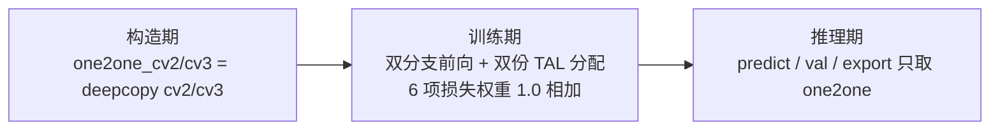
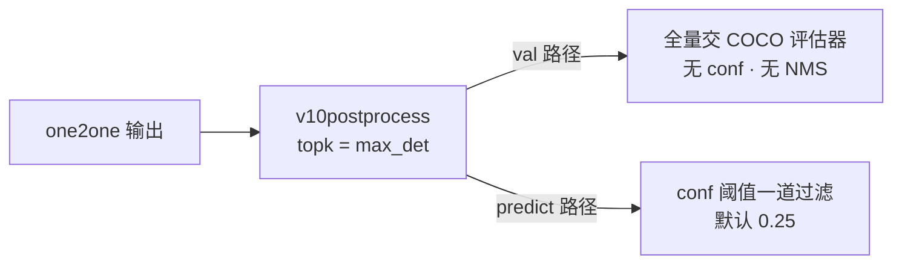
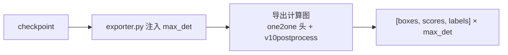

# YOLOv10 训练技巧

v10 的技巧页要**反着读**：它的训练配方与 v8 完全一致——`default.yaml` 逐键同源（box 7.5 / cls 0.5 / dfl 1.5、close_mosaic、[Mosaic](/glossary#mosaic-增强)/MixUp/HSV/Flip 全套照搬），增强管线就是同一份 `data/augment.py`。**v10 没有新增任何训练 trick，全部创新集中在两处：标签分配（一致性双分配）与网络结构（CIB/SCDown/PSA/轻量头）**。训练侧真正的新东西只有一个——one2one 分支的接入方式。本页 4 节如实盘点，不编造新 trick。

## 全部条目速查

| 条目 | 代码位置 | 说明 | 推理是否零开销 |
|-------|----------|------|----------------|
| 训练配方与 v8 完全一致 | cfg/default.yaml L31·L97-99 | 损失增益、增强全套同源，无新增超参 | 是（纯配置） |
| 一致性双分配 | utils/loss.py L719-720 | 同一 assigner、同 α/β，只差 topk 10/1 | 是（分配纯训练期） |
| one2one 分支梯度隔离 | nn/modules/head.py L512 | `xi.detach()`，one2one 损失不回传骨干/neck | 是（训练期设计） |
| 双头先验 bias 初始化 | nn/modules/head.py L527-535 | one2one 分支复用同款 bias_init | 是（初始化） |
| 无 NMS 评估口径 | models/yolov10/val.py L10-20 | top-k 候选全量进 COCO 评估，无 conf 无 NMS | 推理侧变更（见 §3） |
| 端到端导出 | engine/exporter.py L232-233 | 注入 max_det，图内 v10postprocess 输出 6 列 | 导出图无 NMS（见 §4） |

## 1. 训练配方与 v8 完全一致 (`trick-same-recipe`)

> **v1~v9 读者路标**：v7 的 trick 是论文论证的 [freebies](/glossary#trainable-bag-of-freebies-可训练免费午餐)，v8 是工程默认值（见 [v8 tricks](/versions/v8/tricks)）；v10 两样都继承——超参一个没动，动的是分配器和模块。

**动机**：v10 的论文卖点是「同 AP 下延迟大幅下降」（README 快照口径：v10n 2.3M 参数 / 6.7 GFLOPs / 38.5% AP / 1.84ms，T4 TRT FP16 batch1）。支撑这个卖点的方式不是调训练，而是改结构与分配——所以训练配方保持 v8 原样，正是「结构换效率、配方不添乱」的对照组设计。

**实现**（`ultralytics/cfg/default.yaml`，与 v8.1.34 逐键同源）：

| 组 | 默认值 | 位置 |
|----|--------|------|
| 损失增益 | box=7.5 / cls=0.5 / dfl=1.5 | L97-99 |
| close_mosaic | 10（v8 快照默认 0，靠 CLI 传 10；v10 出厂即 10） | L31 |
| conf | 预测 0.25 / 评估 0.001（注释原文；v10 的 val 覆盖层不再读它） | L49 |
| iou | 0.7（NMS 阈值——v10 推理无 NMS，此键对 v10 无意义） | L50 |
| max_det | 300 | L51 |
| AMP | True | L33 |

增强管线同一份 `ultralytics/data/augment.py`：Mosaic（L135）、MixUp（L326）、RandomPerspective（L347）、RandomHSV（L584）、RandomFlip（L627）、LetterBox（L684）、CopyPaste（L753）——类与行号都能在快照里对着看。

<SrcLink file="v10:ultralytics/cfg/default.yaml" :line="97" :end="99" />
<SrcLink file="v10:ultralytics/cfg/default.yaml" :line="31" />

**训练命令**（其余超参全部走 default.yaml 出厂值）：

```bash
yolo detect train model=yolov10n.yaml data=coco.yaml imgsz=640
```

```python
from ultralytics import YOLOv10

model = YOLOv10("yolov10n.yaml")  # 或 yolov10n.pt
model.train(data="coco.yaml", imgsz=640)
```

- CLI 能路由到 v10 专属 trainer，靠的是 entrypoint 里的一个补丁：模型名 stem 含 "yolov10" 时直接实例化 `YOLOv10` 类（cfg/__init__.py:552-555）——普通 `YOLO` 类的 task_map 里 detect 走的还是 v8 trainer
- `YOLOv10DetectionTrainer.get_model` 构造 `YOLOv10DetectionModel`（train.py:15-20），其 `init_criterion` 返回 `v10DetectLoss`（tasks.py:640-642）

<SrcLink file="v10:ultralytics/cfg/__init__.py" :line="552" :end="555" />
<SrcLink file="v10:ultralytics/nn/tasks.py" :line="640" :end="642" />

**推理开销**：零开销。纯配置继承，唯一的配方差异是 close_mosaic 出厂值。

## 2. one2one 分支训练期行为 (`trick-one2one-behavior`)

> **v1~v9 读者路标**：v9 的辅助分支（见 [v9 辅助分支概念](/versions/v9/concepts#_2-辅助可逆分支与-cblinear-cbfuse-路由-concept-aux-branch)）训练完整段拆除；v10 的 one2one 分支反过来——训练期陪跑，推理期接管，one2many 才是退休的那个。

**动机**：one2one 分支要学「只报一次」，不能从零摸索——所以构造时 deepcopy 一份 one2many 头的权重当起点；但它又不能干扰主干的训练——所以输入 detach、梯度隔离。三个设计决定（复制起点、梯度隔离、推理接管）串起来才是完整故事。

**实现**：



- **构造期**：`self.one2one_cv2/one2one_cv3 = copy.deepcopy(self.cv2/cv3)`（head.py:508-509）——两个头从同一份随机初始化出发，`bias_init` 再给 one2one 分支重刷同款先验 bias（head.py:533-535）
- **训练期前向**：one2one 吃 `xi.detach()` 特征（head.py:512，梯度只训练头自身，见 [concepts §4](/versions/v10/concepts#_4-one2one-输入-detach-的设计-concept-detach)）；非 export 模式下 one2many 也照常前向，训练返回 `{"one2many": ..., "one2one": ...}`
- **训练期损失**：两个分支各自跑一遍 [TAL](/glossary#tal-task-alignment-learning) 分配（topk 10 / 1），损失名 `box_om, cls_om, dfl_om, box_oo, cls_oo, dfl_oo` 共 6 项（train.py:10），两份损失权重 1.0 直接相加（loss.py:727）
- **小细节**：训练前探测 stride 时，v10Detect 的 forward 临时取 `["one2many"]`（tasks.py:305-306）——one2many 恒存在，探测不会踩空
- **推理接管**：predict 取 `preds["one2one"]`（predict.py:10）、val 同（val.py:12）；export 模式下 one2many 连前向都不执行（head.py:513-514），主干推理路径与 v8 完全一致

<SrcLink file="v10:ultralytics/nn/modules/head.py" :line="508" :end="509" />
<SrcLink file="v10:ultralytics/models/yolov10/train.py" :line="10" />
<SrcLink file="v10:ultralytics/utils/loss.py" :line="727" />

**效果**：训练日志里能直接看到双分支的 6 项损失曲线——box_oo/cls_oo/dfl_oo 就是 one2one 分支的学习进度条。

**推理开销**：零开销。one2many 分支不参与推理，导出图里干脆没有它。

## 3. 无 NMS 评估口径与 conf 阈值 (`trick-eval-protocol`)

> **v1~v9 读者路标**：v1~v9 的 val 都是「conf 0.001 预筛 → NMS → 交评估器」；v10 的 val 把前两步全删了——这对横向对比 v8/v9 的 mAP 数字时意味着什么，本节说清。

**动机**：端到端模型没有冗余框，评估时再做 conf 预筛和 NMS 既多余又有害（conf 预筛会截断 PR 曲线低端）。v10 的评估口径因此变成：**候选全量进 COCO 评估器，排序交给 COCO 的 PR 计算**。

**实现**：



- **val.py 的 postprocess 只有 5 行逻辑**：取 one2one → 转置 → v10postprocess → xywh2xyxy → cat 返回（val.py:10-20）——没有 conf 阈值，没有 NMS，v10postprocess 取分数最高的 `args.max_det` 个候选全部交给 COCO 评估器（COCO 协议单图最多计前 100 个检测）
- **predict.py 保留一道 conf 过滤**：`mask = preds[..., 4] > self.args.conf`（predict.py:23），默认 0.25（default.yaml:49 注释）——这只影响「给你看几条框」，不承担去重职责
- **iou 阈值失效**：`iou: 0.7`（default.yaml:50）是给 NMS 准备的，v10 推理链没有 NMS，调它没有效果
- **语义提醒**：one2one 的 score 不再是「NMS 前的原始置信度」，而是训练期被 topk=1 稀疏监督塑形过的「端到端排名分」——与 v8 的 score 数值分布不可直接互比
- 复现命令照 README：`yolo val model=yolov10n.pt data=coco.yaml batch=256`（README.md:46）

<SrcLink file="v10:ultralytics/models/yolov10/val.py" :line="10" :end="20" />
<SrcLink file="v10:ultralytics/models/yolov10/predict.py" :line="23" />
<SrcLink file="v10:ultralytics/cfg/default.yaml" :line="49" :end="51" />

**效果**：评估口径更干净（无预筛截断），部署口径更简单（predict 只剩一个 conf 旋钮）——但要记得 v8/v9 对比实验里 NMS 超参那一栏，在 v10 这边是空的。

**推理开销**：这正是「负开销」——后处理从 O(N²) 的 IoU 循环变成一次 topk。

## 4. 部署视角：端到端导出 (`trick-export`)

> **v1~v9 读者路标**：v1~v9 的导出图终点永远是「原始预测张量」，NMS 留给部署端自己接（v8 文档还专门教 ONNX NMS 插件方案）；v10 的导出图直接吐最终结果。

**动机**：部署端接 NMS 的痛苦清单：IoU 动态循环算子支持差、batch 输出变长、跨框架移植各写一遍。v10 把后处理搬进图里后，导出产物就是「喂图 → 出 [boxes, scores, labels]」的封闭函数。

**实现**：



- exporter 在遍历模型模块时给 v10Detect 注入 `max_det`（exporter.py:232-233）——类属性默认 -1（head.py:499），export 分支先断言它已被赋值（head.py:521）
- 导出图里只有 one2one 分支：export 模式下 `one2many = super().forward(x)` 被跳过（head.py:513-514），one2many 的权重躺在 checkpoint 里但不进计算图
- 图内输出：`torch.cat([boxes, scores.unsqueeze(-1), labels.unsqueeze(-1)])` → 定长 `[b, max_det, 6]`（head.py:522-523）
- 算子清单：split / amax / topk / gather / 取模——无 IoU、无动态循环，全部是 ONNX 与 TensorRT 支持良好的张量算子；定长输出天然 batch 友好
- 导出模型再走 predict 时，`preds.shape[-1] == 6` 的分支直接透传（predict.py:15-16），不会重复后处理

<SrcLink file="v10:ultralytics/engine/exporter.py" :line="232" :end="233" />
<SrcLink file="v10:ultralytics/nn/modules/head.py" :line="521" :end="523" />
<SrcLink file="v10:ultralytics/models/yolov10/predict.py" :line="15" :end="16" />

**效果**：README 快照口径的延迟（v10n 1.84ms，T4 TRT FP16 batch1）就是这条无 NMS 链路的实测——对比同档 v8 时，对方的数字里通常还要另算 NMS 的时间。

**推理开销**：max_det 个候选的两次 topk + gather，成本随 max_det 线性，与图里目标数量无关。

## 延伸阅读

- [理论 Concept](/versions/v10/concepts)（双分配与四大结构件的逐行拆解）
- [v8 训练技巧](/versions/v8/tricks)（v10 配方的出处——逐键同源）
- [v9 训练技巧](/versions/v9/tricks)（上一代「训练加料」路线的对照组）
- [术语表](/glossary)
