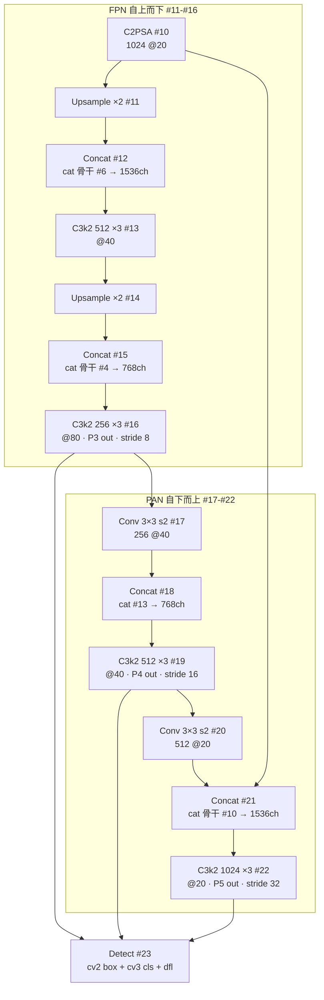
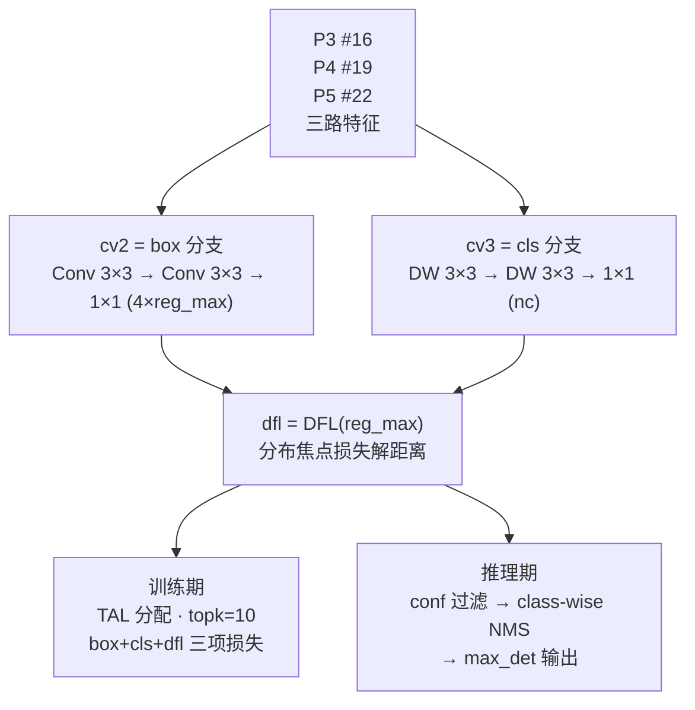
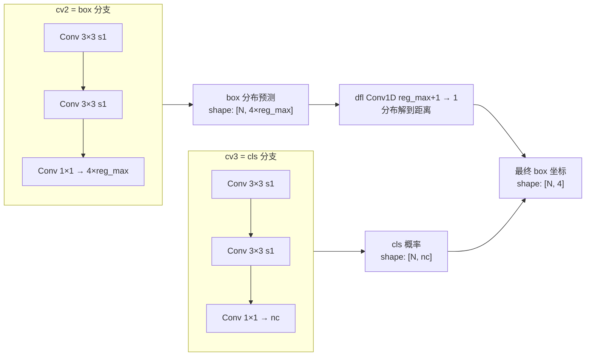

# YOLOv11 Architecture 逐层图解

> 首发载体：`ultralytics/ultralytics` tag `v8.3.0`，commit `6e43d1e1e5db72afbf686dee6745669bcb124b0a`，2024-09-30，PR #16539，作者 Glenn Jocher & Jing Qiu，AGPL-3.0。以 `ultralytics/cfg/models/11/yolo11.yaml` 为基准（**注意 cfg 目录名 `11/`，不带 `v` 前缀**——这是本项目的命名坑），本页通道数为缩放前的基准值。配置原文见 <SrcLink file="v11:ultralytics/cfg/models/11/yolo11.yaml" :line="1" :end="47" />，逐层源码见 [YOLOv11 逐层图解](/versions/v11/layers)。

> **v1~v10 读者路标**：这张 yaml 是 [yolov8.yaml](/versions/v8/source/yolov8-yaml) 的第三代 delta——v8 → v10 换了下采样与检测头、v10 → v11 直接把骨干里所有 C2f 换成 C3k2、把 v10 独有的 SCDown/PSA/C2fCIB/v10Detect 一整套收掉，回归 v8 的 [NMS](/glossary#nms-非极大值抑制) 单头。想快速对上位读者的话，可以把它当作「v8 的骨干 + 一处 [C2PSA](/glossary#c2psa)」来读——只有 12 层骨干 + 13 层头，24 个顶层条目。

::: tip 只想带走三件事
1. **命名坑先记住**：cfg 目录是 `ultralytics/cfg/models/11/`（**不带 `v`**），yaml 是 `yolo11.yaml`；tag 挂在 ultralytics `v8.3.0` 上——三处版本号并不同步；
2. **结构极简**：骨干 11 层（Conv×4 + C3k2×4 + SPPF×1 + C2PSA×1）、头 13 层（Upsample×2 + Concat×4 + C3k2×4 + Conv s2×2 + Detect×1），只有两种自研模块 **C3k2** 与 **C2PSA**——比 v10 少了一个 C2fCIB、比 v9 少了一整套 GELAN/CIB/SPC；
3. **回归 NMS 单头**：v11 用的是 v8 沿用的 `Detect`（<SrcLink file="v11:ultralytics/nn/modules/head.py" :line="21" :end="68" />），**没有** v10 的 `v10Detect`；`one2one`、`v10postprocess`、`detach()` 这些概念在 v11 里全部不存在——推理走标准 [TAL](/glossary#tal-task-alignment-learning) 分配 + class-wise NMS。
:::

## 1. 一眼看清：yolo11.yaml 全图

> **v1~v10 读者路标**：整张图与 [yolov10n.yaml](/versions/v10/source/yolov10-yaml) 的形状几乎一致——层数从 24 条保持 24 条，但骨干里所有 C2f/C2fCIB 都换成了 C3k2、v10 的 SCDown 全部退回普通 Conv、PSA 换成了 C2PSA、v10Detect 换回了 Detect。盯住图中 4 个 C3k2 与 1 个 C2PSA 即可。

```mermaid
flowchart TB
    %% Backbone #0-#10
    IMG["640×640×3"] --> L0["Conv 3×3 s2 #0<br/>64ch @320 · P1/2"]
    L0 --> L1["Conv 3×3 s2 #1<br/>128ch @160 · P2/4"]
    L1 --> L2["C3k2 256 ×3 #2<br/>c3k=False, e=0.25"]
    L2 --> L3["Conv 3×3 s2 #3<br/>256ch @80 · P3/8"]
    L3 --> L4["C3k2 512 ×6 #4<br/>c3k=False, e=0.25"]
    L4 --> L5["Conv 3×3 s2 #5<br/>512ch @40 · P4/16"]
    L5 --> L6["C3k2 512 ×3 #6<br/>c3k=True"]
    L6 --> L7["Conv 3×3 s2 #7<br/>1024ch @20 · P5/32"]
    L7 --> L8["C3k2 1024 ×3 #8<br/>c3k=True"]
    L8 --> L9["SPPF 1024 k=5 #9<br/>@20 · 骨干融合出口"]
    L9 --> L10["C2PSA 1024 #10<br/>Attention + FFN · 骨干出口"]

    %% Head #11-#23
    L10 --> L11["Upsample ×2 #11<br/>1024ch @40"]
    L11 --> L12["Concat #12<br/>cat 骨干 #6 → 1536ch"]
    L12 --> L13["C3k2 512 ×3 #13<br/>@40"]
    L13 --> L14["Upsample ×2 #14<br/>512ch @80"]
    L14 --> L15["Concat #15<br/>cat 骨干 #4 → 768ch"]
    L15 --> L16["C3k2 256 ×3 #16<br/>@80 · P3 out · stride 8"]
    L16 --> L17["Conv 3×3 s2 #17<br/>256ch @40"]
    L17 --> L18["Concat #18<br/>cat #13 → 768ch"]
    L18 --> L19["C3k2 512 ×3 #19<br/>@40 · P4 out · stride 16"]
    L19 --> L20["Conv 3×3 s2 #20<br/>512ch @20"]
    L20 --> L21["Concat #21<br/>cat 骨干 #10 → 1536ch"]
    L21 --> L22["C3k2 1024 ×3 #22<br/>@20 · P5 out · stride 32"]

    L16 --> DET["Detect #23<br/>P3/P4/P5 单头 · stride 8/16/32<br/>cv2 box · cv3 cls · dfl"]
    L19 --> DET
    L22 --> DET
```

- 图中通道数为 yaml 声明的**基准宽度**；n 档 depth=0.50 / width=0.25 把 C3k2 重复数 ×3→2、×6→3、通道 ÷4（末级 1024→256），五档 scales 见 §6
- backbone 占 yaml L15~L27（#0~#10）、head 占 L30~L47（#11~#23）；Detect 落在 #23（<SrcLink file="v11:ultralytics/cfg/models/11/yolo11.yaml" :line="47" />）
- **C3k2 一共出现 8 次**：骨干 4 次（#2/#4/#6/#8）、头 4 次（#13/#16/#19/#22）；`c3k=True` 只用在深层（骨干 #6/#8、头全部 4 次），浅层用 `c3k=False` + `e=0.25` 走轻量路径
- **C2PSA 只挂在骨干出口 #10**：把 v10 的 PSA（部分自注意力）换成完整通道的 C2PSA——v10 是"半个通道过注意力"，v11 是"一半通道走 PSABlock（含 Attention + FFN）"，动机不同
- Concat 输出通道 = 两路之和（#12 是 1024+512=1536）；#21 回连的是 **#10 C2PSA 输出**（与 v10 回连 #10 PSA 的位置对应，语义一致）
- 骨干 C3k2 #2/#4 显式传 `c3k=False, e=0.25`（浅层轻量），#6/#8 传 `c3k=True`（深层标准）；头的 4 个 C3k2 都传 `c3k=True`——**头部一律走标准 C3k 内瓶**

<SrcLink file="v11:ultralytics/cfg/models/11/yolo11.yaml" :line="1" :end="47" />

> **v1~v10 读者路标**：整图 24 个顶层条目，n/s/m/l/x 五档共用；C3k2 出现 8 次（骨干 4 + 头 4），C2PSA 只在骨干出口出现 1 次，Detect 收尾 1 次——**没有 SCDown、没有 PSA、没有 C2fCIB、没有 v10Detect**。想和 v10 对上的话，可以理解为「v10 把新模块 C2fCIB/PSA 全部撤回，把 C2f 全换成 C3k2，把 v10Detect 换回 Detect」。

## 2. Backbone #0~#10：Conv 下采样 + C3k2 融合 + SPPF + C2PSA

> **v1~v10 读者路标**：#0~#4 的形态与 yolov8.yaml 几乎逐字符相同（Conv 3×3 s2 × 2 + C3k2 替代 C2f × 2），差异只在骨干里 4 处 C2f 全部换成 C3k2；下采样不再使用 v10 的 SCDown，回归 v8 的普通 Conv s2；末端 SPPF→C2PSA 是**本代唯一的新模块组合**——v10 是 SPPF→PSA，v11 是 SPPF→C2PSA。

```mermaid
flowchart LR
    %% Backbone only
    IMG["640×640×3"] --> L0["Conv 3×3 s2 #0<br/>64 @320 · P1/2"]
    L0 --> L1["Conv 3×3 s2 #1<br/>128 @160 · P2/4"]
    L1 --> L2["C3k2 256 ×3 #2<br/>c3k=False, e=0.25"]
    L2 --> L3["Conv 3×3 s2 #3<br/>256 @80 · P3/8"]
    L3 --> L4["C3k2 512 ×6 #4<br/>c3k=False, e=0.25"]
    L4 --> L5["Conv 3×3 s2 #5<br/>512 @40 · P4/16"]
    L5 --> L6["C3k2 512 ×3 #6<br/>c3k=True"]
    L6 --> L7["Conv 3×3 s2 #7<br/>1024 @20 · P5/32"]
    L7 --> L8["C3k2 1024 ×3 #8<br/>c3k=True"]
    L8 --> L9["SPPF 1024 k=5 #9<br/>@20"]
    L9 --> L10["C2PSA 1024 #10<br/>全通道过 Attention+FFN"]
```

- **前 5 层**（#0-#4）与 v8 完全同款节奏：Conv s2 → Conv s2 → 融合块 → Conv s2 → 融合块。差异只在于融合块从 v8 的 C2f 换成 v11 的 C3k2（<SrcLink file="v11:ultralytics/nn/modules/block.py" :line="723" />），且 C3k2 显式声明 `c3k=False, e=0.25`——内瓶走 C3k 关闭状态下的默认瓶颈、隐藏通道按 0.25 比例缩窄，浅层不额外付费
- **#5/#7 下采样**（<SrcLink file="v11:ultralytics/cfg/models/11/yolo11.yaml" :line="19" />、<SrcLink file="v11:ultralytics/cfg/models/11/yolo11.yaml" :line="21" />）：回归 v8 的普通 `Conv [c, 3, 2]`——v10 的 SCDown（1×1 降维 + DW s2）被撤回，理由是 v11 走的是"骨干轻量、头标准"路线，下采样处的通道数已经通过 width scaling 压到足够低，没必要再叠一层解耦
- **#6/#8 深层 C3k2**：`c3k=True` 显式启用 C3k 内瓶（<SrcLink file="v11:ultralytics/nn/modules/block.py" :line="734" />），配合骨干深度加大感受野；#8 之后的 SPPF 与 v8 完全同款（<SrcLink file="v11:ultralytics/nn/modules/block.py" :line="169" />，串行 3 次 k=5 MaxPool 等效 SPP 5/9/13）
- **#10 C2PSA 只挂这一个**（<SrcLink file="v11:ultralytics/cfg/models/11/yolo11.yaml" :line="27" />）：这是 v11 相对 v10 的关键结构升级——v10 的 PSA 是「一半通道过 Attention+FFN、另一半直通」，v11 的 C2PSA 是「C2f 外壳 + 一半通道走 PSABlock（含 Attention + FFN）」——注意力从"外挂"变成"内嵌进 C2f 结构"。此处序列长度 400（20×20 网格）、通道最宽，与 v10 的注意力挂载位置一致，动机是**在拿到最强语义特征之后，才花这一次全局建模的钱**
- **骨干 11 层的通道-位置对应**：64@P1 → 128@P2 → 256@P3 → 512@P4 → 512@P4(继续提特征) → 1024@P5 → 1024@P5(继续) → 1024@P5(SPPF) → 1024@P5(C2PSA)——从 P4 开始通道停在 512、到 P5 提到 1024，与 v8/v10 相同

<SrcLink file="v11:ultralytics/cfg/models/11/yolo11.yaml" :line="15" :end="27" />
<SrcLink file="v11:ultralytics/nn/modules/block.py" :line="723" :end="751" />

> **v1~v10 读者路标**：v8 骨干用 4 个 C2f + SPPF 收尾；v10 骨干多了 SCDown 下采样与 PSA 全局注意力；v11 把 SCDown 撤掉、把 PSA 换成 C2PSA、把所有 C2f 换成 C3k2。SPPF 与 Conv s2 下采样这两个 v5/v6 就有的老零件原封不动——**骨干里被换血的部分只有「融合块」和「末端注意力」**。

## 3. Head #11~#23：PAN 双向聚合，两个下采样均走 Conv s2

> **v1~v10 读者路标**：v11 的头回到 v8 的形态——没有 C2fCIB、没有 SCDown 回程、没有 v10Detect；#21 回连的是 C2PSA 而不是 PSA（编号一致、模块不同）。想和 v8 对照的话：v8 的 #11-#22 与 v11 的 #11-#22 完全对得上，唯一差别是 4 个 C2f 都换成了 C3k2、Detect 参数列表里的 `[nc]` 位置一致。

- **FPN 上行 #11-#16**：Upsample×2 + Concat（骨干 #6、#4）+ C3k2 融合，与 v8 结构完全同款；出口 #16（基准 256 通道 @80×80）是 P3 检测输入，stride 8
- **Concat 索引与 v10n 完全一致**：#12 → `[-1, 6]`、#15 → `[-1, 4]`、#18 → `[-1, 13]`、#21 → `[-1, 10]`——四组拼接对象没有一处变化
- **PAN 下行 #17-#22**：两段下采样都是 `Conv [c, 3, 2]`（#17、#20），与 v8 相同——v10 曾在 #20 换成 SCDown，v11 把这一处也退回了
- #21 `Concat` 回连 **#10 C2PSA**（<SrcLink file="v11:ultralytics/cfg/models/11/yolo11.yaml" :line="37" />）——v8 在同一位置回连的是 #9 SPPF；v10 回连的是 #10 PSA；v11 回连的是 #10 C2PSA。三代版本都在同一个位置做「让注意力/SPPF 输出参与 PAN 顶点」的相同选择，只是模块代际不同
- 三个出口 #16/#19/#22 喂给 #23 Detect，stride 8/16/32、640 输入共 **8400 个预测位置**（$80^2+40^2+20^2$）——anchor-free、网格中心即 anchor point，与 v8 完全一致
- 头部 4 个 C3k2 全部传 `c3k=True`（<SrcLink file="v11:ultralytics/cfg/models/11/yolo11.yaml" :line="31" />、L34、L38、L42）：与骨干浅层不同，头部不再用轻量 C3k（`c3k=False, e=0.25`），因为头部通道窄、参数预算相对宽裕，直接走标准 C3k 内瓶

<SrcLink file="v11:ultralytics/cfg/models/11/yolo11.yaml" :line="30" :end="42" />

> **v1~v10 读者路标**：v8 的头走 [C2f + RepConv 收口（v7 有，v8 撤）](/versions/v8/architecture) 的极简形态；v9 头换了 [DualDDetect 双头 + C2SPC](/versions/v9/architecture)；v10 头新增 C2fCIB 大核 + v10Detect 双头去 NMS；**v11 退回 v8 的形态**——PAN 拓扑、Concat 索引、Conv s2 下采样全部对得上，只是把 C2f 换成 C3k2、把末端检测头保留为 Detect。

## 4. Head #23 Detect 详解：回归 v8 单头解耦

> **v1~v10 读者路标**：v11 直接用 v8 沿用的 `Detect` 类（<SrcLink file="v11:ultralytics/nn/modules/head.py" :line="21" :end="68" />），**不用** v10 的 `v10Detect`（<SrcLink file="v11:ultralytics/nn/modules/head.py" :line="564" /> 仍然存在，但本 yaml 未引用）——这是 v11 相对 v10 最显著的**功能回退**：不再有 one2many/one2one 双头、不再有 `v10postprocess`、不再有 detach 梯度截断。

- **构造**（<SrcLink file="v11:ultralytics/nn/modules/head.py" :line="34" :end="52" />）：**没有 cv1 升维层**；L40 定义 `c2, c3 = max((16, ch[0] // 4, reg_max*4)), max(ch[0], min(nc, 100))`；`cv2`（box，L41-43）是两段 3×3 + 1×1 出 `4*reg_max`（64），`cv3`（cls，L44-51）是**两段 DW-separable + 1×1** 出 `nc`——cv2 与 v8 同款，cv3 沿用 v10 的 DW 思路（v11 无 legacy 开关）
- **前向**（<SrcLink file="v11:ultralytics/nn/modules/head.py" :line="58" :end="68" />）：L63-64 逐尺度 `cat((cv2[i](x[i]), cv3[i](x[i])), 1)`；训练模式 L65-66 直接返回 list；推理走 L67 `_inference`，L68 按 `export` 决定返回 `y` 还是 `(y, x)`
- **DFL**（<SrcLink file="v11:ultralytics/nn/modules/head.py" :line="52" />）：`self.dfl = DFL(self.reg_max) if self.reg_max > 1 else nn.Identity()`——把 `4*reg_max` 维分布解回 4 维距离，配合 [DFL 损失](/versions/v8/losses)（v8 引入，v11 沿用）
- **推理**（<SrcLink file="v11:ultralytics/nn/modules/head.py" :line="94" :end="138" />）：`_inference` 里 `make_anchors → split → dfl 期望积分 → dist2bbox`，输出 `(dbox, cls, x)` 元组；**没有** `one2one/one2many` 字典

### 4.1 Detect vs v10Detect 对比

| 维度 | v8 Detect | v10 v10Detect | v11 Detect |
|------|-----------|---------------|------------|
| 类定义位置 | `head.py` L21 | `head.py` L497 | `head.py` L21（沿用 v8） |
| 头数量 | 单头 | 双头（one2many + one2one deepcopy） | **单头** |
| cv3 分类头 | 标准 3×3 两段 | DW-separable 两段（省 FLOPs） | **DW-separable 两段（沿用 v10，无 legacy 开关）** |
| 训练分配 | TAL topk=10 | 双分配 topk=10 + topk=1 | **TAL topk=10** |
| 梯度截断 | 无 | `one2one = [xi.detach() for xi in x]` | **无** |
| 推理后处理 | conf 过滤 + class-wise NMS | v10postprocess（两次 topk） | **conf 过滤 + class-wise NMS** |
| 导出图 | 有 NMS 算子 | 无 NMS 算子 | **有 NMS 算子** |
| 参数量（v11n 头） | — | — | 约 5M（cv2 + cv3 × 3 尺度） |
| max_det 来源 | predict 端常量 | exporter 注入类属性 | **predict 端常量** |

一句话总结：**v11 的检测头选择"回到 v8 老路"**——放弃 v10 的端到端去 NMS 追求，换取更简单、更易移植、生态工具链完全兼容的推理图。

### 4.2 Detect 内部三分支

- cv2 与 cv3 的通道公式相同（`max(ch[0], min(self.nc, 100))`），差异只在最终输出维度
- `reg_max` 默认 16，`4*reg_max=64`——每个预测位置对每个方向（left/right/top/bottom）都输出 16 个距离桶的概率
- dfl 是 Conv1D 与核 `[0,1,2,...,15]`——把 16 个概率乘到 16 个距离值上求和，得到期望距离

<SrcLink file="v11:ultralytics/nn/modules/head.py" :line="21" :end="68" />

> **v1~v10 读者路标**：从 v1 到 v10，检测头经历了「3 段 yolo layer → 2 段解耦 → 三段解耦 → anchor-free 单头 → 双头去 NMS」的完整演进；v11 选择**保留 v8 的三段解耦 anchor-free 单头**，只是外层结构换了 C3k2/C2PSA。推理图里 NMS 节点回来了——但工程上更省心的选择。

## 5. 与 v10/v9/v8 的结构对比

> **v1~v10 读者路标**：把三代 yaml 摆在一起看，v11 的取舍一目了然——**下采样回归普通 Conv**、**融合块统一 C3k2**、**骨干末段 C2PSA**、**头 Detect 单头**。

| 位置 | v8（yolov8.yaml） | v9（yolov9.yaml） | v10（yolov10n.yaml） | v11（yolo11.yaml） | 一句话总结 |
|------|-------------------|-------------------|----------------------|--------------------|------------|
| #2 骨干 P2 融合 | C2f 128 | C2SPC 128 | C2f 128 | **C3k2 256** | C2f→C3k2 换血 |
| #4 骨干 P3 融合 | C2f 256 | CBLinear→… | C2f 256 | **C3k2 512** | 同上 |
| #5/#7 下采样 | Conv s2 | ADown | SCDown | **Conv s2** | v10 SCDown 撤回 |
| #9 骨干融合 | SPPF | SPPF | SPPF | **SPPF** | v5 遗产原样保留 |
| #10 骨干出口 | — | 无 | PSA | **C2PSA** | v10 PSA→v11 C2PSA 升级 |
| #13/#16/#19 头融合 | C2f | C2f | C2f | **C3k2** | 头融合块统一 C3k2 |
| #20 回程下采样 | Conv s2 | Conv s2 | SCDown | **Conv s2** | v10 SCDown 撤回 |
| #22 P5 融合 | C2f | C2f | C2fCIB | **C3k2** | v10 C2fCIB 撤回 |
| #23 检测头 | Detect | DualDDetect | v10Detect | **Detect** | v10 双头去 NMS 撤回 |
| 顶层条目数 | 24 | 32+ | 24 | **24** | v11 与 v8/v10 对齐 |
| 自研模块数 | 1（C2f） | 4（CBLinear/C2SPC/CBAM/DDetect） | 3（SCDown/PSA/C2fCIB/v10Detect） | **2（C3k2/C2PSA）** | v11 模块最少 |

- **v11 的极简主义**：整个 yaml 只有 2 种自研模块（C3k2、C2PSA），Detect/SPPF/Conv/Concat/Upsample 都是 v5/v6 就有的老零件——是三代中模块种类最少的
- **命名坑复述**：cfg 目录是 `11/`（不带 `v`），与其他版本的 `v1/`、`v8/`、`v10/` 不同——写脚本时要注意路径
- **总装仍是 `DetectionModel` 家族**：v11 复用 `YOLOv8DetectionModel`，没有像 v10 那样新增 `YOLOv10DetectionModel`——损失函数沿用 v8 的 `v8DetectionLoss`，不需要覆写 `init_criterion`

## 6. 五档 scales 与参数量

> **v1~v10 读者路标**：v8 五档是 n/s/m/l/x，v10 六档是 n/s/m/b/l/x（首个带 B 档的），**v11 回到五档 n/s/m/l/x**——参数矩阵集中在 `yolo11.yaml` 头部的一个 `scales:` 块里（<SrcLink file="v11:ultralytics/cfg/models/11/yolo11.yaml" :line="6" :end="12" />），不再是 v10 那样每档 yaml 各持一份。

| Model | depth | width | max_channels | 层数 | 参数 | GFLOPs | AP val |
|-------|-------|-------|--------------|------|------|--------|--------|
| N | 0.50 | 0.25 | 1024 | 319 | 2.62M | 6.6G | 40.1% |
| S | 0.50 | 0.50 | 1024 | 319 | 9.46M | 21.7G | 46.8% |
| M | 0.50 | 1.00 | 512 | 409 | 20.11M | 68.5G | 50.8% |
| L | 1.00 | 1.00 | 512 | 631 | 25.37M | 87.6G | 51.5% |
| X | 1.00 | 1.50 | 512 | 631 | 56.97M | 196.0G | 52.9% |

- **scales 集中定义**：v10 是每份 yaml 独立写 `scales:` 块，v11 改成 `yolo11.yaml` 顶部一个 `scales:` 块（<SrcLink file="v11:ultralytics/cfg/models/11/yolo11.yaml" :line="6" :end="12" />）——加载时按 `YOLOv8("yolo11n.yaml")` 或 `YOLOv8("yolo11.yaml", scale="s")` 传档
- **compound scaling**（<SrcLink file="v11:ultralytics/utils/ops.py" :line="1" />）：与 v8 完全一致——depth 放大 C3k2 重复数（×3→×2、×6→×3）、width 缩窄通道、max_channels 封顶深层（n/s 到 1024、m/l/x 到 512）
- **n 档 2.62M vs v8n 3.2M vs v10n 2.3M**：v11 的 C3k2 比 C2f 略重（内瓶 C3k 与 Bottleneck 交替，比 C2f 的多一层残差通路），但 C2PSA 比 v10 的 PSA 参数更多——两者相抵后比 v8n 略轻、比 v10n 略重
- **AP val 数字口径**：640 输入、COCO val、T4 TensorRT FP16 batch1（与 v8/v10 README 一致）；N 档 40.1% 相对 v8n 37.4% 与 v10n 38.5% 有 1.5~2.5 个点提升，主要来自 C3k2 内瓶的更优表征能力与 C2PSA 的完整通道注意力
- **层数差异**：n/s 档 319 层、m 档 409 层、l/x 档 631 层——depth 缩放导致（m/l/x 的 max_channels=512 让深层通道更窄、depth 更容易放大到 1.0）
- **X 档 56.97M**：相对 v8x 的 56.9M 完全对齐；说明 v11 在 x 档的 width=1.50 下依然没有让模型失控，是三代中参数增长最克制的

<SrcLink file="v11:ultralytics/cfg/models/11/yolo11.yaml" :line="6" :end="12" />

> **v1~v10 读者路标**：v8 五档 → v10 六档（+ B）→ v11 五档。v11 把 scales 集中到 yaml 顶部一处，是相对 v10「每档一份 yaml」的关键工程改进——**改一处就改全部**。

## 7. SrcLink 汇总

本页引用到的关键源码位置（可直接跳转）：

- <SrcLink file="v11:ultralytics/cfg/models/11/yolo11.yaml" :line="1" :end="47" />——完整 yolo11.yaml
- <SrcLink file="v11:ultralytics/cfg/models/11/yolo11.yaml" :line="6" :end="12" />——scales 五档集中定义
- <SrcLink file="v11:ultralytics/cfg/models/11/yolo11.yaml" :line="15" :end="27" />——backbone 11 层
- <SrcLink file="v11:ultralytics/cfg/models/11/yolo11.yaml" :line="30" :end="42" />——head 12 层
- <SrcLink file="v11:ultralytics/cfg/models/11/yolo11.yaml" :line="47" />——Detect 入口
- <SrcLink file="v11:ultralytics/nn/modules/block.py" :line="723" :end="751" />——C3k2 类定义
- <SrcLink file="v11:ultralytics/nn/modules/block.py" :line="734" :end="751" />——C3k 类定义（C3k2 内瓶）
- <SrcLink file="v11:ultralytics/nn/modules/block.py" :line="1002" :end="1041" />——C2PSA 类定义
- <SrcLink file="v11:ultralytics/nn/modules/block.py" :line="922" :end="1000" />——PSABlock（C2PSA 内瓶）
- <SrcLink file="v11:ultralytics/nn/modules/block.py" :line="866" :end="921" />——Attention（PSABlock 内部）
- <SrcLink file="v11:ultralytics/nn/modules/block.py" :line="169" :end="186" />——SPPF
- <SrcLink file="v11:ultralytics/nn/modules/head.py" :line="21" :end="68" />——Detect 类定义（v11 使用）
- <SrcLink file="v11:ultralytics/nn/modules/head.py" :line="564" :end="597" />——v10Detect 类定义（**v11 不用**，仅供对照）

> **v1~v10 读者路标**：本清单把 v11 涉及的所有自研模块与配置行都点名——对照 v10 的 [architecture §1-§6](/versions/v10/architecture)，可以逐项 diff；对照 v8 的 [architecture 全文](/versions/v8/architecture)，可以直接复用。

## 延伸阅读

- [YOLOv11 逐层图解](/versions/v11/layers)
- [YOLOv11 理论 Concept](/versions/v11/concepts)
- [YOLOv11 损失函数详解](/versions/v11/losses)
- [yolo11.yaml 源码页](/versions/v11/source/yolo11-yaml)
- [v10 架构总览（对照基线）](/versions/v10/architecture)
- [v8 架构总览（对照基线）](/versions/v8/architecture)
