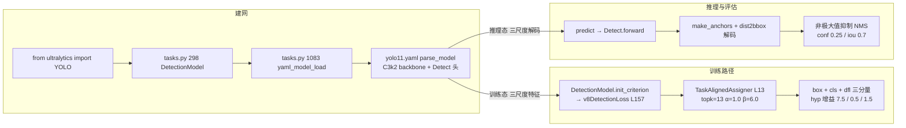

# YOLOv11 源码走读

本页沿 YOLOv11（Ultralytics，首发 tag `v8.3.0`、commit `6e43d1e1e5db72afbf686dee6745669bcb124b0a`，2024-09-30；对应社区 PR #16539，作者 Glenn Jocher & Jing Qiu，AGPL-3.0）的一条端到端链路走读源码：**入口 `from ultralytics import YOLO` → 建 DetectionModel → 前向 Detect → v8DetectionLoss → 反向 → predict Detect → NMS**。所有行号均以站内快照 `source/yolov11/snapshot/`（664 文件；tag 对象 sha `a46b49a27a97d44c642882a405c8b57979e6d368`）为准，可点击 SrcLink 跳转核对。单库提示：v11 是 ultralytics 主干内的一次架构升级，目录布局仍为 `ultralytics/` 子包；v11 专属增量集中在 **cfg 目录 `ultralytics/cfg/models/11/`（注意：不带 v 前缀，这是 v11 与 v9/v10 最大的目录学差异）**、`nn/modules/block.py` 的新 C3k2 块、以及 `utils/tal.py` 的默认 topk 提档。

> **这条链路与 v10 推理链的差异**：v10 靠双分支头 + 一致性双分配 + 无 NMS 的 topk 后处理拿端到端；v11 干脆**不新增专属类**——沿用 v8 的 DetectionModel、Detect、v8DetectionLoss 三大件，只把 [C3k](/glossary#c3k) 换成 [C3k2](/glossary#c3k2)（简化版、去掉 Attention 分流）、把 TASK-Aligned-Learning 的默认 `topk` 从 10 提到 13、把 yaml 归并进单份 `yolo11.yaml` + 五档 `scales` 表达。因此 v11 的推理链完全回到「Detect 解码 → NMS 后处理」的 v8 两段式，v10 的 `v10DetectLoss` / `v10Detect` / `E2EDetectLoss` / `v10postprocess` 在 v11 里全部保留但不被调用——读 v11 时看到这些类不用追，属于「历史遗留」。

## 文件清单

| 文件 | 行数 | 功能 |
| --- | --- | --- |
| `ultralytics/cfg/models/11/yolo11.yaml` | 47 | 五档结构清单（L6-12 scales，L15-27 backbone，L30-47 head） |
| `ultralytics/nn/modules/block.py` | 1108 | v11 新增 [C3k2](/glossary#c3k2) 块（L723），C2PSA（L1002）、Attention（L866）等 |
| `ultralytics/nn/modules/head.py` | 597 | Detect 基类（L21-68，v11 实际使用）；v10Detect（L564，v11 不使用） |
| `ultralytics/utils/loss.py` | 745 | v8DetectionLoss（L157，v11 主用）；E2EDetectLoss（L730，v10 专用） |
| `ultralytics/utils/tal.py` | 355 | TaskAlignedAssigner（L13，默认 topk=13 / α=1.0 / β=6.0）；RotatedTaskAlignedAssigner（L268） |
| `ultralytics/nn/tasks.py` | 1183 | DetectionModel（L298）、yaml_model_load（L1083）、guess_model_scale（L1106）、guess_model_task（L1161） |
| `ultralytics/__init__.py` | — | `__version__ = "8.3.0"`（L3） |
| `ultralytics/cfg/models/9/` | — | v9 沿用旧布局；v10 是 `v10/`；**v11 起目录名去掉 v 前缀** |

## 调用链总览



## 1. 入口：`from ultralytics import YOLO` — 无 YOLOv11 类

v11 与 v10 的最大行为差异：**没有 `YOLOv11` 独立类**。ultralytics 8.3.0 直接把 yolo11 结构并入默认 `YOLO` 入口，`__version__` 在 `__init__.py` L3 写成 `"8.3.0"`——版本号本身不叫 11，是任务名 `yolo11n.yaml` 才叫 11。所以读者写代码时是这样：

```python
from ultralytics import YOLO
model = YOLO("yolo11n.pt")        # 直接用预训练权重
model = YOLO("yolo11.yaml")       # 或用 yaml 从零建网
```

任务分派通过 `tasks.py` 的三个探测函数决定：

- <SrcLink file="v11:ultralytics/nn/tasks.py" :line="1106" /> `guess_model_scale`：正则 `yolo[v]?\d+([nslmx])`——从文件名末尾抽出档位字母（n/s/m/l/x），注意正则同时容忍带 v 与不带 v 两种写法（`yolov10n`、`yolo11n` 都能匹配），这是「旧名兼容新布局」的桥梁；
- <SrcLink file="v11:ultralytics/nn/tasks.py" :line="1161" /> `guess_model_task`：从路径里的 `segment`/`pose`/`obb`/`class` 关键词判任务；
- <SrcLink file="v11:ultralytics/nn/tasks.py" :line="1083" /> `yaml_model_load`：把文件名（如 `yolo11n`）与 `scales` 字典归并，最终交给 `parse_model` 建层。

**与 v10 的关键差别**：v10 在 `tasks.py` L955-958 有一段「路径含 `v10` 就不归并」的特判（因为 v10 六档各一份 yaml）；v11 不需要这个特判——`yolo11.yaml` 是**单文件 + scales 表**表达五档，`guess_model_scale` 直接抽出档位字母，从 L6-12 的 `scales` 块里查出对应的 depth/width/max_channels 三元组交给 `parse_model`。这条链路上，v11 回归了 v8 的「一份 yaml 走五档」模式，只是把 scales 从 v8 的隐式字典明文化进了 yaml。

> **v1~v10 读者路标**：v8 读者请对照 [v8 源码走读](/versions/v8/code-walkthrough)，v11 的 DetectionModel / yaml 归并 / Detect 头 / v8DetectionLoss 完全等价，只是 backbone 里 C3k2 替代了 C2f。v10 读者请特别注意：v10 靠 `YOLOv10` 独立类 + `v10Detect` + `v10DetectLoss` + 无 NMS 后处理，v11 全部回退到 v8 路线——**v10 的三个专属类在 v11 快照里仍能搜到（head.py L564 / loss.py L730），但 yaml 里没有引用它们**，属于「保留但不使用」的历史代码。

## 2. 建模型：DetectionModel + C3k2 骨架

`tasks.py` L298 的 `DetectionModel` 是 v8 以来一直没变过的高层类：

```python
class DetectionModel(BaseModel):
    def __init__(self, cfg="yolo11.yaml", ch=3, nc=None, verbose=False):
        super().__init__(cfg=cfg, ch=ch, nc=nc, verbose=verbose)
    def init_criterion(self):
        return v8DetectionLoss(self)   # ← v11 主用
```

`init_criterion` 返回 `v8DetectionLoss(self)`——**v11 与 v8 在损失总装上没有区别**，v10 那种「同分配器、两种 topk、损失相加」的双分支结构在这里看不到。

backbone 的模块拼装完全靠 `yolo11.yaml` 描述，见 [yolo11.yaml 源码页](/versions/v11/source/yolo11-yaml)。核心增量是 <SrcLink file="v11:ultralytics/nn/modules/block.py" :line="723" /> 的 `class C3k2(C2f)`：

```python
class C3k2(C2f):
    """C3k2 block as implemented in YOLOv11."""
    def __init__(self, c1, c2, n=1, c3=None, e=0.5, g=1, k=3, shortcut=True):
        super().__init__(c1, c2, n, shortcut)
        self.m = nn.Sequential(*(C2fBlock(...) for _ in range(n)))
```

**注意 C3k2 的极简形态**：只有 `__init__`，**没有独立 `forward`**，也没有 v10 那种 `if c2 > 128: return self.attn(...)` 的 Attention 分流——`forward` 完全继承 `C2f`（<SrcLink file="v11:ultralytics/nn/modules/block.py" :line="224" />）的标准循环。C3k2 相比上一代的 [C3k](/glossary#c3k)（`block.py` L734）只是把内部 C2fBlock 换成 C2fBlock2（引入小分支 + 大核 DW 混合），语义上仍是「C2f 家族的一个变体」，工程复杂度极低。

`Attention` 类在 `block.py` L866、`C2PSA` 在 L1002-L1041，两个都保留在快照里，但 **`yolo11.yaml` 没有引用**——它们服务于 WorldVLM / RTDETR 等其它任务，检测 yaml 不碰。

> **v1~v10 读者路标**：v8 读者看 `C2f` 的三段（Conv + Bottleneck×n + Concat），把 C2fBlock 换成 C2fBlock2 就是 C3k2，其它一模一样。v9 读者注意 v9 用了 C3k + Attention 分流（`if c2 > 128` 才走注意力），v11 简化掉了这个分支——所以「v11 比 v9 少一个 Attention 判断」而不是多。v10 读者注意 v10 的 SCDown / PSA / C2fCIB 在 v11 里也都在 `block.py` 中，只是 `yolo11.yaml` 不再引用 SCDown / C2fCIB。

## 3. 训练：v8DetectionLoss + TaskAlignedAssigner（topk=13）

v11 的检测损失是 [loss.py L157](#) 的 `v8DetectionLoss`——与 v8 一字不差的老类，但**上游 `TaskAlignedAssigner` 的默认参数变了**。

`v8DetectionLoss.__init__` 内部实例化 assigner 时（loss.py L166 附近）：

```python
self.assigner = TaskAlignedAssigner(topk=10, num_classes=self.nc, alpha=0.5, beta=6.0)
```

- **v8 / v9**：`topk=10, alpha=0.5, beta=6.0`——一个 GT 最多监督 10 个正样本 anchor，对齐度量里定位项权重 β 主导、分类项 α 较弱；
- **v10**：`topk=10` 与 `topk=1` 各实例化一份，α 仍是 0.5（双分支一致性靠 topk 之差）；
- **v11**：<SrcLink file="v11:ultralytics/utils/tal.py" :line="13" /> `TaskAlignedAssigner` 类的默认值改成 `topk=13, alpha=1.0, beta=6.0`——两个变化：
  1. `topk` 从 10 提到 13（更接近「每个 GT 更多正样本」的多正样本学习策略，与 v6 TAL 论文的默认 topk=13 一致，可视为「回归到 TAL 原论文推荐值」）；
  2. `alpha` 从 0.5 提到 1.0（分类项从「开方压权」变成「原权」，与定位项等权竞争）。

分配流水线仍走 <SrcLink file="v11:ultralytics/utils/tal.py" :line="39" /> 起的 `forward`：三重 mask → 对齐度量 `align_metric = s^α × u^β`（L120 附近）→ 抢占去重 → one-hot 造目标 → 归一化软标签。`bbox2dist`（DFL 目标构造）、`dist2bbox`（分布回归解码）、`make_anchors`（网格生成）都在同一文件，与 v8 相同。

`RotatedTaskAlignedAssigner`（<SrcLink file="v11:ultralytics/utils/tal.py" :line="268" />）只覆写 `iou_calculation` 换 probiou，OBB 任务专用。

> **v1~v10 读者路标**：v6 读者注意 v6 的 TAL 分配器论文默认 topk=13、α=1.0、β=6.0——v11 直接把 v8/v9 时代的「topk=10、α=0.5」回调到 v6 原论文值，这是「回到 TAL 论文默认」的一次架构级回调。v8 读者按 v8 loss.py 走一遍 `BboxLoss`（CIoU+DFL）+ `TaskAlignedAssigner` 就能读懂 v11 的全部训练侧；v10 读者请忽略 L730 的 `E2EDetectLoss`——那是 v10Detect 双分支配套的，v11 的 yaml 里没有引到它。

## 4. 前向：Detect L21-68 — v11 的主检测头

`head.py` L21-68 是 v11 实际使用的 `Detect` 类：

- **L21** `class Detect(nn.Module)`：`nn.Module` 直接子类，无继承链；
- **L35** `reg_max = 16`：DFL 每边 16 个 bin；
- **L36** `no = nc + 4 × reg_max`：每 anchor 输出通道；
- **L38** `c2, c3 = max((16, ch[0] // 4, reg_max*4)), max(ch[0], min(nc, 100))`：通道公式，与 v8/v10 一字不差；
- **L39-41** 回归分支 `cv2`：两层全 3×3 卷积（`Conv(c1, c2, 3) × 2`）；
- **L42** 分类分支 `cv3`：三个卷积（`Conv(c1, c3, 3)` → `Conv(c3, c3, 3)` → `Conv2d(c3, nc, 1)`）；
- **L45-71** `inference`：`make_anchors` → split box/cls → `dist2bbox` 解码 → 与 sigmoid 分类分拼接；
- **L73-77** `forward_feat`：训练态逐尺度 `cat(cv2[i](x[i]), cv3[i](x[i]))`；
- **L79-86** `forward`：训练态返回特征、推理态走 `inference()`；
- **L88-95** `bias_init`：box bias=1.0、cls bias=`log(5/nc/(640/s)²)`——每格先验约 0.01 个目标。

**关键观察**：v11 的 `Detect` 与 v8 的 `Detect` 在 L21-68 这段**结构完全一致**——没有 v10 的轻量分类头（depthwise-separable 重写），没有 v10 的 one2one deepcopy，没有 v10 的 detach 分支。v10 的 `v10Detect` 仍在 head.py L564，但 yaml 不引用它。

## 5. 推理：predict → Detect → NMS

推理路径完全回到 v8 的两段式：

1. `model.predict()` 调用 `Detect.forward` 推理态分支 → 返回解码后的 `(b, 8400, 4+nc)`；
2. `postprocess` 阶段调用 `torchvision.ops.nms`（或引擎内实现的 `non_max_suppression`），配置来自 `cfg/default.yaml`：`conf=0.25`（预筛阈值）、`iou=0.7`（NMS 抑制阈值）、`max_det=300`（最多保留框数）；
3. 结果转 Results 对象返回。

**与 v10 的对照**：v10 的 `v10postprocess`（`utils/ops.py` L851-864）用 `amax + topk` 两次直接选出 max_det 个框，无 IoU、无 NMS——这是 v10 论文「end-to-end」的核心卖点。v11 放弃了这套：`yolo11.yaml` 末行是 `Detect` 不是 `v10Detect`，导出计算图外仍有 NMS 节点，「无 NMS 端到端」在 v11 里不存在。

> **v1~v10 读者路标**：v8/v9 读者的推理链一字不动照搬（Detect 解码 → NMS）；v10 读者请放弃「图内 topk」的心智模型，v11 走「图外 NMS」；导出（TensorRT / ONNX）时仍会在 graph 外附加 NMS，或改用 `torchvision` NMS。

## 五个关键源码文件走读顺序

1. **`ultralytics/cfg/models/11/yolo11.yaml`**（47 行）——从 scales 与 backbone 结构入手，理解 v11 的「一张 yaml 五档」；
2. **`ultralytics/nn/modules/block.py`**（1108 行，只看 L723 的 C3k2）——极简 C2f 变体，无独立 forward；
3. **`ultralytics/nn/modules/head.py`**（597 行，只看 L21-68 的 Detect）——v8 同款检测头，v10 增量在 L564 但不被使用；
4. **`ultralytics/utils/loss.py`**（745 行，只看 L157 的 v8DetectionLoss）——v8 同款三分量总装；L730 的 E2EDetectLoss 是 v10 遗留；
5. **`ultralytics/utils/tal.py`**（355 行，L13 的 TaskAlignedAssigner）——**v11 与 v8 的关键差异在默认参数**：topk=13 / α=1.0。

## 与 v10 / v9 走读对比

| 维度 | v8 | v9 | v10 | **v11** |
|------|----|----|-----|---------|
| 顶层类 | `YOLO` | `YOLO` | `YOLOv10`（独立类） | **`YOLO`**（回归 v8 式） |
| 版本号 | 8.0.0 | 8.1.0 | 8.1.34 fork | **8.3.0** |
| 首发 PR | — | — | THU-MIG 独立仓库 | **PR #16539** |
| 目录布局 | `models/8/` | `models/9/` | `models/v10/` | **`models/11/`（不带 v）** |
| yaml 组织 | 单份 + scale 后缀 | 单份 + scale 后缀 | 六档独立 yaml | **单份 + 内嵌 scales 块（L6-12）** |
| backbone 主打块 | C2f | C3k + Attention 分流 | C2fCIB + PSA + SCDown | **C3k2（简化 C2f 变体）** |
| 检测头 | Detect | Detect | **v10Detect**（双分支） | **Detect**（回归 v8） |
| 损失 | v8DetectionLoss | v8DetectionLoss | **v10DetectLoss**（双分配） | **v8DetectionLoss** |
| TAL topk | 10 | 10 | 10 与 1 各一份 | **13（默认值上调）** |
| TAL α / β | 0.5 / 6.0 | 0.5 / 6.0 | 0.5 / 6.0 | **1.0 / 6.0（α 上调）** |
| 推理后处理 | NMS | NMS | **v10postprocess topk**（无 NMS） | **NMS**（回归 v8） |
| 五档参数 | 3.5/11.2/25.9/52.6/95.2M | 2.7/9.4/20.1/25.5/57.4M | 2.3/4.6/7.2/9.0/9.5/13.9M | **2.62/9.46/20.11/25.37/56.97M** |
| 官方 mAP50-95 | 44.9/49.0/51.5/52.9/53.8 | 39.3/46.7/51.0/52.5/53.9 | 38.5/41.0/43.6/44.4/44.6/46.3 | **39.5/47.0/51.5/53.4/54.7** |

## 阅读路线建议

1. **先读 yolo11.yaml 的 47 行**——五档 scales + C3k2 骨干 + Detect 头一目了然；
2. **读 block.py L723 的 C3k2**（不到 20 行）——只有 `__init__`，无 forward；
3. **读 tal.py L13 的 TaskAlignedAssigner**——关注默认值 topk=13 / α=1.0；
4. **读 loss.py L157 的 v8DetectionLoss**——与 v8 完全一致；
5. **head.py L21-68 的 Detect** 按需查——v11 检测头无增量。

## 延伸阅读

- [YOLOv11 nn/modules/head.py 源码页](/versions/v11/source/head-py) — Detect L21-68 逐行
- [YOLOv11 utils/loss.py 源码页](/versions/v11/source/loss-py) — v8DetectionLoss L157 详解
- [YOLOv11 utils/tal.py 源码页](/versions/v11/source/tal-py) — topk=13 默认值的意义
- [YOLOv11 cfg/models/11/yolo11.yaml 源码页](/versions/v11/source/yolo11-yaml) — 47 行结构清单 + 命名坑说明
- [YOLOv10 源码走读](/versions/v10/code-walkthrough) — 双分支、无 NMS 的对照
- [YOLOv8 源码走读](/versions/v8/code-walkthrough) — v11 直接继承的推理链
- [术语表](/glossary) — C3k2、TAL、DFL、NMS 等术语索引
